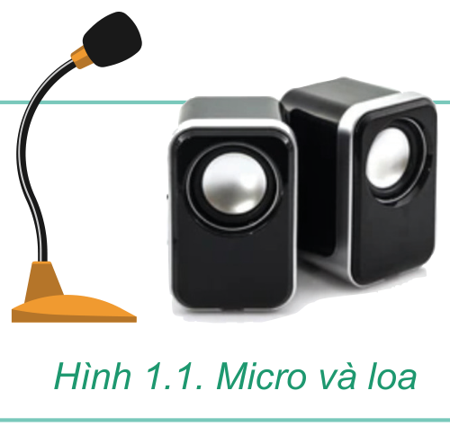
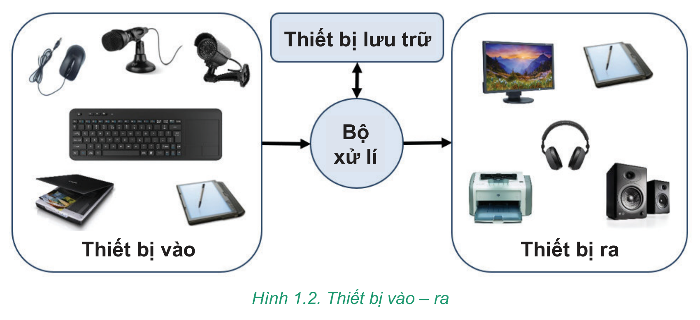
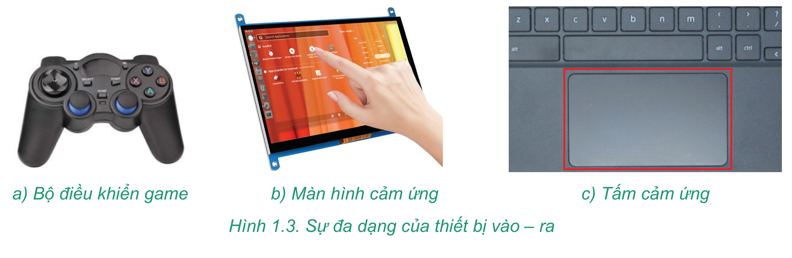
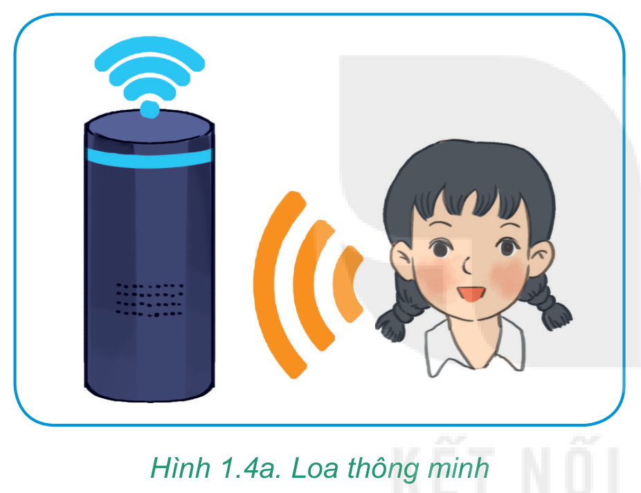
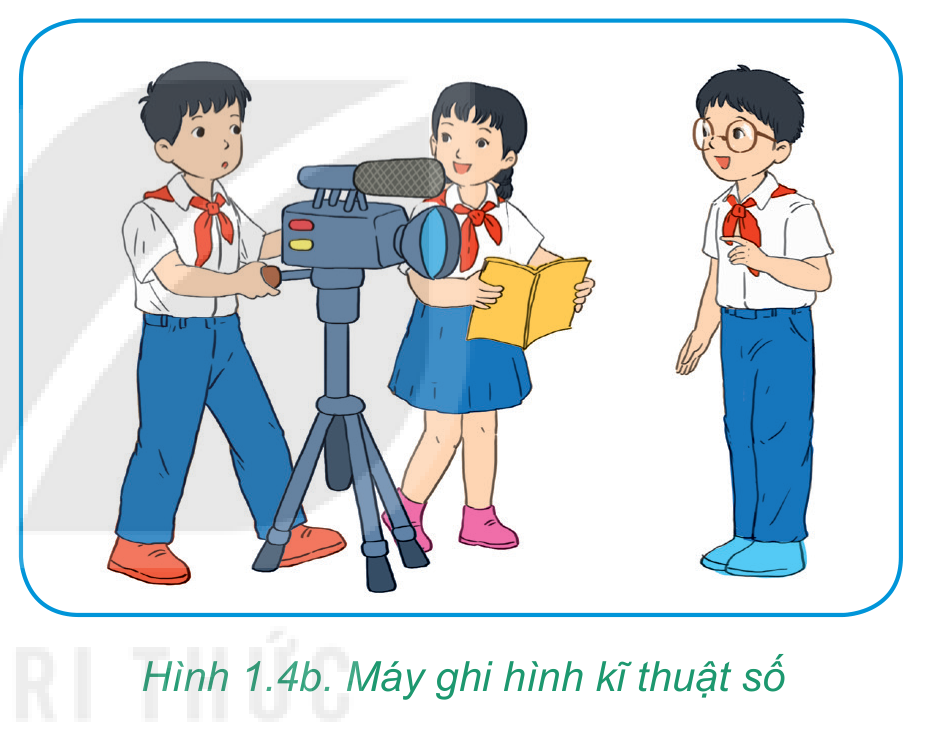
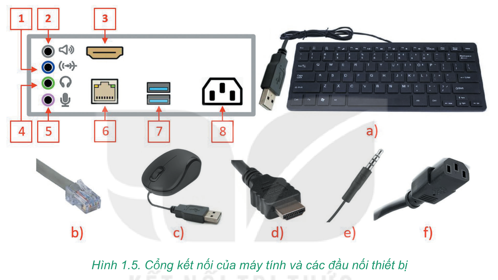

<!-- pdf:6 -->

# BÀI 1: THIẾT BỊ VÀO – RA

## 🎯 Sau bài học này em sẽ:

- Biết và nhận ra được các thiết bị vào – ra có nhiều loại, hình dạng khác nhau.
- Biết được chức năng của các thiết bị vào – ra trong thu nhận, lưu trữ, xử lí và truyền thông tin.
- Thực hiện đúng các thao tác với các thiết bị thông dụng của máy tính.
- Nêu được ví dụ cụ thể về những thao tác không đúng cách sẽ gây ra lỗi cho thiết bị và hệ thống xử lí thông tin.

## 🔴 Khởi động

Ở lớp 6, các em đã biết, máy tính cần phải có bốn thành phần để hỗ trợ con người xử lí thông tin. Đó là thiết bị vào, thiết bị ra, bộ xử lí và bộ nhớ, trong đó thiết bị vào – ra đóng vai trò quan trọng, giúp máy tính trao đổi dữ liệu với thế giới bên ngoài.

## 1. THIẾT BỊ VÀO – RA

> **Hoạt động 1: Thiết bị vào – ra**
>
> Em hãy quan sát Hình 1.1 và trả lời các câu hỏi sau:
> 1. Các thiết bị trong hình làm việc với dạng thông tin nào?
> 2. Thiết bị nào tiếp nhận thông tin và chuyển vào máy tính?
> 3. Thiết bị nào nhận thông tin từ máy tính đưa ra bên ngoài?

*Hình 1.1. Micro và loa*

Micro và loa trong Hình 1.1 là những thiết bị làm việc với thông tin dạng âm thanh.

- **Micro** là thiết bị vào. Micro thu nhận âm thanh và chuyển vào máy tính để mã hoá thành dữ liệu số.
- **Loa** là thiết bị ra. Loa nhận dữ liệu từ máy tính, thể hiện ra bên ngoài dưới dạng âm thanh mà chúng ta có thể nghe thấy.

**Thiết bị vào** được dùng để đưa thông tin vào máy tính như bàn phím, chuột, micro,... **Thiết bị ra** được dùng để đưa dữ liệu từ máy tính ra bên ngoài như màn hình, máy in, loa,...

<!-- pdf:7 -->

*Hình 1.2. Thiết bị vào – ra*

> **Hoạt động 2: Sự đa dạng của thiết bị vào – ra**
>
> 1. Mỗi thiết bị vào – ra trong Hình 1.2. làm việc với dạng thông tin nào? Thiết bị nào có cả hai chức năng vào và ra?
> 2. Máy chiếu là thiết bị vào hay thiết bị ra? Máy chiếu làm việc với dạng thông tin nào?
> 3. Bộ điều khiển game (Hình 1.3.a) là thiết bị vào hay thiết bị ra?
> 4. Màn hình cảm ứng (Hình 1.3.b) là thiết bị vào, thiết bị ra hay có cả hai chức năng vào và ra?

<!-- term: Sự đa dạng của thiết bị vào – ra -->
Nhắc đến thiết bị vào – ra của máy tính, ta thường nghĩ đến bàn phím, màn hình, chuột, máy in và những thiết bị thông dụng như trong Hình 1.2. Tuy nhiên, trên thực tế, thiết bị vào – ra được thiết kế rất đa dạng đáp ứng được những nhu cầu khác nhau của người sử dụng.

- **Máy chiếu** là thiết bị ra, dùng để hiển thị nội dung màn hình máy tính lên màn chiếu.
- **Bộ điều khiển game** là thiết bị đưa mệnh lệnh vào máy tính để điều khiển đối tượng trong một số trò chơi trên máy tính.

<!-- term: Sự đa dạng của thiết bị vào – ra -->
Một trong những loại thiết bị có thiết kế phong phú nhất là chuột. Có nhiều loại chuột máy tính như chuột có dây, chuột không dây, chuột quang,... Chuột còn có thể được thay thế bằng một số thiết bị khác. Chẳng hạn:

*Hình 1.3. Sự đa dạng của thiết bị vào – ra*

<!-- pdf:8 -->

- **Màn hình cảm ứng** (**touch screen**) không chỉ là thiết bị ra mà còn là thiết bị vào. Màn hình cảm ứng phát hiện vị trí và sự di chuyển của ngón tay trên bề mặt, giúp em chọn đối tượng hoặc thực hiện một lệnh như em đang sử dụng chuột.
- **Tấm cảm ứng** (**touchpad**) có thể nhận biết vị trí và sự di chuyển của ngón tay người trên bề mặt đó và thể hiện trên màn hình. Tấm cảm ứng thường chiếm một vùng trên bàn phím máy tính xách tay, có chức năng giống như chuột máy tính thông thường.

<!-- term: Sự đa dạng của thiết bị vào – ra -->
Một số thiết bị vào – ra còn thực hiện cả chức năng lưu trữ, xử lí dữ liệu. Chẳng hạn:

- **Loa thông minh** (Hình 1.4a) là thiết bị ra. Tuy nhiên, nó còn có kết nối không dây với máy tính, điện thoại thông minh, Internet,... để trao đổi dữ liệu. Loa thông minh có thể nhận lệnh bằng giọng nói (hỏi giờ, hỏi thời tiết, yêu cầu phát bài hát,...) và trả lời cũng bằng giọng nói.
- Một chiếc máy ảnh hay **máy ghi hình kĩ thuật số** (Hình 1.4b) không chỉ là thiết bị vào mà còn có thể lưu trữ và thực hiện một số chức năng xử lí ảnh, xử lí video đơn giản.

*Hình 1.4a. Loa thông minh*

*Hình 1.4b. Máy ghi hình kĩ thuật số*

> - **Thiết bị vào** được dùng để nhập dữ liệu và mệnh lệnh vào máy tính.
> - **Thiết bị ra** gửi thông tin từ máy tính ra để con người nhận biết được.
> - Các thiết bị vào – ra có nhiều loại, có những công dụng và hình dạng khác nhau.

> ❓ **Câu hỏi**
>
> 1. Em hãy cho biết máy ảnh nhập dữ liệu dạng nào vào máy tính?
>    A. Con số. &emsp; B. Văn bản.
>    C. Hình ảnh. &emsp; D. Âm thanh.
> 2. Thiết bị nào chuyển dữ liệu âm thanh từ máy tính ra ngoài?
>    A. Máy ảnh. &emsp; B. Micro.
>    C. Màn hình. &emsp; D. Loa.

<!-- pdf:9 -->

## 2. AN TOÀN THIẾT BỊ

> **Hoạt động 3: Kết nối thiết bị vào – ra**
>
> Một máy tính để bàn có các cổng kết nối như Hình 1.5.
> 1. Em hãy lắp các thiết bị sau vào đúng cổng của nó bằng cách ghép mỗi chữ cái với số tương ứng: a) Bàn phím; b) Dây mạng c) Chuột; d) Màn hình; e) Tai nghe.
> 2. Việc cấp nguồn điện cho máy tính cần được thực hiện trước hay sau các kết nối trên? Tại sao?

*Hình 1.5. Cổng kết nối của máy tính và các đầu nối thiết bị*

<!-- term: An toàn thiết bị -->
Máy tính là một hệ thống phức tạp, sử dụng điện, kết nối với nhiều thiết bị khác. Vì vậy, những thao tác không cẩn thận có thể gây ra sự cố, ảnh hưởng đến hoạt động bình thường của thiết bị và an toàn dữ liệu. Ví dụ, với các thiết bị trong Hình 1.5:

- Đầu nối tai nghe (e) cần được cắm vào cổng (4). Nếu cắm đầu nối tai nghe vào cổng (5), em sẽ không nghe thấy âm thanh từ máy tính và có thể sẽ cho rằng thiết bị hoạt động không tốt.
- Đầu nối dây màn hình (d) cần được cắm vào cổng (3). Nếu cắm vào cổng khác sẽ không lắp được và nếu cố gắng làm điều đó, em có thể sẽ làm hỏng đầu nối.
- Cổng (7) là chuẩn kết nối **USB** được sử dụng cho nhiều thiết bị. Tuy nhiên, nếu cắm nhầm đầu kết nối khác vào cổng này có thể gây ra chập điện làm hỏng thiết bị.
- Dây nguồn (f) cần được lắp vào cổng (8). Việc cấp nguồn điện cho máy tính cần được thực hiện sau khi các thiết bị đã được kết nối để đảm bảo an toàn điện.

<!-- term: An toàn thiết bị -->
Khi sử dụng máy tính, em cần tuân theo những quy tắc an toàn để không gây ra lỗi. Một số lời khuyên cho những việc nên làm và không nên làm khi sử dụng máy tính được ghi trong Bảng 1.1.

<!-- pdf:10 -->

*Bảng 1.1. Một số việc nên và không nên làm khi sử dụng máy tính*

| Nên làm | Không nên làm |
| --- | --- |
| Đọc kĩ hướng dẫn trước khi sử dụng thiết bị. | Thao tác tuỳ tiện, không theo hướng dẫn. |
| Giữ bàn tay khô, sạch khi sử dụng máy tính. | Để đồ uống gần chuột, bàn phím, thẻ nhớ,... |
| Gõ phím dứt khoát nhưng nhẹ nhàng. | Tác động lên màn hình bằng các vật sắc, nhọn. |
| Sử dụng chức năng Shut down để tắt máy tính. | Tắt máy tính bằng cách ngắt điện đột ngột. |
| Rút điện trước khi lau, dọn máy tính. | Chạm vào phần kim loại của máy tính. |
| Đóng mọi tài liệu và ứng dụng trước khi tắt máy tính. | Nối máy tính với máy in khi một trong hai máy đang bật nguồn. |

<!-- term: An toàn thiết bị -->
> - Đọc kĩ hướng dẫn của nhà sản xuất trước khi sử dụng thiết bị.
> - Kết nối các thiết bị đúng cách.
> - Giữ gìn nơi làm việc với máy tính gọn gàng, ngăn nắp, vệ sinh, khô ráo.

> ❓ **Câu hỏi**
>
> 1. Thao tác nào sau đây tắt máy tính một cách an toàn?
>    A. Sử dụng nút lệnh Restart của Windows.
>    B. Sử dụng nút lệnh Shut down của Windows.
>    C. Nhấn giữ công tắc nguồn vài giây.
>    D. Rút dây nguồn khỏi ổ cắm.
> 2. Tại sao không nên vừa ăn vừa sử dụng máy tính?

## ✏️ Luyện tập

1. Một bộ tai nghe có gắn micro sử dụng cho máy tính là loại thiết bị gì?
   A. Thiết bị vào. &emsp; B. Thiết bị ra.
   C. Thiết bị vừa vào vừa ra. &emsp; D. Không phải thiết bị vào – ra.
2. Máy tính của em đang làm việc với một tệp trên thẻ nhớ. Em hãy sắp xếp lại thứ tự các thao tác sau để tắt máy tính an toàn, không làm mất dữ liệu.
   a) Chọn nút lệnh Shut down để tắt máy tính.
   b) Đóng tệp đang mở trên thẻ nhớ.
   c) Chọn “Safe To Remove Hardware” để ngắt kết nối với thẻ nhớ.
   d) Lưu lại nội dung của tệp.

## 🚀 Vận dụng

1. Trên màn hình theo dõi, em thấy một người đứng trước camera an ninh. Người đó có biết em đang theo dõi không? Tại sao?
2. Máy in của em in ra những kí hiệu không mong muốn và em biết lỗi này là do virus gây ra. Em cần phải diệt virus ở máy in hay máy tính? Tại sao?
3. Em hãy đề xuất một số quy tắc để giúp các bạn sử dụng phòng máy tính an toàn và hiệu quả.

## 📷 Danh sách hình trong bài

| Mã hình | Trang PDF | Trang sách | Chú thích |
| --- | :---: | :---: | --- |
| H7-tin_hoc-b01-01 | 6 | 5 | Hình 1.1. Micro và loa |
| H7-tin_hoc-b01-02 | 7 | 6 | Hình 1.2. Thiết bị vào – ra |
| H7-tin_hoc-b01-03 | 7 | 6 | Hình 1.3. Sự đa dạng của thiết bị vào – ra |
| H7-tin_hoc-b01-04 | 8 | 7 | Hình 1.4a. Loa thông minh |
| H7-tin_hoc-b01-05 | 8 | 7 | Hình 1.4b. Máy ghi hình kĩ thuật số |
| H7-tin_hoc-b01-06 | 9 | 8 | Hình 1.5. Cổng kết nối của máy tính và các đầu nối thiết bị |
