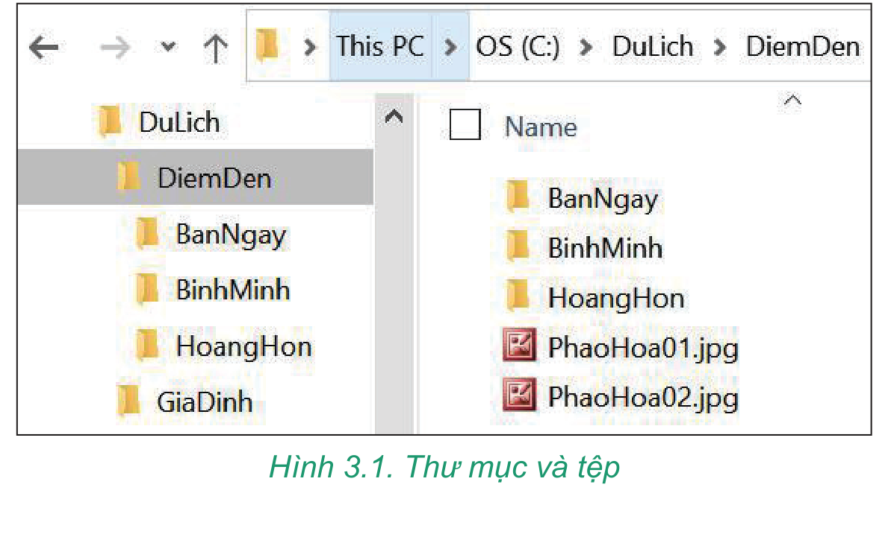
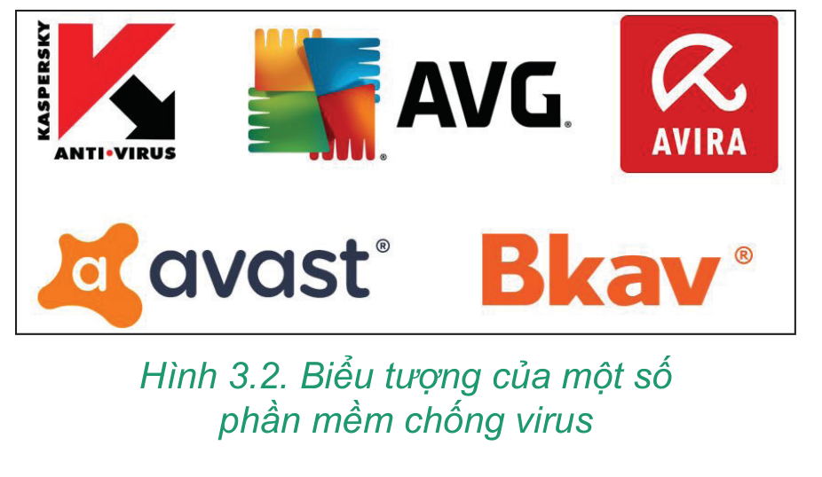
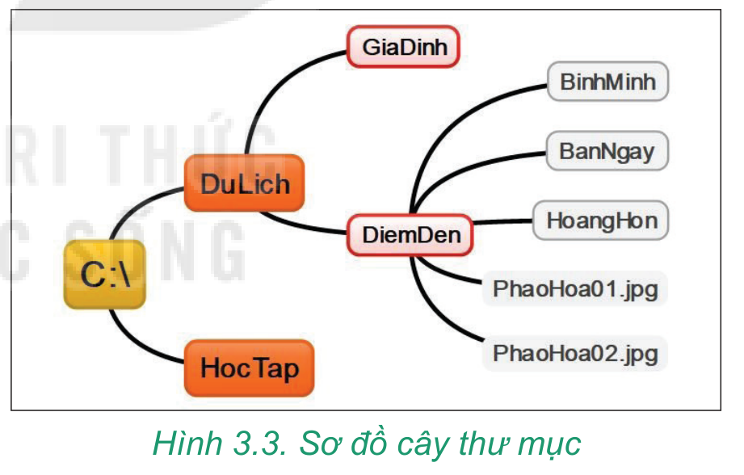
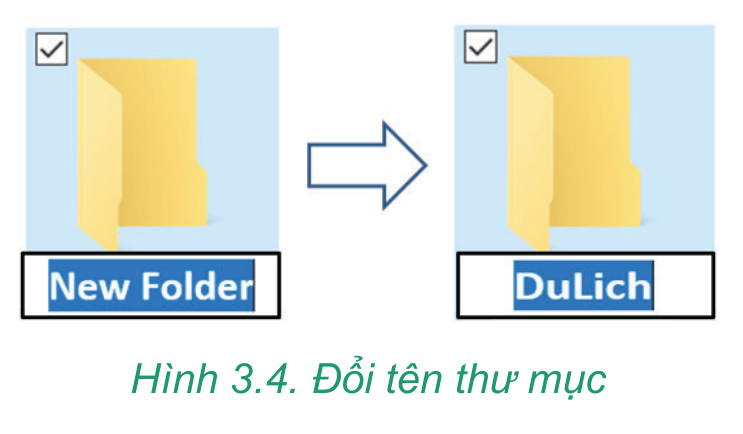
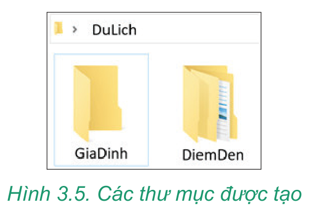
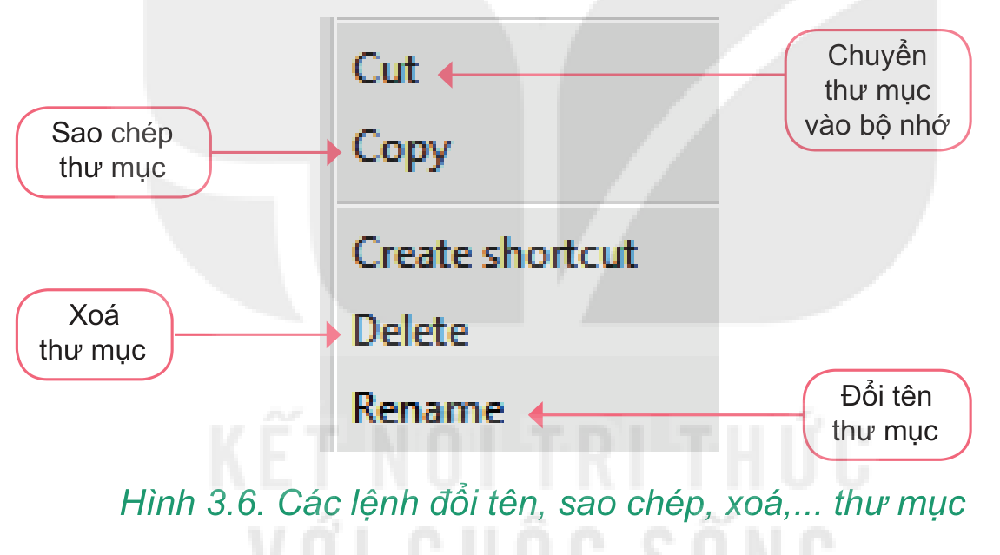

<!-- pdf:14 -->

# BÀI 3: QUẢN LÍ DỮ LIỆU TRONG MÁY TÍNH

## 🎯 Sau bài học này em sẽ:

- Thao tác thành thạo với tệp và thư mục: tạo, sao chép, di chuyển, đổi tên, xoá tệp và thư mục.
- Biết được tệp chương trình cũng là dữ liệu, có thể được lưu trữ trong máy tính.
- Nêu được ví dụ về biện pháp bảo vệ dữ liệu như sao lưu, phòng chống virus,...

## 🔴 Khởi động

> **Hoạt động 1: Đặt tên thư mục**
>
> Trong một chuyến du lịch cùng gia đình, em đã ghi chép lại thông tin và chụp nhiều ảnh kỉ niệm. Các hình ảnh và thông tin đó cần được lưu trữ. Hãy vẽ sơ đồ cây thư mục để chứa các tệp dữ liệu và đặt tên cho các thư mục đó sao cho dễ tìm kiếm và truy cập.

## 1. TÊN TỆP VÀ THƯ MỤC TRONG MÁY TÍNH

<!-- term: Đặt tên tệp và thư mục -->
Khi làm bài tập dự án, số lượng tệp và thư mục có thể tăng lên nhanh chóng. Nếu chúng không được tổ chức lưu trữ tốt, em có thể mất nhiều thời gian để tìm kiếm những gì mình cần. Trước khi lưu trữ, dữ liệu cần được phân loại để việc lưu trữ có trật tự, giúp cho việc tìm kiếm dữ liệu nhanh hơn.

<!-- term: Đặt tên tệp và thư mục -->
Nên đặt tên tệp và thư mục đơn giản, dễ hiểu, nhất là khi em đang làm việc trong một dự án nhóm, để mọi thành viên trong nhóm đều có thể dễ dàng tìm thấy những gì họ cần.

Hình 3.1 là ví dụ về một cách đặt tên tệp, thư mục và thư mục con khá hợp lí, vì nó cho em biết trong đó chứa những gì.

Các chương trình máy tính cũng được lưu trữ dưới dạng tệp giống như tệp dữ liệu. Trong hệ điều hành Windows, chúng thường có phần mở rộng .exe, .com, .bat, .msi. Không nên xoá hay di chuyển những tệp này nếu không có lí do xác đáng vì chúng có thể cần thiết với một số hoạt động của máy tính.

*Hình 3.1. Thư mục và tệp*

<!-- pdf:15 -->

<!-- term: Đặt tên tệp và thư mục -->
> - Tên tệp và thư mục cần được đặt sao cho dễ nhớ, cho ta biết trong đó chứa những gì. Điều đó sẽ giúp cho công việc thuận lợi hơn.
> - Chương trình máy tính được lưu trữ trên thiết bị nhớ giống như một tệp dữ liệu. **Tệp chương trình máy tính** trong hệ điều hành Windows thường có phần mở rộng .exe, .com, .bat, .msi.

> ❓ **Câu hỏi**
>
> 1. Để việc tìm kiếm dữ liệu trong máy tính được dễ dàng và nhanh chóng, khi đặt tên thư mục và tệp em nên:
>    A. Đặt tên theo ý thích như tên người thân hay tên thú cưng.
>    B. Đặt tên sao cho dễ nhớ và để biết trong đó chứa gì.
>    C. Đặt tên giống như trong ví dụ của sách giáo khoa.
>    D. Đặt tên tuỳ ý, không cần theo quy tắc gì.
> 2. Tệp có phần mở rộng .exe thuộc loại tệp gì?
>    A. Không có loại tệp này.
>    B. Tệp chương trình máy tính.
>    C. Tệp dữ liệu của phần mềm Microsoft Word.
>    D. Tệp dữ liệu video.

## 2. CÁC BIỆN PHÁP BẢO VỆ DỮ LIỆU

> **Hoạt động 2: Bảo vệ dữ liệu**
>
> Máy tính của em có nhiều dữ liệu quan trọng. Em muốn bảo vệ dữ liệu trong máy tính của mình thì:
> a) Em sẽ chọn cách bảo vệ dữ liệu nào?
> b) Tại sao em chọn cách đó?

Lưu trữ thông tin trong máy tính và trên Internet có nhiều rủi ro. Em cần thực hiện các biện pháp bảo vệ để dữ liệu không bị mất, bị hỏng hay bị người khác truy cập trái phép. Dưới đây là một số biện pháp chính để **bảo vệ dữ liệu**.

### a) Sao lưu dữ liệu

Dữ liệu cần được sao lưu thường xuyên. **Sao lưu dữ liệu** là tạo ra bản sao các tệp và thư mục rồi lưu chúng lên một thiết bị lưu trữ. Thiết bị lưu trữ đó cho phép em khôi phục lại dữ liệu nếu có điều gì đó xảy ra với bản gốc.

**Sao lưu cục bộ** là bản sao được đặt trên cùng máy tính chứa bản gốc hoặc trên các thiết bị lưu trữ như ổ cứng ngoài, USB,... Cách sao lưu này hữu ích vì có thể phục hồi nhanh chóng. Tuy nhiên, nếu xảy ra những rủi ro cho thiết bị lưu trữ hoặc máy tính bị thất lạc, bản sao lưu sẽ bị mất theo bản gốc. Kết quả là dữ liệu không thể khôi phục được.

**Sao lưu từ xa** là bản sao được đặt bên ngoài máy tính chứa bản gốc. Bản sao có thể lưu ở một máy tính khác, hoặc đưa lên Internet nhờ **công nghệ đám mây**. Nếu máy tính bị hỏng thì bản sao lưu vẫn an toàn.

<!-- pdf:16 -->

*Bảng 3.1. Ưu và nhược điểm của một số thiết bị lưu trữ*

| Thiết bị lưu trữ | Hình ảnh | Ưu điểm | Nhược điểm |
| --- | :---: | --- | --- |
| Thẻ nhớ, USB | | Nhỏ gọn. Tiện sử dụng. Khá bền. | Dễ bị thất lạc. Dễ lây lan virus. Dữ liệu dễ bị hỏng nếu sử dụng không đúng cách. |
| Đĩa quang (CD, DVD) | | Chi phí thấp. Khó bị nhiễm virus. | Dễ hỏng dữ liệu. Dung lượng nhỏ. Khó ghi dữ liệu vì phải có đầu ghi. Khó cất giữ. |
| Ổ cứng ngoài | | Dung lượng lớn. Tiện sử dụng. | Kích thước to và nặng, khó mang theo. Có thể hỏng dữ liệu nếu bị rơi. |
| Lưu trữ nhờ công nghệ đám mây | | Truy cập được bằng bất kì máy tính nào có kết nối Internet. Sao lưu từ xa. | Cần kết nối Internet. Dịch vụ có thể không đáng tin cậy. Có thể bị tin tặc tấn công. |

### b) Tài khoản người sử dụng và mật khẩu

Để bảo vệ dữ liệu, tránh bị người khác truy cập trái phép, em nên đặt mật khẩu cho tài khoản của mình trên máy tính.

Tên tài khoản thường được đặt dựa trên họ tên của người sử dụng, còn mật khẩu cần đặt theo cách riêng để giữ bí mật. **Mật khẩu** là một tính năng bảo mật và có thể được thay đổi để người khác khó đoán.

**Mật khẩu mạnh** thường là dãy:
- Dài ít nhất tám kí tự.
- Bao gồm cả chữ số, chữ in hoa, chữ thường và các kí hiệu đặc biệt như @, #,...
- Không phải là một từ thông thường.

**Mật khẩu yếu** có thể là:
- Tên mình hoặc tên người thân.
- Từ đặc biệt như “12345678”.
- Số điện thoại hoặc ngày sinh.

### c) Phần mềm chống virus

Có những **phần mềm độc hại** có thể làm hỏng dữ liệu và các chương trình trong máy tính. Phần mềm độc hại có nhiều loại khác nhau như virus, sâu, phần mềm gián điệp,...

**Phần mềm chống virus** được thiết kế để phát hiện và diệt virus; phát hiện và chặn các cuộc tấn công từ phần mềm độc hại. Một số hệ điều hành được trang bị sẵn phần mềm chống virus, chẳng hạn phần mềm Windows Defender của hệ điều hành Windows. Để dữ liệu được an toàn, em cần đảm bảo máy tính của mình đã được cài phần mềm chống virus, phần mềm đó phải thường xuyên hoạt động và được cập nhật.

*Hình 3.2. Biểu tượng của một số phần mềm chống virus*

<!-- pdf:17 -->

> - Dữ liệu cần được sao lưu thường xuyên lên thiết bị lưu trữ ngoài máy tính chứa dữ liệu gốc để tránh bị mất hoặc bị hỏng dữ liệu.
> - Việc đặt mật khẩu cho tài khoản người sử dụng trên máy tính và trên Internet sẽ giúp bảo vệ dữ liệu khỏi sự truy cập trái phép.
> - Cần bảo vệ dữ liệu bằng cách không sử dụng phần mềm không rõ nguồn gốc và luôn bật chế độ bảo vệ máy tính của phần mềm chống virus.

> ❓ **Câu hỏi**
>
> 1. Mật khẩu nào sau đây là mạnh nhất?
>    A. 12345678. &emsp; B. AnMinhKhoa.
>    C. matkhau. &emsp; D. 2n#M1nhKh0a.
> 2. Hãy chọn những phát biểu **sai**?
>    A. Lưu trữ bằng công nghệ đám mây tránh được rơi, mất, hỏng dữ liệu.
>    B. Lưu trữ bằng đĩa CD cần phải có đầu ghi đĩa nhưng dung lượng rất lớn.
>    C. Lưu trữ bằng đĩa cứng ngoài vừa nhỏ gọn vừa có dung lượng lớn.
>    D. Lưu trữ bằng thẻ nhớ, USB dễ bị rơi, mất dữ liệu nhưng thuận tiện.

## 3. THỰC HÀNH: QUẢN LÍ DỮ LIỆU TRONG MÁY TÍNH

**Nhiệm vụ**

Em hãy tạo cây thư mục như Hình 3.3 và thực hiện:

– Đổi tên thư mục “HoangHon” thành “ChieuToi”.
– Di chuyển các tệp và thư mục con của thư mục “BinhMinh” sang thư mục “BanNgay”.
– Xoá thư mục “BinhMinh”.

*Hình 3.3. Sơ đồ cây thư mục*

**Hướng dẫn**

**Ứng dụng quản lí tệp** có chức năng hiển thị nội dung của các thư mục và giúp em tổ chức, sắp xếp các thư mục và các tệp trên ổ cứng. Phần hướng dẫn dưới đây sử dụng **File Explorer**, ứng dụng quản lí tệp trong hệ điều hành **Windows 10**, để minh hoạ. Từ hệ điều hành **Windows 7** trở về trước, ứng dụng này có tên là **Windows Explorer**.

Khi mở một thư mục, nội dung thư mục sẽ xuất hiện. Ngoài chức năng hiển thị nội dung của thư mục, cửa sổ thư mục còn chứa nhiều biểu tượng của những chức năng khác như chuyển đến một thư mục khác (điều hướng) hoặc giúp em quản lí các tệp và thư mục dễ dàng hơn.

### a) Tạo thư mục

– Trên màn hình nền, nháy nút phải chuột, chọn **New/Folder**.
– Một thư mục mới có tên New Folder được tạo ra. Em có thể đổi tên thư mục, chẳng hạn “DuLich”.

<!-- pdf:18 -->

– Trong thư mục “DuLich”, em tiếp tục tạo các thư mục mới theo cách trên,... cứ như vậy cho đến khi hoàn thành cây thư mục.

*Hình 3.4. Đổi tên thư mục*

*Hình 3.5. Các thư mục được tạo*

### b) Đổi tên, di chuyển, sao chép, xoá thư mục và tệp

– Việc đổi tên một thư mục được thực hiện bằng cách nháy nút phải chuột vào thư mục đó và chọn **Rename**.
– Di chuyển một tệp hay một thư mục có thể được thực hiện bằng lệnh **Cut** và **Paste**.
– Nháy nút phải chuột vào thư mục “BinhMinh” và chọn **Delete** để xoá thư mục đó.

Thực hiện tương tự để đổi tên, di chuyển, xoá tệp.

*Hình 3.6. Các lệnh đổi tên, sao chép, xoá,... thư mục*

## ✏️ Luyện tập

1. Đâu là chương trình máy tính giúp em quản lí tệp và thư mục?
   A. Internet Explorer. &emsp; B. Help.
   C. Microsoft Word. &emsp; D. File Explorer.
2. Đâu là phần mềm bảo vệ máy tính tránh được virus máy tính?
   A. Windows Defender. &emsp; B. Mozilla Firefox.
   C. Microsoft Windows. &emsp; D. Microsoft Word.

## 🚀 Vận dụng

1. Em hãy lựa chọn một thiết bị lưu trữ để sao lưu thư mục “DuLich”. Giải thích tại sao em lựa chọn cách sao lưu đó.
2. Sau khi học xong bài này và có thêm các kiến thức về sao lưu, bảo vệ dữ liệu, em có thay đổi cách bảo vệ dữ liệu mà em đã chọn trong Hoạt động 2 không? Tại sao?

## 📷 Danh sách hình trong bài

| Mã hình | Trang PDF | Trang sách | Chú thích |
| --- | :---: | :---: | --- |
| H7-tin_hoc-b03-01 | 14 | 13 | Hình 3.1. Thư mục và tệp |
| H7-tin_hoc-b03-02 | 16 | 15 | Hình 3.2. Biểu tượng của một số phần mềm chống virus |
| H7-tin_hoc-b03-03 | 17 | 16 | Hình 3.3. Sơ đồ cây thư mục |
| H7-tin_hoc-b03-04 | 18 | 17 | Hình 3.4. Đổi tên thư mục |
| H7-tin_hoc-b03-05 | 18 | 17 | Hình 3.5. Các thư mục được tạo |
| H7-tin_hoc-b03-06 | 18 | 17 | Hình 3.6. Các lệnh đổi tên, sao chép, xoá,... thư mục |
