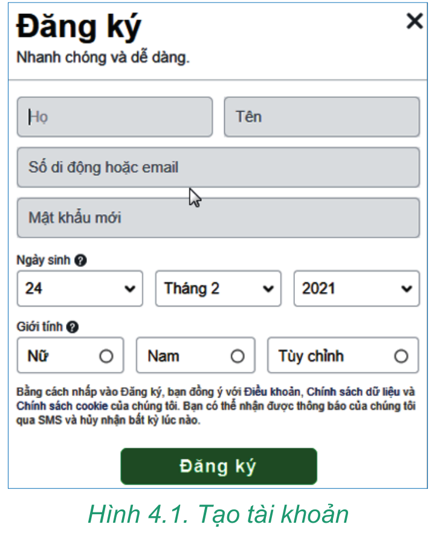
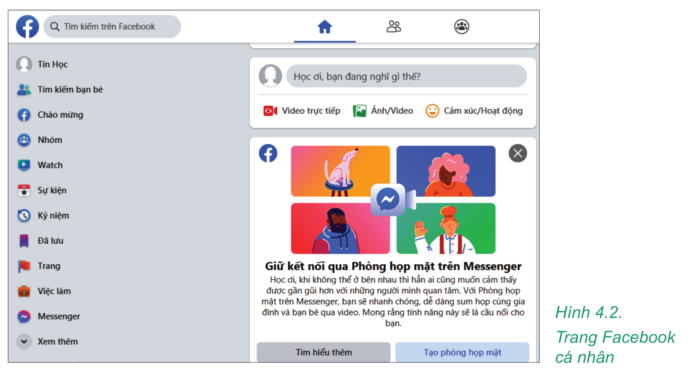
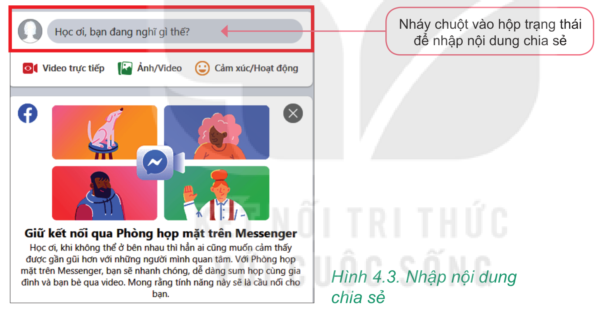
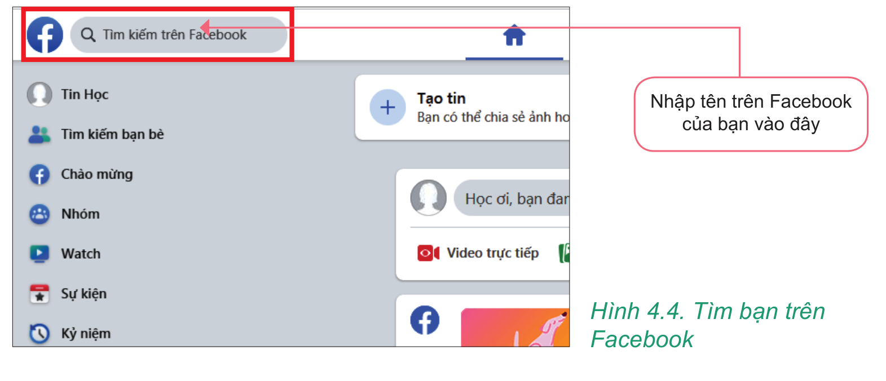
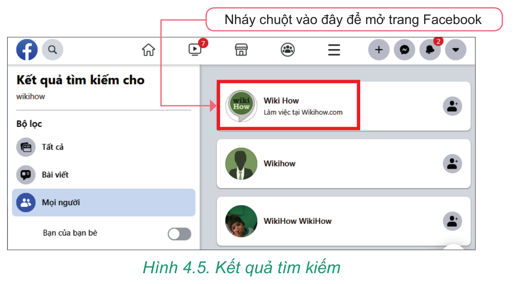
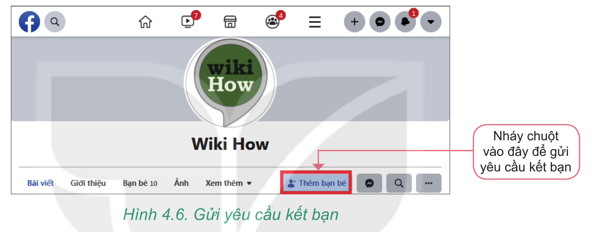

<!-- pdf:19 -->

# BÀI 4: MẠNG XÃ HỘI VÀ MỘT SỐ KÊNH TRAO ĐỔI THÔNG TIN TRÊN INTERNET

## 🎯 Sau bài học này em sẽ:

- Nêu được tên một kênh trao đổi thông tin thông dụng trên Internet và loại thông tin trao đổi trên kênh đó.
- Nêu được một số chức năng cơ bản của mạng xã hội. Nhận biết được một số website là mạng xã hội.
- Sử dụng được một số chức năng cơ bản của một mạng xã hội để giao lưu và chia sẻ thông tin.
- Nêu được ví dụ cụ thể về hậu quả của việc sử dụng thông tin vào mục đích sai trái.

## 🔴 Khởi động

Trong suốt chiều dài lịch sử, con người đã nghĩ ra nhiều cách trao đổi thông tin với nhau: dùng chim bồ câu đưa thư, gửi thư qua bưu điện, sử dụng điện báo, điện thoại,... Thế kỉ XX đã mang đến cho chúng ta Internet, giúp tạo ra nhiều kênh trao đổi thông tin rất hữu ích, nhanh chóng,... Một trong số đó là mạng xã hội.

## 1. MẠNG XÃ HỘI - KÊNH TRAO ĐỔI THÔNG TIN PHỔ BIẾN TRÊN INTERNET

> **Hoạt động 1: Cách thức trao đổi thông tin trên Internet**
>
> 1. Ở lớp 6 em đã biết sử dụng Internet để nhận và gửi thông tin. Đó là cách nào?
> 2. Em có biết cách trao đổi thông tin nào trên Internet đang được sử dụng nhiều nhất không? Tại sao?

### a) Các kênh trao đổi thông tin trên Internet

Từ khi Internet ra đời, việc trao đổi thông tin trên Internet ngày càng trở nên phổ biến và đóng vai trò quan trọng trong đời sống của chúng ta.

<!-- term: Kênh trao đổi thông tin trên Internet -->
Một số kênh trao đổi thông tin phổ biến trên Internet hiện nay là: thư điện tử, **diễn đàn** (**Forum**), mạng xã hội,... Thông tin trên Internet được liên tục cập nhật, chúng tồn tại với nhiều dạng khác nhau như dạng văn bản, hình ảnh, âm thanh, video, phần mềm,...

<!-- pdf:20 -->

### b) Mạng xã hội

<!-- term: Chức năng cơ bản của mạng xã hội -->
**Mạng xã hội** là một cộng đồng trực tuyến để mọi người có thể tương tác với nhau. Cách tổ chức mạng xã hội phổ biến nhất để người sử dụng tham gia là dưới dạng các website. Tuỳ theo mục đích, các trang mạng xã hội có thể cung cấp những cách thức giao tiếp khác nhau như: tin nhắn riêng tư, đưa ra nhận xét trên trang của bạn bè, đăng ảnh và video lên, thảo luận học tập, chơi trò chơi trực tuyến,...

Ví dụ một số website mạng xã hội được phân loại theo mục đích như trong Bảng 4.1.

*Bảng 4.1. Một số mạng xã hội và mục đích sử dụng*

| Mục đích và ví dụ | Mô tả |
| --- | --- |
| Giao lưu với bạn bè (Facebook, Zalo) | Cho phép người sử dụng tạo hồ sơ cá nhân, kết nối bạn bè. Người sử dụng có thể chia sẻ suy nghĩ và ý kiến cá nhân cũng như hình ảnh, âm nhạc, video. |
| Chia sẻ video (YouTube) | Người sử dụng có thể xem, chia sẻ, bình luận các video hoặc tải lên video của riêng họ. |
| Chia sẻ ảnh (Instagram) | Cho phép người sử dụng tải lên, sắp xếp và chia sẻ các hình ảnh của mình. Mọi người có thể khám phá những bức ảnh hay các phòng trưng bày kĩ thuật số. |
| **Diễn đàn** học tập, thảo luận (Scratch) | Nơi mọi người có thể cùng nhau thảo luận, chia sẻ kiến thức về một chủ đề nào đó. Là hình thức thảo luận không trực tiếp, bài viết hoặc ý kiến của bạn có thể nhận được phản hồi ngay, cũng có khi vài ngày hoặc lâu hơn. |

<!-- term: Kênh trao đổi thông tin trên Internet -->
> - Thư điện tử, diễn đàn, mạng xã hội,... là những kênh trao đổi thông tin thông dụng trên Internet.
> - Tham gia mạng xã hội là tham gia một cộng đồng trực tuyến, nơi mọi người tương tác với nhau theo nhiều cách.
> - Mạng xã hội thường được tổ chức dưới dạng các website. Mỗi mạng xã hội thường có mục đích nhất định như: thảo luận, chia sẻ ảnh, video,...

<!-- term: Tính hai mặt của mạng xã hội -->
Mạng xã hội luôn có tính hai mặt, tốt và xấu. Vì vậy, chúng ta cần cân nhắc và tìm hiểu kĩ trước khi quyết định tham gia. Một số mạng xã hội quy định độ tuổi tối thiểu được phép tham gia là thành viên, phổ biến là từ 13 tuổi trở lên.

<!-- term: Tính hai mặt của mạng xã hội -->
Nhiều bạn học sinh đã biết tận dụng mạng xã hội để kết nối bạn bè, tiếp nhận thông tin và học hỏi kiến thức, kĩ năng hay bày tỏ quan điểm cá nhân,... Tuy nhiên, cũng có những bạn học sinh sử dụng mạng xã hội và thông tin vào mục đích sai trái như đăng thông tin giả, thông tin đe doạ, bắt nạt,... gây hậu quả cho người khác hoặc cho chính bản thân mình. Ví dụ đã có bạn học sinh bị nhà trường kỉ luật vì dùng mạng xã hội đăng tải thông tin sai trái (được sao chép từ mạng xã hội mà không được kiểm chứng) gây hoang mang và nguy cơ suy nghĩ lệch lạc trong một bộ phận học sinh. Một ví dụ khác, đã có trường hợp học sinh bị đình chỉ thi và bị công an điều tra, xử lí vì hành vi chụp ảnh đề thi, chia sẻ lên mạng xã hội nhờ làm hộ trong quá trình thi.

<!-- pdf:21 -->

<!-- term: Chức năng cơ bản của mạng xã hội -->
> - Mạng xã hội giúp người sử dụng kết nối, giao lưu, chia sẻ và thảo luận các vấn đề mà họ quan tâm.
> - Cần tuân thủ đúng các quy định khi sử dụng mạng xã hội và các kênh trao đổi thông tin trên Internet.

> ❓ **Câu hỏi**
>
> 1. Không nên dùng mạng xã hội cho mục đích nào sau đây?
>    A. Giao lưu với bạn bè.
>    B. Học hỏi kiến thức.
>    C. Bình luận xấu về người khác.
>    D. Chia sẻ các hình ảnh phù hợp của mình.
> 2. “Đưa thông tin sai sự thật lên mạng, sử dụng thông tin vào mục đích sai trái là hành vi bị nghiêm cấm và có thể bị phạt theo quy định của pháp luật”. Theo em điều đó là:
>    A. Đúng. &emsp; B. Sai.

## 2. THỰC HÀNH: SỬ DỤNG MẠNG XÃ HỘI

**Nhiệm vụ**

a) Tạo tài khoản trên một trang mạng xã hội phù hợp với lứa tuổi của em.

b) Sử dụng một số chức năng như: xem, chia sẻ thông tin dạng văn bản, hình ảnh,... trên mạng xã hội đó.

c) Kết nối với ít nhất một bạn cùng lớp.

**Hướng dẫn**

*(Hướng dẫn dưới đây sử dụng mạng xã hội Facebook và trình duyệt Google Chrome để minh hoạ.)*

### a) Tạo tài khoản Facebook

Bước 1. Truy cập trang www.facebook.com.

Bước 2. Lựa chọn ngôn ngữ tiếng Việt bằng cách nháy chuột vào liên kết **Tiếng Việt** ở phía dưới màn hình.

Bước 3. Nháy chuột vào ô **Tạo tài khoản mới**.

Bước 4. Nhập đầy đủ thông tin vào các ô theo hướng dẫn.

Bước 5. Nháy chuột vào nút **Đăng ký** (Hình 4.1).

*Hình 4.1. Tạo tài khoản*

### b) Sử dụng một số chức năng của tài khoản vừa tạo

Bước 1. Truy cập trang www.facebook.com.

Bước 2. Đăng nhập vào tài khoản. Trang Facebook của em mở ra như Hình 4.2.

Bước 3. Cập nhật ảnh đại diện và các thông tin cá nhân nếu muốn.

<!-- pdf:22 -->

*Hình 4.2. Trang Facebook cá nhân*

Bước 4. Chia sẻ một nội dung trên trang Facebook của mình.

*Hình 4.3. Nhập nội dung chia sẻ*

<!-- term: Hộp trạng thái -->
Em có thể nhập nội dung văn bản vào hộp trạng thái hoặc có thể thêm ảnh, video từ máy tính của mình bằng cách nháy chuột vào **Ảnh/Video**. Nháy chuột vào nút **Đăng/Post** để hoàn thành việc chia sẻ nội dung.

### c) Kết nối với một bạn cùng lớp

Bước 1. Tìm trang Facebook của bạn.

*Hình 4.4. Tìm bạn trên Facebook*

<!-- pdf:23 -->

Bước 2. Khi tìm thấy trang Facebook của bạn, em nháy chuột vào ảnh đại diện để mở.

*Hình 4.5. Kết quả tìm kiếm*

Bước 3. Nháy chuột vào nút **Thêm bạn bè** để gửi yêu cầu kết bạn đến người đó.

*Hình 4.6. Gửi yêu cầu kết bạn*

– Nếu yêu cầu kết bạn được chấp nhận, em và bạn sẽ trở thành "bạn bè trên Facebook". Hai tài khoản sẽ tự động theo dõi nhau. Nghĩa là người này có thể thấy hoạt động của người kia và có thể tương tác với nhau.

## ✏️ Luyện tập

1. Em hãy nêu tên ba kênh trao đổi thông tin trên Internet.
2. Các câu nói về mạng xã hội sau đây đúng hay sai?
   a) Mạng xã hội giúp mọi người tương tác với nhau mà không cần gặp mặt.
   b) Tất cả các website đều là mạng xã hội.
   c) Người xấu có thể đưa tin giả lên mạng xã hội. Vì vậy, chỉ nên trò chuyện với người mình quen biết.
   d) Bất cứ tuổi nào cũng có thể tham gia mạng xã hội.

## 🚀 Vận dụng

1. Em hãy tìm hiểu kĩ một mạng xã hội (ví dụ: Zalo, Lotus) mà em quan tâm và giới thiệu với các bạn hay người thân về mạng xã hội đó. Phần giới thiệu của em nên có các thông tin: chức năng chính, đối tượng phù hợp để tham gia, cách thức tham gia, những lưu ý cần thiết khi tham gia,...
2. Em hãy tìm hiểu thêm những ví dụ cụ thể về hậu quả của việc sử dụng thông tin vào mục đích sai trái. Hãy chia sẻ với người thân và bạn bè để cùng phòng tránh.

## 📷 Danh sách hình trong bài

| Mã hình | Trang PDF | Trang sách | Chú thích |
| --- | :---: | :---: | --- |
| H7-tin_hoc-b04-01 | 21 | 20 | Hình 4.1. Tạo tài khoản |
| H7-tin_hoc-b04-02 | 22 | 21 | Hình 4.2. Trang Facebook cá nhân |
| H7-tin_hoc-b04-03 | 22 | 21 | Hình 4.3. Nhập nội dung chia sẻ |
| H7-tin_hoc-b04-04 | 22 | 21 | Hình 4.4. Tìm bạn trên Facebook |
| H7-tin_hoc-b04-05 | 23 | 22 | Hình 4.5. Kết quả tìm kiếm |
| H7-tin_hoc-b04-06 | 23 | 22 | Hình 4.6. Gửi yêu cầu kết bạn |
