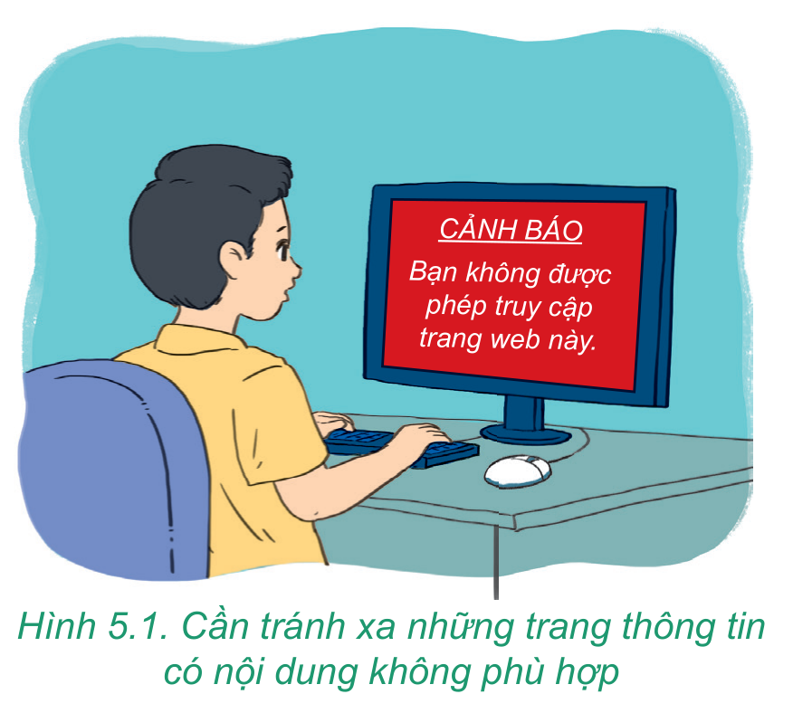
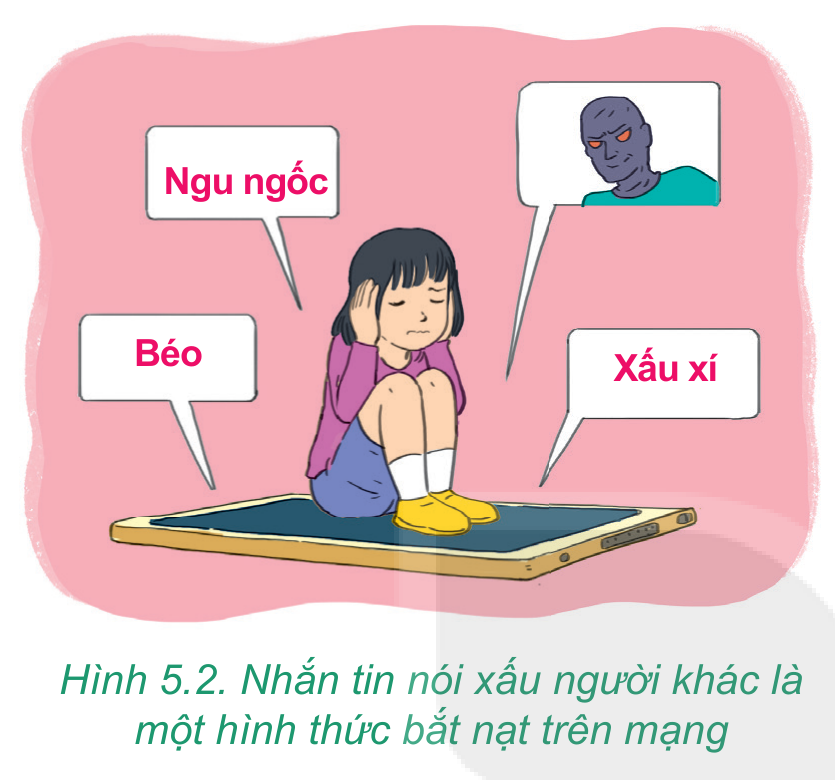
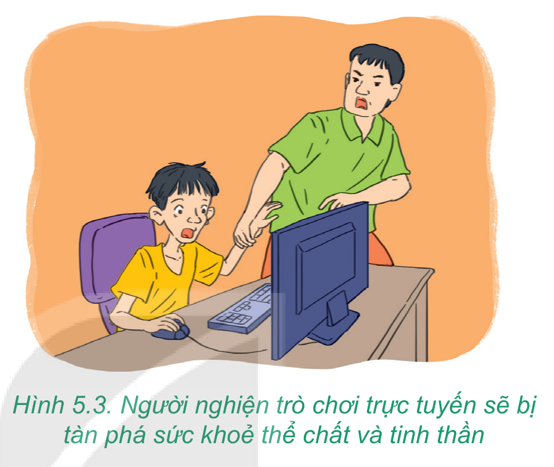
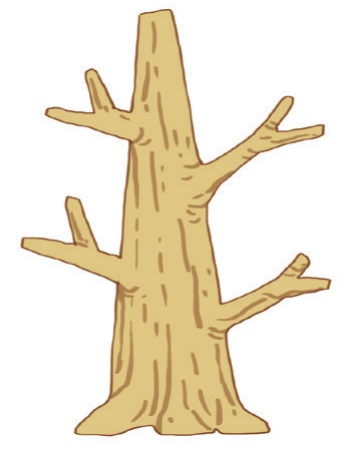

<!-- pdf:24 -->

# BÀI 5: ỨNG XỬ TRÊN MẠNG

## 🎯 Sau bài học này em sẽ:

- Thực hiện được giao tiếp qua mạng theo đúng quy tắc và bằng ngôn ngữ lịch sự, thể hiện ứng xử có văn hoá.
- Nêu được ví dụ truy cập không hợp lệ vào các nguồn thông tin; biết cách ứng xử hợp lí khi gặp những thông tin trên mạng có nội dung xấu, không phù hợp lứa tuổi.
- Biết được tác hại của bệnh nghiện Internet, từ đó có ý thức phòng tránh.
- Biết nhờ người lớn giúp đỡ, tư vấn khi cần thiết trong quá trình ứng xử trên mạng.

## 🔴 Khởi động

Internet có vai trò to lớn trong cuộc sống hiện nay. Internet tác động tích cực đến nhiều mặt của xã hội. Tuy nhiên, bên cạnh đó Internet cũng có các tác động tiêu cực. Trên thế giới cũng như ở Việt Nam, càng ngày càng xảy ra nhiều sự việc đau lòng liên quan đến việc sử dụng mạng. Các nguyên nhân thường do bắt nạt trên mạng, nghiện Internet, nghiện trò chơi trực tuyến,... Ứng xử trên mạng có văn hoá và đúng quy tắc, sử dụng Internet hợp lí sẽ giúp mỗi chúng ta có một cuộc sống văn minh, an toàn hơn.

## 1. GIAO TIẾP, ỨNG XỬ CÓ VĂN HOÁ QUA MẠNG

> **Hoạt động 1: Ngôn ngữ giao tiếp qua mạng**
>
> 1. Em biết những phương thức giao tiếp qua mạng nào? Em đã từng sử dụng những phương thức nào?
> 2. Theo em những đặc điểm khác nhau giữa giao tiếp gặp gỡ trực tiếp và giao tiếp qua mạng là gì?
> 3. Tại sao có những bạn khi giao tiếp qua mạng lại thiếu văn minh hơn so với khi giao tiếp trực tiếp?

Khi chưa có mạng Internet, phương thức giao tiếp chủ yếu của chúng ta là nói chuyện trực tiếp, gọi điện thoại, gửi thư qua bưu điện,... Ngày nay, với sự phổ biến của Internet và mạng xã hội, giao tiếp qua mạng được nhiều người ưa thích sử dụng.

<!-- term: Giao tiếp qua mạng -->
Một số phương thức giao tiếp qua mạng phổ biến là: gửi và nhận thư điện tử, gửi và nhận tin nhắn, nói chuyện trực tuyến thông qua các ứng dụng, trên các diễn đàn, trên mạng xã hội,... Các mối quan hệ qua mạng thường có phạm vi rộng, đa dạng và khó kiểm soát hơn trong đời thực. Vì vậy, để trở thành người giao tiếp lịch sự, ứng xử có văn hoá qua mạng, mỗi người cần xác định cho mình những điều nên và không nên.

<!-- pdf:25 -->

> **Hoạt động 2: Nên hay không nên?**
>
> Em hãy cùng các bạn thảo luận những điều các em nghĩ là nên và không nên làm khi giao tiếp qua mạng rồi sắp xếp vào hai nhóm tương ứng. Các em có thể sử dụng những gợi ý sau:
> a) Tôn trọng mọi người khi giao tiếp qua mạng.
> b) Giấu bố mẹ, thầy cô vấn đề khiến em căng thẳng, sợ hãi khi sử dụng mạng.
> c) Sử dụng ngôn ngữ, hình ảnh, biểu tượng,... văn minh, lịch sự.
> d) Bảo vệ tài khoản cá nhân trên mạng (ví dụ thư điện tử) của mình.
> e) Nói bậy, nói xấu người khác, sử dụng tiếng lóng, hình ảnh không lành mạnh.
> f) Tìm sự hỗ trợ của bố mẹ, thầy cô, người tư vấn khi bị bắt nạt trên mạng.
> g) Đưa thông tin, hình ảnh cá nhân của người khác lên mạng khi chưa được họ cho phép.
> h) Dành quá nhiều thời gian truy cập mạng, ảnh hưởng tới học tập và sinh hoạt của bản thân.
> i) Tự chủ bản thân để sử dụng mạng hợp lí.
> j) Đọc thông tin trong hộp thư điện tử của người khác.

<!-- term: Ứng xử có văn hoá qua mạng -->
> Luôn sử dụng ngôn ngữ lịch sự và ứng xử có văn hoá khi tham gia giao tiếp qua mạng.

<!-- term: Ứng xử có văn hoá qua mạng -->
> 📌 Không nên có lời nói, cách ứng xử nào qua mạng mà em không thực hiện như vậy khi gặp trực tiếp!

> ❓ **Câu hỏi**
>
> 1. Cách tốt nhất em nên làm khi bị ai đó bắt nạt trên mạng là gì?
>    A. Nói lời xúc phạm người đó.
>    B. Cố gắng quên đi và tiếp tục chịu đựng.
>    C. Nhờ bố mẹ, thầy cô giáo giúp đỡ, tư vấn.
>    D. Đe doạ người bắt nạt mình.
> 2. Là một người ứng xử có văn hoá khi tham gia giao tiếp qua mạng, em sẽ có những hành động cụ thể nào?

## 2. LÀM GÌ KHI GẶP THÔNG TIN CÓ NỘI DUNG XẤU TRÊN MẠNG?

> **Hoạt động 3: Xử lí tình huống khi đang truy cập mạng**
>
> Khi em đang **truy cập mạng**, máy tính thỉnh thoảng lại hiện lên những trang web có nội dung bạo lực, nội dung không phù hợp với lứa tuổi của em, em sẽ làm gì?

Em biết có bao nhiêu trang web trên Internet không? Không ai có câu trả lời chính xác. Con số ước đoán là có hàng tỉ trang web và mỗi ngày lại có rất nhiều trang web mới xuất hiện.

<!-- term: Thông tin có nội dung xấu trên mạng -->
Chúng ta dễ dàng tìm kiếm những thông tin hữu ích phục vụ học tập, giải trí, mua sắm,... từ các trang web. Tuy nhiên, cũng có nhiều trang web chứa nội dung xấu, thông tin không phù hợp với lứa tuổi mà chúng ta cần tránh. Ví dụ: các trang web có nội dung khiêu dâm; có thông tin về cờ bạc, chất gây nghiện; có thông tin kích động bạo lực;...

<!-- term: Phần mềm chặn truy cập trang web xấu -->
Sử dụng phần mềm chặn truy cập trang web xấu là một cách bảo vệ người sử dụng trên mạng. Tuy nhiên, tự xây dựng ý thức tốt cho bản thân khi sử dụng mạng chính là công cụ bảo vệ tốt nhất.

<!-- pdf:26 -->

<!-- term: Thông tin có nội dung xấu trên mạng -->
<!-- term: Phần mềm chặn truy cập trang web xấu -->
> - Chỉ truy cập vào các trang web có thông tin phù hợp với lứa tuổi.
> - Nhờ người lớn cài phần mềm chặn truy cập các trang web xấu.
> - Hỏi ý kiến người lớn trong trường hợp cần thiết khi truy cập mạng.
> - Đóng ngay các trang thông tin có nội dung xấu, không phù hợp lứa tuổi nếu vô tình truy cập vào.

*Hình 5.1. Cần tránh xa những trang thông tin có nội dung không phù hợp*

> ❓ **Câu hỏi**
>
> Những cách ứng xử nào sau đây là hợp lí khi truy cập một trang web có nội dung xấu?
> A. Tiếp tục truy cập trang web đó.
> B. Đóng ngay trang web đó.
> C. Đề nghị bố mẹ, thầy cô hoặc người có trách nhiệm ngăn chặn truy cập trang web đó.
> D. Gửi trang web đó cho bạn bè xem.

## 3. TÁC HẠI VÀ CÁCH PHÒNG TRÁNH BỆNH NGHIỆN INTERNET

> **Hoạt động 4: Nghiện Internet – Biểu hiện và tác hại**
>
> 1. Trung bình một ngày em sử dụng máy tính bao nhiêu giờ?
> 2. Em có chơi trò chơi điện tử và sử dụng mạng xã hội không? Nếu có thì khoảng bao nhiêu giờ một tuần?
> 3. Theo em các biểu hiện và tác hại của bệnh nghiện Internet là gì?

Nếu chúng ta thiếu ý thức, không quản lí đúng việc sử dụng thiết bị điện tử của mình, những tác hại tiềm tàng mà Internet gây ra là rất lớn. Chơi trò chơi điện tử quá nhiều, sử dụng mạng xã hội liên tục làm ảnh hưởng tới mối quan hệ với gia đình và bạn bè, tới việc học tập của bản thân thì được coi là biểu hiện của **bệnh nghiện Internet**. Một số tác hại ảnh hưởng tới người nghiện Internet là:

- Thiếu giao tiếp với thế giới xung quanh: Sử dụng Internet quá nhiều thường dẫn tới việc chán ăn, sụt cân, không ngủ được. Kết quả là thể lực giảm sút, không muốn giao tiếp với ai, chỉ muốn một mình trong phòng với thiết bị kết nối Internet.
- Khó tập trung vào công việc, học tập: Việc gián đoạn lặp đi lặp lại sẽ ảnh hưởng đến sự tập trung. Hãy thử tưởng tượng, nếu cứ 10 phút chúng ta lại xem điện thoại hay kiểm tra tin nhắn trên mạng xã hội, liệu chúng ta có thể tập trung vào công việc, nhiệm vụ học tập của mình được không.
- Tăng nguy cơ tham gia vào các vụ **bắt nạt trên mạng**: Người nghiện Internet dễ có hành vi hung hăng, cố ý làm tổn thương hoặc đe doạ nhằm vào người khác, biểu hiện dưới nhiều hình thức như phát tán tin đồn không đúng về người khác; để lại tin nhắn nói xấu người khác trong diễn đàn; chia sẻ ảnh và thông tin cá nhân của người khác mà không được sự đồng ý.

<!-- pdf:27 -->

- Dễ bị dẫn dắt đến các trang thông tin xấu: Trên mạng, thông tin lan truyền rộng rãi, khó kiểm soát. Nhiều trang thông tin có nội dung xấu, không phù hợp với lứa tuổi có thể được gửi tới một cách vô tình hay cố ý.
- Dễ bị **nghiện trò chơi trực tuyến**: Nhiều người nghiện Internet từ việc chơi trò chơi trực tuyến quá nhiều. Những người này thường phải đối mặt với áp lực là phải chơi trong thời gian dài để đạt được mục tiêu trò chơi đưa ra hoặc giữ cho các kĩ năng chơi trở nên thành thạo. Chơi trò chơi trực tuyến nhiều dẫn đến tâm trạng dễ cáu gắt, lầm lì và ít nói. Những lúc không được chơi sẽ cảm thấy thiếu thốn, bồn chồn, khó chịu.

*Hình 5.2. Nhắn tin nói xấu người khác là một hình thức bắt nạt trên mạng*

*Hình 5.3. Người nghiện trò chơi trực tuyến sẽ bị tàn phá sức khoẻ thể chất và tinh thần*

> **Nghiện Internet** gây ảnh hưởng xấu tới sức khoẻ thể chất, tinh thần, kết quả học tập và khả năng giao tiếp với mọi người xung quanh.

> ❓ **Câu hỏi**
>
> Em có các biểu hiện nào trong các hành vi sau đây?
> a) Bỏ bê việc học hành để lên mạng.
> b) Hay thức khuya để sử dụng mạng.
> c) Thấy tức giận, cáu kỉnh khi không được sử dụng máy tính.
> d) Nói dối khi có người hỏi về thời gian em truy cập mạng.
> e) Thích dành thời gian trên mạng hơn là với gia đình, bạn bè.
> f) Mất hứng thú với những hoạt động thú vị trước đây, khi em chưa sử dụng mạng.
> Chúc mừng em nếu hầu hết các câu trả lời của em là Không.

> **Hoạt động 5: Hồi sinh cây**
>
> Người bị bệnh nghiện Internet có thể được ví như một cái cây có nguy cơ úa tàn. Em hãy cùng các bạn trong nhóm của mình vẽ một cây tương tự như hình bên lên một tờ giấy to để tạo một tấm áp phích bằng cách vẽ thêm lá, hoa cho cây và ghi trên đó những điều nên làm để phòng tránh bệnh nghiện Internet, giúp cây xanh tươi trở lại.

<!-- pdf:28 -->

<!-- term: Phòng tránh bệnh nghiện Internet -->
Để không biến mình thành một người nghiện Internet, em hãy tham khảo một số lời khuyên dưới đây:

<!-- term: Phòng tránh bệnh nghiện Internet -->
| CHIA SẺ | RỜI XA | GIỚI HẠN | THEO ĐUỔI |
| --- | --- | --- | --- |
| Tìm một người tin tưởng để thường xuyên chia sẻ, tâm sự. Bố mẹ, thầy cô, anh chị em ruột là những người phù hợp nhất. | Di chuyển máy tính khỏi phòng riêng của mình, ví dụ tới nơi sinh hoạt chung của gia đình, để được mọi người giúp theo dõi thời gian sử dụng Internet. | Cài đặt phần mềm giới hạn thời gian sử dụng Internet. Điều này giúp quản lí thời gian sử dụng mạng phù hợp. | Tìm và theo đuổi những sở thích, thói quen tốt như đọc sách, chơi thể thao, tham gia dự án làm từ thiện. |

> 📌 **Góc cha mẹ**
>
> Cha mẹ cần bảo vệ con cái.
> Hãy cởi mở giao tiếp với con, hướng dẫn con sử dụng Internet một cách an toàn, đúng mức thay vì cấm đoán.

<!-- term: Phòng tránh bệnh nghiện Internet -->
> Dành thời gian với người thân và bạn bè, hạn chế để thiết bị kết nối Internet trong phòng riêng, giới hạn thời gian sử dụng, theo đuổi những sở thích không liên quan quá nhiều đến thiết bị điện tử là những cách thức tốt để phòng tránh nguy cơ nghiện Internet.

## ✏️ Luyện tập

1. Khi giao tiếp qua mạng, những điều nào sau đây nên tránh?
   A. Tôn trọng người đang giao tiếp với mình.
   B. Nói bất cứ điều gì xuất hiện trong đầu.
   C. Kết bạn với những người mình không quen biết.
   D. Bảo vệ thông tin cá nhân của mình.
   E. Truy cập bất cứ liên kết nào nhận được.
2. Theo em, hai hoạt động trên mạng nào sau đây dễ gây bệnh nghiện Internet nhất?
   A. Chơi trò chơi trực tuyến.
   B. Đọc tin tức.
   C. Sử dụng mạng xã hội.
   D. Học tập trực tuyến.
   E. Trao đổi thông tin qua thư điện tử.

## 🚀 Vận dụng

1. Em hãy cùng một nhóm bạn của mình tạo ra một sản phẩm (áp phích, đoạn kịch ngắn, sơ đồ tư duy, bài trình chiếu,...) về chủ đề Ứng xử trên mạng để trình bày với các bạn trong lớp.
2. Nếu một trong những người bạn của em có biểu hiện nghiện trò chơi trực tuyến. Em sẽ làm gì để giúp bạn?

## 📷 Danh sách hình trong bài

| Mã hình | Trang PDF | Trang sách | Chú thích |
| --- | :---: | :---: | --- |
| H7-tin_hoc-b05-01 | 26 | 25 | Hình 5.1. Cần tránh xa những trang thông tin có nội dung không phù hợp |
| H7-tin_hoc-b05-02 | 27 | 26 | Hình 5.2. Nhắn tin nói xấu người khác là một hình thức bắt nạt trên mạng |
| H7-tin_hoc-b05-03 | 27 | 26 | Hình 5.3. Người nghiện trò chơi trực tuyến sẽ bị tàn phá sức khoẻ thể chất và tinh thần |
| H7-tin_hoc-b05-04 | 27 | 26 | (sách không đánh số, hình minh hoạ cái cây ở Hoạt động 5) |
