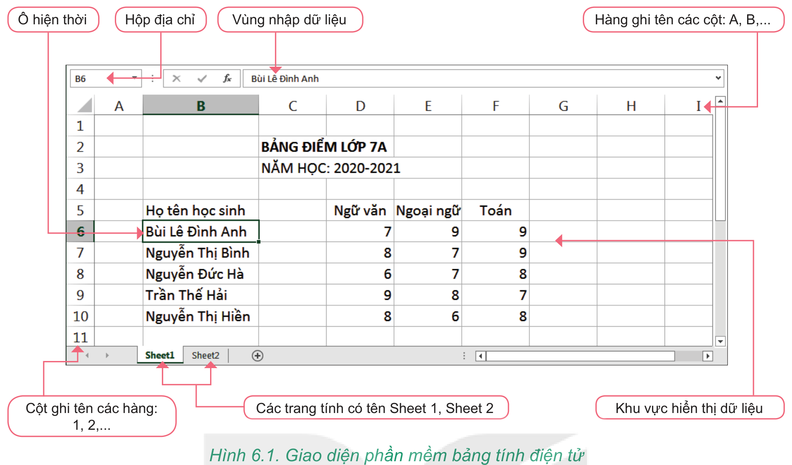
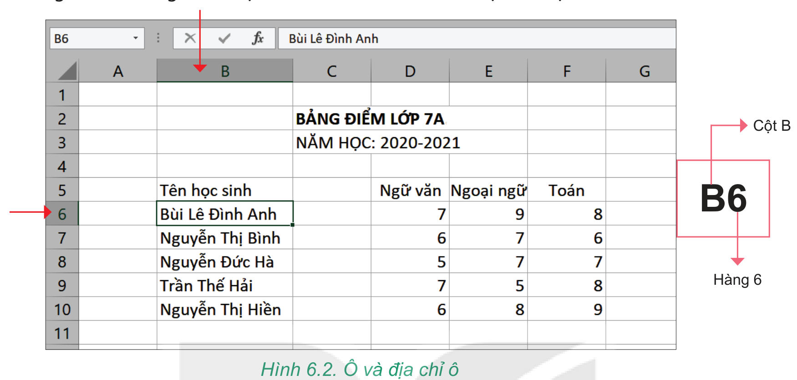
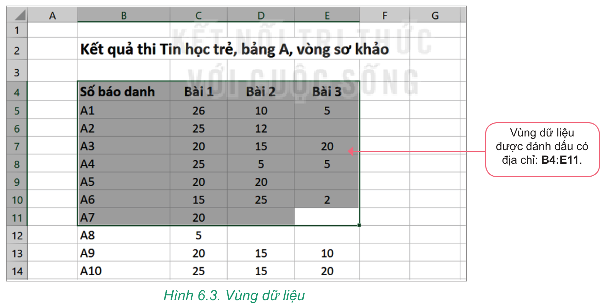
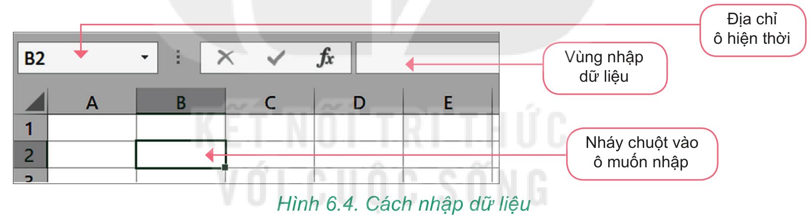
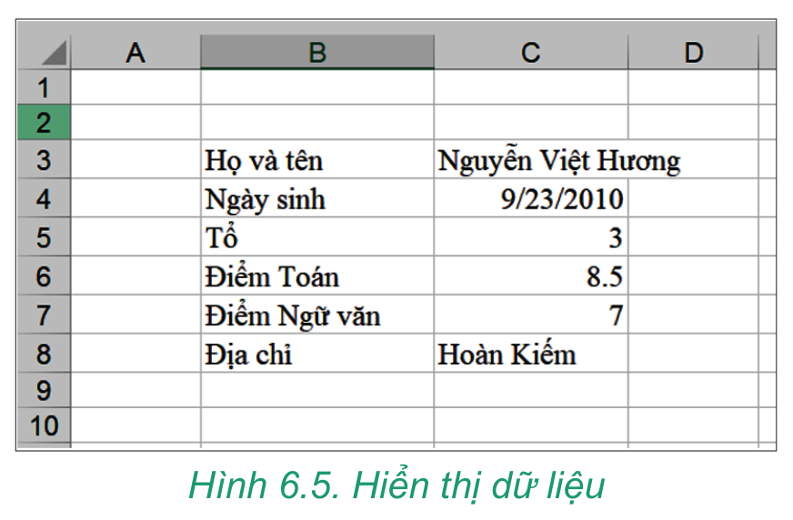
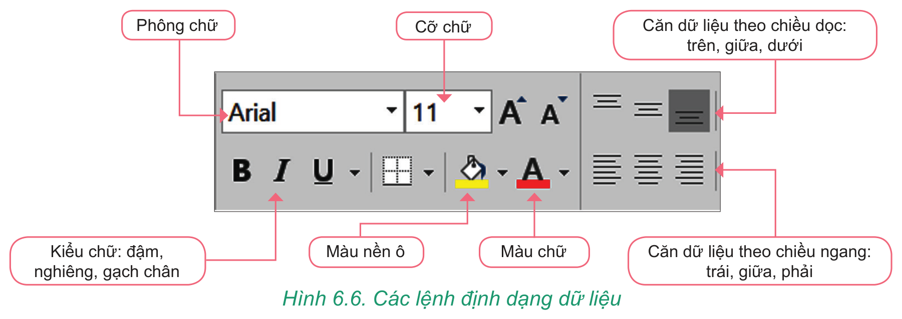
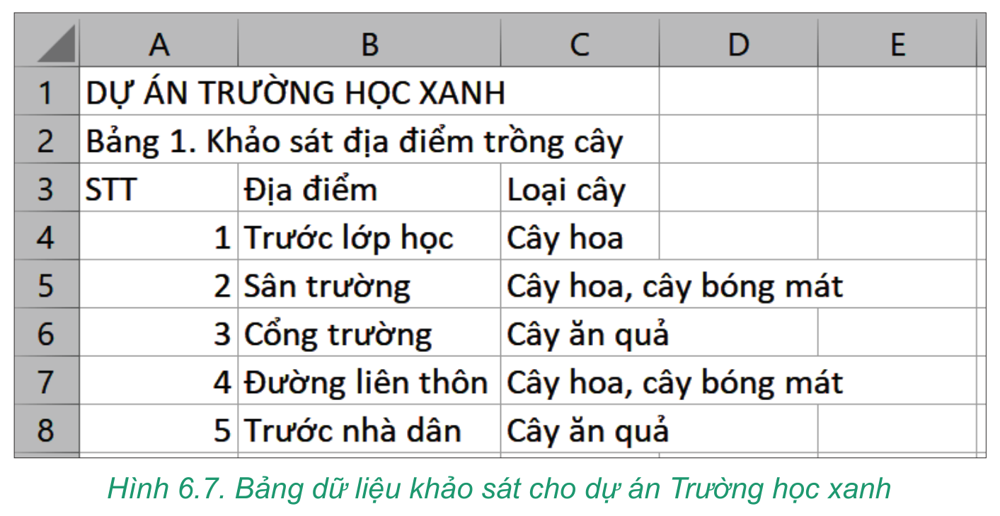
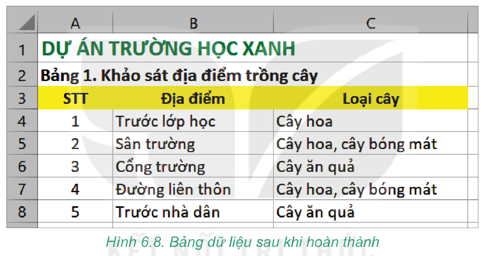

<!-- pdf:29 -->

# BÀI 6: LÀM QUEN VỚI PHẦN MỀM BẢNG TÍNH

## 🎯 Sau bài học này em sẽ:

- Nêu được một số chức năng cơ bản của phần mềm bảng tính.
- Thực hiện được một số thao tác đơn giản: chọn phông chữ, căn chỉnh dữ liệu trong ô tính, thay đổi độ rộng cột.

## 🔴 Khởi động

> Dự án **Trường học xanh**
>
> Nhóm của em được giao nhiệm vụ khảo sát, xây dựng và thực hiện dự án **Trường học xanh**. Dự án thực hiện trồng cây phủ xanh nhà trường bằng cách tổ chức cho học sinh khối 7 tham gia. Hãy khảo sát cảnh quan của nhà trường và thảo luận để trả lời các câu hỏi sau:
>
> – Những vị trí nào trong trường có thể trồng thêm cây?
>
> – Loại cây nào phù hợp cho mỗi vị trí?
>
> – Những công việc gì cần được thực hiện?
>
> – Để thực hiện dự án, cần thu thập và tính toán rất nhiều dữ liệu. Nên sử dụng phần mềm nào trên máy tính để thực hiện những công việc đó?

## 1. GIAO DIỆN PHẦN MỀM BẢNG TÍNH

> **Hoạt động 1: Làm quen với giao diện phần mềm bảng tính**
>
> Quan sát giao diện làm việc của một phần mềm bảng tính mà em biết. Nêu tên các vùng chính và chức năng của chúng.

**Phần mềm bảng tính** là phần mềm ứng dụng giúp em trình bày thông tin dưới dạng bảng một cách cô đọng và dễ so sánh, thực hiện các tính toán phổ biến (tính tổng, trung bình cộng, xác định giá trị lớn nhất, nhỏ nhất,...), vẽ các biểu đồ minh hoạ các số liệu tương ứng,... Không chỉ thế, khi tính toán bằng chương trình bảng tính, nếu dữ liệu gốc thay đổi, kết quả tính toán trên các số liệu đó sẽ được tự động cập nhật. Có rất nhiều phần mềm bảng tính khác nhau như Google Sheets, Microsoft Excel, Libre Calc,... và chúng đều có các chức năng tương tự nhau. Giao diện của các phần mềm bảng tính có dạng tương tự như Hình 6.1.

<!-- pdf:30 -->

*Hình 6.1. Giao diện phần mềm bảng tính điện tử*

– Thẻ và nhóm lệnh chứa các lệnh và biểu tượng lệnh.

– **Vùng nhập dữ liệu** là nơi thực hiện trực tiếp việc nhập dữ liệu vào bảng tính.

– Khu vực chính của bảng tính là nơi lưu trữ và hiển thị dữ liệu. Dữ liệu được lưu trữ trong các **trang tính**. Mỗi bảng tính có thể chứa nhiều trang tính. Mỗi trang tính là một lưới dữ liệu gồm các hàng và cột. Tên của trang tính nằm ở phía dưới cửa sổ bảng tính.

– Mỗi trang tính thường có hàng ghi tên cột ở phía trên và cột ghi tên hàng ở bên trái.

<!-- term: Hàng của trang tính -->
– Các hàng của trang tính được đặt tên bằng các số: 1, 2, 3,... theo thứ tự từ trên xuống dưới.

<!-- term: Cột của trang tính -->
– Các cột của trang tính được đặt tên bằng các chữ cái: A, B, C,... theo thứ tự từ trái sang phải.

<!-- term: Hộp địa chỉ -->
– Giao của một hàng và một cột trên trang tính tạo thành một **ô tính** (gọi tắt là **ô**). Luôn có một ô tính là **ô hiện thời** mà chúng ta đang quan sát, đang nhập dữ liệu hoặc tính toán. Ô hiện thời luôn được đóng khung. Địa chỉ của ô hiện thời luôn hiển thị tại hộp địa chỉ nằm bên trái vùng nhập dữ liệu.

> Phần mềm bảng tính giúp lưu lại và trình bày thông tin dưới dạng bảng, thực hiện các tính toán (từ đơn giản đến phức tạp) cũng như xây dựng các biểu đồ biểu diễn một cách trực quan các số liệu trong bảng.

> ❓ **Câu hỏi**
>
> 1. Vị trí giao của một hàng và một cột được gọi là gì?
>    A. Ô.
>    B. Trang tính.
>    C. Hộp địa chỉ.
>    D. Bảng tính.
> 2. Phát biểu nào dưới đây đúng?
>    A. Các hàng của trang tính được đặt tên theo các chữ cái: A, B, C,...
>    B. Các hàng của trang tính được đặt tên theo các số: 1, 2, 3,...
>    C. Các cột của trang tính được đặt tên theo các số: 1, 2, 3,...
>    D. Các hàng và cột trong trang tính không có tên.

<!-- pdf:31 -->

> **Hoạt động 2: Ô và vùng trên trang tính**
>
> Em hãy quan sát kĩ hơn các ô và vùng trên trang tính. Xác định cách di chuyển con trỏ trên trang tính thông qua ô hiện thời. Xác định cách phần mềm đánh địa chỉ các ô và vùng dữ liệu.
>
> Trong Hình 6.2, ô ghi tên học sinh “Bùi Lê Đình Anh” được xác định như thế nào?

*Hình 6.2. Ô và địa chỉ ô*

Mỗi ô trên trang tính được đánh địa chỉ theo cột và hàng, ví dụ A1, B3, C10,... **Địa chỉ của ô** được quy định là tên cột ghép với tên hàng.

<!-- term: Địa chỉ vùng -->
Nhiều ô liền kề tạo thành hình chữ nhật trên trang tính được gọi là **vùng dữ liệu** (gọi tắt là **vùng**). Vùng dữ liệu được đánh địa chỉ theo địa chỉ của ô góc trên bên trái và ô góc dưới bên phải, cách nhau bởi dấu ":". Ví dụ B4:E11 là một địa chỉ của một vùng dữ liệu.

*Hình 6.3. Vùng dữ liệu*

Các thao tác chọn (đánh dấu) một ô, hàng, cột, vùng trên trang tính:

– Chọn một ô: Nháy chuột vào ô cần chọn.

– Chọn một hàng: Nháy chuột vào tên hàng cần chọn.

– Chọn một cột: Nháy chuột vào tên cột cần chọn.

– Chọn một vùng: Kéo thả chuột từ một ô góc (ví dụ ô góc trên bên trái) đến ô ở góc đối diện (ô góc dưới bên phải). Ô chọn đầu tiên sẽ là ô hiện thời.

<!-- pdf:32 -->

> **\<địa chỉ ô\> = \<tên cột\> \<tên hàng\>**
>
> Nhiều ô liền kề tạo thành hình chữ nhật trên trang tính gọi là vùng.
>
> **\<địa chỉ vùng\> = \<địa chỉ ô góc trên bên trái\> : \<địa chỉ ô góc dưới bên phải\>**

> ❓ **Câu hỏi**
>
> 1. Một ô có thể coi là một vùng được không?
> 2. Vùng A5:B10 có bao nhiêu ô?
> 3. Có thể chọn một vùng hình tam giác được không?

## 2. NHẬP, CHỈNH SỬA VÀ ĐỊNH DẠNG DỮ LIỆU TRONG TRANG TÍNH

> **Hoạt động 3: Nhập, chỉnh sửa và định dạng dữ liệu trong trang tính**
>
> Quan sát và thực hiện các bước nhập dữ liệu trong trang tính và trả lời các câu hỏi sau:
>
> 1. Có thể nhập dữ liệu vào trang tính theo bao nhiêu cách? Hãy nêu các cách đó.
> 2. Dữ liệu được nhập vào các ô sẽ được tự động căn chỉnh như thế nào?

### a) Cách nhập dữ liệu

Bước 1. Nháy chuột vào ô muốn nhập.

Bước 2. Thực hiện việc nhập dữ liệu từ bàn phím (hoặc nháy chuột vào vùng nhập dữ liệu, sau đó mới tiến hành nhập dữ liệu từ bàn phím), nhập xong nhấn phím **Enter**.

*Hình 6.4. Cách nhập dữ liệu*

Quan sát Hình 6.5 ta thấy:

– Dữ liệu văn bản sẽ tự động căn trái.

– Dữ liệu số, ngày tháng,... sẽ tự động căn phải.

Khi nhập dữ liệu vào ô, phần mềm sẽ tự động nhận biết, phân loại dữ liệu theo các kiểu dữ liệu khác nhau như văn bản, số, ngày tháng.

*Hình 6.5. Hiển thị dữ liệu*

### b) Chỉnh sửa dữ liệu

Muốn chỉnh sửa dữ liệu trong ô tính em thực hiện một trong hai cách sau:

– Cách 1. Nháy đúp chuột vào ô cần sửa, con trỏ soạn thảo xuất hiện trong ô, tiến hành sửa dữ liệu và nhấn phím **Enter** để kết thúc.

– Cách 2. Nháy chuột vào ô cần sửa, sau đó nháy chuột vào vùng nhập dữ liệu, con trỏ soạn thảo xuất hiện trong vùng nhập dữ liệu, tiến hành sửa dữ liệu tại thanh này và nhấn phím **Enter** để kết thúc.

<!-- pdf:33 -->

### c) Định dạng dữ liệu

Để định dạng dữ liệu trong một vùng của trang tính em thực hiện:

Bước 1. Chọn vùng dữ liệu.

Bước 2. Sử dụng các lệnh định dạng dữ liệu trong nhóm lệnh **Font** và **Alignment** của thẻ **Home** (Hình 6.6).

*Hình 6.6. Các lệnh định dạng dữ liệu*

> ❓ **Câu hỏi**
>
> Nếu em chọn một vùng rồi nhập dữ liệu thì dữ liệu sẽ được nhập vào ô nào?

## 3. THỰC HÀNH: NHẬP THÔNG TIN KHẢO SÁT DỰ ÁN TRƯỜNG HỌC XANH

**Nhiệm vụ:** Nhập thông tin khảo sát ban đầu của dự án **Trường học xanh**.

**Hướng dẫn**

*(Hướng dẫn sau đây sử dụng phần mềm Microsoft Excel phiên bản 2016 để minh hoạ.)*

Bước 1. Mở phần mềm Microsoft Excel bằng cách nháy đúp chuột lên biểu tượng trên màn hình. Chọn **Blank workbook** để tạo một bảng tính mới.

Bước 2. Nhập dữ liệu khảo sát cho dự án **Trường học xanh** (Hình 6.7) bao gồm các thông tin chính như sau:

– Nhập tại ô A1: **DỰ ÁN TRƯỜNG HỌC XANH**.

– Nhập tại ô A2: **Bảng 1. Khảo sát địa điểm trồng cây**.

– Các cột thông tin chính sẽ là: **STT**, **Địa điểm**, **Loại cây**.

*Hình 6.7. Bảng dữ liệu khảo sát cho dự án Trường học xanh*

<!-- pdf:34 -->

Bước 3. Chỉnh sửa, định dạng dữ liệu.

– Điều chỉnh độ rộng các cột để nhìn thấy toàn bộ dữ liệu. Muốn thay đổi độ rộng cột, đưa con trỏ chuột vào vạch giữa các tên cột (tại hàng ghi tên cột), khi xuất hiện biểu tượng $\leftrightarrow$ thì kéo thả chuột để thay đổi. Muốn thay đổi chiều cao hàng, đưa con trỏ chuột vào giữa vạch giữa các tên hàng (tại cột ghi tên hàng), khi xuất hiện biểu tượng $\updownarrow$ thì kéo thả chuột để thay đổi.

– Định dạng chữ in đậm, màu xanh lá cây, tăng cỡ chữ cho tiêu đề bảng (tại ô A1).

– Cột STT: Căn dữ liệu vào giữa cột.

Bước 4. Nháy đúp vào tên trang tính Sheet1 và nhập `1. Khảo sát` để đổi tên cho trang tính.

– Hàng tiêu đề của bảng (hàng 3): Định dạng nền màu vàng và căn dữ liệu giữa ô.

Bước 5. Lưu lại bảng tính với tên `THXanh.xlsx` bằng lệnh **File/Save** hoặc nhấn tổ hợp phím **Ctrl+S**.

*Hình 6.8. Bảng dữ liệu sau khi hoàn thành*

## ✏️ Luyện tập

1. Muốn xoá nhanh dữ liệu trong một vùng thì em làm thế nào?
2. Có bao nhiêu cách nhập dữ liệu vào trang tính? Em hãy mô tả các cách đó.

## 🚀 Vận dụng

1. Vì sao khi nhập `12/15/2020` thì phần mềm tự động căn phải, nhưng nếu nhập `15/12/2020` thì phần mềm tự động căn trái?
2. Em hãy tìm một số loại cây có thể mua và trồng cho dự án **Trường học xanh**. Em hãy tạo một bảng tính và đặt tên là `Danh sách các loại cây`. Bảng tính có ba cột là STT, Loại cây (Cây hoa, Cây ăn quả, Cây bóng mát) và Tên cây. Nhập dữ liệu vào bảng tính rồi chỉnh sửa và định dạng bảng tính.

## 📷 Danh sách hình trong bài

| Mã hình | Trang PDF | Trang sách | Chú thích |
| --- | --- | --- | --- |
| H7-tin_hoc-b06-01 | 30 | 29 | Hình 6.1. Giao diện phần mềm bảng tính điện tử |
| H7-tin_hoc-b06-02 | 31 | 30 | Hình 6.2. Ô và địa chỉ ô |
| H7-tin_hoc-b06-03 | 31 | 30 | Hình 6.3. Vùng dữ liệu |
| H7-tin_hoc-b06-04 | 32 | 31 | Hình 6.4. Cách nhập dữ liệu |
| H7-tin_hoc-b06-05 | 32 | 31 | Hình 6.5. Hiển thị dữ liệu |
| H7-tin_hoc-b06-06 | 33 | 32 | Hình 6.6. Các lệnh định dạng dữ liệu |
| H7-tin_hoc-b06-07 | 33 | 32 | Hình 6.7. Bảng dữ liệu khảo sát cho dự án Trường học xanh |
| H7-tin_hoc-b06-08 | 34 | 33 | Hình 6.8. Bảng dữ liệu sau khi hoàn thành |
