<!-- pdf:35 -->

# BÀI 7: TÍNH TOÁN TỰ ĐỘNG TRÊN BẢNG TÍNH

## 🎯 Sau bài học này em sẽ:

- Nhận biết được một số kiểu dữ liệu trên bảng tính.
- Sử dụng được công thức và dùng được địa chỉ trong công thức, tạo được bảng tính đơn giản có số liệu tính toán bằng công thức.
- Giải thích được việc đưa các công thức vào bảng tính là một cách điều khiển tính toán tự động trên dữ liệu.

## 🔴 Khởi động

> Trong bài trước em đã biết nhập dữ liệu dạng số, văn bản và thời gian vào bảng tính. Có thể nhập dữ liệu là công thức tính toán được không? Khi thực hiện dự án **Trường học xanh**, em cần tính toán rất nhiều. Hãy tìm hiểu các công cụ tính toán đó của phần mềm bảng tính để có thể sử dụng cho dự án.

## 1. KIỂU DỮ LIỆU TRÊN BẢNG TÍNH

> **Hoạt động 1: Nhận biết kiểu dữ liệu trên bảng tính**
>
> Quan sát các ô dữ liệu, vùng nhập dữ liệu (có hình ngôi sao) trong Hình 7.1, Hình 7.2 và cho biết:
>
> 1. Bảng tính điện tử nhận biết được các kiểu dữ liệu nào?
> 2. Các kiểu dữ liệu đó được thể hiện như thế nào trên bảng tính?

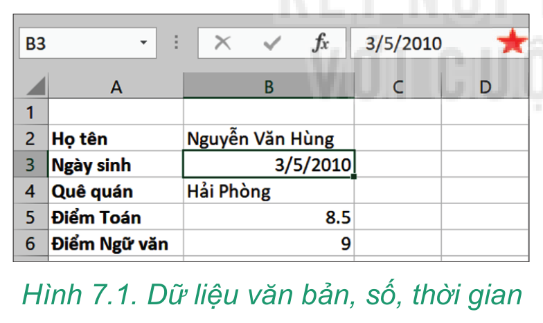

*Hình 7.1. Dữ liệu văn bản, số, thời gian*

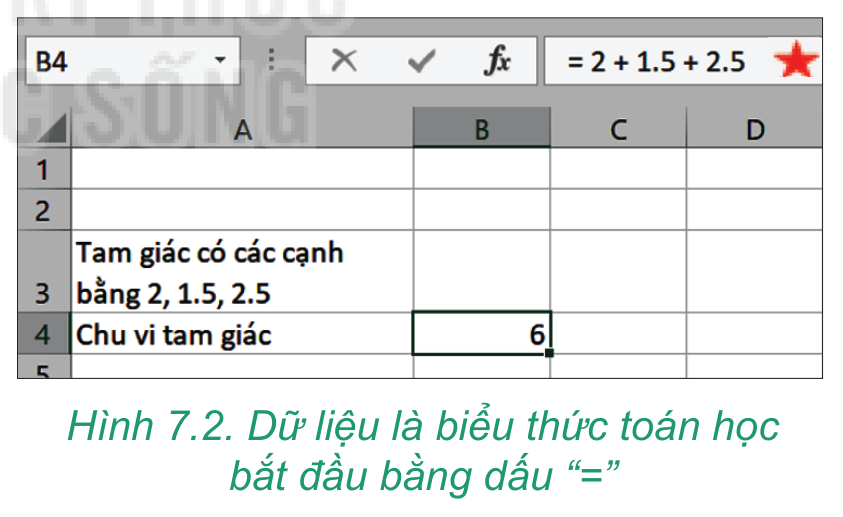

*Hình 7.2. Dữ liệu là biểu thức toán học bắt đầu bằng dấu “=”*

<!-- term: Kiểu dữ liệu trên bảng tính -->
Khi nhập dữ liệu vào các ô trong trang tính, phần mềm sẽ tự động nhận biết được kiểu dữ liệu đã nhập và hiển thị theo khuôn dạng mặc định. Các kiểu dữ liệu cơ bản phần mềm nhận dạng được là văn bản, số, ngày tháng,...

Khả năng hỗ trợ tính toán là đặc trưng ưu việt của các chương trình bảng tính. Em có thể sử dụng **công thức** để thực hiện các tính toán với dữ liệu một cách nhanh chóng. Công thức có dạng các biểu thức toán học được nhập trực tiếp vào ô tính. Muốn nhập công thức cần gõ dấu “=” đầu tiên, sau đó gõ biểu thức. Các phép toán đơn giản là phép cộng (`+`), trừ (`–`), nhân (`*`), chia (`/`) và luỹ thừa (`^`). Công thức tính toán có thể chứa các số, phép toán và các dấu ngoặc tròn. Thứ tự thực hiện các phép toán trong công thức giống như trong các biểu thức toán học.

<!-- pdf:36 -->

*Bảng 7.1. Một số kí hiệu phép toán dùng trong phần mềm bảng tính*

| Phép toán | Kí hiệu toán | Kí hiệu trong phần mềm bảng tính | Ví dụ trong phần mềm bảng tính |
| --- | --- | --- | --- |
| Phép cộng | + | + | `20 + 7` |
| Phép trừ | – | – | `42 – 35` |
| Phép nhân | $\times$ | `*` | `7*9` |
| Phép chia | : | `/` | `35/7` |
| Phép luỹ thừa | $a^x$ | `a^x` | `5^3` |

<!-- term: Kiểu dữ liệu trên bảng tính -->
> Dữ liệu trong ô tính có thể thuộc kiểu văn bản, số, ngày tháng và công thức. Công thức luôn bắt đầu bằng dấu `"="`, sau đó là biểu thức toán học.

> ❓ **Câu hỏi**
>
> Trong phần mềm bảng tính, công thức tính nào dưới đây **sai**? Vì sao?
>
> A. `= 5^2 + 6*101`
>
> B. `= 6*(3 + 2))`
>
> C. `= 2(3 + 4)`
>
> D. `= 1^2 + 2^2`

## 2. CÔNG THỨC TRONG BẢNG TÍNH

> **Hoạt động 2: Nhập công thức vào bảng tính**
>
> Em hãy cho biết, nếu nhập công thức vào một ô tính và tính toán với giá trị nằm ở các ô khác thì phải làm thế nào?

Nếu em muốn tính Tổng số cây hoa ở ô E4 trong Bảng 2. Dự kiến số lượng cây cần trồng ở Hình 7.3, thì em cần lấy số vị trí (là dữ liệu ở ô C4) nhân với số lượng cây ở mỗi vị trí (là dữ liệu ở ô D4). Có hai cách tính như sau:

Cách 1. Nhập vào ô E4 công thức với giá trị số lấy từ các ô C4, D4. Nhập `= 25*10` (Hình 7.3).

Cách 2. Nhập vào ô E4 công thức với các địa chỉ ô C4, D4. Nhập `= C4*D4` (Hình 7.4).

Với cách 1, em tính được tổng số cây hoa cần trồng là 250. Nhưng khi em muốn bổ sung thêm vị trí hoặc tăng số lượng cây hoa tại một vị trí, tức là dữ liệu trong ô C4 hoặc D4 thay đổi thì kết quả tại ô E4 không thay đổi (vẫn là 250) tức là kết quả không được cập nhật.

Với cách 2, nếu sửa dữ liệu tại hai ô, C4 hoặc D4, thì ô kết quả E4 luôn được cập nhật đúng. Cách 2 có ưu điểm là công thức sẽ tự động cập nhật nếu các dữ liệu có liên quan thay đổi. Có thể nói, công thức sử dụng trong cách 2 được **tính toán tự động**.

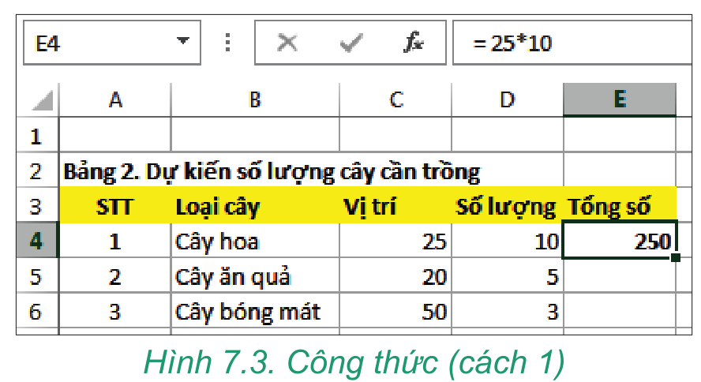

*Hình 7.3. Công thức (cách 1)*

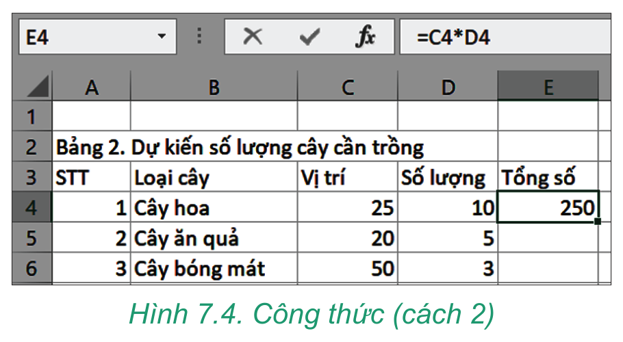

*Hình 7.4. Công thức (cách 2)*

> Khi nhập công thức vào ô tính, nếu tính toán với giá trị từ các ô dữ liệu khác thì trong công thức cần ghi địa chỉ của ô dữ liệu tương ứng. Phần mềm bảng tính sẽ **tự động tính toán** và cập nhật kết quả nếu có thay đổi.

<!-- pdf:37 -->

> ❓ **Câu hỏi**
>
> Trong các trường hợp sau, công thức cần nhập tại ô tính là gì?

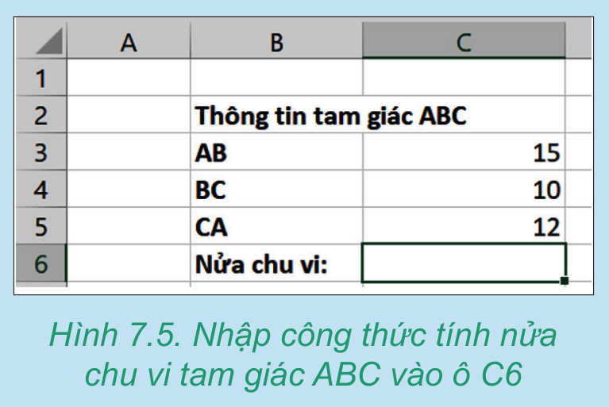

*Hình 7.5. Nhập công thức tính nửa chu vi tam giác ABC vào ô C6*

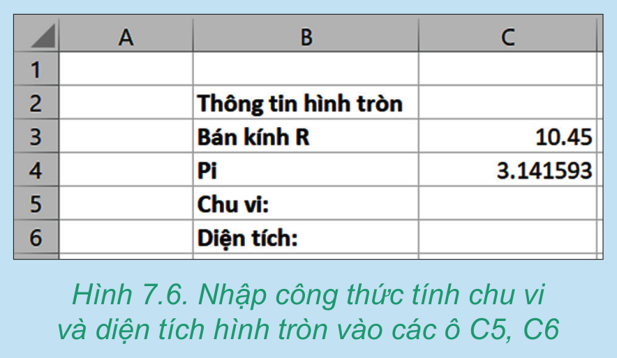

*Hình 7.6. Nhập công thức tính chu vi và diện tích hình tròn vào các ô C5, C6*

## 3. SAO CHÉP Ô TÍNH CHỨA CÔNG THỨC

> **Hoạt động 3: Sao chép ô tính chứa công thức**
>
> 1. Khi sao chép ô tính chứa công thức hoặc vùng có chứa công thức thì các công thức này sẽ được sao chép như thế nào?
> 2. Chức năng tính toán tự động của công thức có được bảo toàn hay không khi sao chép dữ liệu? Nếu có thì được thể hiện như thế nào?

Trở lại với bảng dữ liệu dự kiến số lượng cây cần trồng. Nếu muốn sao chép công thức tính tổng số cây cần trồng tại ô E4 xuống các ô phía dưới (E5, E6) để tính Tổng số cho các loại cây khác thì em làm như sau:

Bước 1. Chọn ô tính chứa dữ liệu cần sao chép (ô E4) (Hình 7.7).

Bước 2. Nhấn tổ hợp phím **Ctrl+C** để sao chép dữ liệu (có công thức).

Bước 3. Đánh dấu vùng muốn sao chép dữ liệu đến (E5:E6) (Hình 7.8).

Bước 4. Nhấn tổ hợp phím **Ctrl+V** để dán dữ liệu.

Kết quả là vùng E5:E6 được gán dữ liệu là công thức tính tổng số cây cần trồng. Công thức này có các tham số liên quan đến dữ liệu tương ứng trong hai cột C và D.

Khi sao chép công thức `= C4*D4` có trong ô E4, xuống các ô phía dưới của cột E, các địa chỉ C4, D4 trong công thức này đã bị thay đổi, chẳng hạn công thức trong ô E6 sẽ là `= C6*D6`.

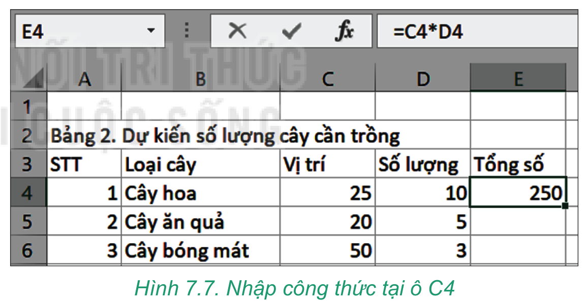

*Hình 7.7. Nhập công thức tại ô C4*

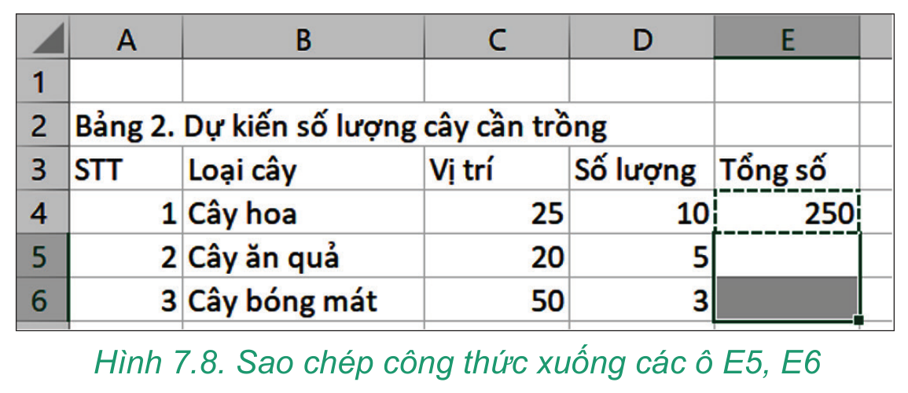

*Hình 7.8. Sao chép công thức xuống các ô E5, E6*

<!-- pdf:38 -->

Như vậy khi sao chép công thức, vị trí tương đối giữa các ô tham chiếu và ô có công thức sẽ không thay đổi. Trong ví dụ trên, công thức gốc `E4 = C4*D4`, vị trí tương đối của hai ô C4, D4 với E4 (lần lượt bên trái 2 ô, bên trái 1 ô) sẽ không thay đổi, tức là khi sao chép ô E4 đến ô E6 được công thức `= C6*D6` (vị trí tương đối của hai ô C6, D6 với ô E6 vẫn lần lượt là bên trái 2 ô, bên trái 1 ô).

Việc giữ nguyên vị trí tương đối giữa các ô tham chiếu và ô chứa công thức khi sao chép là tính năng quan trọng của mọi phần mềm bảng tính.

<!-- term: Sao chép công thức -->
> - Khi sao chép một ô có công thức chứa địa chỉ, các địa chỉ được điều chỉnh để giữ nguyên vị trí tương đối giữa ô chứa công thức và ô có địa chỉ trong công thức.
> - Chức năng tính toán tự động của phần mềm bảng tính còn được thể hiện khi sao chép công thức.

> ❓ **Câu hỏi**
>
> 1. Trong ví dụ trên nếu chúng ta sao chép công thức từ ô E4 sang ô E10 thì công thức tại ô E10 là gì?
> 2. Giả sử tại ô G10 có công thức `G10 = H10 + 2*K10`. Nếu sao chép công thức này đến ô G12 thì công thức sẽ thay đổi như thế nào?

## 4. THỰC HÀNH: NHẬP THÔNG TIN DỰ KIẾN SỐ LƯỢNG CÂY CẦN TRỒNG CỦA DỰ ÁN

**Nhiệm vụ**

– Tạo trang tính mới trong bảng tính của dự án để nhập dữ liệu dự kiến số lượng cây trồng cho dự án.

– Nhập dữ liệu cho trang tính.

– Thiết lập công thức tính tổng số cây mỗi loại và tổng số cây của tất cả các loại.

– Thực hiện các thao tác định dạng dữ liệu cho trang tính.

**Hướng dẫn**

Bước 1. Mở tệp `THXanh.xlsx`.
<!-- ocr-ok: đã đối chiếu ảnh trang 38, chữ màu hồng THXanh.xlsx bị OCR đọc nhầm thành THIXanh.xlsx -->

Bước 2. Nháy chuột vào nút $\oplus$ tại vùng tên trang tính để tạo một trang tính mới. Nhập tên trang tính là `2. Dự kiến số lượng cây` và nhập dữ liệu như Hình 7.9.

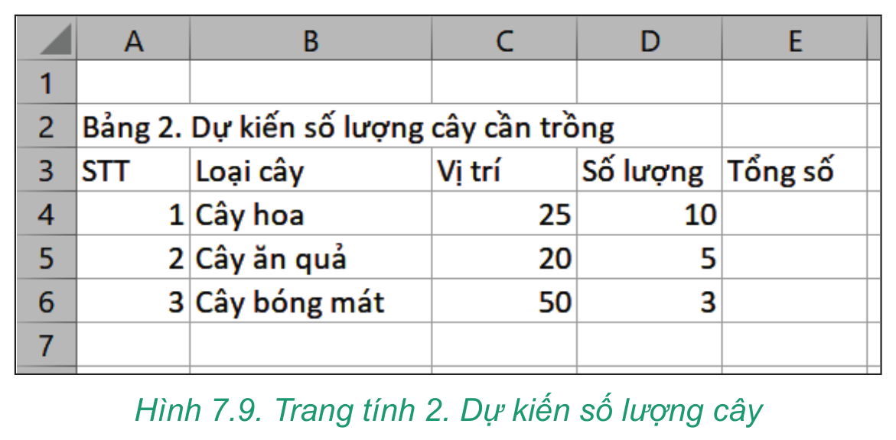

*Hình 7.9. Trang tính 2. Dự kiến số lượng cây*

Bước 3. Nhập công thức `= C4*D4` vào ô E4, sau đó sao chép công thức này xuống các ô E5 và E6.

<!-- pdf:39 -->

Bước 4. Tại ô E7 thiết lập công thức tính tổng của cả ba loại cây dự kiến trồng. Cụ thể là nhập vào ô E7 công thức `= E4+E5+E6`.

Bước 5. Định dạng chữ đậm và màu nền vàng cho ô A2 và hàng tiêu đề của bảng (hàng 3). Cột STT căn giữa. Điều chỉnh độ rộng cột để hiển thị đủ dữ liệu.

Bước 6. Lưu lại kết quả.

## ✏️ Luyện tập

1. Em hãy tạo một trang tính mới trong bảng tính của dự án, đặt tên là `3. Tìm hiểu giống cây`. Tiến hành nhập dữ liệu là danh sách các loại cây cụ thể và đơn giá. Định dạng cho trang tính như Hình 7.10 và lưu lại kết quả.
2. Nhập công thức `= D4 * E4` vào ô F4. Sao chép ô F4 xuống các ô từ F5 đến F19 để tính giá trị của cột Thành tiền.

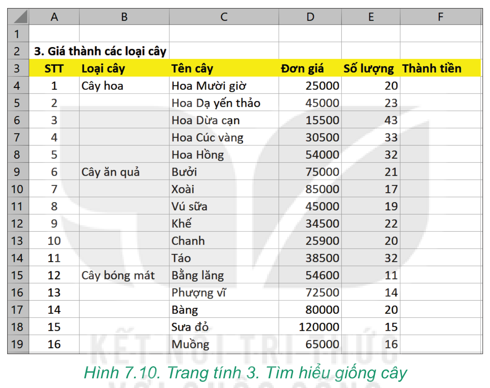

*Hình 7.10. Trang tính 3. Tìm hiểu giống cây*

## 🚀 Vận dụng

1. Phần mềm bảng tính mặc định căn phải các giá trị là số và ngày tháng, căn trái dữ liệu là văn bản. Em có thể thay đổi lại cách căn lề cho dữ liệu số, ngày tháng và văn bản được không? Nếu có thì bằng lệnh nào?
2. Em hãy tạo một bảng tính mới, nhập dữ liệu cho bảng tính như Hình 7.11, nhập công thức tính tổng diện tích rừng cho tỉnh Hà Giang và sao chép công thức để tính cho các tỉnh còn lại. Lưu tệp bảng tính với tên `Dientichrung.xlsx`.

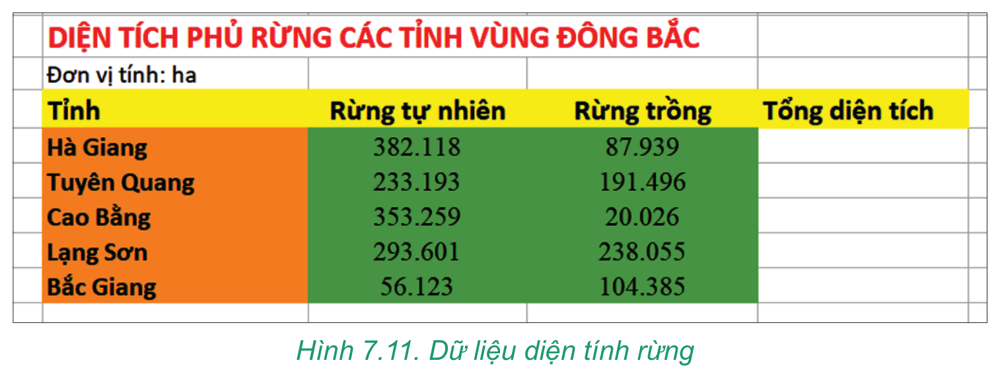

*Hình 7.11. Dữ liệu diện tính rừng*

## 📷 Danh sách hình trong bài

| Mã hình | Trang PDF | Trang sách | Chú thích |
| --- | --- | --- | --- |
| H7-tin_hoc-b07-01 | 35 | 34 | Hình 7.1. Dữ liệu văn bản, số, thời gian |
| H7-tin_hoc-b07-02 | 35 | 34 | Hình 7.2. Dữ liệu là biểu thức toán học bắt đầu bằng dấu “=” |
| H7-tin_hoc-b07-03 | 36 | 35 | Hình 7.3. Công thức (cách 1) |
| H7-tin_hoc-b07-04 | 36 | 35 | Hình 7.4. Công thức (cách 2) |
| H7-tin_hoc-b07-05 | 37 | 36 (nền xanh hộp Câu hỏi) | Hình 7.5. Nhập công thức tính nửa chu vi tam giác ABC vào ô C6 |
| H7-tin_hoc-b07-06 | 37 | 36 (nền xanh hộp Câu hỏi) | Hình 7.6. Nhập công thức tính chu vi và diện tích hình tròn vào các ô C5, C6 |
| H7-tin_hoc-b07-07 | 37 | 36 | Hình 7.7. Nhập công thức tại ô C4 |
| H7-tin_hoc-b07-08 | 37 | 36 | Hình 7.8. Sao chép công thức xuống các ô E5, E6 |
| H7-tin_hoc-b07-09 | 38 | 37 | Hình 7.9. Trang tính 2. Dự kiến số lượng cây |
| H7-tin_hoc-b07-10 | 39 | 38 | Hình 7.10. Trang tính 3. Tìm hiểu giống cây |
| H7-tin_hoc-b07-11 | 39 | 38 | Hình 7.11. Dữ liệu diện tính rừng |
