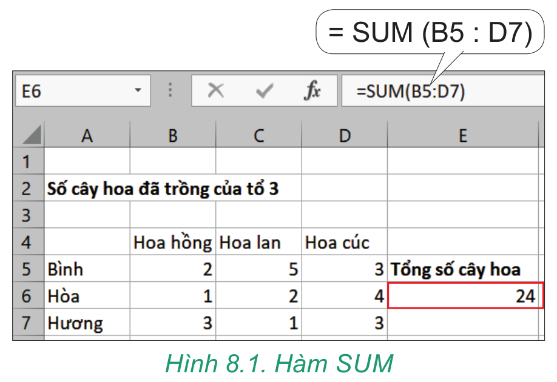
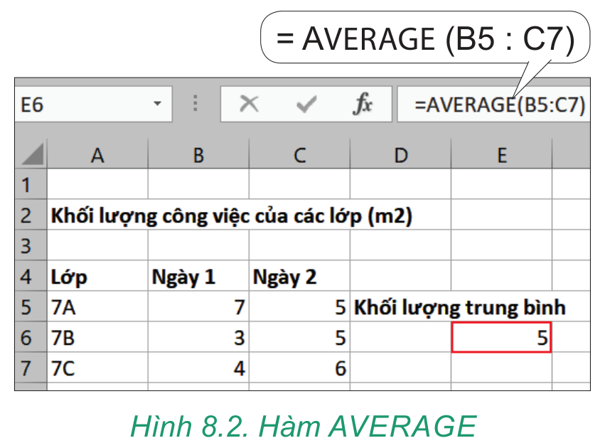
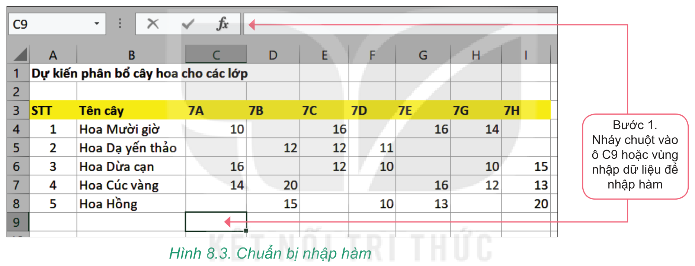
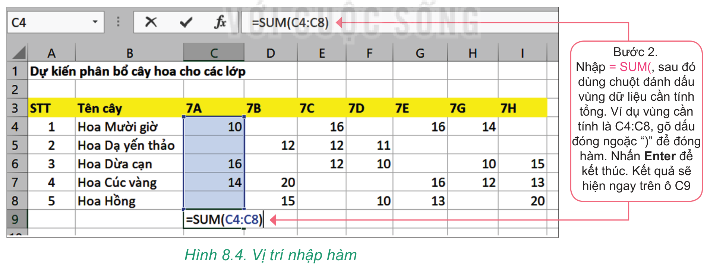
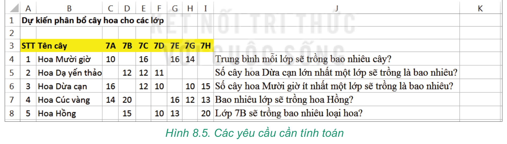
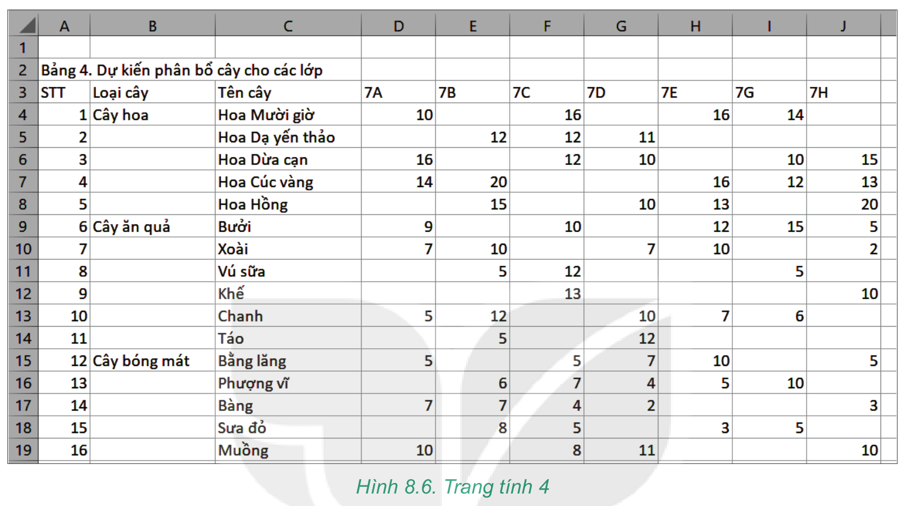
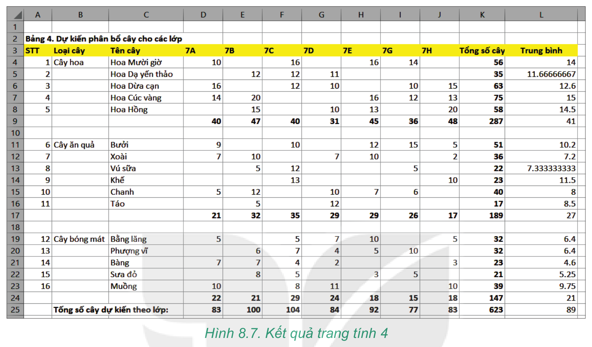

<!-- pdf:40 -->

# BÀI 8: CÔNG CỤ HỖ TRỢ TÍNH TOÁN

## 🎯 Sau bài học này em sẽ:

- Thực hiện được một số phép toán thông dụng, sử dụng được một số hàm đơn giản như MAX, MIN, SUM, AVERAGE, COUNT,...

## 🔴 Khởi động

> Trong bài trước em đã biết cách tính toán theo công thức trên trang tính. Phần mềm bảng tính còn có các hàm giúp em tính toán. Trong phần mềm bảng tính, **hàm** là công thức (hoặc kết hợp nhiều công thức) được định nghĩa từ trước. Hàm được sử dụng để thực hiện tính toán theo công thức với các giá trị dữ liệu cụ thể. Phần mềm bảng tính có rất nhiều hàm có sẵn hỗ trợ tính toán, ví dụ hàm tính tổng, hàm đếm, hàm tính giá trị trung bình,... Trong dự án **Trường học xanh** có cần dùng các hàm này để tính toán không, chúng ta hãy cùng tìm hiểu nhé.

## 1. HÀM TRONG BẢNG TÍNH

> **Hoạt động 1: Hàm trong bảng tính**
>
> Em hãy quan sát công thức là hàm trong Hình 8.1 và Hình 8.2 (chú ý quan sát kĩ công thức trong vùng nhập dữ liệu) và trả lời các câu hỏi sau:
>
> 1. Tên của hàm là gì?
> 2. Ý nghĩa của hàm?
> 3. Hàm có bao nhiêu tham số, các tham số của hàm là gì?

*Hình 8.1. Hàm SUM*

*Hình 8.2. Hàm AVERAGE*

<!-- pdf:41 -->

Mỗi hàm trong bảng tính sẽ được xác định bởi:

– Tên của hàm số (ví dụ SUM, AVERAGE).

– Ý nghĩa hàm số (ví dụ tính tổng, trung bình).

– Các tham số của hàm có thể là dãy bao gồm các số, địa chỉ ô, địa chỉ vùng dữ liệu được viết cách nhau bởi dấu `","` hoặc dấu `“;”`.

Cách sử dụng hàm:

**`= <tên hàm>(<các tham số>)`**

> **Hoạt động 2: Nhập hàm**
>
> Theo em, nhập hàm vào bảng tính có giống như nhập dữ liệu thông thường không?

Quan sát bảng dữ liệu phân bổ các cây hoa cho khối lớp 7 như trong Hình 8.3. Chúng ta sẽ nhập hàm tại các ô từ C9 đến I9 để tính tổng các cây được phân bổ cho mỗi lớp. Quan sát các bước thực hiện sau và rút ra nhận xét về cách nhập hàm trên bảng tính.

*Hình 8.3. Chuẩn bị nhập hàm*

*Hình 8.4. Vị trí nhập hàm*

Tương tự nhập hàm tính tổng cho các lớp khác tại các ô từ D9 đến I9. Có thể sao chép công thức đã có từ ô C9 sang các ô từ D9 đến I9.

<!-- pdf:42 -->

<!-- term: Cú pháp nhập hàm -->
> Cách nhập hàm tương tự như cách nhập công thức. Cú pháp nhập hàm:
>
> `= <tên hàm>(<các tham số>)`
>
> Cần nhập chính xác tên của hàm và các tham số của hàm. Khi nhập thông tin vùng dữ liệu trong tham số của hàm có thể dùng chuột chọn các ô hoặc vùng này. Tên hàm có thể dùng chữ in hoa hoặc in thường.

> ❓ **Câu hỏi**
>
> 1. Hàm được nhập như thế nào?
> 2. Các tham số của hàm có thể là địa chỉ ô hoặc vùng dữ liệu không?

## 2. MỘT SỐ HÀM TÍNH TOÁN ĐƠN GIẢN

> **Hoạt động 3: Làm quen với một số hàm tính toán đơn giản**
>
> Em hãy xem lại dữ liệu của dự án **Trường học xanh** và cho biết em cần tính toán những gì? Các yêu cầu tính toán đó có thể diễn tả bằng các hàm như thế nào?

Sử dụng các hàm SUM (tính tổng), AVERAGE (tính trung bình), MIN (tính giá trị nhỏ nhất), MAX (tính giá trị lớn nhất), COUNT (đếm) để thực hiện các yêu cầu: (Chú ý, tất cả các hàm số này đều có cú pháp sử dụng tương tự như hàm SUM đã biết).

Quan sát trang tính `Dự kiến phân bổ cây hoa cho các lớp`, tính toán để trả lời các câu hỏi tại cột J bằng cách nhập công thức tại các ô từ K4 đến K8 tương ứng.

*Hình 8.5. Các yêu cầu cần tính toán*

Em có thể nhập công thức để tính toán như gợi ý trong Bảng 8.1.

*Bảng 8.1. Các công thức cần nhập*

| Yêu cầu tính toán | Công thức tính | Kết quả |
| --- | --- | --- |
| Trung bình mỗi lớp sẽ trồng bao nhiêu cây? | `=AVERAGE(C4:I8)` | `13.6667` |
| Số cây hoa Dừa cạn lớn nhất một lớp sẽ trồng là bao nhiêu? | `=MAX(C6:I6)` | |
| Số cây hoa Mười giờ ít nhất một lớp sẽ trồng là bao nhiêu? | `=MIN(C4:I4)` | |
| Bao nhiêu lớp sẽ trồng hoa Hồng? | `=COUNT(C8:I8)` | |
| Lớp 7B sẽ trồng bao nhiêu loại hoa? | `=COUNT(D4:D8)` | |

<!-- pdf:43 -->

Cú pháp một số hàm thông dụng của phần mềm bảng tính mà em có thể cần sử dụng để tính toán dữ liệu cho dự án **Trường học xanh** được cho trong Bảng 8.2.

*Bảng 8.2. Cú pháp một số hàm*

| STT | Tên hàm | Cách viết | Ý nghĩa | Ví dụ |
| --- | --- | --- | --- | --- |
| 1 | **SUM** | `SUM(v1,v2,...)` | Tính **tổng** các giá trị số có trong các ô, vùng hoặc số có trong danh sách v1, v2,... | `SUM(C3:E5)`; `SUM(D4:H4,15,K10)` |
| 2 | **AVERAGE** | `AVERAGE(v1,v2,...)` | Tính **trung bình** các giá trị số có trong các ô, vùng hoặc số có trong danh sách v1, v2,... | `AVERAGE(B2:E6)`; `AVERAGE(10,12,1)` |
| 3 | **MIN** | `MIN(v1,v2,...)` | Tìm **giá trị nhỏ nhất** trong các giá trị số có trong các ô, vùng hoặc số có trong danh sách v1, v2,... | `MIN(A1:B10)`; `MIN(C2,B3,10)` |
| 4 | **MAX** | `MAX(v1,v2,...)` | Tìm **giá trị lớn nhất** trong các giá trị số có trong các ô, vùng hoặc số có trong danh sách v1, v2,... | `MAX(B1:E1)`; `MAX(2,A1:B5)` |
| 5 | **COUNT** | `COUNT(v1,v2,...)` | **Đếm** số các giá trị là số có trong các ô, vùng hoặc số có trong danh sách v1, v2,... | `COUNT(B3:E10)`; `COUNT(1,2)` |

**Lưu ý:**

– Tất cả các hàm trên đều chỉ xử lí các ô có dữ liệu số có trong tham số của hàm. Hàm sẽ bỏ qua các ô dữ liệu chứa văn bản hoặc ô trống.

– Các phần mềm bảng tính thường dùng dấu chấm `“.”` để ngăn cách phần nguyên và phần thập phân, dùng dấu phẩy `“,”` để ngăn cách các chữ số hàng nghìn, hàng triệu,...

> ❓ **Câu hỏi**
>
> Mỗi hàm sau cho kết quả như thế nào?
>
> a) `SUM(1,3, “Hà Nội”, “Zero”, 5)`
>
> b) `MIN(3,5, “One”,1)`
>
> c) `COUNT(1,3,5,7)`

## 3. THỰC HÀNH: TÍNH TOÁN TRÊN DỮ LIỆU TRỒNG CÂY THỰC TẾ
<!-- ocr-ok: đã đối chiếu ảnh trang 43, tiêu đề phông trang trí màu hồng bị OCR đọc sai dấu -->

**Nhiệm vụ**

– Tạo trang tính mới trong bảng tính của dự án để nhập dữ liệu dự kiến kết quả thực hiện dự án.

– Nhập và sao chép dữ liệu vào trang tính.

– Thiết lập công thức tính tổng số cây mỗi loại và tổng số cây các loại mà mỗi lớp trồng được.

– Thực hiện các thao tác định dạng dữ liệu cho trang tính.

**Hướng dẫn**

### a) Tạo trang tính mới

– Mở tệp bảng tính `THXanh.xlsx`.

– Tạo thêm một trang tính mới đặt tên `4. Dự kiến kết quả`.

<!-- pdf:44 -->

### b) Nhập và sao chép dữ liệu vào trang tính

– Nhập tại ô A2: `Bảng 4. Dự kiến phân bổ cây cho các lớp`.

– Mở lại trang tính `3. Tìm hiểu giống cây` và sao chép vùng dữ liệu A3:C19 (3 cột đầu tiên STT, Loại cây, Tên cây) sang trang tính `4. Dự kiến kết quả` tại địa chỉ A3.

– Nhập dữ liệu dự kiến phân bổ cho các lớp khối 7 được giao thực hiện dự án **Trường học xanh** như Hình 8.6.

*Hình 8.6. Trang tính 4*

### c) Tính tổng số cây mỗi loại mà mỗi lớp trồng được

– Chèn thêm hai hàng trống ở trên hàng 9 bằng cách thực hiện hai lần các thao tác sau: Chọn cả hàng số 9, nháy nút phải chuột tại hàng 9 và chọn lệnh **Insert**.

– Thực hiện tương tự để chèn thêm hai hàng trống ở trên hàng có số thứ tự 12.

– Tại ô D9 nhập công thức `=SUM(D4:D8)` để tính số cây hoa của lớp 7A, sau đó sao chép công thức này sang các ô bên cạnh tương ứng với các lớp 7B, 7C, 7D, 7E, 7G, 7H.

– Thực hiện tương tự để tính tổng số cây ăn quả và cây bóng mát mà mỗi lớp đã trồng.

### d) Tính tổng số cây các loại mà mỗi lớp trồng được

– Tại ô D25 nhập công thức `=D9+D17+D24` để tính tổng số cây đã trồng của lớp 7A.

– Sao chép công thức tại ô D25 sang các ô E25, F25, G25, H25, I25, J25 để tính tổng số cây của các lớp 7B, 7C, 7D, 7E, 7G, 7H.

– Tại hàng 3, bên cạnh cột 7H tạo thêm hai cột **Tổng số cây** và **Trung bình** để tính tổng số mỗi cây và số cây trung bình mỗi lớp trồng.

– Tại ô K4, nhập hàm `=SUM(D4:J4)` tính tổng số cây Hoa mười giờ.

– Tại ô L4 nhập hàm `=AVERAGE(D4:J4)` tính số cây Hoa mười giờ trung bình của mỗi lớp.

– Sao chép dữ liệu tại ô K4 xuống phía dưới cho đến ô K25, sau đó xoá đi dữ liệu tại các hàng trống là K10, K18 ứng với các hàng không có dữ liệu.

– Sao chép dữ liệu tại ô L4 xuống phía dưới cho đến ô L25, sau đó xoá đi dữ liệu tại các hàng trống là L10, L18.

<!-- pdf:45 -->

### e) Định dạng dữ liệu cho trang tính

– Định dạng chữ in đậm cho tiêu đề bảng.

– Hàng tiêu đề (hàng 3) định dạng chữ in đậm và có nền màu vàng.

– Định dạng chữ in đậm cho tất cả các ô chứa dữ liệu tổng hợp để làm nổi bật.

– Lưu lại kết quả.

*Hình 8.7. Kết quả trang tính 4*

## ✏️ Luyện tập

1. Tại các ô K9, K17, K24 trong trang tính `4. Dự kiến kết quả` có thể dùng công thức khác được không? Nếu có thì dùng công thức gì? Từ đó em rút ra điều gì?
2. Các công thức sau đây có cho kết quả giống nhau hay không?
   a) `= SUM(C3:K3)`
   b) `= C3 + SUM(D3:J3) + K3`
   c) `= SUM(C3:G3) + SUM(H3:K3)`
3. Dựa trên dữ liệu của `Bảng 4. Dự kiến phân bổ cây cho các lớp` hãy thực hành để:
   a) Tính số cây lớn nhất sẽ được trồng của một lớp.
   b) Tính số cây trung bình sẽ được trồng của các lớp.

## 🚀 Vận dụng

Em hãy tạo bảng tính và nhập dữ liệu ghi lại các khoản chi tiêu của gia đình em trong một tháng. Sử dụng các hàm để tính toán và trả lời những câu hỏi sau:

a) Tổng số tiền chi tiêu một tháng là bao nhiêu?

b) Khoản chi nhiều nhất, ít nhất là bao nhiêu?

c) Có bao nhiêu khoản đã chi?

d) Trung bình mỗi ngày chi bao nhiêu tiền?

Em hãy chia sẻ với bố mẹ những kết quả em tính toán được để cùng cân đối chi tiêu gia đình sao cho hợp lí.

## 📷 Danh sách hình trong bài

| Mã hình | Trang PDF | Trang sách | Chú thích |
| --- | --- | --- | --- |
| H7-tin_hoc-b08-01 | 40 | 39 | Hình 8.1. Hàm SUM |
| H7-tin_hoc-b08-02 | 40 | 39 | Hình 8.2. Hàm AVERAGE |
| H7-tin_hoc-b08-03 | 41 | 40 | Hình 8.3. Chuẩn bị nhập hàm |
| H7-tin_hoc-b08-04 | 41 | 40 | Hình 8.4. Vị trí nhập hàm |
| H7-tin_hoc-b08-05 | 42 | 41 | Hình 8.5. Các yêu cầu cần tính toán |
| H7-tin_hoc-b08-06 | 44 | 43 | Hình 8.6. Trang tính 4 |
| H7-tin_hoc-b08-07 | 45 | 44 | Hình 8.7. Kết quả trang tính 4 |
