<!-- pdf:46 -->

# BÀI 9: TRÌNH BÀY BẢNG TÍNH

## 🎯 Sau bài học này em sẽ:

- Biết và thực hiện được một số chức năng định dạng dữ liệu số và trình bày bảng tính.
- Áp dụng được một số hàm tính toán dữ liệu như SUM, COUNT, AVERAGE, MIN, MAX vào dự án Trường học xanh.

## 🔴 Khởi động

> Quan sát một phần bảng tính của dự án **Trường học xanh** trong Hình 9.1, em có nhận xét gì? Có cần chỉnh sửa, định dạng hay trình bày dữ liệu cho đẹp hơn không?

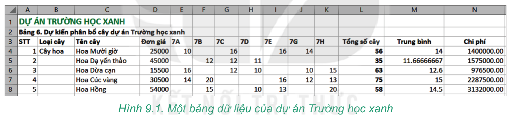

*Hình 9.1. Một bảng dữ liệu của dự án Trường học xanh*

## 1. ĐỊNH DẠNG DỮ LIỆU SỐ

> **Hoạt động 1: Làm quen với lệnh định dạng dữ liệu (Format Cells)**
>
> 1. Cột dữ liệu `Trung bình` cần điều chỉnh gì để hiển thị dễ đọc, dễ so sánh hơn không?
> 2. Dữ liệu tại cột `Chi phí` nên trình bày lại như thế nào để phù hợp với dữ liệu là số tiền?

### a) Định dạng dữ liệu số

<!-- term: Định dạng dữ liệu số -->
Dữ liệu số trong bảng tính được hiểu là các số nguyên hoặc số thực (là số có phần nguyên và phần thập phân). Tất cả các phần mềm bảng tính đều cho phép thiết lập cách định dạng thể hiện các số này. Ví dụ chỉ cho phép hiện bao nhiêu chữ số thập phân, hoặc quy định dùng dấu `","` phân tách hàng nghìn, hàng triệu,... Để thực hiện định dạng các số tại một ô hoặc vùng dữ liệu, em cần chọn vùng dữ liệu và chọn **Home**, nháy chuột vào mũi tên bên cạnh nhóm lệnh **Number** để mở cửa sổ **Format Cells**. Sau đó em nhập các tham số định dạng kiểu dữ liệu số thực trong cửa sổ **Format Cells** như Hình 9.2.

<!-- pdf:47 -->

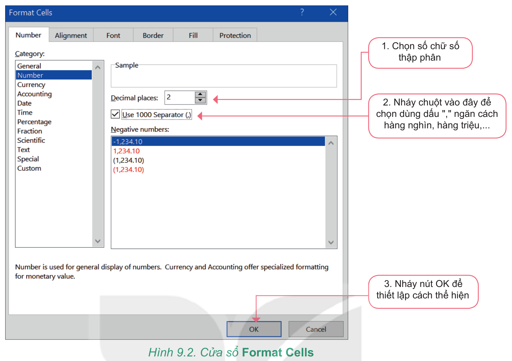

*Hình 9.2. Cửa sổ Format Cells*

### b) Định dạng dữ liệu kiểu phần trăm

<!-- term: Định dạng dữ liệu kiểu phần trăm -->
Khi nói đến tỉ lệ phần trăm chúng ta hiểu là tỉ lệ giữa hai giá trị, ví dụ a/b. Muốn mô tả tỉ lệ này thành các số phần trăm, chúng ta sẽ tính `(a/b)` $\times$ `100(%)`. Phần mềm bảng tính có lệnh để hiển thị các giá trị (là tỉ lệ giữa hai số a, b nào đó) để giá trị này thể hiện trên bảng tính là số phần trăm. Thao tác định dạng dữ liệu kiểu phần trăm như sau: đánh dấu vùng dữ liệu, trong cửa sổ **Format Cells**, chọn **Number**, chọn kiểu **Percentage**, nháy chuột chọn **OK**.

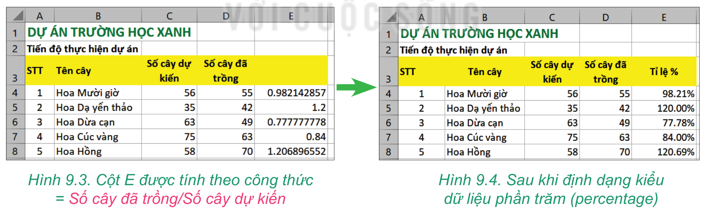

*Hình 9.3. Cột E được tính theo công thức = Số cây đã trồng/Số cây dự kiến — Hình 9.4. Sau khi định dạng kiểu dữ liệu phần trăm (percentage)*

### c) Định dạng dữ liệu ngày tháng

<!-- term: Định dạng dữ liệu ngày tháng -->
Chúng ta đã biết các phần mềm bảng tính cho phép nhập dữ liệu ngày tháng theo khuôn dạng: mm/dd/yyyy, tức là nhập tháng, sau đó nhập ngày, sau đó là năm, các số cách nhau bởi dấu `"/"` hoặc `"–"`. Mặc định dữ liệu thời gian cũng thể hiện trên màn hình dưới dạng `"mm/dd/yyyy"`.

<!-- term: Định dạng dữ liệu ngày tháng -->
Muốn thay đổi lại cách thể hiện ngày tháng em thực hiện như sau: đánh dấu vùng dữ liệu; trong cửa sổ **Format Cells** em thực hiện các bước như Hình 9.5. Lưu ý: Việc chỉnh sửa chỉ thay đổi cách hiển thị, còn việc nhập dữ liệu vẫn cần tuân theo thứ tự mặc định của phần mềm.

<!-- pdf:48 -->

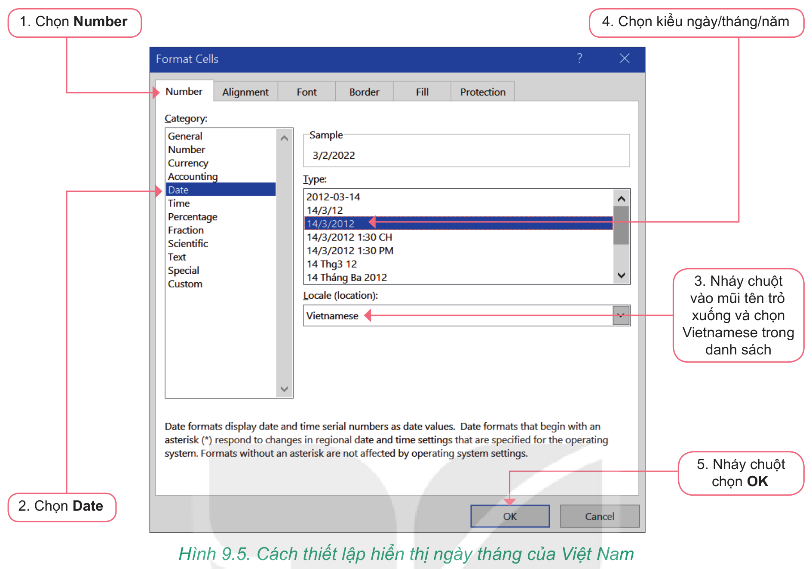

*Hình 9.5. Cách thiết lập hiển thị ngày tháng của Việt Nam*

**Lưu ý:** Dữ liệu kiểu ngày tháng có thể thực hiện các phép cộng với số nguyên (mỗi số nguyên được tính là một ngày) và phép trừ hai dữ liệu ngày tháng (trong Hình 9.6 các ô dữ liệu ngày tháng đều là kiểu hiển thị ngày của Việt Nam).

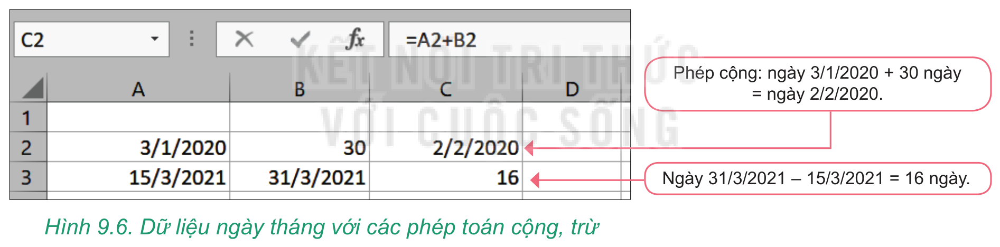

*Hình 9.6. Dữ liệu ngày tháng với các phép toán cộng, trừ*

<!-- term: Định dạng dữ liệu số -->
> Có thể định dạng dữ liệu số theo các kiểu khác nhau như xác định số chữ số thập phân, phân tách hàng nghìn, hàng triệu,... Có thể định dạng số theo kiểu phần trăm và định dạng dữ liệu ngày tháng của Việt Nam (dd/mm/yyyy).

## 2. TRÌNH BÀY BẢNG TÍNH

> **Hoạt động 2: Tìm hiểu một số lệnh trình bày bảng tính**
>
> 1. Theo em việc định dạng dữ liệu và trình bày bảng tính có khác nhau không?
> 2. Các lệnh trình bày bảng tính hay định dạng dữ liệu có làm thay đổi dữ liệu trên bảng tính không?

<!-- pdf:49 -->

### a) Các lệnh chèn, xoá, ẩn, hiện hàng và cột

– Xoá hàng, cột: Nháy chuột vào tên của cột hoặc hàng để chọn cột hoặc hàng muốn xoá. Nháy nút phải chuột vào chỗ chọn, chọn **Delete**. Có thể chọn nhiều hàng (cột) để xoá đồng thời.

– Chèn thêm một hàng, cột mới: Chọn hàng (dưới hàng muốn chèn) hoặc cột (bên phải cột muốn chèn). Nháy nút phải chuột vào chỗ chọn, chọn lệnh **Insert**. Hàng mới sẽ được chèn vào bên trên hàng em chọn, cột mới sẽ được chèn vào bên trái cột em chọn.

<!-- term: Ẩn, hiện hàng và cột -->
– Làm ẩn, hiện hàng hoặc cột: Trong khi làm việc, một số hàng hoặc cột của bảng tính có thể ẩn đi với mục đích làm gọn bảng tính, dễ quan sát. Khi cần em có thể hiển thị lại các hàng, cột đã ẩn bất cứ lúc nào.

<!-- term: Ẩn, hiện hàng và cột -->
Muốn ẩn hàng hoặc cột, em chọn hàng hoặc cột, nháy nút phải chuột vào chỗ chọn và chọn **Hide**. Hình 9.7 mô tả một số cột và hàng bị làm ẩn đi.

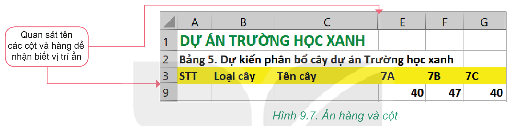

*Hình 9.7. Ẩn hàng và cột*

<!-- term: Ẩn, hiện hàng và cột -->
Muốn hiển thị lại, em chọn các hàng, cột xung quanh vị trí hàng, cột bị ẩn đi, nháy nút phải chuột và chọn **Unhide**.

### b) Lệnh gộp các ô của một vùng dữ liệu

<!-- term: Gộp các ô của một vùng dữ liệu -->
Đánh dấu vùng dữ liệu (các ô muốn gộp), chọn **Home/Alignment/Merge & Center**.

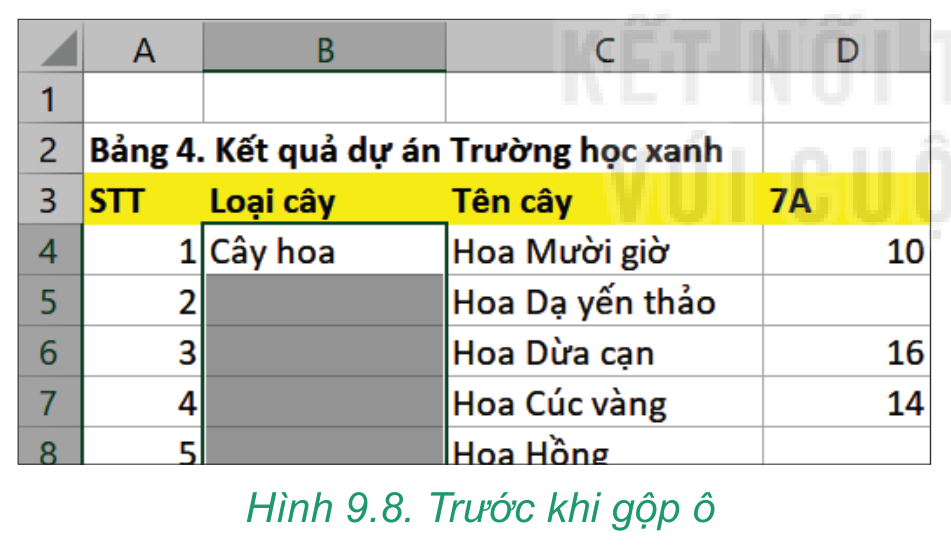

*Hình 9.8. Trước khi gộp ô*

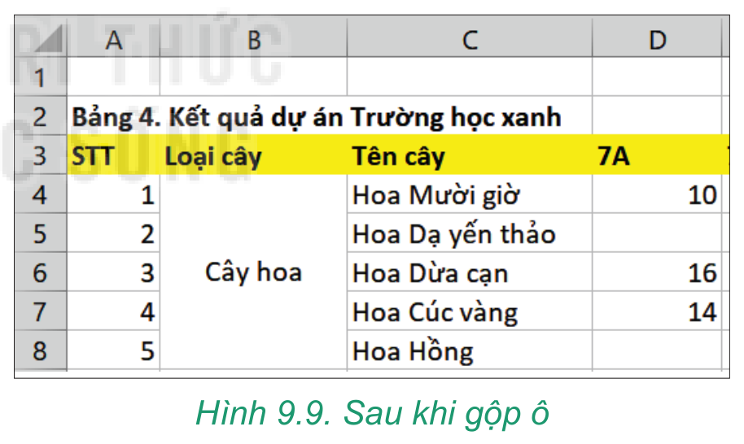

*Hình 9.9. Sau khi gộp ô*

<!-- term: Gộp các ô của một vùng dữ liệu -->
**Lưu ý:** Sau khi gộp, ô kết quả sẽ có địa chỉ là ô đầu tiên bên trái của vùng đã gộp và lưu kết quả của ô này. Dữ liệu trong các ô khác sẽ bị xoá khi gộp.

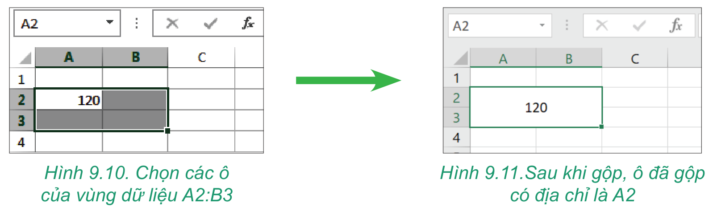

*Hình 9.10. Chọn các ô của vùng dữ liệu A2:B3 — Hình 9.11.Sau khi gộp, ô đã gộp có địa chỉ là A2*

<!-- pdf:50 -->

## 3. TÍNH CHẤT CỦA CÁC HÀM TRÊN BẢNG TÍNH

> **Hoạt động 3: Tìm hiểu thêm tính chất một số hàm tính toán cơ bản**
>
> Giả sử nhóm em lập bảng dữ liệu như Hình 9.12 để theo dõi tiến độ thực hiện dự án **Trường học xanh**. Dữ liệu được nhập vào bảng có thể là số liệu cụ thể hoặc có thể ghi `"Không"` nếu lớp không có cây này, hoặc ghi `"Đang làm"` nếu lớp đã thực hiện nhưng chưa có số liệu, ghi `"???"` nếu chưa biết thông tin gì. Cột cuối cùng luôn tính Tổng số cây theo từng loại, hàng cuối sẽ đếm số loại cây đã trồng của mỗi lớp.
>
> Các kết quả của bảng dữ liệu này có luôn đúng hay không? Vì sao?

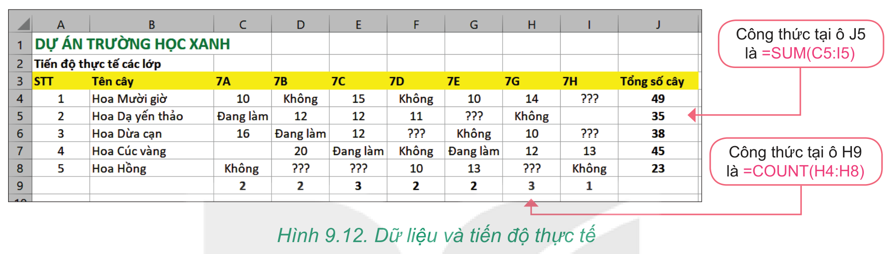

*Hình 9.12. Dữ liệu và tiến độ thực tế*

Các hàm tính toán của bảng tính điện tử như SUM, AVERAGE, COUNT, MIN, MAX sẽ chỉ tính toán trên các ô chứa dữ liệu số và bỏ qua các ô chứa dữ liệu dạng văn bản hoặc ô trống. Tính chất đặc biệt này giúp cho bảng dữ liệu theo dõi quá trình thực hiện dự án như Hình 9.12 sẽ luôn cho kết quả đúng.

> ❓ **Câu hỏi**
>
> Trong bảng dữ liệu của Hình 9.12 các hàm sau sẽ cho kết quả bao nhiêu?
>
> a) `= COUNT(C6:I6)`
>
> b) `= AVERAGE(C7:I7)`
>
> c) `= MAX(C4:I8)`
>
> d) `= SUM(C4:I8)`

## 4. THỰC HÀNH: HOÀN THIỆN DỮ LIỆU DỰ ÁN TRƯỜNG HỌC XANH

**Nhiệm vụ**

– Tạo trang tính mới trong bảng tính của dự án để nhập dữ liệu dự kiến phân bổ cây.

– Nhập và sao chép dữ liệu vào trang tính.

– Thiết lập công thức tính chi phí trồng mỗi loại cây và chi phí của toàn bộ dự án.

– Thực hiện các thao tác định dạng dữ liệu cho trang tính.

**Hướng dẫn**

### a) Tạo trang tính mới

– Mở tệp bảng tính `THXanh.xlsx`.

– Tạo thêm một trang tính mới đặt tên `5. Tổng kết`.

### b) Nhập và sao chép dữ liệu vào trang tính

– Mở trang tính `4. Dự kiến kết quả`. Sao chép toàn bộ dữ liệu của trang tính `4. Dự kiến kết quả` sang trang tính `5. Tổng kết`.

– Trong trang tính 5, sửa lại tên bảng tại ô A2 là: `Bảng 5. Dự kiến phân bổ cây dự án Trường học xanh`.

<!-- pdf:51 -->

### c) Tính chi phí trồng mỗi loại cây và của toàn bộ dự án

– Nháy chuột chọn cột D (cột của lớp 7A), nháy nút phải chuột và chọn Insert để chèn thêm cột.

– Đặt tiêu đề cho cột mới tạo là `Đơn giá`.

– Mở trang tính `3. Tìm hiểu giống cây`. Sao chép toàn bộ đơn giá của các loại cây từ dữ liệu trong trang tính này vào cột Đơn giá ở trang tính `5. Tổng kết`. (Chú ý: cần sao chép chính xác vào các ô tương ứng vì trang tính `5. Tổng kết` đã có thêm các hàng trống giữa các loại cây.)

– Tạo thêm cột `Chi phí` bên phải cột `Trung bình` (cột N).

– Nhập công thức tính `Chi phí = Đơn giá` $\times$ `Tổng số cây` cho các ô trong cột `Chi phí`.

– Để tính tổng chi phí mỗi loại cây và toàn bộ dự án tại các ô N9, N17, N24, N25 em có thể nhập công thức trực tiếp hoặc sao chép công thức từ các ô E9, E17, E24, E25 sang các ô N9, N17, N24, N25 tương ứng.

### d) Định dạng dữ liệu cho trang tính

– Định dạng trang tính, có thể theo mẫu trong Hình 9.13.

– Lưu lại kết quả.

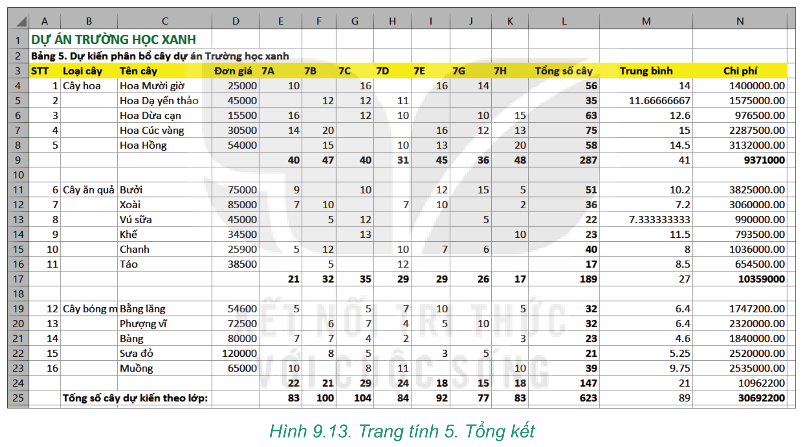

*Hình 9.13. Trang tính 5. Tổng kết*

## ✏️ Luyện tập

1. Có thể sao chép công thức từ trang tính này sang trang tính khác được không?
2. Phần mềm bảng tính điện tử có thể gộp các ô trong một vùng không là hình chữ nhật không?

## 🚀 Vận dụng

1. Em hãy quan sát bảng `Dự kiến phân bổ cây dự án Trường học xanh` ở Hình 9.13 và hãy trả lời các câu hỏi sau:
   a) Tổng số cây của toàn bộ khối 7 sẽ trồng là bao nhiêu?
   b) Trung bình mỗi lớp sẽ trồng bao nhiêu cây?
2. Dựa trên bảng `Dự kiến phân bổ cây dự án Trường học xanh` em hãy tính tỉ lệ phần trăm của từng loại cây hoa được phân bổ so với chỉ tiêu đã giao.

## 📷 Danh sách hình trong bài

| Mã hình | Trang PDF | Trang sách | Chú thích |
| --- | --- | --- | --- |
| H7-tin_hoc-b09-01 | 46 | 45 | Hình 9.1. Một bảng dữ liệu của dự án Trường học xanh |
| H7-tin_hoc-b09-02 | 47 | 46 | Hình 9.2. Cửa sổ Format Cells |
| H7-tin_hoc-b09-03 | 47 | 46 | Hình 9.3. Cột E được tính theo công thức = Số cây đã trồng/Số cây dự kiến — Hình 9.4. Sau khi định dạng kiểu dữ liệu phần trăm (percentage) |
| H7-tin_hoc-b09-04 | 48 | 47 | Hình 9.5. Cách thiết lập hiển thị ngày tháng của Việt Nam |
| H7-tin_hoc-b09-05 | 48 | 47 | Hình 9.6. Dữ liệu ngày tháng với các phép toán cộng, trừ |
| H7-tin_hoc-b09-06 | 49 | 48 | Hình 9.7. Ẩn hàng và cột |
| H7-tin_hoc-b09-07 | 49 | 48 | Hình 9.8. Trước khi gộp ô |
| H7-tin_hoc-b09-08 | 49 | 48 | Hình 9.9. Sau khi gộp ô |
| H7-tin_hoc-b09-09 | 49 | 48 | Hình 9.10. Chọn các ô của vùng dữ liệu A2:B3 — Hình 9.11.Sau khi gộp, ô đã gộp có địa chỉ là A2 |
| H7-tin_hoc-b09-10 | 50 | 49 | Hình 9.12. Dữ liệu và tiến độ thực tế |
| H7-tin_hoc-b09-11 | 51 | 50 | Hình 9.13. Trang tính 5. Tổng kết |
