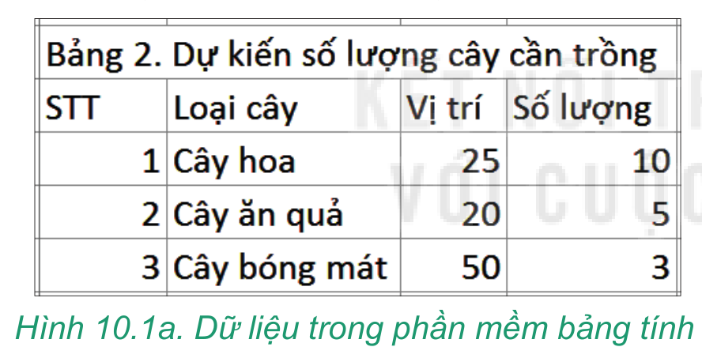
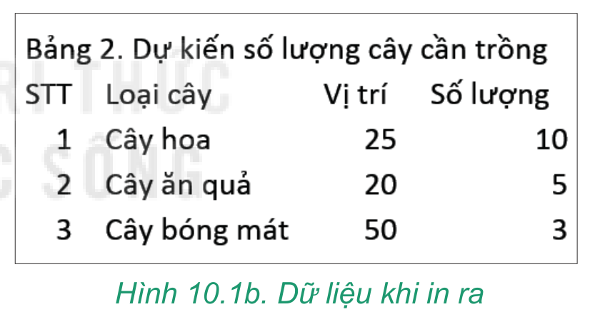
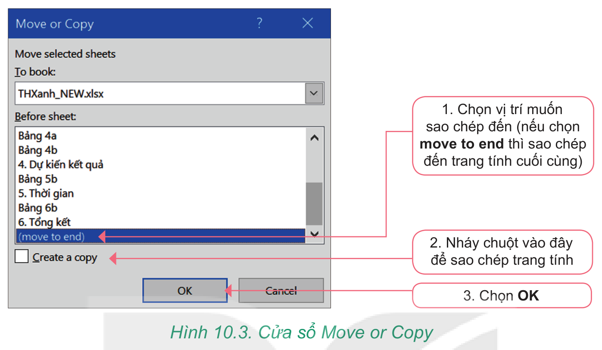
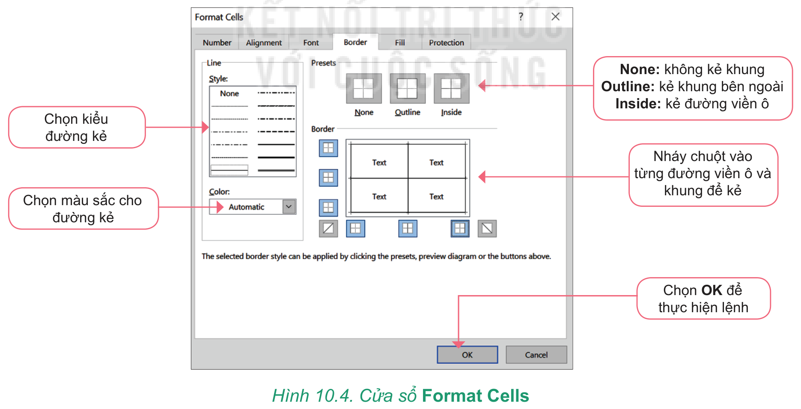
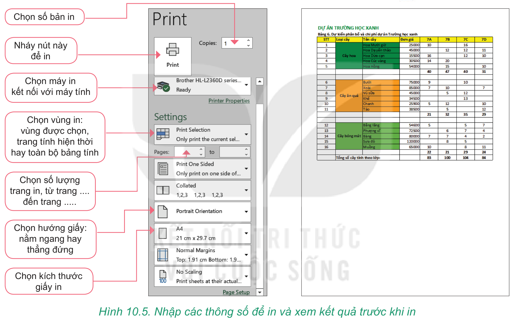
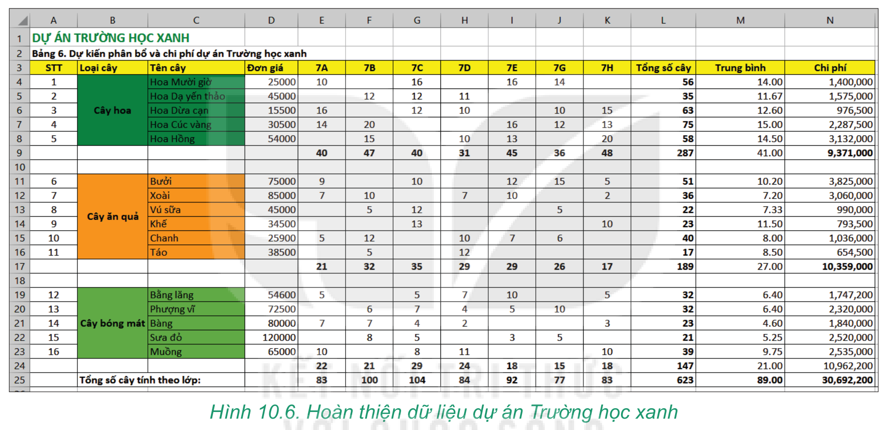

<!-- pdf:52 -->

# BÀI 10: HOÀN THIỆN BẢNG TÍNH

## 🎯 Sau bài học này em sẽ:

- Thực hiện được các thao tác hoàn thiện bảng tính.
- Thực hành hoàn thiện dự án.
- Sử dụng được bảng tính điện tử để giải quyết một vài công việc cụ thể đơn giản.

## 🔴 Khởi động

> Công việc thu thập dữ liệu, tính toán dữ liệu cho dự án **Trường học xanh** đã hoàn thành. Việc tiếp theo là trình bày, hoàn thiện bảng tính để có thể trình bày trước lớp.

## 1. CÁC THAO TÁC HOÀN THIỆN BẢNG TÍNH

> **Hoạt động 1: Tại sao khi in dữ liệu ra giấy lại không nhìn thấy các đường kẻ?**
>
> Bạn An in dữ liệu trong `Bảng 2. Dự kiến số lượng cây cần trồng` (Hình 10.1a) ra giấy nhưng kết quả nhận được là bảng dữ liệu không có các đường kẻ (Hình 10.1b) giống như bạn nhìn thấy trên màn hình máy tính. Em có biết lí do tại sao không?

*Hình 10.1a. Dữ liệu trong phần mềm bảng tính*

*Hình 10.1b. Dữ liệu khi in ra*

### a) Các thao tác với trang tính

Mỗi bảng tính bao gồm nhiều trang tính. Vị trí phía dưới của bảng tính là nơi hiện danh sách các trang tính.

– Tạo trang tính mới:

*Hình 10.2. Tạo mới trang tính*

– Xoá một trang tính: Nháy nút phải chuột vào tên trang tính rồi chọn **Delete**.

– Chèn trang tính mới trước trang tính A: Nháy nút phải chuột vào tên trang tính A, chọn **Insert/Worksheet** rồi chọn **OK**.

– Đổi tên trang tính: Nháy đúp chuột vào tên trang tính, nhập tên mới, nhấn phím **Enter**.

<!-- pdf:53 -->

– Thay đổi thứ tự các trang tính: Nháy chuột vào tên trang tính, kéo thả chuột sang trái, phải để di chuyển trang tính đến vị trí mong muốn.

– Sao chép một trang tính sang vị trí mới: Nháy nút phải chuột vào tên trang tính và chọn lệnh **Move or Copy**. Cửa sổ **Move or Copy** xuất hiện như Hình 10.3.

*Hình 10.3. Cửa sổ Move or Copy*

### b) Kẻ đường viền ô và khung bao quanh vùng dữ liệu

<!-- term: Kẻ đường viền ô và khung bao quanh vùng dữ liệu -->
Trên màn hình máy tính em nhìn thấy mỗi trang tính là một lưới các ô nhưng mặc định khi in dữ liệu thì các đường lưới không được in ra. Vì vậy, trước khi in dữ liệu của bảng tính em cần kẻ đường viền ô và khung bao quanh vùng dữ liệu nếu cần.

– Chọn vùng dữ liệu muốn kẻ đường viền ô, kẻ khung và chọn **Format Cells**.

– Trong cửa sổ **Format Cells** chọn trang **Border**, thiết lập các thông số kẻ đường viền, kẻ khung như hướng dẫn trong Hình 10.4.

*Hình 10.4. Cửa sổ Format Cells*

<!-- term: Các thao tác với trang tính -->
<!-- term: Kẻ đường viền ô và khung bao quanh vùng dữ liệu -->
> Người sử dụng có thể thực hiện các thao tác đa dạng trên trang tính của bảng tính: đổi tên, tạo mới, chèn, sao chép, di chuyển hoặc xoá một trang tính. Nên kẻ khung các vùng dữ liệu trước khi tiến hành in hoặc trình bày dữ liệu.

<!-- pdf:54 -->

## 2. IN DỮ LIỆU TRONG BẢNG TÍNH

> **Hoạt động 2: In dữ liệu**
>
> Em hãy quan sát và nêu các bước in một trang tính.

<!-- term: In dữ liệu trong bảng tính -->
Có thể in trang tính hiện thời, hoặc toàn bộ bảng tính, hoặc có thể chỉ in vùng dữ liệu đang chọn, phần mềm sẽ tự động tính toán để in. Thao tác in dữ liệu như sau:

Bước 1. Đánh dấu vùng dữ liệu muốn in.

<!-- term: In dữ liệu trong bảng tính -->
Bước 2. Thực hiện lệnh **File/Print**.

Xuất hiện hộp thoại **Print** như Hình 10.5. Nhập các thông số in trước khi chọn **Print** để in.

Bước 3. Sau khi nhập các thông số in, nháy chuột lên biểu tượng Print để tiến hành in.

*Hình 10.5. Nhập các thông số để in và xem kết quả trước khi in*

## 3. THỰC HÀNH: TRÌNH BÀY HOÀN CHỈNH DỮ LIỆU DỰ ÁN TRƯỜNG HỌC XANH
<!-- ocr-ok: đã đối chiếu ảnh trang 54, tiêu đề phông trang trí màu hồng bị OCR đọc sai dấu -->

**Nhiệm vụ**

– Tạo trang tính mới để trình bày dữ liệu của dự án **Trường học xanh**.

– Sử dụng các kiến thức đã biết để định dạng dữ liệu và trình bày trang tính.

– Kẻ đường viền, kẻ khung.

**Hướng dẫn**

### a) Tạo trang tính mới

– Mở tệp bảng tính `THXanh.xlsx`.

– Tạo trang tính mới có tên là `6. Hoàn thiện`.

– Chọn trang tính `5. Tổng kết` và sao chép nội dung trang tính này vào trang tính `6. Hoàn thiện`.

– Sửa tên các dòng đầu của trang tính như Hình 10.7.

<!-- pdf:55 -->

### b) Định dạng dữ liệu và trình bày trang tính

– Thiết lập định dạng dữ liệu cho hai cột `Trung bình` và `Chi phí` như sau:

  + Cột dữ liệu `Trung bình`: Thiết lập định dạng là số có hai chữ số thập phân.
  + Cột dữ liệu `Chi phí`: Thiết lập định dạng là số không có chữ số thập phân (số chữ số thập phân bằng 0) và thiết lập chế độ hiển thị phân tách hàng nghìn, hàng triệu,...

– Tại cột `Loại cây` (cột B) em gộp các ô cùng nhóm theo loại cây hoa, cây ăn quả, cây bóng mát.

– Căn giữa cho dữ liệu trong các ô đã gộp theo cả chiều dọc và chiều ngang.

– Tô màu nền cho các ô dữ liệu theo từng loại cây.

### c) Kẻ đường viền, kẻ khung

– Đánh dấu toàn bộ vùng dữ liệu chính của trang tính (vùng A3:N25).

– Kẻ đường viền cho các ô và kẻ khung cho vùng dữ liệu.

– Thực hiện các thao tác căn chỉnh một lần nữa các cột và hàng của trang tính một cách thích hợp, có thể theo mẫu như Hình 10.6.

*Hình 10.6. Hoàn thiện dữ liệu dự án Trường học xanh*

– Lưu tệp.

Công việc tính toán dữ liệu dự án đã hoàn thành. Em có thể in toàn bộ trang tính này hoặc sao chép dữ liệu sang phần mềm trình chiếu để trình bày trước lớp.

## ✏️ Luyện tập

1. Quan sát lệnh in một trang tính và so sánh với lệnh in văn bản mà em đã học ở lớp 6, có điểm gì giống nhau giữa hai lệnh in này?
2. Em hãy thực hiện lệnh in bảng dữ liệu rút gọn bằng cách ẩn đi tất cả các cột ứng với các lớp cụ thể từ 7A đến 7H.

## 🚀 Vận dụng

Em hãy giúp cô giáo tạo trang tính Điểm thi khảo sát có các cột Họ và tên, Toán, Văn, Anh và Điểm trung bình. Dùng các hàm hay công thức để tính toán rồi trình bày trang tính.

## 📷 Danh sách hình trong bài

| Mã hình | Trang PDF | Trang sách | Chú thích |
| --- | --- | --- | --- |
| H7-tin_hoc-b10-01 | 52 | 51 | Hình 10.1a. Dữ liệu trong phần mềm bảng tính |
| H7-tin_hoc-b10-02 | 52 | 51 | Hình 10.1b. Dữ liệu khi in ra |
| H7-tin_hoc-b10-03 | 52 | 51 | Hình 10.2. Tạo mới trang tính |
| H7-tin_hoc-b10-04 | 53 | 52 | Hình 10.3. Cửa sổ Move or Copy |
| H7-tin_hoc-b10-05 | 53 | 52 | Hình 10.4. Cửa sổ Format Cells |
| H7-tin_hoc-b10-06 | 54 | 53 | Hình 10.5. Nhập các thông số để in và xem kết quả trước khi in |
| H7-tin_hoc-b10-07 | 55 | 54 | Hình 10.6. Hoàn thiện dữ liệu dự án Trường học xanh |
