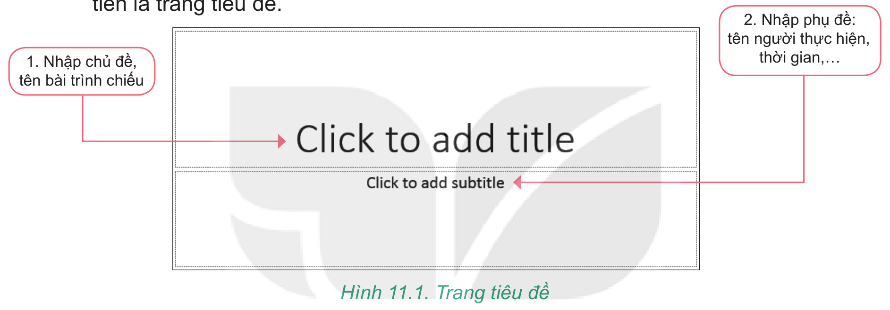
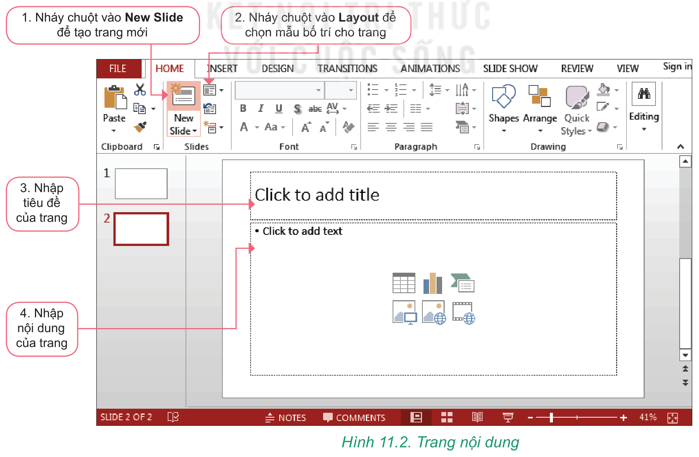
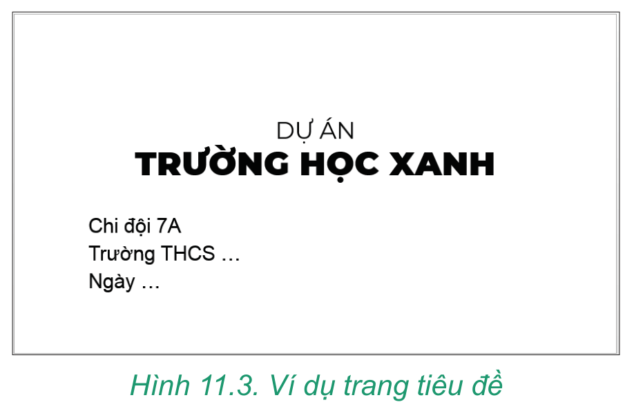
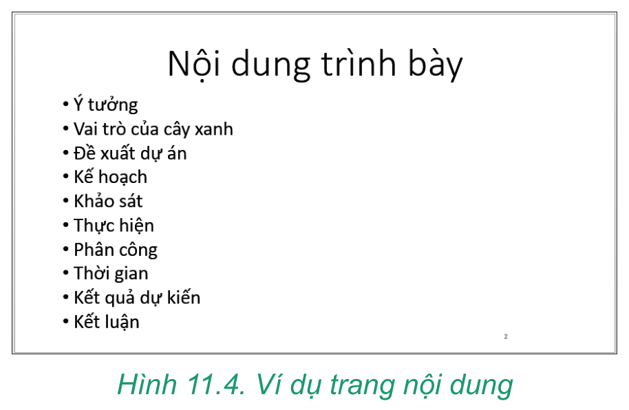
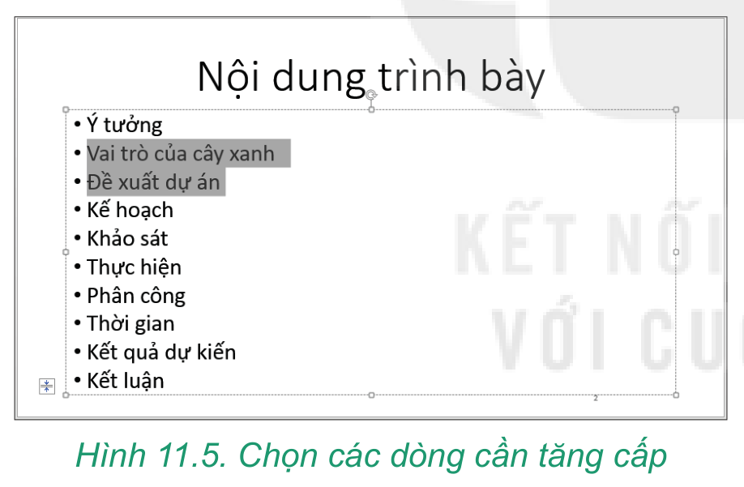
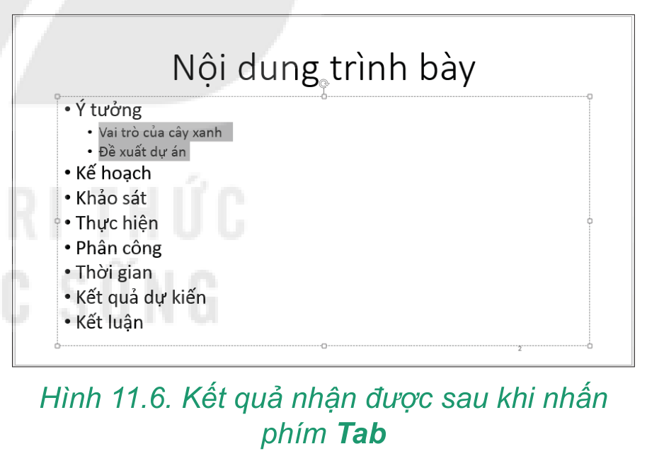
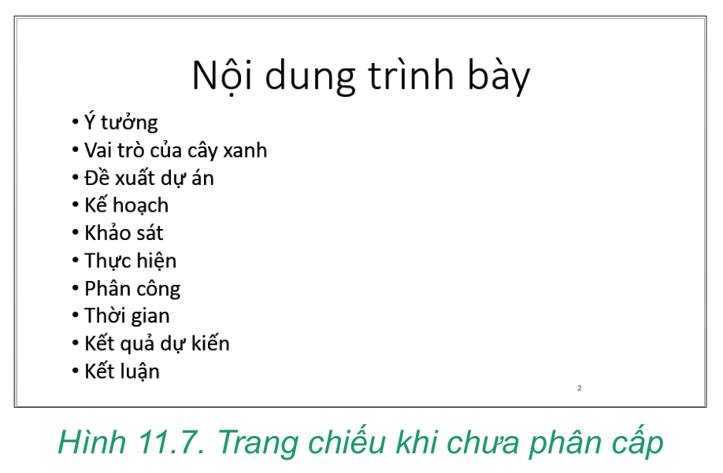
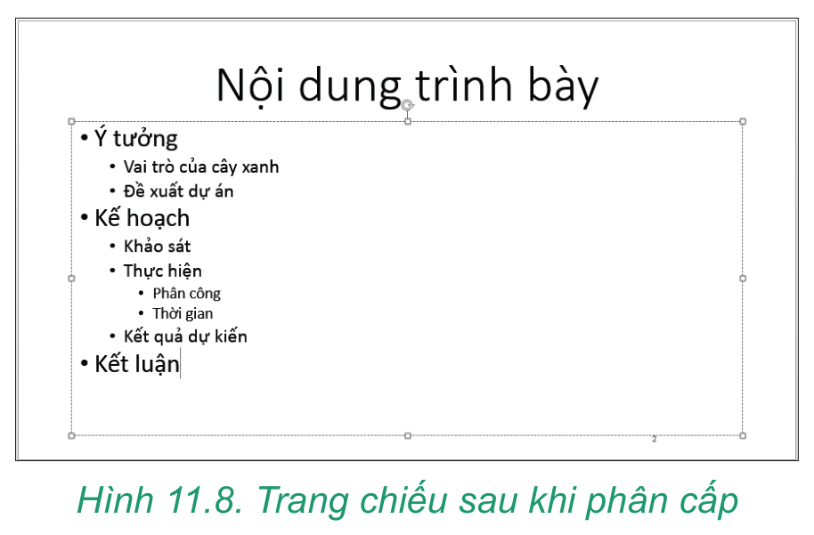
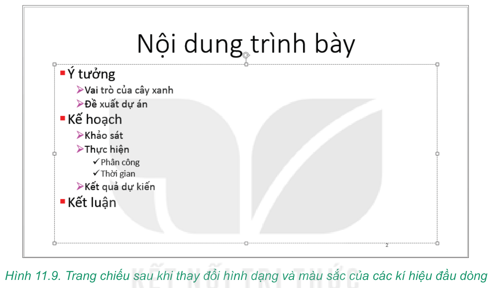

<!-- pdf:56 -->

# BÀI 11: TẠO BÀI TRÌNH CHIẾU

## 🎯 Sau bài học này em sẽ:

- Nêu được một số chức năng cơ bản của phần mềm trình chiếu.
- Tạo được một bài báo cáo có tiêu đề, cấu trúc phân cấp.

## 🔴 Khởi động

> Giờ ra chơi, các bạn An, Minh và Khoa trao đổi về dự án **Trường học xanh** mà các bạn đang thực hiện.
>
> **An:** Việc khảo sát, thu thập thông tin và tính toán cho dự án đã xong. Bây giờ nhóm mình cần làm một bài báo cáo kết quả.
>
> **Minh:** Nhóm mình nên sử dụng phần mềm trình chiếu để tạo bài báo cáo.
>
> **Khoa:** Bài trình chiếu báo cáo cần có trang tiêu đề, mỗi trang nội dung nên có tiêu đề trang để giúp người nghe nhanh chóng hiểu được chủ đề và nội dung trình bày.
>
> **Minh:** Sử dụng cấu trúc phân cấp sẽ làm cho bố cục của bài báo cáo được mạch lạc, rõ ràng.
>
> **An:** Hay quá! Chúng ta phân công nhau làm từng phần việc nhé.

## 1. MỘT SỐ CHỨC NĂNG CƠ BẢN CỦA PHẦN MỀM TRÌNH CHIẾU

> **Hoạt động 1: Một số chức năng cơ bản của phần mềm trình chiếu**
>
> 1. Em đã biết gì về phần mềm trình chiếu?
> 2. Khi tạo một bài trình bày với nội dung gồm văn bản, hình ảnh và nhiều đối tượng khác, em chọn sử dụng phần mềm soạn thảo văn bản hay phần mềm trình chiếu? Vì sao?

Ở Lớp 3 và Lớp 4 các em đã biết **Phần mềm trình chiếu** là phần mềm được thiết kế để cho phép người sử dụng trình bày thông tin như văn bản, hình ảnh, âm thanh và video dưới hình thức trình chiếu một cách hấp dẫn và hiệu quả.

Phần mềm trình chiếu có các chức năng hỗ trợ người sử dụng tạo các bài trình chiếu. Phần mềm trình chiếu thường có một số chức năng cơ bản sau:

- Tạo bài trình chiếu lưu trên máy tính dưới dạng tệp tin. Chức năng này bao gồm soạn thảo, chỉnh sửa, định dạng văn bản. Mỗi bài trình chiếu gồm một hay nhiều **trang chiếu** (slide) được đánh số thứ tự. Thông tin trên mỗi trang có thể là văn bản, âm thanh, hình ảnh, biểu đồ hay video.
- Trình chiếu nội dung các trang chiếu lên màn hình hoặc màn chiếu rộng bằng máy chiếu (projector).

Phần mềm trình chiếu có các hiệu ứng động, hiệu ứng chuyển trang làm cho nội dung trình bày thêm sinh động và hấp dẫn.

Phần mềm trình chiếu thường được sử dụng để tạo bài trình chiếu phục vụ hội thảo, hội nghị, dạy học, quảng cáo, tạo các phần mềm giải trí như album với các hiệu ứng hoạt hình (ảnh, ca nhạc,...).

<!-- pdf:57 -->

> - Phần mềm trình chiếu có hai chức năng cơ bản là tạo bài trình chiếu và trình chiếu nó.
> - Phần mềm trình chiếu có các hiệu ứng làm cho nội dung trình bày thêm sinh động và hấp dẫn.
> - Phần mềm trình chiếu thường được sử dụng để tạo bài trình chiếu phục vụ hội thảo, hội nghị, dạy học, quảng cáo,...

> ❓ **Câu hỏi**
>
> Trong các phát biểu sau, phát biểu nào đúng, phát biểu nào sai?
>
> a) Phần mềm trình chiếu thường được sử dụng để tạo bài trình chiếu phục vụ hội nghị, dạy học, quảng cáo,...
>
> b) Phần mềm trình chiếu có chức năng tạo bài trình chiếu và lưu dưới dạng tệp.
>
> c) Có thể nhập và xử lí văn bản, hình ảnh trên các trang chiếu.
>
> d) Chức năng chính của phần mềm trình chiếu là tính toán tự động.

## 2. TIÊU ĐỀ CỦA BÀI TRÌNH CHIẾU

> **Hoạt động 2: Tạo tiêu đề của bài trình chiếu**
>
> 1. Khi tạo bài trình chiếu, em thường trình bày các trang như thế nào?
> 2. Theo em, tiêu đề của bài trình chiếu nên đặt ở trang nào? Muốn làm nổi bật nội dung của mỗi trang thì cần làm như thế nào?

Một bài trình chiếu thường có nhiều trang được đánh số thứ tự. Trang đầu tiên là trang tiêu đề, còn lại là các trang nội dung. Nội dung trên các trang thường được bố trí thống nhất theo cùng một mẫu.

**Trang tiêu đề** (Title Slide) cho biết chủ đề của bài trình chiếu. Trang tiêu đề còn có thêm thông tin như tên tác giả, ngày trình bày, địa điểm trình bày,... Trang này được ví như cổng vào bài trình chiếu, nó thu hút sự chú ý của người nghe ngay từ đầu.

**Trang nội dung** thường có tiêu đề trang và nội dung (Title and Content). **Tiêu đề trang** được viết dưới dạng văn bản ở trên đầu mỗi trang. Tiêu đề trang là thành phần làm nổi bật nội dung cần trình bày.

**Mẫu bố trí nội dung trang trình chiếu** (layout): Các phần mềm trình chiếu có sẵn các mẫu bố trí nội dung. Người sử dụng có thể sử dụng các mẫu này hoặc thay đổi bố trí nội dung của trang sao cho phù hợp. Em cũng có thể tự tạo mẫu bố trí cho trang chiếu.

> - Bài trình chiếu thường có trang đầu tiên là trang tiêu đề cho biết chủ đề của bài trình bày, tiếp theo là các trang nội dung.
> - Tiêu đề trang làm nổi bật nội dung cần trình bày trong trang và được đặt trên đầu các trang nội dung.
> - Các phần mềm trình chiếu có sẵn các mẫu bố trí nội dung trang chiếu để thuận tiện cho người sử dụng.

<!-- pdf:58 -->

> ❓ **Câu hỏi**
>
> Phát biểu nào sau đây không đúng?
>
> A. Trang tiêu đề là trang đầu tiên và cho biết chủ đề của bài trình chiếu.
>
> B. Các trang nội dung của bài trình chiếu thường có tiêu đề trang.
>
> C. Tiêu đề trang giúp làm nổi bật nội dung cần trình bày của trang.
>
> D. Các phần mềm trình chiếu không có sẵn các mẫu bố trí.

## 3. CẤU TRÚC PHÂN CẤP

> **Hoạt động 3: Cấu trúc phân cấp**
>
> Em hãy quan sát hai cách trình bày dự án **Trường học xanh** sau đây và cho biết cách trình bày nào dễ hiểu hơn?
>
> **Cách 1**
>
> Dự án Trường học xanh
> - Ý tưởng
> - Vai trò của cây xanh
> - Đề xuất dự án
> - Kế hoạch
> - Khảo sát thực tế
> - Thực hiện
> - Phân công trồng và chăm sóc cây
> - Thời gian
> - Kết quả dự kiến
> - Kết luận
>
> **Cách 2**
>
> Dự án Trường học xanh
> 1. Ý tưởng
>    - Vai trò của cây xanh
>    - Đề xuất dự án
> 2. Kế hoạch
>    2.1. Khảo sát thực tế
>    2.2. Thực hiện
>       - Phân công trồng và chăm sóc cây
>       - Thời gian
>    2.3. Kết quả dự kiến
> 3. Kết luận

Trong Hoạt động 3, Cách 2 là hình thức trình bày theo cấu trúc phân cấp. Đây là một cấu trúc gồm danh sách nhiều cấp rất phổ biến trong soạn thảo văn bản, tạo các bài trình chiếu,...

Cấu trúc phân cấp giúp truyền tải thông tin một cách mạch lạc, dễ hiểu và dễ quản lí. Người xem dễ dàng hiểu được bố cục của nội dung cần trình bày.

> **Cấu trúc phân cấp** (hay danh sách kí hiệu đầu dòng nhiều cấp) thường được dùng trong soạn thảo văn bản, tạo bài trình chiếu,... Đây là một công cụ giúp làm cho nội dung trình bày có bố cục mạch lạc, dễ hiểu, giúp truyền tải thông tin và quản lí nội dung tốt hơn.

> ❓ **Câu hỏi**
>
> Câu nào sau đây **sai** khi nói về cấu trúc phân cấp?
>
> A. Là cấu trúc gồm danh sách nhiều cấp.
>
> B. Giúp làm cho nội dung cần trình bày có bố cục mạch lạc, dễ hiểu.
>
> C. Cấu trúc này gồm một chuỗi các dấu đầu dòng ngang cấp nhau.
>
> D. Cấu trúc này được sử dụng nhiều trong soạn thảo văn bản, tạo bài trình chiếu.

<!-- pdf:59 -->

## 4. THỰC HÀNH: TẠO BÀI TRÌNH CHIẾU CÓ TIÊU ĐỀ, CẤU TRÚC PHÂN CẤP

**Nhiệm vụ**

Tạo bài trình chiếu báo cáo kết quả thực hiện dự án **Trường học xanh** của nhóm.

– Bài trình chiếu có trang tiêu đề, các trang nội dung có tiêu đề trang.

– Bài trình chiếu sử dụng cấu trúc phân cấp.

– Lưu tệp trình chiếu với tên `Truonghocxanh.pptx`.

**Hướng dẫn**

*(Hướng dẫn sau đây sử dụng phần mềm trình chiếu Microsoft PowerPoint phiên bản 2016 để minh hoạ.)*

### a) Tạo bài trình chiếu

Bước 1. Khởi động PowerPoint. Phần mềm tự động tạo một bài trình chiếu mới. Trang đầu tiên là trang tiêu đề.

*Hình 11.1. Trang tiêu đề*

Bước 2. Tạo các trang nội dung theo các bước như trong Hình 11.2.

*Hình 11.2. Trang nội dung*

<!-- pdf:60 -->

Các trang chiếu sau khi nhập nội dung có thể như Hình 11.3, Hình 11.4.

*Hình 11.3. Ví dụ trang tiêu đề*

*Hình 11.4. Ví dụ trang nội dung*

### b) Tạo cấu trúc phân cấp

– Tạo cấu trúc

Bước 1. Đặt con trỏ soạn thảo ở đầu dòng cần tạo cấu trúc phân cấp (nếu cần tạo cấu trúc phân cấp giống nhau cho nhiều dòng em chọn đồng thời các dòng đó).

Bước 2. Chọn lệnh **Increase List Level** (hoặc nhấn phím **Tab**) để tăng bậc phân cấp; Chọn lệnh **Decrease List Level** (hoặc nhấn tổ hợp phím **Shift +Tab**) để giảm bậc phân cấp.

Các dòng được tăng cấp sẽ tự động dịch chuyển sang phải một khoảng và giảm cỡ chữ. Các dòng được giảm cấp sẽ tự động dịch chuyển sang trái một khoảng và tăng cỡ chữ.

*Hình 11.5. Chọn các dòng cần tăng cấp*

*Hình 11.6. Kết quả nhận được sau khi nhấn phím Tab*

Thực hiện tương tự để tạo phân cấp cho các dòng khác trong trang chiếu. Hình 11.7, Hình 11.8 minh hoạ nội dung trang chiếu ban đầu và sau khi đã phân cấp.

*Hình 11.7. Trang chiếu khi chưa phân cấp*

*Hình 11.8. Trang chiếu sau khi phân cấp*

<!-- pdf:61 -->

– Thay đổi màu sắc, kí hiệu đầu dòng

Phần mềm trình chiếu có sẵn các kí hiệu đầu dòng (ví dụ kí hiệu dấu chấm tròn, màu đen đầu dòng ở Hình 11.7). Tuy nhiên, em có thể thay đổi màu, chọn kí hiệu đầu dòng tuỳ ý hoặc chuyển kí hiệu đầu dòng thành số thứ tự.

Bước 1. Đặt con trỏ soạn thảo ở đầu dòng cần thay đổi kí hiệu (nếu cần thay đổi cho nhiều dòng em chọn đồng thời các dòng đó).

Bước 2. Chọn **Home**, nháy chuột vào mũi tên bên phải lệnh **Bullets** hoặc **Numbering**, chọn **Bullets and Numbering...** để mở hộp thoại **Bullets and Numbering**. Trong hộp thoại, chọn **Bulleted** để thay đổi kí hiệu, chọn **Numbered** để đánh số thứ tự, chọn **Color** để đổi màu cho kí hiệu.

*Hình 11.9. Trang chiếu sau khi thay đổi hình dạng và màu sắc của các kí hiệu đầu dòng*

### c) Lưu bài trình chiếu

Lưu bài trình chiếu với tên `Truonghocxanh.pptx`.

## ✏️ Luyện tập

1. Ưu điểm của việc sử dụng cấu trúc phân cấp trong bài trình chiếu là gì?
2. Em hãy tạo trang chiếu ghi các công việc cần làm trong ngày và sử dụng cấu trúc phân cấp để trình bày nội dung.

## 🚀 Vận dụng

Em hãy đề xuất một dự án mà em nhận thấy nó thiết thực với điều kiện hiện tại. (Ví dụ: Làm sạch đẹp cảnh quan ngôi nhà của em; Trang trí thư viện của trường để thu hút các bạn học sinh đến đọc sách; Tái chế rác thải;...). Tạo bài trình chiếu để trình bày dự án đó (mục tiêu, cách làm, tác dụng, hiệu ứng,...) với những người có liên quan để thuyết phục mọi người cùng thực hiện. Trong bài có trang tiêu đề, các trang nội dung có tiêu đề trang và sử dụng cấu trúc phân cấp. Ghi lại bài trình chiếu với tên `Baitaptinhoc7.pptx`.

## 📷 Danh sách hình trong bài

| Mã hình | Trang PDF | Trang sách | Chú thích |
| --- | --- | --- | --- |
| H7-tin_hoc-b11-01 | 59 | 58 (sát chữ đoạn trên) | Hình 11.1. Trang tiêu đề |
| H7-tin_hoc-b11-02 | 59 | 58 | Hình 11.2. Trang nội dung |
| H7-tin_hoc-b11-03 | 60 | 59 | Hình 11.3. Ví dụ trang tiêu đề |
| H7-tin_hoc-b11-04 | 60 | 59 | Hình 11.4. Ví dụ trang nội dung |
| H7-tin_hoc-b11-05 | 60 | 59 | Hình 11.5. Chọn các dòng cần tăng cấp |
| H7-tin_hoc-b11-06 | 60 | 59 | Hình 11.6. Kết quả nhận được sau khi nhấn phím Tab |
| H7-tin_hoc-b11-07 | 60 | 59 | Hình 11.7. Trang chiếu khi chưa phân cấp |
| H7-tin_hoc-b11-08 | 60 | 59 | Hình 11.8. Trang chiếu sau khi phân cấp |
| H7-tin_hoc-b11-09 | 61 | 60 | Hình 11.9. Trang chiếu sau khi thay đổi hình dạng và màu sắc của các kí hiệu đầu dòng |
