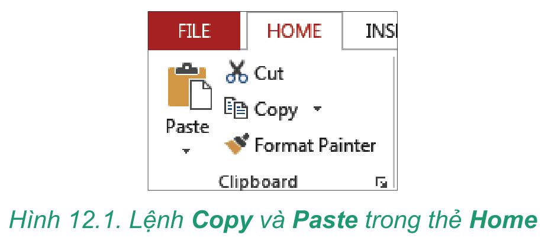
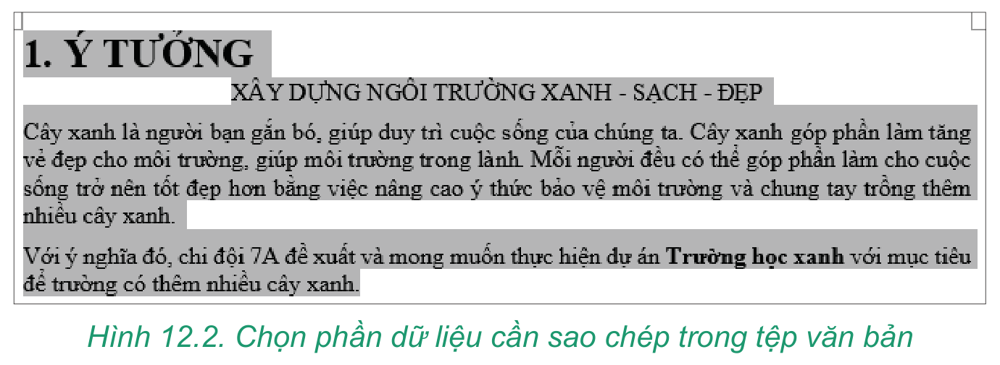
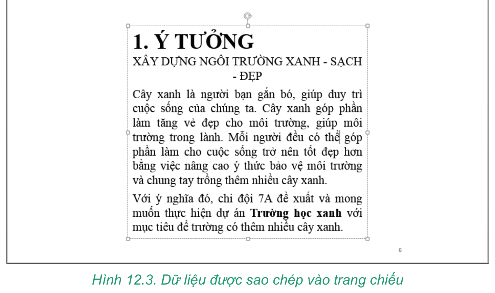
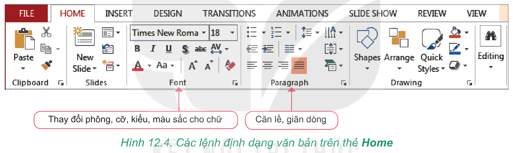
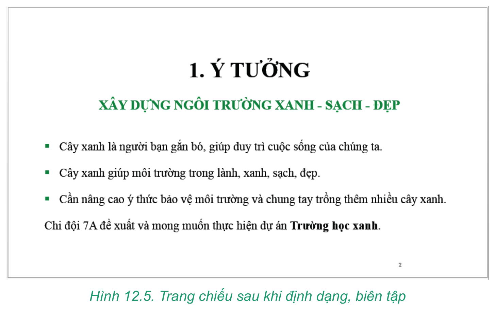
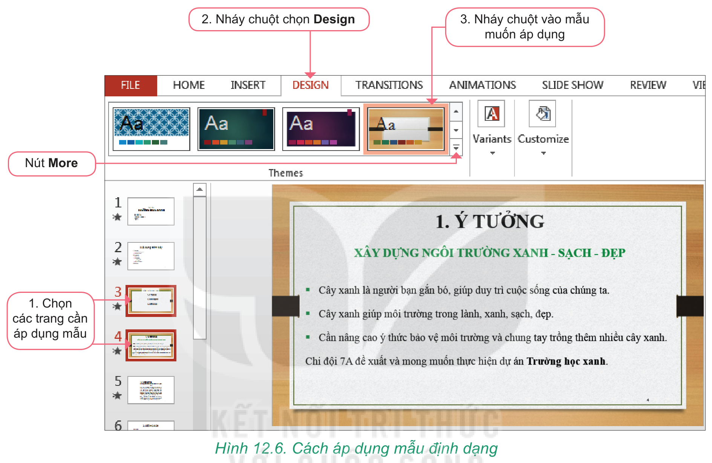
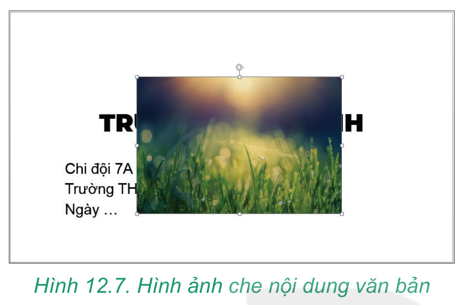
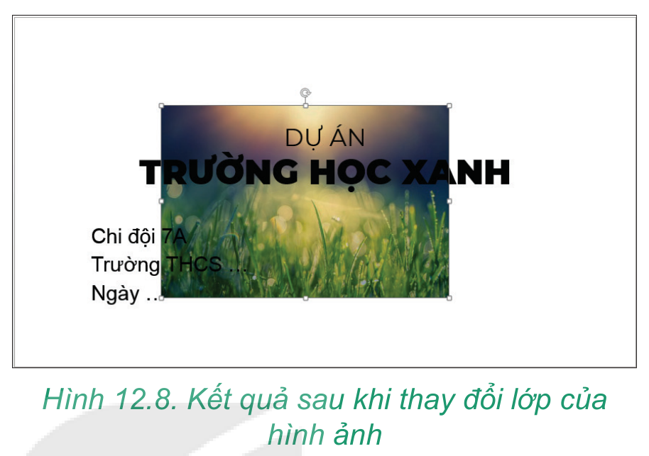
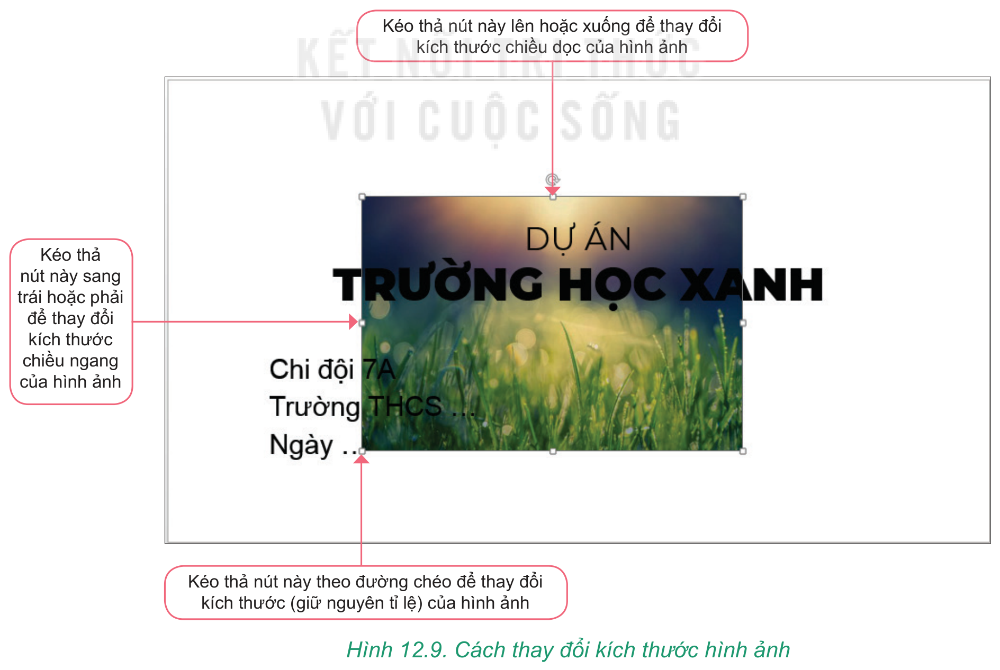

<!-- pdf:62 -->

# BÀI 12: ĐỊNH DẠNG ĐỐI TƯỢNG TRÊN TRANG CHIẾU

## 🎯 Sau bài học này em sẽ:

- Sao chép được dữ liệu từ tệp văn bản sang trang trình chiếu.
- Đưa được hình ảnh minh hoạ vào bài trình chiếu.
- Biết sử dụng các định dạng cho văn bản, ảnh minh hoạ một cách hợp lí.

## 🔴 Khởi động

> Hôm nay An, Minh và Khoa tiếp tục bàn về cách trình bày báo cáo dự án **Trường học xanh**.
>
> **An:** Chúng ta có thể sao chép dữ liệu về ý tưởng dự án đã có sẵn từ tệp `Truonghocxanh.docx`, sao chép các kết quả tính toán từ các trang tính trong tệp `THXanh.xlsx`. Còn hình thức thì nên trình bày sao cho thật ấn tượng.
>
> **Minh:** Minh hoạ bằng hình ảnh là một lựa chọn tốt. Hình ảnh có tính trực quan và rất thuyết phục.
>
> **Khoa:** Bài trình bày sẽ hiệu quả hơn nếu sử dụng định dạng văn bản và ảnh minh hoạ một cách hợp lí.

## 1. ẢNH MINH HOẠ

> **Hoạt động 1: Ảnh minh hoạ**
>
> 1. Theo em có nên sử dụng hình ảnh để minh hoạ cho bài trình chiếu không? Vì sao?
> 2. Em sẽ chọn hình ảnh gì để thêm vào bài trình chiếu báo cáo dự án?

Hình ảnh là dạng thông tin trực quan và dễ gây ấn tượng nhất. Sử dụng hình ảnh minh hoạ cho nội dung trình bày sẽ giúp cho bài trình chiếu hấp dẫn và sinh động, thu hút sự chú ý của người nghe.

Khi lựa chọn hình ảnh nên căn cứ vào hai yếu tố quan trọng sau: phù hợp với nội dung; có tính thẩm mĩ.

Sẽ ấn tượng hơn nếu các hình ảnh trong trang chiếu có kích thước và vị trí hợp lí, kết hợp với nội dung thành một tổng thể hài hoà.

<!-- term: Ảnh minh hoạ -->
> - Hình ảnh thường được dùng để minh hoạ cho nội dung bài trình chiếu, nhờ đó bài trình chiếu trở nên trực quan, ấn tượng và hấp dẫn hơn.
> - Nên lựa chọn hình ảnh phù hợp với nội dung bài trình chiếu và có tính thẩm mĩ.
> - Kích thước hình ảnh và vị trí đặt trên trang chiếu cần hợp lí.

<!-- pdf:63 -->

> ❓ **Câu hỏi**
>
> Phát biểu nào đúng, phát biểu nào sai?
>
> A. Hình ảnh minh hoạ làm cho bài trình chiếu ấn tượng hơn.
>
> B. Nên chọn hình ảnh phù hợp với chủ đề của bài trình chiếu.
>
> C. Màu sắc, hoạ tiết trên hình ảnh không cần trùng khớp với chủ đề.
>
> D. Hình ảnh minh hoạ cần có tính thẩm mĩ.

## 2. ĐỊNH DẠNG VĂN BẢN

> **Hoạt động 2: Định dạng văn bản**
>
> 1. Sau khi tạo văn bản cho một bài trình chiếu, em thường định dạng văn bản như thế nào? Cần làm gì để nhấn mạnh nội dung trên một trang?
> 2. Có nên viết nhiều chữ, dùng nhiều màu trên một trang không? Vì sao?

Các phần mềm trình chiếu đều có các công cụ định dạng văn bản giúp cho người sử dụng định dạng phông chữ, cỡ chữ, kiểu chữ, màu chữ, căn lề,... Cách sử dụng các công cụ định dạng văn bản của phần mềm trình chiếu tương tự như của phần mềm soạn thảo văn bản mà em đã học ở lớp 6.

Để tạo được bài trình bày hiệu quả và chuyên nghiệp em cần chú ý:

– Phông chữ: Nên chọn phông đơn giản, dễ đọc (ví dụ: Arial, Calibri, Tahoma,...); Không nên sử dụng quá nhiều phông chữ trên một trang.

– Cỡ chữ: Tiêu đề nên dùng cỡ từ 40 đến 50, văn bản nên dùng cỡ từ 18 trở lên, tuỳ phông chữ.

– Kiểu chữ: Tiêu đề nên chọn kiểu chữ đậm, nội dung chọn kiểu chữ thường.

– Màu chữ: Màu chữ cần tương phản với màu nền của trang, không sử dụng quá nhiều màu chữ.

– Số lượng chữ trên trang: Không dùng quá nhiều chữ trên một trang. Mỗi trang chỉ nên có khoảng 5 đến 7 dòng.

– Nội dung trong mỗi trang chiếu chỉ nên tập trung vào một ý chính. Văn bản cần cô đọng, chọn lọc từ ngữ. Thông điệp chính hay những điều quan trọng nên được làm nổi bật và nhấn mạnh bằng cách dùng kiểu chữ đậm, màu,...

> Màu nền và định dạng văn bản cần thống nhất. Không nên dùng nhiều màu, nhiều phông chữ trên một trang.

<!-- term: Định dạng văn bản trên trang chiếu -->
> - Định dạng văn bản trong phần mềm trình chiếu tương tự như trong phần mềm soạn thảo.
> - Nên chọn phông chữ, cỡ chữ, kiểu chữ, màu chữ, nền,... thống nhất và phù hợp, để làm nổi bật thông điệp chính của trang.
> - Nội dung trình bày nên cô đọng. Mỗi trang chiếu chỉ nên tập trung vào một ý chính.

<!-- pdf:64 -->

> ❓ **Câu hỏi**
>
> Em hãy ghép mỗi nội dung ở cột A với một nội dung phù hợp ở cột B.
>
> | A | B |
> | --- | --- |
> | 1) Định dạng văn bản trong trang chiếu | a) nội dung chính của trang chiếu. |
> | 2) Định dạng làm nổi bật | b) cô đọng. |
> | 3) Nội dung trên mỗi trang chiếu | c) cho văn bản trên một trang chiếu. |
> | 4) Không nên dùng quá nhiều phông chữ | d) tương tự như định dạng trong soạn thảo văn bản. |

## 3. THỰC HÀNH: SAO CHÉP DỮ LIỆU, CHÈN HÌNH ẢNH, ĐỊNH DẠNG CHO VĂN BẢN VÀ HÌNH ẢNH TRONG TRANG CHIẾU

**Nhiệm vụ**

Tiếp tục hoàn thiện bài trình chiếu báo cáo dự án **Trường học xanh**.

– Sao chép dữ liệu từ tệp văn bản `Truonghocxanh.docx` sang tệp trình chiếu `Truonghocxanh.pptx`.

– Định dạng cho văn bản trên trang chiếu.

– Chèn hình ảnh minh hoạ vào trang chiếu.

– Định dạng cho hình ảnh trên trang chiếu.

**Hướng dẫn**

### a) Sao chép dữ liệu từ tệp văn bản sang tệp trình chiếu

Em có thể sử dụng nội dung mô tả dự án đã lưu trong tệp văn bản `Truonghocxanh.docx` để dùng cho bài trình chiếu. Như vậy thông tin về dự án sẽ thống nhất, chính xác và tiết kiệm được thời gian soạn thảo.

Bước 1. Mở tệp văn bản `Truonghocxanh.docx`.

Bước 2. Chọn phần dữ liệu cần sao chép (Hình 12.2) rồi thực hiện lệnh **Copy** (chọn **Home/Copy** hoặc nhấn tổ hợp phím **Ctrl + C**).

Bước 3. Mở tệp trình chiếu `Truonghocxanh.pptx`.

Bước 4. Đặt con trỏ tại vị trí cần sao chép đến rồi thực hiện lệnh **Paste** (chọn **Home/Paste** hoặc nhấn tổ hợp phím **Ctrl + V**) em được kết quả như Hình 12.3.

*Hình 12.1. Lệnh Copy và Paste trong thẻ Home*

*Hình 12.2. Chọn phần dữ liệu cần sao chép trong tệp văn bản*

<!-- pdf:65 -->

*Hình 12.3. Dữ liệu được sao chép vào trang chiếu*

### b) Sử dụng các công cụ định dạng văn bản

Các công cụ định dạng văn bản của phần mềm trình chiếu nằm trong thẻ **Home** (Hình 12.4).

*Hình 12.4. Các lệnh định dạng văn bản trên thẻ Home*

Em hãy sử dụng các công cụ định dạng văn bản, thêm kí hiệu đầu dòng,... để định dạng, đồng thời biên tập lại nội dung văn bản trong trang chiếu, chọn lọc từ ngữ, làm nổi bật ý chính,... để nội dung ngắn gọn, cô đọng. Ví dụ một phương án biên tập và định dạng lại trang chiếu trình bày ý tưởng dự án như Hình 12.5.

*Hình 12.5. Trang chiếu sau khi định dạng, biên tập*

<!-- pdf:66 -->

### c) Áp dụng các mẫu định dạng

Ngoài các công cụ định dạng văn bản, với mục đích giúp người sử dụng dễ dàng tạo các bài trình chiếu hấp dẫn, chuyên nghiệp, phần mềm trình chiếu còn cung cấp nhiều **mẫu định dạng** (theme) đã được thiết kế sẵn. Các mẫu định dạng được hiển thị trực quan trong nhóm **Themes** của thẻ **Design**. Khi em di chuyển con trỏ chuột trên một mẫu, tên của mẫu đó xuất hiện và kết quả áp dụng mẫu đó vào trang chiếu được thể hiện ngay trên màn hình. Vì vậy việc tạo bài trình chiếu rất dễ dàng, thuận tiện và tiết kiệm thời gian.

Để sử dụng mẫu định dạng cho các trang chiếu em thực hiện theo các bước trong Hình 12.6.

*Hình 12.6. Cách áp dụng mẫu định dạng*

**Lưu ý:**

+ Nhấn giữ phím **Ctrl** để chọn đồng thời nhiều trang.

+ Nếu không chọn trang thì mẫu sẽ được áp dụng cho tất cả các trang trong bài.

+ Nháy chuột vào nút **More** trong nhóm **Themes** để xem thêm mẫu định dạng.

+ Nháy chuột vào nút **More** trong nhóm **Variants** để thay đổi màu sắc, phông chữ, hiệu ứng, nền cho mẫu đã chọn.

+ Nháy chuột vào nút **Undo** (hoặc nhấn tổ hợp phím **Ctrl+Z**) để khôi phục lại mẫu trước đó.

### d) Chèn hình ảnh vào trang chiếu

Thao tác chèn hình ảnh vào trang chiếu tương tự như chèn hình ảnh vào tệp văn bản mà em đã biết.

Bước 1. Chọn trang, vị trí trong trang cần chèn hình ảnh.

Bước 2. Chọn **Insert/Pictures** để mở hộp thoại **Insert Picture**.
<!-- ocr-ok: đã đối chiếu ảnh trang 66, dấu gạch chéo trong Insert/Pictures bị OCR đọc nhầm thành chữ i -->

Bước 3. Chọn tệp ảnh, nháy chuột chọn nút **Insert**.

Hình ảnh đã chọn được chèn vào trang chiếu.

> Nên chọn lọc hình ảnh đưa vào bài và lưu ý đến bản quyền của hình ảnh.
<!-- ocr-ok: đã đối chiếu ảnh trang 66, ghi chú giấy nhớ xoay nghiêng bị OCR đọc lỗi -->

**Lưu ý:** Em có thể chèn hình ảnh vào trang chiếu bằng cách sử dụng lệnh **Copy** và **Paste**.

<!-- pdf:67 -->

### e) Sử dụng các công cụ định dạng cho hình ảnh

<!-- term: Định dạng cho hình ảnh trên trang chiếu -->
Sau khi chèn hình ảnh vào trang chiếu, em có thể sử dụng các công cụ để: thay đổi vị trí và kích thước, thêm đường viền tạo khung, thay đổi lớp, cắt hình, quay hình,...

Giả sử em chèn hình ảnh vào trang chiếu tiêu đề để minh hoạ.

Sau khi chèn, hình ảnh xuất hiện trong trang chiếu như Hình 12.7. Em cần thay đổi lớp để hình ảnh nằm bên dưới văn bản (không che mất văn bản) và thay đổi vị trí, kích thước hình ảnh cho phù hợp với mục đích minh hoạ.

*Hình 12.7. Hình ảnh che nội dung văn bản*

*Hình 12.8. Kết quả sau khi thay đổi lớp của hình ảnh*

– Cách thay đổi lớp cho hình ảnh:

Bước 1. Chọn hình ảnh.

Bước 2. Chọn **Format/Arrange/Send Backward** (nếu muốn đưa hình ảnh lên lại lớp trên thì chọn **Bring Forward**).

– Cách thay đổi vị trí cho hình ảnh: Dùng chuột chọn hình ảnh, kéo thả đến vị trí mới.

– Cách thay đổi kích thước hình ảnh: Em thực hiện theo các bước như mô tả trong Hình 12.9.

*Hình 12.9. Cách thay đổi kích thước hình ảnh*

<!-- pdf:68 -->

– Thêm đường viền cho hình ảnh:

Bước 1. Chọn hình ảnh.

Bước 2. Chọn **Format/Picture Styles/Picture Border** rồi chọn màu đường viền, kiểu đường viền.

– Em có thể đặt nền màu xanh cho trang chiếu, đổi màu cho văn bản để được kết quả tương tự như Hình 12.10.

*Hình 12.10. Trang chiếu kết quả*

## ✏️ Luyện tập

1. Em hãy bổ sung thêm một hình ảnh vào trang trình bày ý tưởng (Hình 12.5) rồi định dạng hình ảnh đó sao cho hợp lí.
2. Em hãy bổ sung kết quả tính toán của dự án **Trường học xanh** đã làm trong phần mềm bảng tính vào bài trình chiếu (có thể ở trang Kết quả dự kiến).
3. Em hãy định dạng văn bản, biên tập nội dung cho các trang chiếu của tệp trình chiếu `Truonghocxanh.pptx`. Chọn mẫu định dạng phù hợp cho các trang chiếu.

## 🚀 Vận dụng

Em hãy mở tệp `Baitaptinhoc7.pptx` mà em đã tạo ở Bài 11, bổ sung thông tin vào các trang chiếu của bài trình chiếu (bằng cách sao chép dữ liệu từ tệp văn bản hoặc nhập mới từ bàn phím). Sau khi đã có nội dung em cần tạo cấu trúc phân cấp, chèn hình ảnh, chọn mẫu định dạng cho trang chiếu và định dạng cho văn bản, hình ảnh.

## 📷 Danh sách hình trong bài

| Mã hình | Trang PDF | Trang sách | Chú thích |
| --- | --- | --- | --- |
| H7-tin_hoc-b12-01 | 64 | 63 | Hình 12.1. Lệnh Copy và Paste trong thẻ Home |
| H7-tin_hoc-b12-02 | 64 | 63 | Hình 12.2. Chọn phần dữ liệu cần sao chép trong tệp văn bản |
| H7-tin_hoc-b12-03 | 65 | 64 | Hình 12.3. Dữ liệu được sao chép vào trang chiếu |
| H7-tin_hoc-b12-04 | 65 | 64 | Hình 12.4. Các lệnh định dạng văn bản trên thẻ Home |
| H7-tin_hoc-b12-05 | 65 | 64 | Hình 12.5. Trang chiếu sau khi định dạng, biên tập |
| H7-tin_hoc-b12-06 | 66 | 65 | Hình 12.6. Cách áp dụng mẫu định dạng |
| H7-tin_hoc-b12-07 | 67 | 66 | Hình 12.7. Hình ảnh che nội dung văn bản |
| H7-tin_hoc-b12-08 | 67 | 66 | Hình 12.8. Kết quả sau khi thay đổi lớp của hình ảnh |
| H7-tin_hoc-b12-09 | 67 | 66 | Hình 12.9. Cách thay đổi kích thước hình ảnh |
| H7-tin_hoc-b12-10 | 68 | 67 | Hình 12.10. Trang chiếu kết quả |
