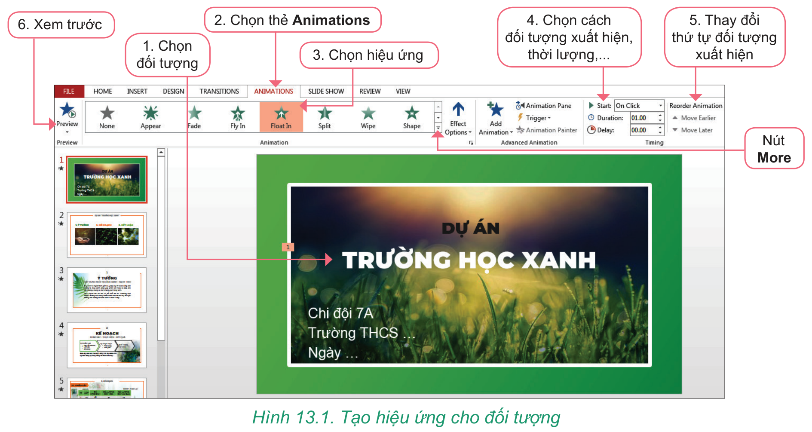
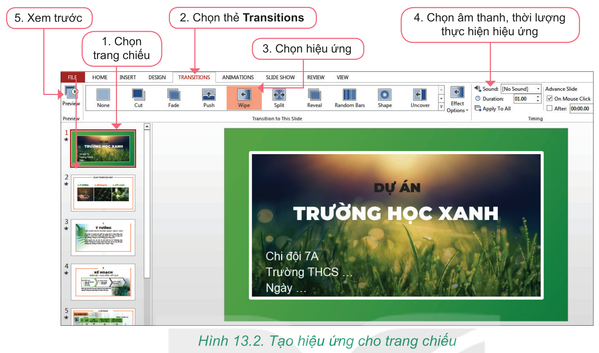

<!-- pdf:69 -->

# BÀI 13: THỰC HÀNH TỔNG HỢP: HOÀN THIỆN BÀI TRÌNH CHIẾU

## 🎯 Sau bài học này em sẽ:

- Biết đưa hiệu ứng động vào bài trình chiếu và sử dụng hiệu ứng một cách hợp lí.
- Biết cách tổng hợp, sắp xếp các nội dung đã có thành một bài trình chiếu hoàn chỉnh.

## 🔴 Khởi động

> Bài trình chiếu báo cáo dự án **Trường học xanh** đã có đầy đủ thông tin, mang được thông điệp cần truyền tải. Các đối tượng trong các trang chiếu cũng đã được định dạng. Việc tiếp theo của em là bổ sung các hiệu ứng động khi trình bày để có một bài thuyết trình hoàn chỉnh.

## 1. HIỆU ỨNG ĐỘNG

> **Hoạt động 1: Hiệu ứng động**
>
> 1. Em hãy quan sát hai trang chiếu có cùng nội dung. Một trang không có hiệu ứng động, một trang có thêm hiệu ứng động cho các đối tượng.
> 2. Em thích xem trang nào hơn? Vì sao? Em có muốn sử dụng các hiệu ứng động trong bài trình chiếu của mình không?
> 3. Sử dụng hiệu ứng động cần lưu ý những điều gì? Tại sao?

Hiệu ứng động trong bài trình chiếu là cách thức và thời điểm xuất hiện của các trang chiếu và các đối tượng trên trang chiếu (văn bản, hình ảnh, biểu đồ, âm thanh,...) khi trình chiếu.

Có hai loại hiệu ứng động:

- Hiệu ứng cho các đối tượng trên trang chiếu, gọi là **hiệu ứng cho đối tượng**.
- Hiệu ứng cho các trang chiếu, gọi là **hiệu ứng chuyển trang chiếu**.

Các phần mềm trình chiếu thường cung cấp nhiều hiệu ứng động cho đối tượng cùng những lựa chọn để điều khiển việc hiển thị đối tượng trên trang chiếu ở các mức độ khác nhau.

Việc sử dụng hiệu ứng động giúp cho bài trình chiếu trở nên sinh động và hấp dẫn hơn, thu hút sự chú ý của người xem và tạo hiệu quả tốt trong việc truyền đạt thông tin. Tuy nhiên việc sử dụng quá nhiều hoặc không phù hợp có thể gây hiệu ứng ngược, làm cho người nghe mất tập trung vào nội dung chính. Bởi vậy, cần cân nhắc sử dụng hiệu ứng cho hợp lí để tăng hiệu quả, hỗ trợ cho việc trình bày nội dung.

<!-- pdf:70 -->

> - **Hiệu ứng động** là cách thức và thời điểm xuất hiện của các trang chiếu và các đối tượng trên trang khi trình chiếu.
> - Sử dụng hiệu ứng động giúp cho bài trình chiếu trở nên sinh động và hấp dẫn hơn, thu hút sự chú ý của người xem và tạo hiệu quả tốt trong việc truyền đạt thông tin.
> - Hiệu ứng động nên được sử dụng một cách có chọn lọc để giúp tăng tính hiệu quả cho nội dung và tạo ấn tượng với người xem.

> ❓ **Câu hỏi**
>
> Em hãy ghép mỗi nội dung ở cột A với một nội dung phù hợp ở cột B.
>
> | A | B |
> | --- | --- |
> | 1) Sử dụng hiệu ứng động trong bài trình chiếu | a) gọi là hiệu ứng chuyển trang chiếu. |
> | 2) Hiệu ứng động trong bài trình chiếu | b) giúp cho việc trình chiếu trở nên sinh động và hấp dẫn hơn. |
> | 3) Hiệu ứng cho các trang chiếu | c) khi được thêm các hiệu ứng động. |
> | 4) Nội dung trên trang chiếu sẽ thu hút sự chú ý của người xem và tạo hiệu quả tốt hơn trong việc truyền đạt thông tin | d) là cách thức và thời điểm xuất hiện của các trang chiếu và các đối tượng trên trang chiếu. |

## 2. THỰC HÀNH TỔNG HỢP: HOÀN THIỆN BÀI TRÌNH CHIẾU

**Nhiệm vụ**

– Em hãy tạo hiệu ứng cho bài trình chiếu báo cáo dự án **Trường học xanh**.

– Tổng hợp, sắp xếp, bổ sung các nội dung để hoàn thiện bài trình chiếu.

**Hướng dẫn**

### a) Tạo hiệu ứng cho đối tượng

Thực hiện các bước như trong Hình 13.1.

*Hình 13.1. Tạo hiệu ứng cho đối tượng*

<!-- pdf:71 -->

### b) Tạo hiệu ứng chuyển trang chiếu

*Hình 13.2. Tạo hiệu ứng cho trang chiếu*

### c) Sử dụng hiệu ứng hợp lí

Chắc chắn em sẽ không muốn người xem cảm thấy khó chịu khi theo dõi bài thuyết trình báo cáo dự án của mình đúng không nào. Hãy làm theo những lưu ý dưới đây khi sử dụng các hiệu ứng.

– Trình bày càng đơn giản, rõ ràng thì càng thuyết phục.

– Dùng hiệu ứng chuyển trang thống nhất cho tất cả các trang.

– Chọn lọc hiệu ứng cho các đối tượng. Tự trả lời câu hỏi “Hiệu ứng này có thể khiến bài thuyết trình hiệu quả hơn không?”.

– Chỉ dùng âm thanh khi thật cần thiết.

### d) Hoàn thiện bài trình chiếu

– Xem lại bố cục, nội dung của bài báo cáo.

– Bố trí lại các đối tượng trên trang: khung văn bản, hình ảnh, bảng biểu,... Định dạng lại một số hình ảnh, căn lề văn bản (nếu cần).

– Em có thể sáng tạo thêm, phát huy khả năng hội hoạ của mình trong cách trình bày bài báo cáo.

– Lưu lại kết quả làm việc.

## ✏️ Luyện tập

Em hãy tạo hiệu ứng cho các trang và đối tượng để hoàn thiện bài trình chiếu báo cáo dự án của nhóm em.

## 🚀 Vận dụng

Em hãy bổ sung hiệu ứng động cho bài trình chiếu ghi trong tệp `Baitaptinhoc7.pptx`. Xem lại nội dung, định dạng, hiệu ứng của từng trang để hoàn thiện bài trình chiếu.

## 📷 Danh sách hình trong bài

| Mã hình | Trang PDF | Trang sách | Chú thích |
| --- | --- | --- | --- |
| H7-tin_hoc-b13-01 | 70 | 69 | Hình 13.1. Tạo hiệu ứng cho đối tượng |
| H7-tin_hoc-b13-02 | 71 | 70 | Hình 13.2. Tạo hiệu ứng cho trang chiếu |
