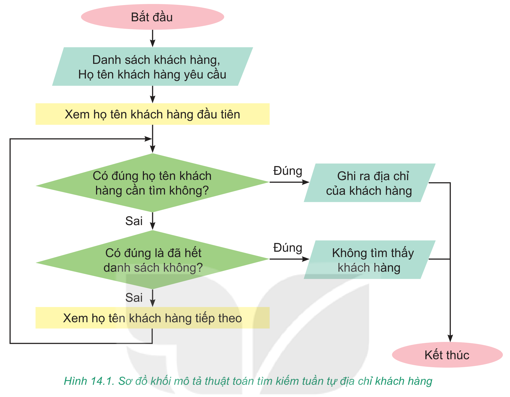

<!-- pdf:72 -->

# BÀI 14: THUẬT TOÁN TÌM KIẾM TUẦN TỰ

## 🎯 Sau bài học này em sẽ:

- Giải thích được thuật toán tìm kiếm tuần tự.
- Biểu diễn và mô phỏng được hoạt động của thuật toán tìm kiếm tuần tự trên một bộ dữ liệu vào có kích thước nhỏ.

## 🔴 Khởi động

> Gia đình bạn An bán giống cây trồng cho bà con nông dân trong vùng. Hôm nay có một khách hàng gọi điện đến mua cây giống và nhờ mẹ An chở cây giống đến nhà. Thông tin khách hàng được mẹ An ghi trong cuốn sổ lưu danh sách khách hàng gồm họ tên, địa chỉ, số điện thoại. Em hãy cùng An giúp mẹ tìm địa chỉ từ danh sách khách hàng để chuyển cây giống nhé.

## 1. THUẬT TOÁN TÌM KIẾM TUẦN TỰ

Trong cuộc sống, chúng ta thường xuyên phải tìm kiếm dữ liệu để biết về đối tượng trong hàng chục, hàng trăm, hàng nghìn, thậm chí hàng triệu nội dung liên quan đến nó. Thuật toán tìm kiếm giúp chúng ta tìm được dữ liệu cần thiết để có được thông tin ta cần một cách hiệu quả.

Trong tình huống khởi động, công việc mà An cần làm có thể nêu thành bài toán tìm kiếm như sau:
- Đầu vào: danh sách khách hàng; họ tên khách hàng cần tìm.
- Đầu ra: địa chỉ của khách hàng cần tìm.
<!-- term: Bài toán tìm kiếm -->

An thực hiện tìm kiếm lần lượt từ đầu đến cuối danh sách khách hàng. Cách tìm kiếm này gọi là **tìm kiếm tuần tự**. Với mỗi họ tên khách hàng trong danh sách, An kiểm tra xem có đúng họ tên khách hàng mà mẹ yêu cầu không, nếu đúng thì ghi ra địa chỉ và kết thúc công việc, còn không thì chuyển đến họ tên khách hàng tiếp theo. Nếu tìm hết danh sách mà vẫn không thấy thì thông báo là không tìm thấy và kết thúc. Như vậy, chừng nào chưa tìm thấy và chưa tìm hết thì còn tìm tiếp. Đây chính là cấu trúc lặp. Hai điều kiện cần kiểm tra để dừng vòng lặp là:
- Điều kiện thứ nhất: kiểm tra họ tên khách hàng có đúng là họ tên cần tìm không.
- Điều kiện thứ hai: kiểm tra đã hết danh sách chưa.

Các bước thực hiện tìm kiếm địa chỉ khách hàng của An được mô tả ở sơ đồ khối trong Hình 14.1.

<!-- pdf:73 -->

*Hình 14.1. Sơ đồ khối mô tả thuật toán tìm kiếm tuần tự địa chỉ khách hàng*

> **Hoạt động 1: Tìm địa chỉ**
>
> Danh sách khách hàng được mẹ An ghi trong Bảng 14.1 như sau:
>
> *Bảng 14.1. Danh sách khách hàng*
>
> | TT | Họ tên | Địa chỉ |
> | --- | --- | --- |
> | 1 | Nguyễn An | Xóm 1, Nghĩa Lộ, Võng Xuyên |
> | 2 | Trần Bình | Xóm 3, Thư Trai |
> | 3 | Hoàng Mai | Số 3, tổ 7, Phúc Hoà |
> | 4 | Thanh Trúc | Xóm 2, Lục Xuân, Hoà Hưng |
> | 5 | Nguyễn Hoà | Số 69 đường Ngô Quyền |
>
> Em hãy kẻ Bảng 14.2 vào vở và điền các bước thực hiện thuật toán tìm kiếm tuần tự để tìm ra địa chỉ của khách hàng có họ tên là “Thanh Trúc”.
>
> *Bảng 14.2. Các bước tìm địa chỉ khách hàng*
>
> | Lần lặp | Tên khách hàng | Có đúng khách hàng cần tìm không? | Có đúng là đã hết danh sách không? |
> | --- | --- | --- | --- |
> | 1 | Nguyễn An | Sai | Sai |
> | 2 | ............................. | ............................. | ............................. |
> | ...... | ............................. | ............................. | ............................. |

<!-- pdf:74 -->

**Mô tả thuật toán tìm kiếm tuần tự bằng ngôn ngữ tự nhiên:**

- Bước 1. Xét phần tử đầu tiên của danh sách.
- Bước 2. Nếu giá trị của phần tử đang xét bằng giá trị cần tìm thì chuyển sang Bước 4, nếu không thì thực hiện bước tiếp theo (Bước 3).
- Bước 3. Kiểm tra đã hết danh sách chưa. Nếu đã hết danh sách thì chuyển sang Bước 5, nếu chưa thì lặp lại từ Bước 2.
- Bước 4. Trả lời “Tìm thấy” và chỉ ra vị trí phần tử tìm được; Kết thúc.
- Bước 5. Trả lời “không tìm thấy”; Kết thúc.
<!-- term: Mô tả thuật toán tìm kiếm tuần tự -->

> **Thuật toán tìm kiếm tuần tự** thực hiện tìm lần lượt từ đầu đến cuối danh sách, chừng nào chưa tìm thấy và chưa tìm hết thì còn tìm tiếp.

> ❓ **Câu hỏi**
>
> 1. Thuật toán tìm kiếm tuần tự thực hiện công việc gì?
>    A. Lưu trữ dữ liệu.
>    B. Sắp xếp dữ liệu theo chiều tăng dần.
>    C. Xử lí dữ liệu.
>    D. Tìm kiếm dữ liệu cho trước trong một danh sách đã cho.
> 2. Thuật toán tìm kiếm tuần tự thực hiện công việc như thế nào?
>    A. Sắp xếp lại dữ liệu theo thứ tự của bảng chữ cái.
>    B. Xem xét mục dữ liệu đầu tiên, sau đó xem xét lần lượt từng mục dữ liệu tiếp theo cho đến khi tìm thấy mục dữ liệu được yêu cầu hoặc đến khi hết danh sách.
>    C. Chia nhỏ dữ liệu thành từng phần để tìm kiếm.
>    D. Bắt đầu tìm từ vị trí bất kì của danh sách.

## ✏️ Luyện tập

Cho danh sách tên các nước sau đây:

Bolivia, Albania, Scotland, Canada, Vietnam, Iceland, Portugal, Greenland, Germany

Em hãy kẻ Bảng 14.3 vào vở và điền các bước thực hiện thuật toán tìm kiếm tuần tự để tìm tên nước Iceland trong danh sách trên (dòng 1 là ví dụ minh hoạ).

*Bảng 14.3. Các bước tìm kiếm tuần tự*

| Lần lặp | Tên nước | Có đúng tên nước cần tìm không? | Có đúng là đã hết danh sách không? | Đầu ra |
| --- | --- | --- | --- | --- |
| 1 | Bolivia | Sai | Sai |  |
| 2 | ........................... | .............................. | .............................. |  |
| ...... | ........................... | .............................. | .............................. |  |

## 🚀 Vận dụng

Em hãy lập danh sách những cuốn sách mà em có. Sau đó sử dụng thuật toán tìm kiếm tuần tự để tìm một cuốn sách trong danh sách đó.

## 📷 Danh sách hình trong bài

| Mã hình | Trang PDF | Trang sách | Chú thích |
| --- | --- | --- | --- |
| H7-tin_hoc-b14-01 | 73 | 72 | Hình 14.1. Sơ đồ khối mô tả thuật toán tìm kiếm tuần tự địa chỉ khách hàng |
