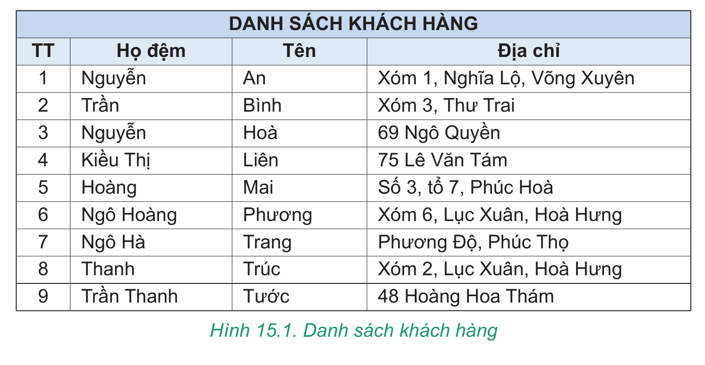
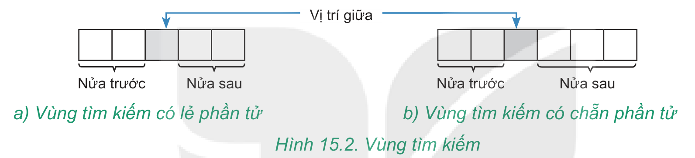

<!-- pdf:75 -->

# BÀI 15: THUẬT TOÁN TÌM KIẾM NHỊ PHÂN

## 🎯 Sau bài học này em sẽ:

- Giải thích được thuật toán tìm kiếm nhị phân.
- Biểu diễn và mô phỏng được hoạt động của thuật toán tìm kiếm nhị phân trên một bộ dữ liệu vào có kích thước nhỏ.
- Giải thích được mối liên quan giữa sắp xếp và tìm kiếm, nêu được ví dụ minh hoạ.

## 🔴 Khởi động

> Việc kinh doanh mở rộng, số lượng khách hàng của cửa hàng bán giống cây trồng nhà An lên đến hàng trăm người. Việc tìm kiếm tên khách hàng trong danh sách thật khó khăn. Em có gợi ý gì cho bạn An để việc tìm kiếm được dễ dàng hơn không?

## 1. THUẬT TOÁN TÌM KIẾM NHỊ PHÂN

Khi danh sách khách hàng ngày càng nhiều, để thuận lợi cho việc tìm kiếm, An đã giúp mẹ soạn thảo danh sách khách hàng trên máy tính với tên khách hàng được sắp xếp theo thứ tự chữ cái. Giả sử An cần tìm địa chỉ của khách hàng tên là “Trúc” trong danh sách khách hàng như Hình 15.1.

Khi danh sách đã được sắp xếp, An không cần tìm từ đầu mà so sánh ngay giá trị cần tìm với giá trị của vị trí ở giữa danh sách. Nếu giá trị cần tìm bằng giá trị ở giữa thì tìm thấy và dừng lại, nếu lớn hơn thì chỉ cần tìm ở nửa sau của danh sách, nếu nhỏ hơn thì tìm ở nửa đầu của danh sách. Lặp lại quá trình đó cho đến khi tìm thấy hoặc hết danh sách. Như vậy, tại mỗi bước lặp, thuật toán tìm kiếm thu hẹp danh sách tìm kiếm chỉ còn một nửa. Do đó thuật toán này có tên là **tìm kiếm nhị phân** (chia đôi).

| TT | Họ đệm | Tên | Địa chỉ |
| --- | --- | --- | --- |
| 1 | Nguyễn | An | Xóm 1, Nghĩa Lộ, Võng Xuyên |
| 2 | Trần | Bình | Xóm 3, Thư Trai |
| 3 | Nguyễn | Hoà | 69 Ngô Quyền |
| 4 | Kiều Thị | Liên | 75 Lê Văn Tám |
| 5 | Hoàng | Mai | Số 3, tổ 7, Phúc Hoà |
| 6 | Ngô Hoàng | Phương | Xóm 6, Lục Xuân, Hoà Hưng |
| 7 | Ngô Hà | Trang | Phương Độ, Phúc Thọ |
| 8 | Thanh | Trúc | Xóm 2, Lục Xuân, Hoà Hưng |
| 9 | Trần Thanh | Tước | 48 Hoàng Hoa Thám |

*Hình 15.1. Danh sách khách hàng*

<!-- pdf:76 -->

Các bước để An tìm khách hàng tên “Trúc” trong danh sách ở Hình 15.1 theo thuật toán tìm kiếm nhị phân như sau:

Bước 1. Xét vị trí ở giữa của dãy, đó là vị trí số 5

| 1 | 2 | 3 | 4 | 5 *(Vị trí ở giữa)* | 6 | 7 | 8 | 9 |
| --- | --- | --- | --- | --- | --- | --- | --- | --- |
| An | Bình | Hoà | Liên | **Mai** | Phương | Trang | Trúc | Tước |

> So sánh “Trúc” và “Mai”.
> Vì “T” đứng sau “M” trong bảng chữ cái nên bỏ đi nửa đầu danh sách.

Bước 2. Xét vị trí ở giữa của nửa sau của dãy là vị trí số 7

| 1 | 2 | 3 | 4 | 5 | 6 | 7 *(Vị trí ở giữa)* | 8 | 9 |
| --- | --- | --- | --- | --- | --- | --- | --- | --- |
| ~~An~~ | ~~Bình~~ | ~~Hoà~~ | ~~Liên~~ | ~~Mai~~ | Phương | **Trang** | Trúc | Tước |

> So sánh “Trúc” và “Trang”.
> Vì “Tru” đứng sau “Tra” trong bảng chữ cái nên bỏ đi nửa đầu danh sách.

Bước 3. Xét vị trí ở giữa của nửa sau còn lại của dãy, đó là vị trí số 8

| 1 | 2 | 3 | 4 | 5 | 6 | 7 | 8 *(Vị trí ở giữa)* | 9 |
| --- | --- | --- | --- | --- | --- | --- | --- | --- |
| ~~An~~ | ~~Bình~~ | ~~Hoà~~ | ~~Liên~~ | ~~Mai~~ | ~~Phương~~ | ~~Trang~~ | **Trúc** | Tước |

> So sánh “Trúc” và “Trúc”.
> Vì hai giá trị bằng nhau nên thuật toán kết thúc.

Vì sau bước 3 đã tìm thấy tên khách hàng nên thuật toán kết thúc.

> **Hoạt động 1: Sắp xếp và tìm kiếm**
>
> 1. Em hãy cho biết thuật toán tìm kiếm tuần tự phải thực hiện bao nhiêu bước để tìm được khách hàng tên “Trúc” trong danh sách ở Hình 15.1? Em hãy so sánh số bước thực hiện của thuật toán tìm kiếm tuần tự với số bước thực hiện của thuật toán tìm kiếm nhị phân.
> 2. Theo em trước khi thực hiện thuật toán tìm kiếm nhị phân, danh sách khách hàng cần thoả mãn điều kiện gì? Nếu không thoả mãn điều kiện đó, thuật toán tìm kiếm nhị phân có thực hiện được không?

<!-- pdf:77 -->

Trong phần mô tả sau đây, ta giả sử danh sách (dãy) đã được sắp xếp theo thứ tự từ nhỏ đến lớn và gọi *vùng tìm kiếm* là đoạn danh sách mà thuật toán tìm kiếm trên đó. Ban đầu, vùng tìm kiếm là toàn bộ danh sách.
<!-- term: Vùng tìm kiếm -->

**Mô tả thuật toán tìm kiếm nhị phân bằng ngôn ngữ tự nhiên:**

- Bước 1. Nếu *vùng tìm kiếm* không có phần tử nào thì kết luận không tìm thấy và thuật toán kết thúc.
- Bước 2. Xác định vị trí giữa của *vùng tìm kiếm*. Vị trí này chia vùng tìm kiếm thành hai nửa: nửa trước và nửa sau vị trí giữa.
- Bước 3. Nếu giá trị cần tìm bằng giá trị của vị trí giữa thì kết luận “giá trị cần tìm xuất hiện tại vị trí giữa” và kết thúc.
- Bước 4. Nếu giá trị cần tìm nhỏ hơn giá trị của vị trí giữa thì *vùng tìm kiếm* mới được thu hẹp lại, chỉ còn nửa trước của dãy.
  Ngược lại (nếu giá trị cần tìm lớn hơn giá trị của vị trí giữa) *vùng tìm kiếm* mới được thu hẹp lại, chỉ còn nửa sau của dãy.
- Bước 5. Lặp lại từ Bước 1 đến Bước 4 cho đến khi tìm thấy giá trị cần tìm (Bước 3) hoặc *vùng tìm kiếm* không còn phần tử nào (Bước 1).
<!-- term: Mô tả thuật toán tìm kiếm nhị phân -->

> 📌 Vị trí giữa của *vùng tìm kiếm* bằng phần nguyên của (vị trí đầu + vị trí cuối)/2.
<!-- term: Vị trí giữa của vùng tìm kiếm -->
<!-- ocr-ok: đã đối chiếu ảnh trang gốc 77, khung ghi chú nghiêng bên lề phải bị OCR đọc lẫn vào cột chữ -->

*Hình 15.2. Vùng tìm kiếm*

**Lưu ý:** “nửa trước” và "nửa sau" không gồm phần tử giữa.

> **Thuật toán tìm kiếm nhị phân**
>
> - Thực hiện trên danh sách đã được sắp xếp. Bắt đầu từ vị trí ở giữa danh sách.
> - Tại mỗi bước, so sánh giá trị cần tìm với giá trị của vị trí giữa danh sách, nếu lớn hơn thì tìm trong nửa sau của danh sách, nếu nhỏ hơn thì tìm trong nửa trước của danh sách, nếu bằng thì dừng lại.
> - Chừng nào chưa tìm thấy và chưa hết danh sách thì còn tìm tiếp.

> 📌 Trong trường hợp so sánh kí tự thì kí tự đứng trước là “nhỏ hơn” kí tự đứng sau trong bảng chữ cái.
<!-- term: Quy ước so sánh kí tự -->
<!-- ocr-ok: đã đối chiếu ảnh trang gốc 77, khung ghi chú nghiêng bên lề phải bị OCR đọc sót chữ -->

> ❓ **Câu hỏi**
>
> Em hãy viết các bước thực hiện thuật toán tìm kiếm nhị phân để tìm khách hàng tên "Hoà" trong danh sách ở Hình 15.1.

## 2. SẮP XẾP VÀ TÌM KIẾM

Trong ví dụ ở mục 1, khách hàng tên “Trúc” được tìm thấy sau 3 bước thực hiện theo thuật toán tìm kiếm nhị phân, trong khi thuật toán tìm kiếm tuần tự phải thực hiện 8 bước.

Xét trường hợp có một khách hàng nào đó mà mẹ bạn An quên chưa ghi vào sổ, do đó tên khách hàng không có trong danh sách ở Hình 15.1. Khi phải tìm kiếm tên khách hàng này, thuật toán tìm kiếm tuần tự cần thực hiện 9 bước để xét hết danh sách và kết luận “Không tìm thấy”, trong khi thuật toán tìm kiếm nhị phân chỉ mất 4 bước thực hiện.

<!-- pdf:78 -->

Như vậy, trong ví dụ trên, thuật toán tìm kiếm nhị phân thực hiện tìm kiếm nhanh hơn thuật toán tìm kiếm tuần tự. Có được ưu điểm này là do trước khi thực hiện tìm kiếm nhị phân, danh sách khách hàng cần tìm đã được sắp xếp. Nhờ việc danh sách đã được sắp xếp, tại mỗi bước, thuật toán tìm kiếm nhị phân thu hẹp được phạm vi tìm kiếm chỉ còn một nửa.
<!-- term: Mối liên quan giữa sắp xếp và tìm kiếm -->

> Sắp xếp giúp cho việc tìm kiếm được thực hiện nhanh hơn.
<!-- term: Mối liên quan giữa sắp xếp và tìm kiếm -->

> **Hoạt động 2: Trò chơi tìm số**
>
> **Chuẩn bị:** Hai bạn chơi A, B và 10 tấm thẻ ghi 10 số khác nhau (các số đều nhỏ hơn 20). Ví dụ, 10 số trên các tấm thẻ là 2, 3, 5, 6, 8, 9, 11, 15, 16, 18. Giả sử A giữ 10 tấm thẻ và B là người tìm kiếm.
>
> **Yêu cầu:** Bạn B sử dụng thuật toán tìm kiếm nhị phân để tìm một số nhỏ hơn 20 trong các tấm thẻ của bạn A.
>
> **Cách chơi:**
> - Bước 1. A úp lần lượt 10 chiếc thẻ lên bàn theo thứ tự các số từ bé đến lớn.
> - Bước 2. B cho A biết con số mình cần tìm.
> - Bước 3. B chọn tấm thẻ ở vị trí giữa.
> - Bước 4. A hé mở tấm thẻ và trả lời B bằng cách nói một trong ba cụm từ: “bằng nhau”, “lớn hơn” hoặc “bé hơn” tuỳ thuộc vào kết quả so sánh số bạn B cần tìm với số ở vị trí giữa của dãy.
> - Bước 5. Tuỳ vào câu trả lời của A mà B chọn nửa dãy tiếp theo để tìm kiếm.
> - Bước 6. Lặp lại các bước 3, 4, 5 cho đến khi B tìm thấy số cần tìm hoặc đã tìm hết dãy số.
> - Bước 7. Hoán đổi vị trí của A và B trong lượt chơi tiếp theo.

> ❓ **Câu hỏi**
>
> Em hãy nêu ví dụ trong thực tế cho thấy mối liên quan giữa sắp xếp và tìm kiếm.

## ✏️ Luyện tập

1. Cho danh sách tên các nước sau đây:

   Bolivia, Albania, Scotland, Canada, Vietnam, Iceland, Portugal, Greenland, Germany

   a) Em hãy sắp xếp danh sách tên các nước theo thứ tự trong bảng chữ cái.

   b) Em hãy liệt kê các bước tìm kiếm tên nước Iceland trong danh sách đã sắp xếp theo thuật toán tìm kiếm nhị phân.

   c) Em hãy so sánh số bước thực hiện tìm kiếm ở phần b với số bước thực hiện tìm kiếm ở Câu 2 phần Luyện tập của bài 14.

2. Em hãy cho ví dụ một bài toán tìm kiếm trong thực tế mà có thể thực hiện bằng thuật toán tìm kiếm nhị phân? Hãy thực hiện thuật toán tìm kiếm nhị phân để giải quyết bài toán đó.

## 🚀 Vận dụng

Em tìm một từ tiếng Anh trong quyển từ điển theo cách nào? Tại sao em lại dùng cách đó?

## 📷 Danh sách hình trong bài

| Mã hình | Trang PDF | Trang sách | Chú thích |
| --- | --- | --- | --- |
| H7-tin_hoc-b15-01 | 75 | 74 | Hình 15.1. Danh sách khách hàng |
| H7-tin_hoc-b15-02 | 77 | 76 | Hình 15.2. Vùng tìm kiếm |
