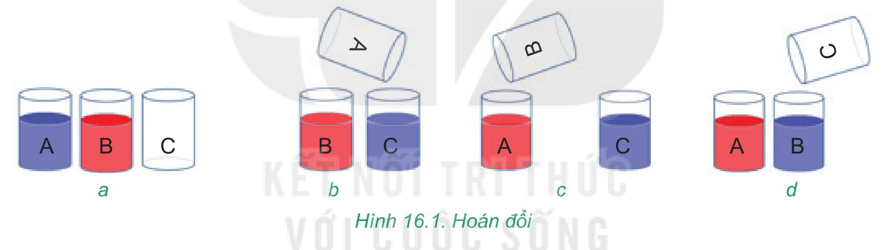
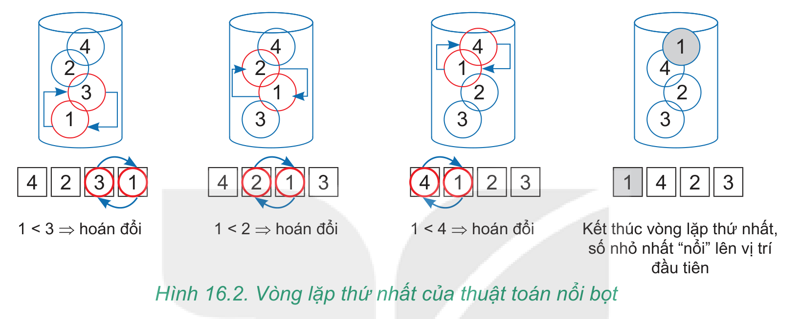
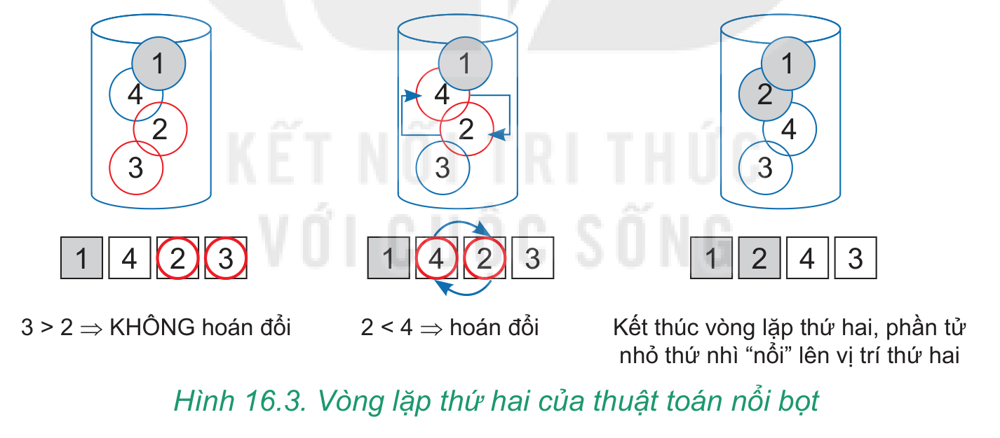
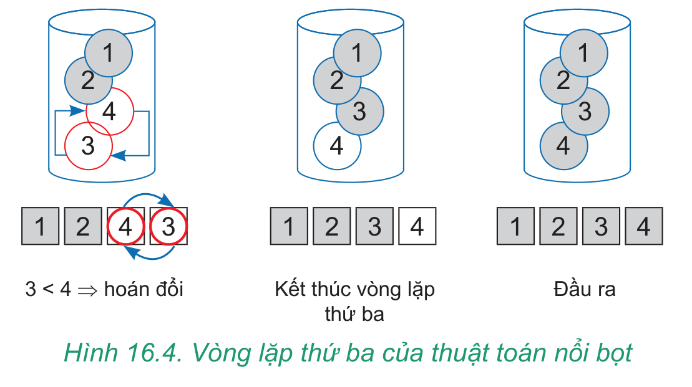
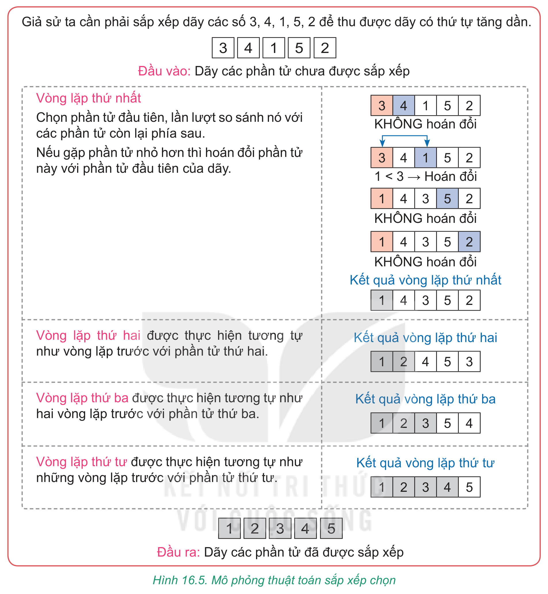

<!-- pdf:79 -->

# BÀI 16: THUẬT TOÁN SẮP XẾP

## 🎯 Sau bài học này em sẽ:

- Giải thích được một vài thuật toán sắp xếp cơ bản.
- Biểu diễn và mô phỏng được hoạt động của thuật toán sắp xếp với bộ dữ liệu đầu vào có kích thước nhỏ.
- Nêu được ý nghĩa của việc chia một bài toán thành những bài toán nhỏ hơn.

## 🔴 Khởi động

> Có hai chất lỏng khác màu là xanh và đỏ, lần lượt được chứa trong hai chiếc cốc A và B (Hình 16.1a). Chúng ta cần đổi chỗ hai chất lỏng này, sao cho cốc A đựng chất lỏng màu đỏ, còn cốc B đựng chất lỏng màu xanh. Để thực hiện công việc này, chúng ta sử dụng thêm một chiếc cốc thứ ba (cốc C) không đựng gì. Em hãy quan sát Hình 16.1b, Hình 16.1c, Hình 16.1d để biết cách thực hiện.

*Hình 16.1. Hoán đổi*

## 1. THUẬT TOÁN SẮP XẾP NỔI BỌT

Trong bài học trước, chúng ta đã biết sắp xếp giúp cho việc tìm kiếm được thực hiện dễ dàng. Trong cuộc sống hằng ngày, chúng ta thường xuyên phải thực việc sắp xếp các đồ vật để dễ tìm. Máy tính cũng thường xuyên phải thực hiện thuật toán sắp xếp khi người sử dụng yêu cầu. Ví dụ: Sắp xếp điểm trung bình của học sinh trong lớp bằng chương trình bảng tính; Sắp xếp tên tệp trong thư mục;... Có nhiều thuật toán sắp xếp khác nhau. Một trong số đó là thuật toán **sắp xếp nổi bọt**.
<!-- term: Bài toán sắp xếp -->

Giả sử ta cần phải sắp xếp dãy các số 4, 2, 3, 1 để thu được dãy có thứ tự tăng dần. Thuật toán sắp xếp nổi bọt xét từng vị trí từ đầu đến cuối dãy. Tại mỗi vị trí được xét, thuật toán tìm phần tử nhỏ nhất trong những phần tử phía sau để đưa vào vị trí đó. Việc này được thực hiện bằng một vòng lặp, so sánh từng cặp phần tử cạnh nhau và hoán đổi chúng nếu số ở phía sau nhỏ hơn. Các bước thực hiện được mô tả trong Hình 16.2, Hình 16.3, Hình 16.4. Việc hoán đổi được thực hiện giống như việc hoán đổi ở Hoạt động khởi động.

<!-- pdf:80 -->

**Đầu vào:**

| 4 | 2 | 3 | 1 |
| --- | --- | --- | --- |

Xét vị trí đầu tiên, vòng lặp thứ nhất thực hiện như sau:

| Bước trong vòng lặp 1 | Trạng thái dãy số | Nhận xét / Thao tác |
| --- | --- | --- |
| So sánh cặp (3, 1) | `4, 2, (3, 1)` | $1 < 3 \Rightarrow$ hoán đổi |
| So sánh cặp (2, 1) | `4, (2, 1), 3` | $1 < 2 \Rightarrow$ hoán đổi |
| So sánh cặp (4, 1) | `(4, 1), 2, 3` | $1 < 4 \Rightarrow$ hoán đổi |
| Kết quả vòng lặp 1 | **`1`**, `4, 2, 3` | Kết thúc vòng lặp thứ nhất, số nhỏ nhất “nổi” lên vị trí đầu tiên |
<!-- ocr-ok: đã đối chiếu ảnh trang gốc 80, bảng mô phỏng các bước hoán đổi trong Hình 16.2 -->

*Hình 16.2. Vòng lặp thứ nhất của thuật toán nổi bọt*

Xét vị trí thứ hai:

| Bước trong vòng lặp 2 | Trạng thái dãy số | Nhận xét / Thao tác |
| --- | --- | --- |
| So sánh cặp (2, 3) | **`1`**, `4, (2, 3)` | $3 > 2 \Rightarrow$ KHÔNG hoán đổi |
| So sánh cặp (4, 2) | **`1`**, `(4, 2), 3` | $2 < 4 \Rightarrow$ hoán đổi |
| Kết quả vòng lặp 2 | **`1, 2`**, `4, 3` | Kết thúc vòng lặp thứ hai, phần tử nhỏ thứ nhì “nổi” lên vị trí thứ hai |
<!-- ocr-ok: đã đối chiếu ảnh trang gốc 80, bảng mô phỏng các bước hoán đổi trong Hình 16.3 -->

*Hình 16.3. Vòng lặp thứ hai của thuật toán nổi bọt*

Xét vị trí thứ ba:

| Bước trong vòng lặp 3 | Trạng thái dãy số | Nhận xét / Thao tác |
| --- | --- | --- |
| So sánh cặp (4, 3) | **`1, 2`**, `(4, 3)` | $3 < 4 \Rightarrow$ hoán đổi |
| Kết quả vòng lặp 3 | **`1, 2, 3`**, `4` | Kết thúc vòng lặp thứ ba |
| Đầu ra | **`1, 2, 3, 4`** | Dãy đã sắp xếp |
<!-- ocr-ok: đã đối chiếu ảnh trang gốc 80, bảng mô phỏng các bước hoán đổi trong Hình 16.4 -->

*Hình 16.4. Vòng lặp thứ ba của thuật toán nổi bọt*

<!-- pdf:81 -->

Sau vòng lặp thứ ba, không có bất kì sự hoán đổi nào được thực hiện nữa nên thuật toán dừng lại. Danh sách được sắp xếp theo đúng thứ tự yêu cầu.

**Mô tả thuật toán sắp xếp nổi bọt bằng ngôn ngữ tự nhiên:**

Sắp xếp dãy số theo thứ tự tăng bằng thuật toán sắp xếp nổi bọt.
1. Với phần tử đầu tiên, em thực hiện một vòng lặp như sau:
   1.1. So sánh hai phần tử đứng cạnh nhau theo thứ tự từ cuối dãy lên phần tử đầu tiên.
   1.2. Nếu phần tử đứng sau nhỏ hơn phần tử đứng trước thì đổi chỗ chúng cho nhau.
   1.3. Cuối vòng lặp em sẽ nhận được dãy số với phần tử nhỏ nhất nổi lên vị trí đầu tiên.
2. Với phần tử thứ hai, em thực hiện một vòng lặp tương tự như trên.
   2.1. So sánh hai phần tử đứng cạnh nhau theo thứ tự từ cuối dãy ngược lên phần tử thứ hai.
   2.2. Nếu phần tử đứng sau nhỏ hơn phần tử đứng trước thì đổi chỗ chúng cho nhau.
   2.3. Cuối vòng lặp em sẽ nhận được dãy số với phần tử nhỏ thứ nhì nổi lên vị trí thứ hai.
3. Tương tự như trên với các phần tử thứ ba, thứ tư,... đến phần tử trước phần tử cuối cùng.
4. Kết thúc, em sẽ nhận được dãy số đã được sắp xếp theo thứ tự từ nhỏ đến lớn.
<!-- term: Mô tả thuật toán sắp xếp nổi bọt -->

> **Hoạt động 1: Mô phỏng thuật toán sắp xếp nổi bọt**
>
> Em hãy thực hiện thuật toán sắp xếp nổi bọt để sắp xếp 5 số sau đây theo thứ tự tăng dần. Hãy mô phỏng các bước sắp xếp bằng hình vẽ minh hoạ tương tự như Hình 16.2, Hình 16.3, Hình 16.4.
>
> | 3 | 5 | 4 | 1 | 2 |
> | --- | --- | --- | --- | --- |

> **Sắp xếp nổi bọt**
>
> Nổi bọt là thuật toán sắp xếp được thực hiện bằng cách hoán đổi nhiều lần các phần tử liền kề nếu giá trị của chúng không đúng thứ tự.

> ❓ **Câu hỏi**
>
> Thuật toán sắp xếp nổi bọt sắp xếp danh sách bằng cách
> A. Chọn phần tử có giá trị bé nhất đặt vào đầu danh sách.
> B. Chọn phần tử có giá trị lớn nhất đặt vào đầu danh sách.
> C. Hoán đổi nhiều lần các phần tử liền kề nếu giá trị của chúng không đúng thứ tự.
> D. Chèn phần tử vào vị trí thích hợp để đảm bảo danh sách sắp xếp theo đúng thứ tự.

## 2. THUẬT TOÁN SẮP XẾP CHỌN

Một thuật toán sắp xếp khác có tên là **sắp xếp chọn**. Giống thuật toán sắp xếp nổi bọt, thuật toán sắp xếp chọn cũng xét từng vị trí và đưa phần tử nhỏ nhất trong những phần tử phía sau vào vị trí đó. Tuy nhiên việc này được thực hiện bằng cách so sánh trực tiếp phần tử ở vị trí được xét với những phần tử ở phía sau nó và hoán đổi nếu phần tử phía sau nhỏ hơn. Các bước thực hiện được minh hoạ trong Hình 16.5.

<!-- pdf:82 -->

| Giai đoạn | Mô tả thực hiện | Dãy số / Kết quả |
| --- | --- | --- |
| Đầu vào | Giả sử ta cần phải sắp xếp dãy các số 3, 4, 1, 5, 2 để thu được dãy có thứ tự tăng dần. Dãy các phần tử chưa được sắp xếp: | `3, 4, 1, 5, 2` |
| Vòng lặp thứ nhất | Chọn phần tử đầu tiên, lần lượt so sánh nó với các phần tử còn lại phía sau. Nếu gặp phần tử nhỏ hơn thì hoán đổi phần tử này với phần tử đầu tiên của dãy: `(3, 4)` KHÔNG hoán đổi; `(3, 1)` $1 < 3 \rightarrow$ Hoán đổi thành `1, 4, 3, 5, 2`; `(1, 5)` KHÔNG hoán đổi; `(1, 2)` KHÔNG hoán đổi. Kết quả vòng lặp thứ nhất: | **`1`**, `4, 3, 5, 2` |
| Vòng lặp thứ hai | Vòng lặp thứ hai được thực hiện tương tự như vòng lặp trước với phần tử thứ hai. Kết quả vòng lặp thứ hai: | **`1, 2`**, `4, 5, 3` |
| Vòng lặp thứ ba | Vòng lặp thứ ba được thực hiện tương tự như hai vòng lặp trước với phần tử thứ ba. Kết quả vòng lặp thứ ba: | **`1, 2, 3`**, `5, 4` |
| Vòng lặp thứ tư | Vòng lặp thứ tư được thực hiện tương tự như những vòng lặp trước với phần tử thứ tư. Kết quả vòng lặp thứ tư: | **`1, 2, 3, 4`**, `5` |
| Đầu ra | Dãy các phần tử đã được sắp xếp: | **`1, 2, 3, 4, 5`** |

*Hình 16.5. Mô phỏng thuật toán sắp xếp chọn*

**Mô tả thuật toán sắp xếp chọn bằng ngôn ngữ tự nhiên:**

Sắp xếp dãy số theo thứ tự từ nhỏ đến lớn bằng thuật toán sắp xếp chọn.
1. Với phần tử đầu tiên, em thực hiện một vòng lặp như sau:
   1.1. So sánh từng phần tử (kể từ phần tử thứ hai đến phần tử cuối cùng) với phần tử đầu tiên.
   1.2. Nếu phần tử được xét nhỏ hơn phần tử đầu tiên thì hoán đổi nó với phần tử đầu tiên.
   1.3. Cuối vòng lặp, em sẽ nhận được dãy số với phần tử nhỏ nhất được đưa về vị trí đầu tiên.
2. Với phần tử thứ hai, em thực hiện một vòng lặp tương tự như trên.
   2.1. So sánh từng phần tử (kể từ phần tử thứ ba đến phần tử cuối cùng) với phần tử thứ hai.
   2.2. Nếu phần tử được xét nhỏ hơn phần tử thứ hai thì hoán đổi nó với phần tử thứ hai.
   2.3. Cuối vòng lặp, em sẽ nhận được dãy số với phần tử nhỏ thứ nhì được đưa về vị trí thứ hai.
3. Tương tự như trên với các phần tử thứ ba, thứ tư,... đến phần tử trước phần tử cuối cùng.
4. Kết thúc, em sẽ nhận được dãy số đã được sắp xếp theo thứ tự từ nhỏ đến lớn.
<!-- term: Mô tả thuật toán sắp xếp chọn -->

<!-- pdf:83 -->

> **Hoạt động 2: Sắp xếp chọn**
>
> Chọn năm học sinh, mỗi học sinh viết ra tờ giấy một con số mà mình yêu thích. Các em đứng thành một hàng ngang và cầm tờ giấy có ghi con số để cả lớp có thể quan sát được.
>
> Ví dụ:
>
> | 41 | 15 | 17 | 32 | 18 |
> | --- | --- | --- | --- | --- |
>
> Học sinh thứ sáu thực hiện thuật toán sắp xếp chọn để sắp xếp các con số của năm bạn theo thứ tự tăng dần.

> **Thuật toán sắp xếp chọn** xét từng vị trí từ đầu đến cuối dãy, so sánh trực tiếp phần tử ở vị trí được xét với những phần tử ở phía sau nó và hoán đổi nếu chúng chưa đúng thứ tự.

> ❓ **Câu hỏi**
>
> Em hãy viết vào vở cụ thể các bước của vòng lặp thứ 2, 3, 4 được mô tả trong Hình 16.5.

## 3. CHIA BÀI TOÁN THÀNH NHỮNG BÀI TOÁN NHỎ HƠN

Trong quá trình thực hiện cả hai thuật toán sắp xếp nổi bọt và sắp xếp chọn, ta đều thấy xuất hiện nhiều lần thuật toán đơn giản hơn: hoán đổi giá trị hai phần tử. Như vậy, bài toán sắp xếp đã được giải quyết dựa trên lời giải của bài toán nhỏ hơn là bài toán hoán đổi giá trị.
<!-- term: Bài toán hoán đổi giá trị -->

Xem xét thuật toán tìm kiếm nhị phân ở bài học trước, ta cũng nhận thấy thuật toán tìm kiếm nhị phân thực hiện chia bài toán thành những bài toán nhỏ hơn. Trong đó, bài toán nhỏ hơn là một phần của bài toán ban đầu. Cụ thể, ở mỗi lần lặp, thuật toán tìm kiếm nhị phân đã thu hẹp vùng tìm kiếm chỉ còn một nửa.

Một cách khái quát, để giải quyết một bài toán, chúng ta đã dựa trên lời giải của bài toán nhỏ hơn. Việc chia một bài toán thành những bài toán nhỏ hơn giúp việc giải bài toán đó dễ dàng hơn, đồng thời việc mô tả thuật toán dễ hiểu và dễ thực hiện hơn.
<!-- term: Chia bài toán thành những bài toán nhỏ hơn -->

> Chia một bài toán thành những bài toán nhỏ hơn giúp thuật toán dễ hiểu và dễ thực hiện hơn.
<!-- term: Chia bài toán thành những bài toán nhỏ hơn -->

> ❓ **Câu hỏi**
>
> Chọn phương án đúng.
> Tại sao chúng ta chia bài toán thành những bài toán nhỏ hơn?
> A. Để thay đổi đầu vào của bài toán.
> B. Để thay đổi yêu cầu đầu ra của bài toán.
> C. Để bài toán dễ giải quyết hơn.
> D. Để bài toán khó giải quyết hơn.

## ✏️ Luyện tập

1. Em hãy liệt kê các bước của thuật toán sắp xếp nổi bọt để sắp xếp các số 3, 2, 4, 1, 5, theo thứ tự tăng dần.
2. Em hãy liệt kê các bước của thuật toán sắp xếp chọn để sắp xếp các số 3, 2, 4, 1, 5, theo thứ tự tăng dần.

## 🚀 Vận dụng

Em hãy ghi lại kết quả điểm học tập môn Tin học của các bạn trong tổ. Thực hiện thuật toán sắp xếp chọn hoặc sắp xếp nổi bọt để sắp xếp điểm theo thứ tự giảm dần. Dựa trên kết quả sắp xếp, hãy cho biết danh sách tên các bạn tương ứng theo kết quả sắp xếp đó.

## 📷 Danh sách hình trong bài

| Mã hình | Trang PDF | Trang sách | Chú thích |
| --- | --- | --- | --- |
| H7-tin_hoc-b16-01 | 79 | 78 | Hình 16.1. Hoán đổi |
| H7-tin_hoc-b16-02 | 80 | 79 | Hình 16.2. Vòng lặp thứ nhất của thuật toán nổi bọt |
| H7-tin_hoc-b16-03 | 80 | 79 | Hình 16.3. Vòng lặp thứ hai của thuật toán nổi bọt |
| H7-tin_hoc-b16-04 | 80 | 79 | Hình 16.4. Vòng lặp thứ ba của thuật toán nổi bọt |
| H7-tin_hoc-b16-05 | 82 | 81 | Hình 16.5. Mô phỏng thuật toán sắp xếp chọn |
