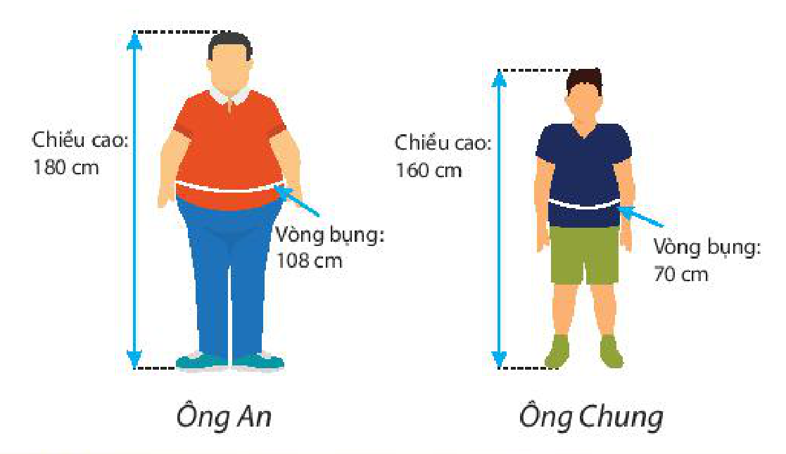
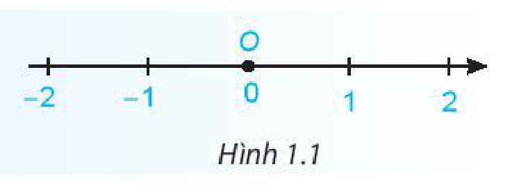
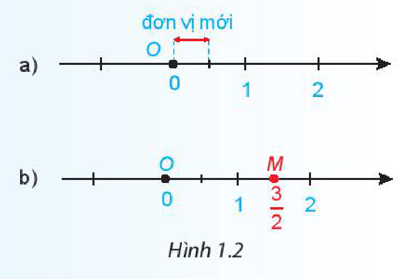
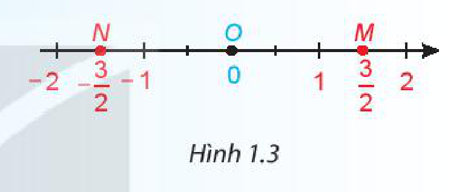
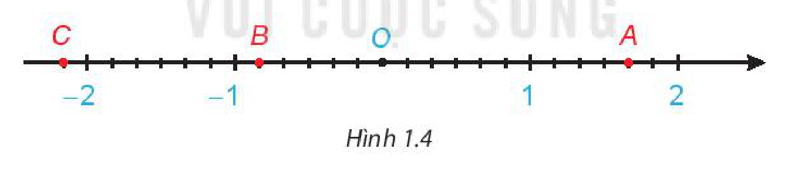
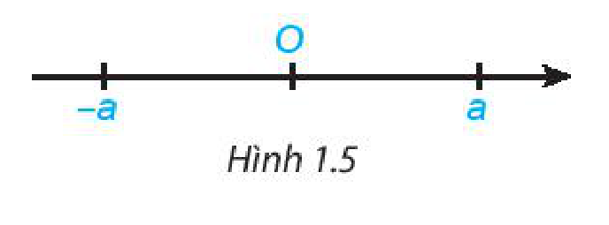
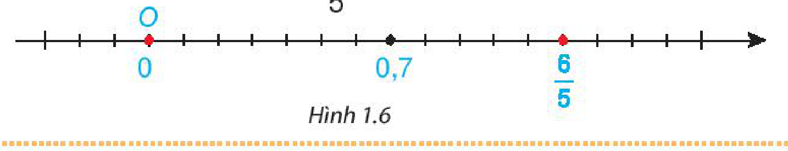
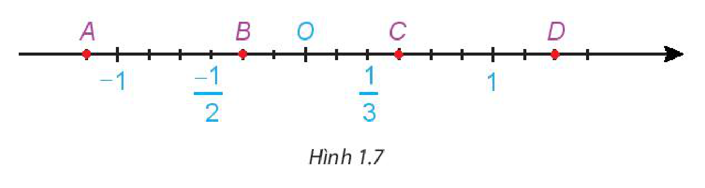

<!-- pdf:6 -->
<!-- Phần giới thiệu đầu Chương I (nửa trên trang PDF 6): SỐ HỌC — CHƯƠNG I: SỐ HỮU TỈ -->

Hệ sinh thái trên Trái Đất đang dần bị phá huỷ. Cứ sau ba giây, thế giới mất diện tích rừng đủ để che phủ một sân bóng đá. Trong thế kỉ qua, hơn $\frac{1}{2}$ vùng đất ngập nước bị phá huỷ; khoảng $50\%$ rạn san hô đã biến mất và có thể tới hơn $90\%$ rạn san hô sẽ biến mất vào năm $2050$, ngay cả khi sự nóng lên toàn cầu được giới hạn ở mức tăng $1,5\ ^\circ\text{C}$.

Mất hệ sinh thái sẽ gây ra hiệu ứng nhà kính, khiến Trái Đất ngày càng nóng lên, từ đó sẽ gây ra các thảm hoạ thiên nhiên thảm khốc.

*(Theo Báo cáo của Liên Hợp Quốc nhân ngày Môi trường thế giới, 5-5-2021)*
<!-- ocr-ok: đã đối chiếu ảnh trang PDF 6, OCR đọc sai chữ nghiêng "Báo cáo" thành "Bún cúp" -->

# BÀI 1: TẬP HỢP CÁC SỐ HỮU TỈ

## 🔤 Khái niệm, thuật ngữ

- Số hữu tỉ

## 🎯 Kiến thức, kĩ năng

- Nhận biết số hữu tỉ, tập hợp các số hữu tỉ $\mathbb{Q}$, số đối của số hữu tỉ, thứ tự trong tập hợp các số hữu tỉ.
- Biểu diễn số hữu tỉ trên trục số.
- So sánh hai số hữu tỉ.

## 🔴 Mở đầu

Chỉ số WHtR (Waist to Height Ratio) của một người trưởng thành, được tính bằng tỉ số giữa số đo vòng bụng và số đo chiều cao (cùng một đơn vị đo). Chỉ số này được coi là một công cụ đo lường sức khoẻ hữu ích vì có thể dự báo được các nguy cơ béo phì, mắc bệnh tim mạch,... Bảng bên cho biết nguy cơ thừa cân, béo phì của một người đàn ông trưởng thành dựa vào chỉ số WHtR.

*(Theo hospimedica.com)*

| Mức độ | Chỉ số WHtR |
| --- | --- |
| Gầy | Chỉ số WHtR nhỏ hơn hoặc bằng $0,42$ |
| Tốt | Chỉ số WHtR lớn hơn $0,42$ và nhỏ hơn hoặc bằng $0,52$ |
| Hơi béo | Chỉ số WHtR lớn hơn $0,52$ và nhỏ hơn hoặc bằng $0,57$ |
| Thừa cân | Chỉ số WHtR lớn hơn $0,57$ và nhỏ hơn hoặc bằng $0,63$ |
| Béo phì | Chỉ số WHtR lớn hơn $0,63$ |
<!-- ocr-ok: đã đối chiếu ảnh trang PDF 6, bảng phân loại chỉ số WHtR nhiều hàng cột bị OCR đọc sai WHtR thành WHIR -->

<!-- pdf:7 -->

Ông An cao $180\text{ cm}$, vòng bụng $108\text{ cm}$.

Ông Chung cao $160\text{ cm}$, vòng bụng $70\text{ cm}$.

Theo em, nếu tính theo chỉ số WHtR, sức khoẻ của ông An hay ông Chung tốt hơn?
<!-- ocr-ok: đã đối chiếu ảnh trang PDF 7, OCR đọc sai chữ WHtR thành WHIR -->

## 1. KHÁI NIỆM SỐ HỮU TỈ VÀ BIỂU DIỄN SỐ HỮU TỈ TRÊN TRỤC SỐ

**Số hữu tỉ là gì?**

**HĐ1:** Tính chỉ số WHtR của ông An và ông Chung.

**HĐ2:** Ta có thể viết $1,5 = \frac{3}{2} = \frac{6}{4} = \frac{9}{6} = \dots$.
<!-- ocr-ok: đã đối chiếu ảnh trang PDF 7, dòng chứa dãy phân số bằng nhau trong LaTeX -->

Tương tự, em hãy viết ba phân số bằng nhau và bằng:

a) $-2,5$;

b) $2\frac{3}{4}$.

Các phân số bằng nhau là các cách viết khác nhau của cùng một số, số đó gọi là *số hữu tỉ*. Như vậy, chỉ số WHtR của ông An, ông Chung và các số cho trong HĐ2 là các số hữu tỉ.

> **Số hữu tỉ** là số viết được dưới dạng phân số $\frac{a}{b}$ với $a, b \in \mathbb{Z}$, $b \ne 0$.
>
> **Tập hợp các số hữu tỉ** được kí hiệu là $\mathbb{Q}$.

**Chú ý:** Mỗi số hữu tỉ đều có một **số đối**. Số đối của số hữu tỉ $m$ là số hữu tỉ $-m$.

**Ví dụ 1:** Các số $-7$; $0,6$; $-1,2$; $1\frac{4}{5}$ có là số hữu tỉ không? Vì sao?

**Giải:** Các số $-7$; $0,6$; $-1,2$; $1\frac{4}{5}$ là các số hữu tỉ vì chúng đều viết được dưới dạng phân số:

$-7 = \frac{-7}{1}; \quad 0,6 = \frac{6}{10}; \quad -1,2 = \frac{-12}{10}; \quad 1\frac{4}{5} = \frac{9}{5}.$

**Luyện tập 1:** Giải thích vì sao các số $8$; $-3,3$; $3\frac{2}{3}$ đều là các số hữu tỉ. Tìm số đối của mỗi số đó.

**Nhận xét:** Vì các số thập phân đã biết đều viết được dưới dạng phân số thập phân nên chúng đều là các số hữu tỉ. Tương tự, số nguyên, hỗn số cũng là các số hữu tỉ.

**Cách biểu diễn số hữu tỉ trên trục số**

Ta đã biết cách biểu diễn các số nguyên trên trục số. Chẳng hạn, Hình 1.1 cho ta hình ảnh các số nguyên $-2$; $-1$; $1$ và $2$ được biểu diễn trên trục số.
<!-- ocr-ok: đã đối chiếu ảnh trang PDF 7, OCR dính chữ ở câu giới thiệu Hình 1.1 -->

*Hình 1.1*

<!-- pdf:8 -->

- Tương tự số nguyên, ta có thể biểu diễn các số hữu tỉ trên trục số. Chẳng hạn, để biểu diễn số hữu tỉ $\frac{3}{2}$ ta làm như sau:
  - Chia đoạn thẳng đơn vị (chẳng hạn đoạn từ $0$ đến $1$) thành hai đoạn bằng nhau, lấy một đoạn làm đơn vị mới (đơn vị mới bằng $\frac{1}{2}$ đơn vị cũ) (H.1.2a).
  - Số hữu tỉ $\frac{3}{2}$ được biểu diễn bởi điểm $M$ (nằm sau gốc $O$) và cách $O$ một đoạn bằng $3$ đơn vị mới (H.1.2b).

*Hình 1.2*

Tương tự, số hữu tỉ $-\frac{3}{2}$ được biểu diễn bởi điểm $N$ (nằm trước gốc $O$) và cách $O$ một đoạn bằng $3$ đơn vị mới (H.1.3). Do đó $OM = ON$.

*Hình 1.3*

- Số hữu tỉ $\frac{3}{2} = 1,5$ nên $1,5$ cũng được biểu diễn bởi điểm $M$;

  Số hữu tỉ $-\frac{3}{2} = -\frac{6}{4}$ nên $-\frac{6}{4}$ cũng được biểu diễn bởi điểm $N$ (H.1.3).
<!-- ocr-ok: đã đối chiếu ảnh trang PDF 8, câu chứa nhiều phân số LaTeX -->

- Trên trục số, điểm biểu diễn số hữu tỉ $a$ được gọi là **điểm $a$**.

> ❓ Mỗi điểm $A, B, C$ trên trục số Hình 1.4 biểu diễn số hữu tỉ nào?
<!-- ocr-ok: đã đối chiếu ảnh trang PDF 8, OCR đọc sai chữ "Mỗi" thành "Mối" -->

*Hình 1.4*

**Luyện tập 2:**

Biểu diễn các số hữu tỉ $\frac{5}{4}$ và $\frac{-5}{4}$ trên trục số.

**Nhận xét:** Trên trục số, hai điểm biểu diễn của hai số hữu tỉ đối nhau $a$ và $-a$ nằm về hai phía khác nhau so với điểm $O$ và có cùng khoảng cách đến $O$ (H.1.5).

*Hình 1.5*

<!-- pdf:9 -->

## 2. THỨ TỰ TRONG TẬP HỢP CÁC SỐ HỮU TỈ

*Thứ tự trong tập hợp các số hữu tỉ*

**HĐ3:** Viết các số hữu tỉ sau dưới dạng phân số rồi so sánh:

a) $-1,5$ và $\frac{5}{2}$;

b) $-0,375$ và $-\frac{5}{8}$.

**HĐ4:** Biểu diễn hai số hữu tỉ $-1,5$ và $\frac{5}{2}$ trên trục số. Em hãy cho biết điểm $-1,5$ nằm trước hay nằm sau điểm $\frac{5}{2}$ trên trục số.

<!-- term: Thứ tự trong tập hợp các số hữu tỉ -->
> - Ta có thể so sánh hai số hữu tỉ bất kì bằng cách viết chúng dưới dạng phân số rồi so sánh hai phân số đó.
> - Với hai số hữu tỉ $a, b$ bất kì, ta luôn có hoặc $a = b$ hoặc $a < b$ hoặc $a > b$.
>   Cho ba số hữu tỉ $a, b, c$. Nếu $a < b$ và $b < c$ thì $a < c$ (*tính chất bắc cầu*).
> - Trên trục số, nếu $a < b$ thì điểm $a$ nằm trước điểm $b$.

**Chú ý:** Trên trục số, các điểm nằm trước gốc $O$ biểu diễn **số hữu tỉ âm** (tức số hữu tỉ nhỏ hơn $0$); các điểm nằm sau gốc $O$ biểu diễn **số hữu tỉ dương** (tức số hữu tỉ lớn hơn $0$). Số $0$ không là số hữu tỉ dương, cũng không là số hữu tỉ âm.

**Ví dụ 2:** So sánh $0,7$ và $\frac{6}{5}$. Từ đó cho biết điểm $0,7$ nằm trước hay nằm sau điểm $\frac{6}{5}$ trên trục số.

**Giải:** Ta có $0,7 = \frac{7}{10}$ và $\frac{6}{5} = \frac{12}{10}$. Vì $\frac{7}{10} < \frac{12}{10}$ nên $0,7 < \frac{6}{5}$.
<!-- ocr-ok: đã đối chiếu ảnh trang PDF 9, câu lời giải chứa nhiều phân số LaTeX -->

Do đó điểm $0,7$ nằm trước điểm $\frac{6}{5}$ trên trục số (H.1.6).
<!-- ocr-ok: đã đối chiếu ảnh trang PDF 9, OCR đọc nhầm "trên" thành "tên" và "(H.1.6)" thành "(H.1.8)" -->

*Hình 1.6*

**Nhận xét:** Ta có thể sử dụng tính chất bắc cầu để so sánh $0,7$ và $\frac{6}{5}$ bằng cách như sau:
<!-- ocr-ok: đã đối chiếu ảnh trang PDF 9, OCR đọc sai dấu tiếng Việt chữ "thể", "để", "bằng" -->

Vì $0,7 < 1$ và $1 < \frac{6}{5}$ nên $0,7 < \frac{6}{5}$.

**Luyện tập 3:** Sắp xếp các số hữu tỉ sau theo thứ tự từ nhỏ đến lớn.

$5\frac{1}{4}; \quad -2; \quad 3,125; \quad -\frac{3}{2}.$

**Vận dụng:**

Em hãy giải *bài toán mở đầu*.

<!-- pdf:10 -->

## BÀI TẬP

1.1. Hãy cho biết tính đúng, sai của mỗi khẳng định sau:

a) $0,25 \in \mathbb{Q}$;

b) $-\frac{6}{7} \in \mathbb{Q}$;

c) $-235 \notin \mathbb{Q}$.

1.2. Tìm số đối của các số hữu tỉ sau:

a) $-0,75$;

b) $6\frac{1}{5}$.

1.3. Các điểm $A, B, C, D$ (H.1.7) biểu diễn những số hữu tỉ nào?

*Hình 1.7*

1.4. a) Trong các phân số sau, những phân số nào biểu diễn số hữu tỉ $-0,625$?

$\frac{5}{-8}; \quad \frac{10}{16}; \quad \frac{20}{-32}; \quad \frac{-10}{16}; \quad \frac{-25}{40}; \quad \frac{35}{-48}.$

b) Biểu diễn số hữu tỉ $-0,625$ trên trục số.

> **Vuông:** Nếu hai số hữu tỉ được viết dưới dạng số thập phân thì ta so sánh trực tiếp, không cần đưa về dạng phân số.
<!-- ocr-ok: đã đối chiếu ảnh trang PDF 10, hộp bóng thoại của Vuông đặt cạnh bài 1.4 -->

1.5. So sánh:

a) $-2,5$ và $-2,125$;

b) $-\frac{1}{10\,000}$ và $\frac{1}{23\,456}$.

1.6. Tuổi thọ trung bình dự kiến của những người sinh năm $2019$ ở một số quốc gia được cho trong bảng sau:

| Quốc gia | Australia | Pháp | Tây Ban Nha | Anh | Mỹ |
| --- | :---: | :---: | :---: | :---: | :---: |
| **Tuổi thọ trung bình dự kiến** | $83$ | $82,5$ | $83\frac{1}{5}$ | $81\frac{2}{5}$ | $78\frac{1}{2}$ |
<!-- ocr-ok: đã đối chiếu ảnh trang PDF 10, bảng số liệu có chứa hỗn số -->

*(Theo Báo cáo của Tổ chức Y tế Thế giới, 2020)*

Sắp xếp các quốc gia theo tuổi thọ trung bình dự kiến từ nhỏ đến lớn.

## 📷 Danh sách hình trong bài

| Mã hình | Trang PDF | Vị trí trong bài | Chú thích gốc |
| --- | :---: | --- | --- |
| H7-toan-b01-01 | 7 | Mở đầu | (sách không đánh số, minh hoạ chiều cao và vòng bụng của ông An và ông Chung) |
| H7-toan-b01-02 | 7 | Mục 1 | Hình 1.1 |
| H7-toan-b01-03 | 8 | Mục 1 | Hình 1.2 |
| H7-toan-b01-04 | 8 | Mục 1 | Hình 1.3 |
| H7-toan-b01-05 | 8 | Mục 1, Câu hỏi | Hình 1.4 |
| H7-toan-b01-06 | 8 | Mục 1, Nhận xét | Hình 1.5 |
| H7-toan-b01-07 | 9 | Mục 2, Ví dụ 2 | Hình 1.6 |
| H7-toan-b01-08 | 10 | Bài tập 1.3 | Hình 1.7 |
