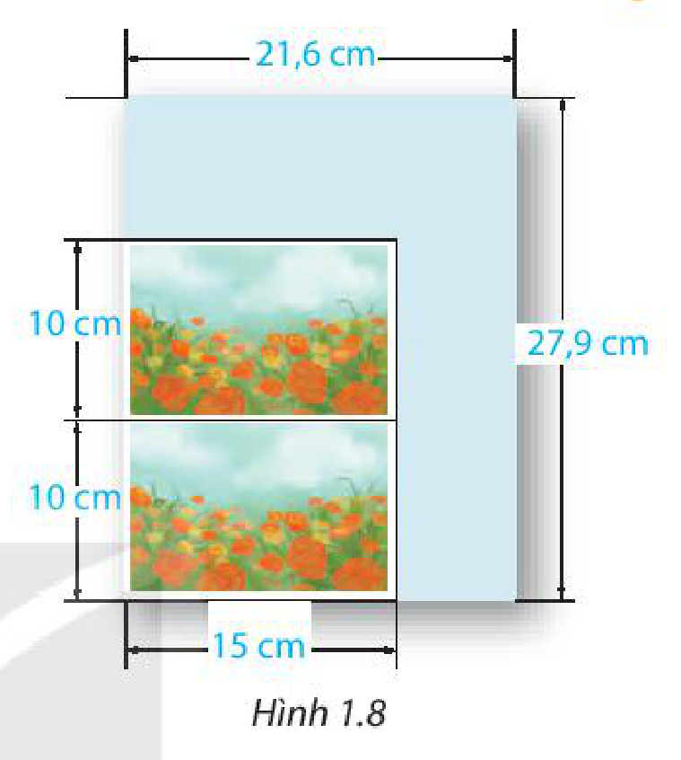
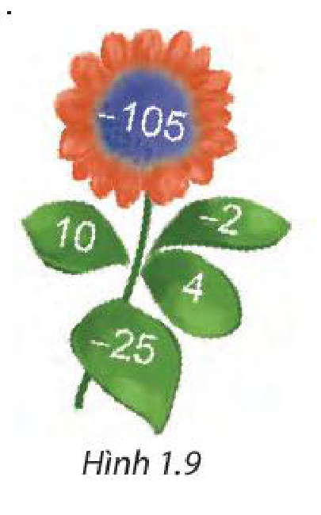
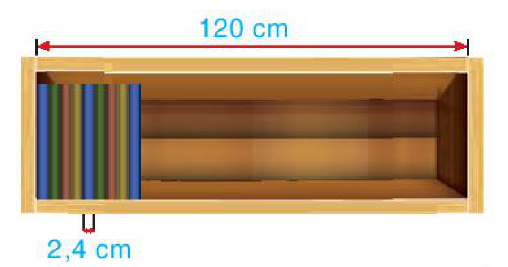

<!-- pdf:11 -->

# BÀI 2: CỘNG, TRỪ, NHÂN, CHIA SỐ HỮU TỈ

## 🎯 Kiến thức, kĩ năng

- Thực hiện các phép tính cộng, trừ, nhân, chia trong $\mathbb{Q}$.
- Vận dụng các tính chất của các phép toán và quy tắc dấu ngoặc để tính viết, tính nhẩm, tính nhanh một cách hợp lí.
- Giải quyết một số bài toán thực tế dùng số hữu tỉ.

## 🔴 Mở đầu

Giả sử một khinh khí cầu bay lên từ mặt đất theo chiều thẳng đứng với vận tốc $0,8\text{ m/s}$ trong $50$ giây. Sau đó nó giảm dần độ cao với vận tốc $\frac{5}{9}\text{ m/s}$. Hỏi sau $27$ giây kể từ khi hạ độ cao, khinh khí cầu cách mặt đất bao nhiêu mét?

## 1. CỘNG VÀ TRỪ HAI SỐ HỮU TỈ

**Cách cộng và trừ hai số hữu tỉ**

**HĐ1:** Nhắc lại quy tắc cộng và trừ hai phân số rồi thực hiện phép tính:

a) $\frac{-7}{8} + \frac{5}{12}$;

b) $\frac{-5}{7} - \frac{8}{21}$.

> **Vuông:** Mỗi số hữu tỉ đều viết được dưới dạng phân số với mẫu dương.
<!-- ocr-ok: đã đối chiếu ảnh trang PDF 11, hộp bóng thoại của Vuông bên phải HĐ1 -->

**HĐ2:** Viết các hỗn số và số thập phân trong phép tính sau dưới dạng phân số rồi thực hiện phép tính:
<!-- ocr-ok: đã đối chiếu ảnh trang PDF 11, OCR đọc sai chữ "phép" thành "phóp" -->

a) $0,25 + 1\frac{5}{12}$;

b) $-1,4 - \frac{3}{5}$.

<!-- term: Quy tắc cộng và trừ hai số hữu tỉ -->
> Ta có thể cộng, trừ hai số hữu tỉ bằng cách viết chúng dưới dạng phân số rồi áp dụng quy tắc cộng, trừ phân số.

**Ví dụ 1:** Tính: a) $\frac{2}{-3} + 2,5 + \frac{1}{3} + 1\frac{1}{2}$; b) $-0,5 + \frac{2}{3} + \frac{1}{2}$; c) $(-9,15) + 8,09$.
<!-- ocr-ok: đã đối chiếu ảnh trang PDF 11, OCR đọc lỗi nhãn Ví dụ 1 màu tím -->

> **Pi:** Phép cộng số hữu tỉ cũng có tính chất giao hoán, kết hợp giống phép cộng phân số.

**Giải:**

a) $\frac{2}{-3} + 2,5 + \frac{1}{3} + 1\frac{1}{2}$

$= \frac{-2}{3} + \frac{5}{2} + \frac{1}{3} + \frac{3}{2}$ $\leftarrow$ *viết số hữu tỉ dưới dạng phân số có mẫu dương*

$= \frac{-2}{3} + \frac{1}{3} + \frac{5}{2} + \frac{3}{2}$ $\leftarrow$ *tính chất giao hoán*

<!-- pdf:12 -->

$= \left(\frac{-2}{3} + \frac{1}{3}\right) + \left(\frac{5}{2} + \frac{3}{2}\right)$ $\leftarrow$ *tính chất kết hợp*

$= \frac{-1}{3} + 4 = \frac{11}{3}$;

b) $-0,5 + \frac{2}{3} + \frac{1}{2}$

$= \frac{-1}{2} + \frac{2}{3} + \frac{1}{2}$ $\leftarrow$ *viết số hữu tỉ dưới dạng phân số*

$= \left(\frac{-1}{2} + \frac{1}{2}\right) + \frac{2}{3}$ $\leftarrow$ *tính chất giao hoán, kết hợp*
<!-- ocr-ok: đã đối chiếu ảnh trang PDF 12, OCR đọc mất dấu chữ "kết" -->

$= 0 + \frac{2}{3} = \frac{2}{3}$; $\leftarrow$ *cộng với số $0$*

> **Pi:** Hai số đối nhau luôn có tổng bằng $0$:
> $a + (-a) = 0$.

c) $(-9,15) + 8,09 = -(9,15 - 8,09) = -1,06$.

<!-- term: Quy tắc cộng và trừ hai số hữu tỉ -->
**Chú ý:** Nếu hai số hữu tỉ đều được cho dưới dạng số thập phân thì ta áp dụng quy tắc cộng và trừ đối với số thập phân.
<!-- ocr-ok: đã đối chiếu ảnh trang PDF 12, OCR đọc sai chữ "hữu tỉ" -->

**Luyện tập 1:** Tính:

a) $(-7) - \left(-\frac{5}{8}\right)$;

b) $-21,25 + 13,3$.

**Nhận xét:** Trong tập các số hữu tỉ $\mathbb{Q}$, ta cũng có **quy tắc dấu ngoặc** tương tự như trong tập các số nguyên $\mathbb{Z}$.

**Ví dụ 2:** Tính: $\frac{8}{9} - \left[\frac{7}{4} - \left(\frac{3}{4} - \frac{2}{3}\right)\right]$.

**Giải:** $\frac{8}{9} - \left[\frac{7}{4} - \left(\frac{3}{4} - \frac{2}{3}\right)\right] = \frac{8}{9} - \frac{7}{4} + \left(\frac{3}{4} - \frac{2}{3}\right)$ $\leftarrow$ *bỏ dấu ngoặc có dấu “$-$” đằng trước dấu ngoặc vuông*
<!-- ocr-ok: đã đối chiếu ảnh trang PDF 12, OCR đọc sai dấu chữ "bỏ", "dấu", "đằng" -->

$= \frac{8}{9} - \frac{7}{4} + \frac{3}{4} - \frac{2}{3}$ $\leftarrow$ *bỏ dấu ngoặc có dấu “$+$” đằng trước*

$= \left(\frac{8}{9} - \frac{2}{3}\right) - \left(\frac{7}{4} - \frac{3}{4}\right)$ $\leftarrow$ *đặt dấu ngoặc có dấu “$-$” đằng trước*

$= \left(\frac{8}{9} - \frac{6}{9}\right) - 1 = \frac{2}{9} - 1 = -\frac{7}{9}$.

**Chú ý:** Đối với một tổng trong $\mathbb{Q}$, ta có thể đổi chỗ các số hạng, đặt dấu ngoặc để nhóm các số hạng một cách tuỳ ý như các tổng trong $\mathbb{Z}$.

**Luyện tập 2:** Bỏ dấu ngoặc rồi tính các tổng sau:

a) $\frac{9}{10} - \left(\frac{6}{5} - \frac{7}{4}\right)$;

b) $6,5 + [0,75 - (8,25 - 1,75)]$.

<!-- pdf:13 -->

**Vận dụng 1:**

Khoai tây là thức ăn chính của người châu Âu và là một món ăn ưa thích của người Việt Nam. Trong $100$ gam khoai tây khô có $11$ gam nước; $6,6$ gam protein; $0,3$ gam chất béo; $75,1$ gam glucid và các chất khác.

*(Theo Viện Dinh dưỡng Quốc gia)*

Em hãy cho biết khối lượng các chất khác trong $100$ gam khoai tây khô.

## 2. NHÂN VÀ CHIA HAI SỐ HỮU TỈ

**Cách nhân và chia hai số hữu tỉ**

**HĐ3:** Viết các hỗn số và số thập phân trong các phép tính sau dưới dạng phân số rồi thực hiện phép tính:

a) $0,36 \cdot \frac{-5}{9}$;

b) $\frac{-7}{6} : 1\frac{5}{7}$.

<!-- term: Nhân và chia hai số hữu tỉ -->
> Ta có thể nhân, chia hai số hữu tỉ bằng cách viết chúng dưới dạng phân số rồi áp dụng quy tắc nhân, chia phân số.

**Ví dụ 3:** Tính: a) $\frac{6}{7} \cdot 0,25$; b) $-2,4 : \frac{6}{5}$.
<!-- ocr-ok: đã đối chiếu ảnh trang PDF 13, OCR đọc lỗi nhãn Ví dụ 3 màu tím -->

**Giải:** a) $\frac{6}{7} \cdot 0,25 = \frac{6}{7} \cdot \frac{25}{100} = \frac{6}{7} \cdot \frac{1}{4} = \frac{6}{28} = \frac{3}{14}$; $\quad$ b) $-2,4 : \frac{6}{5} = \frac{-24}{10} : \frac{6}{5} = \frac{-12}{5} \cdot \frac{5}{6} = \frac{-60}{30} = -2$.

**Luyện tập 3:**

Tính:

a) $\left(-\frac{9}{13}\right) \cdot \left(-\frac{4}{5}\right)$;

b) $-0,7 : \frac{3}{2}$.

> **Pi:** Phép nhân các số hữu tỉ cũng có các tính chất của phép nhân phân số.

**Luyện tập 4:**

Tính một cách hợp lí: $\frac{7}{6} \cdot 3\frac{1}{4} + \frac{7}{6} \cdot (-0,25)$.

<!-- term: Nhân và chia hai số hữu tỉ -->
**Chú ý:** Nếu hai số hữu tỉ đều được cho dưới dạng số thập phân thì ta có thể áp dụng quy tắc nhân và chia đối với số thập phân, chẳng hạn:

$1,25 \cdot (-4,6) = -(1,25 \cdot 4,6) = -5,75;$

$7,8 : (-0,13) = -(7,8 : 0,13) = -60.$

<!-- pdf:14 -->

**Ví dụ 4:**

Trở lại *bài toán mở đầu*, trong $50$ giây đầu, khinh khí cầu bay lên cách mặt đất là:

$0,8 \cdot 50 = 40\text{ (m)}.$

Sau $27$ giây, khinh khí cầu giảm độ cao là: $\frac{5}{9} \cdot 27 = 15\text{ (m)}$.

Vậy sau $27$ giây, khinh khí cầu cách mặt đất là: $40 - 15 = 25\text{ (m)}$.

**Vận dụng 2:**

Có hai tấm ảnh kích thước $10\text{ cm} \times 15\text{ cm}$ được in trên giấy ảnh kích thước $21,6\text{ cm} \times 27,9\text{ cm}$ như Hình 1.8. Nếu cắt ảnh theo đúng kích thước thì diện tích phần giấy ảnh còn lại là bao nhiêu?

*Hình 1.8*

## BÀI TẬP

1.7. Tính:

a) $\frac{-6}{18} + \frac{18}{27}$;

b) $2,5 - \left(-\frac{6}{9}\right)$;

c) $-0,32 \cdot (-0,875)$;

d) $(-5) : 2\frac{1}{5}$.

1.8. Tính giá trị của các biểu thức sau:

a) $\left(8 + 2\frac{1}{3} - \frac{3}{5}\right) - (5 + 0,4) - \left(3\frac{1}{3} - 2\right)$;

b) $\left(7 - \frac{1}{2} - \frac{3}{4}\right) : \left(5 - \frac{1}{4} - \frac{5}{8}\right)$.

1.9. Em hãy tìm cách "nối" các số ở những chiếc lá trong Hình 1.9 bằng dấu các phép tính cộng, trừ, nhân, chia và dấu ngoặc để được một biểu thức có giá trị đúng bằng số ở bông hoa.

*Hình 1.9*

1.10. Tính một cách hợp lí.

$0,65 \cdot 78 + 2\frac{1}{5} \cdot 2\,020 + 0,35 \cdot 78 - 2,2 \cdot 2\,020.$

1.11. Ngăn đựng sách của một giá sách trong thư viện dài $120\text{ cm}$ (xem hình bên). Người ta dự định xếp các cuốn sách dày khoảng $2,4\text{ cm}$ vào ngăn này. Hỏi ngăn sách đó có thể để được nhiều nhất bao nhiêu cuốn sách như vậy?

## 📷 Danh sách hình trong bài

| Mã hình | Trang PDF | Vị trí trong bài | Chú thích gốc |
| --- | :---: | --- | --- |
| H7-toan-b02-01 | 11 | Mở đầu | (sách không đánh số, khinh khí cầu đang bay) |
| H7-toan-b02-02 | 13 | Mục 1, Vận dụng 1 | (sách không đánh số, củ khoai tây) |
| H7-toan-b02-03 | 14 | Mục 2, Vận dụng 2 | Hình 1.8 |
| H7-toan-b02-04 | 14 | Bài tập 1.9 | Hình 1.9 |
| H7-toan-b02-05 | 14 | Bài tập 1.11 | (sách không đánh số, ngăn đựng sách dài $120\text{ cm}$ và các cuốn sách dày $2,4\text{ cm}$) |
