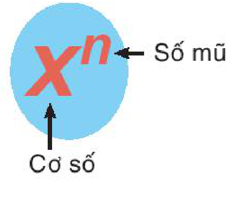
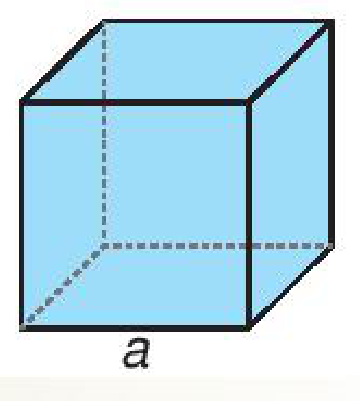
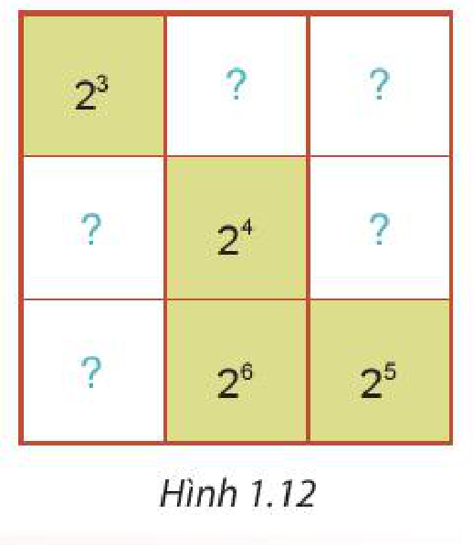

<!-- pdf:17 -->

# BÀI 3: LUỸ THỪA VỚI SỐ MŨ TỰ NHIÊN CỦA MỘT SỐ HỮU TỈ

## 🔤 Khái niệm, thuật ngữ

- Luỹ thừa
- Cơ số
- Số mũ
<!-- ocr-ok: đã đối chiếu ảnh trang PDF 17, OCR đọc nhầm "Cơ số" thành "(ơ số" -->

## 🎯 Kiến thức, kĩ năng

- Mô tả phép tính luỹ thừa với số mũ tự nhiên của một số hữu tỉ.
- Thực hiện tính tích, thương hai luỹ thừa cùng cơ số, luỹ thừa của luỹ thừa.

## 🔴 Mở đầu

Trái Đất, ngôi nhà chung của tất cả chúng ta có khoảng $71\%$ diện tích bề mặt được bao phủ bởi nước. Nếu gom hết toàn bộ lượng nước trên Trái Đất để đổ đầy vào một bể chứa hình lập phương thì kích thước cạnh của bể phải lên tới $1\,111,34\text{ km}$.

*(Theo usgs.gov)*

Muốn biết lượng nước trên Trái Đất là khoảng bao nhiêu kilômét khối, ta cần tính $1\,111,34 \times 1\,111,34 \times 1\,111,34$. Biểu thức này có thể viết gọn hơn dưới dạng luỹ thừa giống như luỹ thừa của một số tự nhiên mà em đã học ở lớp $6$.

## 1. LUỸ THỪA VỚI SỐ MŨ TỰ NHIÊN

**Luỹ thừa với số mũ tự nhiên**

**HĐ1:** Viết các tích sau dưới dạng luỹ thừa rồi chỉ ra cơ số và số mũ của luỹ thừa đó.

a) $2 \cdot 2 \cdot 2 \cdot 2$;

b) $5 \cdot 5 \cdot 5$.

> **Tròn:** $a^n = \underbrace{a \cdot a \cdot \dots \cdot a}_{n \text{ thừa số}}$ ($a, n \in \mathbb{N}, n > 1$)

**HĐ2:** Thực hiện phép tính:

a) $(-2) \cdot (-2) \cdot (-2)$;

b) $(-0,5) \cdot (-0,5)$;

c) $\frac{1}{2} \cdot \frac{1}{2} \cdot \frac{1}{2} \cdot \frac{1}{2}$.

**HĐ3:** Hãy viết các biểu thức trong HĐ2 dưới dạng luỹ thừa tương tự như luỹ thừa của số tự nhiên.

Với số hữu tỉ $x$, ta cũng có định nghĩa sau:

> **Luỹ thừa bậc $n$** của một số hữu tỉ $x$, kí hiệu $x^n$, là tích của $n$ thừa số $x$ ($n$ là số tự nhiên lớn hơn $1$):
>
> $x^n = \underbrace{x \cdot x \cdot x \cdot \dots \cdot x}_{n \text{ thừa số}} \quad (x \in \mathbb{Q}, n \in \mathbb{N}, n > 1).$
>
> $x^n$ đọc là $x$ mũ $n$ hoặc $x$ luỹ thừa $n$ hoặc luỹ thừa bậc $n$ của $x$.
>
> $x$ gọi là **cơ số**, $n$ gọi là **số mũ**.
>
> *Quy ước:* $x^0 = 1$ ($x \ne 0$); $x^1 = x$.
<!-- ocr-ok: đã đối chiếu ảnh trang PDF 17, khung định nghĩa luỹ thừa nhiều công thức LaTeX -->

<!-- pdf:18 -->

**Ví dụ 1:** Tính: a) $(-3)^3$; $\quad$ b) $\left(\frac{1}{3}\right)^4$.
<!-- ocr-ok: đã đối chiếu ảnh trang PDF 18, OCR đọc lỗi nhãn Ví dụ 1 màu tím -->

**Giải:** a) $(-3)^3 = (-3) \cdot (-3) \cdot (-3) = -27$; $\quad$ b) $\left(\frac{1}{3}\right)^4 = \frac{1}{3} \cdot \frac{1}{3} \cdot \frac{1}{3} \cdot \frac{1}{3} = \frac{1 \cdot 1 \cdot 1 \cdot 1}{3 \cdot 3 \cdot 3 \cdot 3} = \frac{1}{81}$.

**Luyện tập 1:** Tính:

a) $\left(-\frac{4}{5}\right)^4$;

b) $(0,7)^3$.

**Ví dụ 2:** Tính và so sánh: a) $2^2 \cdot 3^2$ và $(2 \cdot 3)^2$; $\quad$ b) $\frac{(-14)^2}{7^2}$ và $\left(\frac{-14}{7}\right)^2$.
<!-- ocr-ok: đã đối chiếu ảnh trang PDF 18, câu chứa nhiều biểu thức luỹ thừa LaTeX -->

**Giải:** a) $2^2 \cdot 3^2 = 4 \cdot 9 = 36$ và $(2 \cdot 3)^2 = 6^2 = 36$ nên $2^2 \cdot 3^2 = (2 \cdot 3)^2$.

b) $\frac{(-14)^2}{7^2} = \frac{196}{49} = 4$ và $\left(\frac{-14}{7}\right)^2 = (-2)^2 = 4$ nên $\frac{(-14)^2}{7^2} = \left(\frac{-14}{7}\right)^2$.

<!-- term: Luỹ thừa của một tích và một thương -->
**Chú ý:** Luỹ thừa của một tích bằng tích các luỹ thừa; Luỹ thừa của một thương bằng thương các luỹ thừa.

<!-- term: Luỹ thừa của một tích và một thương -->
> **Pi:**
> - $(x \cdot y)^n = x^n \cdot y^n$.
> - $\left(\frac{x}{y}\right)^n = \frac{x^n}{y^n}$ ($y \ne 0$).

**Luyện tập 2:** Tính:

a) $\left(\frac{2}{3}\right)^{10} \cdot 3^{10}$;

b) $(-125)^3 : 25^3$;

c) $(0,08)^3 \cdot 10^3$.

**Vận dụng:**

Viết công thức tính thể tích của hình lập phương cạnh $a$ dưới dạng luỹ thừa. Từ đó viết biểu thức luỹ thừa để tính toàn bộ lượng nước trên Trái Đất trong *bài toán mở đầu* (đơn vị kilômét khối).

## 2. NHÂN VÀ CHIA HAI LUỸ THỪA CÙNG CƠ SỐ

**Cách tính nhân và chia hai luỹ thừa cùng cơ số**

**HĐ4:** Tính và so sánh:

a) $(-3)^2 \cdot (-3)^4$ và $(-3)^6$;

b) $0,6^3 : 0,6^2$ và $0,6$.

<!-- term: Tích và thương của hai luỹ thừa cùng cơ số -->
> - Khi nhân hai luỹ thừa cùng cơ số, ta giữ nguyên cơ số và cộng hai số mũ.
>   $x^m \cdot x^n = x^{m + n}.$
> - Khi chia hai luỹ thừa cùng cơ số khác $0$, ta giữ nguyên cơ số và lấy số mũ của luỹ thừa bị chia trừ số mũ của luỹ thừa chia.
>   $x^m : x^n = x^{m - n} \quad (x \ne 0, m \ge n).$

> **Vuông:** $(-3)^2 \cdot (-3)^4 = (-3) \cdot (-3) \cdot (-3) \cdot \dots = \dots$

<!-- pdf:19 -->

**Ví dụ 3:** Tính: a) $\left(\frac{2}{3}\right)^5 \cdot \left(\frac{2}{3}\right)^3$; $\quad$ b) $(-5)^5 : (-5)^5$.
<!-- ocr-ok: đã đối chiếu ảnh trang PDF 19, OCR đọc lỗi nhãn Ví dụ 3 màu tím -->

**Giải:** a) $\left(\frac{2}{3}\right)^5 \cdot \left(\frac{2}{3}\right)^3 = \left(\frac{2}{3}\right)^{5 + 3} = \left(\frac{2}{3}\right)^8 = \frac{256}{6\,561}$; $\quad$ b) $(-5)^5 : (-5)^5 = (-5)^{5 - 5} = (-5)^0 = 1$.

**Luyện tập 3:** Viết kết quả của các phép tính sau dưới dạng luỹ thừa.

a) $(-2)^3 \cdot (-2)^4$;

b) $(0,25)^7 : (0,25)^3$.

## 3. LUỸ THỪA CỦA LUỸ THỪA

**Tính luỹ thừa của luỹ thừa**

**HĐ5:** Viết số $(2^2)^3$ dưới dạng luỹ thừa cơ số $2$ và số $\left[(-3)^2\right]^2$ dưới dạng luỹ thừa cơ số $-3$.

> **Tròn:** $(2^2)^3 = 2^2 \cdot 2^2 \cdot 2^2 = \dots$

<!-- term: Luỹ thừa của luỹ thừa -->
> Khi tính luỹ thừa của một luỹ thừa, ta giữ nguyên cơ số và nhân hai số mũ.
>
> $\left(x^m\right)^n = x^{m \cdot n}.$

**Ví dụ 4:** Tính: $\left[(-5)^3\right]^7$.

**Giải:** $\left[(-5)^3\right]^7 = (-5)^{3 \cdot 7} = (-5)^{21}$.

**Luyện tập 4:** Viết các số $\left(\frac{1}{4}\right)^8$; $\left(\frac{1}{8}\right)^3$ dưới dạng luỹ thừa cơ số $\frac{1}{2}$.

**Thử thách nhỏ:**

Cho hình vuông như Hình 1.12. Em hãy thay mỗi dấu “$?$” bằng một luỹ thừa của $2$, biết tích các luỹ thừa trên mỗi hàng, mỗi cột và mỗi đường chéo đều bằng nhau.

*Hình 1.12*

## BÀI TẬP

1.18. Viết các số $125$; $3\,125$ dưới dạng luỹ thừa của $5$.

1.19. Viết các số $\left(\frac{1}{9}\right)^5$; $\left(\frac{1}{27}\right)^7$ dưới dạng luỹ thừa cơ số $\frac{1}{3}$.
<!-- ocr-ok: đã đối chiếu ảnh trang PDF 19, OCR đọc chữ "số" thành "SỐ" -->

1.20. Thay mỗi dấu “$?$” bởi một luỹ thừa của $3$, biết rằng từ ô thứ ba, luỹ thừa cần tìm là tích của hai luỹ thừa ở hai ô liền trước.

| $3^0$ | $3^1$ | $?$ | $?$ | $?$ | $?$ | $?$ |
| :---: | :---: | :---: | :---: | :---: | :---: | :---: |

<!-- pdf:20 -->

1.21. Không sử dụng máy tính, hãy tính:

a) $(-3)^8$, biết $(-3)^7 = -2\,187$;

b) $\left(-\frac{2}{3}\right)^{12}$, biết $\left(-\frac{2}{3}\right)^{11} = \frac{-2\,048}{177\,147}$.

1.22. Viết các biểu thức sau dưới dạng luỹ thừa của một số hữu tỉ.

a) $15^8 \cdot 2^4$;

b) $27^5 : 32^3$.

1.23. Tính:

a) $\left(1 + \frac{1}{2} - \frac{1}{4}\right)^2 \cdot \left(2 + \frac{3}{7}\right)$;

b) $4 : \left(\frac{1}{2} - \frac{1}{3}\right)^3$.

1.24. Khoảng cách từ Trái Đất đến Mặt Trời bằng khoảng $1,5 \cdot 10^8\text{ km}$. Khoảng cách từ Mộc tinh đến Mặt Trời khoảng $7,78 \cdot 10^8\text{ km}$. Hỏi khoảng cách từ Mộc tinh đến Mặt Trời gấp khoảng bao nhiêu lần khoảng cách từ Trái Đất đến Mặt Trời?

*(Theo solarsystem.nasa.gov)*

1.25. Bảng thống kê dưới đây cho biết số lượt khách quốc tế đến thăm Việt Nam trong năm $2019$.

| Quốc gia | Số lượt khách đến thăm |
| --- | :---: |
| Hàn Quốc | $4,3 \cdot 10^6$ |
| Hoa Kỳ | $7,4 \cdot 10^5$ |
| Pháp | $2,9 \cdot 10^5$ |
| Ý | $7 \cdot 10^4$ |
<!-- ocr-ok: đã đối chiếu ảnh trang PDF 20, OCR đọc nhầm "Ý" thành "KH m" -->

*(Theo Viện Nghiên cứu Phát triển Du lịch)*

Em hãy sắp xếp tên các quốc gia theo thứ tự số lượng khách đến thăm Việt Nam từ nhỏ đến lớn.

## 💡 Em có biết?

**LUỸ THỪA VỚI SỐ MŨ ÂM**

<!-- term: Luỹ thừa với số mũ nguyên âm -->
Cùng với luỹ thừa với số mũ tự nhiên, người ta còn xét cả luỹ thừa với số mũ nguyên âm của một số khác $0$. Ta định nghĩa $x^{-n} = \frac{1}{x^n}$, với $n$ là số nguyên dương, $x \ne 0$.

Ví dụ: $\frac{1}{100} = \frac{1}{10^2} = 10^{-2}$; $\quad \frac{1}{1\,000} = \frac{1}{10^3} = 10^{-3}$.

Luỹ thừa với số mũ nguyên âm của $10$ thường được dùng để viết những số rất nhỏ cho thuận tiện. Ví dụ, phần lớn vi khuẩn có kích thước là $1$ micromét, tức $10^{-6}\text{ m}$. Đơn vị đo thời gian nhỏ nhất là yocto giây, $1\text{ yocto giây} = 10^{-24}\text{ giây}$.

*(Theo chemistryviews.org)*

## 📷 Danh sách hình trong bài

| Mã hình | Trang PDF | Vị trí trong bài | Chú thích gốc |
| --- | :---: | --- | --- |
| H7-toan-b03-01 | 17 | Mở đầu | (sách không đánh số, hình ảnh Trái Đất nhìn từ vũ trụ) |
| H7-toan-b03-02 | 17 | Mục 1 | (sách không đánh số, sơ đồ cơ số và số mũ của luỹ thừa $x^n$) |
| H7-toan-b03-03 | 18 | Mục 1, Vận dụng | (sách không đánh số, hình lập phương cạnh $a$) |
| H7-toan-b03-04 | 19 | Mục 3, Thử thách nhỏ | Hình 1.12 |
