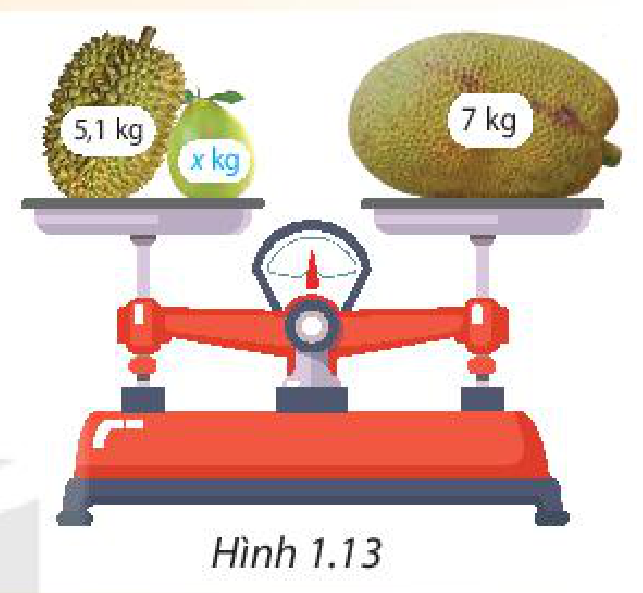

<!-- pdf:21 -->

# BÀI 4: THỨ TỰ THỰC HIỆN CÁC PHÉP TÍNH. QUY TẮC CHUYỂN VẾ

## 🔤 Khái niệm, thuật ngữ

- Quy tắc chuyển vế

## 🎯 Kiến thức, kĩ năng

- Mô tả thứ tự thực hiện các phép tính.
- Mô tả quy tắc chuyển vế.
- Giải quyết một số vấn đề thực tiễn gắn với các phép tính về số hữu tỉ.

## 🔴 Mở đầu

Biết cân ở trạng thái cân bằng (H.1.13), hỏi quả bưởi nặng bao nhiêu kilôgam?

*Hình 1.13*

## 1. THỨ TỰ THỰC HIỆN CÁC PHÉP TÍNH

*Thứ tự thực hiện các phép tính*

**HĐ:** Em hãy nhắc lại thứ tự thực hiện các phép tính đối với các số tự nhiên rồi tính:

a) $10 + 36 : 2 \cdot 3$;

b) $[5 + 2 \cdot (9 - 2^3)] : 7$.

*Thứ tự thực hiện phép tính đối với các số tự nhiên vẫn đúng đối với các số hữu tỉ.*
<!-- ocr-ok: đã đối chiếu ảnh trang PDF 21, OCR đọc sai dấu ngã chữ "hữu" thành "hũu" -->

<!-- term: Thứ tự thực hiện các phép tính -->
> - Với các biểu thức chỉ có phép cộng và phép trừ hoặc chỉ có phép nhân và phép chia ta thực hiện các phép tính từ trái sang phải.
> - Với các biểu thức không có dấu ngoặc, ta thực hiện theo thứ tự:
>   $\text{Luỹ thừa} \longrightarrow \text{Nhân và chia} \longrightarrow \text{Cộng và trừ}$
> - Với các biểu thức có dấu ngoặc, ta thực hiện trong ngoặc trước, ngoài ngoặc sau.
>   $( ) \rightarrow [ ] \rightarrow \{ \}.$

**Ví dụ 1:** Tính giá trị của các biểu thức sau:

a) $1,2 - 3^2 + 7,5 : 3$;

b) $9,8 + 1,5 \cdot 6 + (6,8 - 2) : 3$.

**Giải:**

a) $1,2 - 3^2 + 7,5 : 3 = 1,2 - 9 + 2,5$ $\leftarrow$ *thực hiện phép tính luỹ thừa, nhân, chia trước*

$= -7,8 + 2,5 = -5,3$;

b) $9,8 + 1,5 \cdot 6 + (6,8 - 2) : 3 = 9,8 + 9 + 4,8 : 3$ $\leftarrow$ *thực hiện trong ngoặc trước*

$= 18,8 + 1,6 = 20,4$.

<!-- pdf:22 -->

**Luyện tập 1:** Tính giá trị của các biểu thức sau:

a) $\left(\frac{2}{3} + \frac{1}{6}\right) : \frac{5}{4} + \left(\frac{1}{4} + \frac{3}{8}\right) : \frac{5}{2}$;

b) $\frac{5}{9} : \left(\frac{1}{11} - \frac{5}{22}\right) + \frac{7}{4} \cdot \left(\frac{1}{14} - \frac{2}{7}\right)$.

## 2. QUY TẮC CHUYỂN VẾ

**Đẳng thức**

Từ Hình 1.13 trong *bài toán mở đầu*, nếu gọi $x$ là số cân nặng của quả bưởi thì ta có $5,1 + x = 7$.

Ta nói $5,1 + x = 7$ là một **đẳng thức**, trong đó $5,1 + x$ là **vế trái**, $7$ là **vế phải** của đẳng thức.
<!-- ocr-ok: đã đối chiếu ảnh trang PDF 22, OCR dính chữ câu định nghĩa đẳng thức -->

Chẳng hạn, $a \cdot a = a^2$ và $2,7 - 8,1 = -5,4$ là những đẳng thức.

<!-- term: Tính chất của đẳng thức -->
*Khi biến đổi các đẳng thức, ta thường áp dụng các tính chất sau:*

<!-- term: Tính chất của đẳng thức -->
> Nếu $a = b$ thì: $\quad b = a$; $\quad a + c = b + c$.
<!-- ocr-ok: đã đối chiếu ảnh trang PDF 22, hộp kiến thức nhiều kí hiệu toán học -->

> ❓ Chỉ ra vế trái, vế phải của đẳng thức $2 \cdot (b + 1) = 2b + 2$.

**Ví dụ 2:** a) Tìm $a$, biết $a + 6 = -9$; $\quad$ b) Tìm $b$, biết $b - 8 = -3$.

**Giải:**

a) Từ đẳng thức $a + 6 = -9$, ta có:

$\begin{aligned} a + 6 + (-6) &= -9 + (-6) \\ a + [6 + (-6)] &= -15 \\ a + 0 &= -15 \\ a &= -15; \end{aligned}$

b) Từ đẳng thức $b - 8 = -3$, ta có:

$\begin{aligned} b - 8 + 8 &= -3 + 8 \\ b - (8 - 8) &= 5 \\ b - 0 &= 5 \\ b &= 5. \end{aligned}$

**Quy tắc chuyển vế**

Từ Ví dụ 2, ta thấy $a = -9 - 6$ và $b = -3 + 8$.

> Khi chuyển một số hạng từ vế này sang vế kia của một đẳng thức, ta phải đổi dấu số hạng đó: dấu “$+$” đổi thành dấu “$-$” và dấu “$-$” đổi thành dấu “$+$”.

> **Tròn:**
> - Nếu $a + b = c$ thì $a = c - b$.
> - Nếu $a - b = c$ thì $a = c + b$.
<!-- ocr-ok: đã đối chiếu ảnh trang PDF 22, hộp bóng thoại của Tròn nhiều kí hiệu toán học -->

**Ví dụ 3:** Tìm $x$, biết:
<!-- ocr-ok: đã đối chiếu ảnh trang PDF 22, OCR đọc lỗi nhãn Ví dụ 3 màu tím -->

a) $x + \frac{1}{2} = -\frac{6}{7}$;

b) $x - \frac{3}{4} = \frac{9}{8}$.

<!-- pdf:23 -->

**Giải:**

a) $x + \frac{1}{2} = -\frac{6}{7}$

$x = -\frac{6}{7} - \frac{1}{2}$ $\leftarrow$ *quy tắc chuyển vế*
<!-- ocr-ok: đã đối chiếu ảnh trang PDF 23, OCR đọc mất chữ ở chú thích mũi tên quy tắc chuyển vế -->

$x = -\frac{12}{14} - \frac{7}{14}$

$x = -\frac{19}{14}$. Vậy $x = -\frac{19}{14}$.

b) $x - \frac{3}{4} = \frac{9}{8}$

$x = \frac{9}{8} + \frac{3}{4}$ $\leftarrow$ *quy tắc chuyển vế*
<!-- ocr-ok: đã đối chiếu ảnh trang PDF 23, OCR đọc mất chữ ở chú thích mũi tên quy tắc chuyển vế -->

$x = \frac{9}{8} + \frac{6}{8}$

$x = \frac{15}{8}$. Vậy $x = \frac{15}{8}$.

**Luyện tập 2:**

Tìm $x$, biết:

a) $x + 7,25 = 15,75$;

b) $\left(-\frac{1}{3}\right) - x = \frac{17}{6}$.

**Vận dụng:**

Vào dịp tết Nguyên đán, bà của An gói bánh chưng cho gia đình. Nguyên liệu để làm bánh gồm gạo nếp, đậu xanh, thịt lợn và lá dong. Mỗi cái bánh chưng sau khi gói nặng khoảng $0,8\text{ kg}$ gồm $0,5\text{ kg}$ gạo; $0,125\text{ kg}$ đậu xanh; $0,04\text{ kg}$ lá dong, còn lại là thịt. Hỏi khối lượng thịt trong mỗi cái bánh là khoảng bao nhiêu?

## BÀI TẬP

1.26. Tìm $x$, biết:

a) $x + 0,25 = \frac{1}{2}$;

b) $x - \left(-\frac{5}{7}\right) = \frac{9}{14}$.

1.27. Tìm $x$, biết:

a) $x - \left(\frac{5}{4} - \frac{7}{5}\right) = \frac{9}{20}$;

b) $9 - x = \frac{8}{7} - \left(-\frac{7}{8}\right)$.

1.28. Tính một cách hợp lí.

a) $-1,2 + (-0,8) + 0,25 + 5,75 - 2\,021$;

b) $-0,1 + \frac{16}{9} + 11,1 + \frac{-20}{9}$.

1.29. Bỏ dấu ngoặc rồi tính các tổng sau:

a) $\frac{17}{11} - \left(\frac{6}{5} - \frac{16}{11}\right) + \frac{26}{5}$;

b) $\frac{39}{5} + \left(\frac{9}{4} - \frac{9}{5}\right) - \left(\frac{5}{4} + \frac{6}{7}\right)$.

1.30. Để làm một cái bánh, cần $2\frac{3}{4}$ cốc bột. Lan đã có $1\frac{1}{2}$ cốc bột. Hỏi Lan cần thêm bao nhiêu cốc bột nữa để vừa đủ làm được một cái bánh?

## 📷 Danh sách hình trong bài

| Mã hình | Trang PDF | Vị trí trong bài | Chú thích gốc |
| --- | :---: | --- | --- |
| H7-toan-b04-01 | 21 | Mở đầu | Hình 1.13 |
| H7-toan-b04-02 | 22 | Mục 2, Đẳng thức | (sách không đánh số, sơ đồ minh hoạ vế trái và vế phải của đẳng thức $A = B$) |
| H7-toan-b04-03 | 23 | Mục 2, Vận dụng | (sách không đánh số, ảnh gói bánh chưng ngày Tết) |
