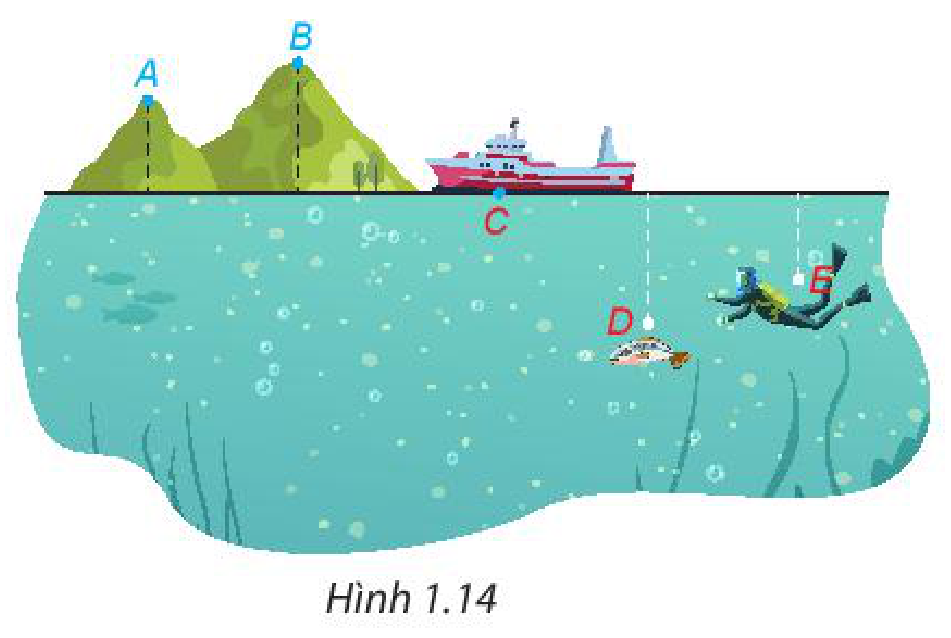
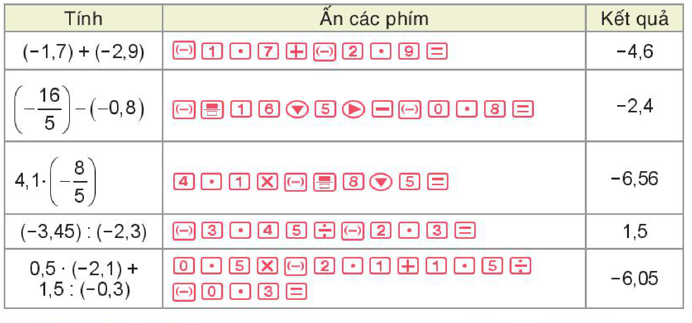

<!-- pdf:26 -->

# BÀI TẬP CUỐI CHƯƠNG I

1.35. Hình 1.14 mô phỏng vị trí của năm điểm $A, B, C, D, E$ so với mực nước biển. Biết rằng độ cao (tính theo đơn vị kilômét) so với mực nước biển của mỗi điểm là một trong các số sau:

$\frac{33}{12}; \quad \frac{79}{30}; \quad -\frac{25}{12}; \quad -\frac{5}{6}; \quad 0.$

Quan sát hình và cho biết độ cao của mỗi điểm.
<!-- ocr-ok: đã đối chiếu ảnh trang PDF 26, OCR đọc sai dấu ngã chữ "mỗi" thành "môi" -->

*Hình 1.14*

1.36. Tính giá trị của các biểu thức sau:

a) $\frac{3^{12} + 3^{15}}{1 + 3^3}$;

b) $2 : \left(\frac{1}{2} - \frac{2}{3}\right)^2 + 0,125^3 \cdot 8^3 - (-12)^4 : 6^4$.

1.37. Chị Trang đang có ba tháng thực tập tại Mỹ. Gần hết thời gian thực tập, chị Trang và bạn có kế hoạch tổ chức một bữa tiệc chia tay trước khi về nước. Chị ấy dự định mua $4$ cái bánh pizza, mỗi cái giá $10,25\text{ USD}$. Chị Trang có phiếu giảm giá $1,5\text{ USD}$ cho mỗi cái bánh pizza, hãy tính tổng số tiền chị ấy dùng để mua bánh.
<!-- ocr-ok: đã đối chiếu ảnh trang PDF 26, OCR dính chữ với hộp bóng thoại USD bên phải -->

> **Vuông:** Đồng đô la Mỹ, viết tắt là USD (United States dollar), là đơn vị tiền tệ chính thức của Hoa Kỳ.
<!-- ocr-ok: đã đối chiếu ảnh trang PDF 26, hộp bóng thoại giải thích đơn vị tiền tệ USD -->

1.38. Bố của Hà chuẩn bị đi công tác bằng máy bay. Theo kế hoạch, máy bay sẽ cất cánh lúc $14$ giờ $40$ phút. Bố của Hà cần phải có mặt ở sân bay trước ít nhất $2$ giờ để làm thủ tục, biết rằng đi từ nhà Hà đến sân bay mất khoảng $45$ phút. Hỏi bố của Hà phải đi từ nhà muộn nhất là lúc mấy giờ để đến sân bay cho kịp giờ bay?

**GÓC CÔNG NGHỆ**

Ta có thể sử dụng loại máy tính cầm tay thích hợp để thực hiện các phép tính với số hữu tỉ. Chẳng hạn:
<!-- ocr-ok: đã đối chiếu ảnh trang PDF 26, OCR đọc mất chữ i trong "số hữu tỉ" -->

| Tính | Ấn các phím | Kết quả |
| :---: | --- | :---: |
| $(-1,7) + (-2,9)$ | `(-)` `1` `.` `7` `+` `(-)` `2` `.` `9` `=` | $-4,6$ |
| $\left(-\frac{16}{5}\right) - (-0,8)$ | `(-)` `[phân số]` `1` `6` `▼` `5` `▶` `-` `(-)` `0` `.` `8` `=` | $-2,4$ |
| $4,1 \cdot \left(-\frac{8}{5}\right)$ | `4` `.` `1` `×` `(-)` `[phân số]` `8` `▼` `5` `=` | $-6,56$ |
| $(-3,45) : (-2,3)$ | `(-)` `3` `.` `4` `5` `÷` `(-)` `2` `.` `3` `=` | $1,5$ |
| $0,5 \cdot (-2,1) + 1,5 : (-0,3)$ | `0` `.` `5` `×` `(-)` `2` `.` `1` `+` `1` `.` `5` `÷` `(-)` `0` `.` `3` `=` | $-6,05$ |
<!-- ocr-ok: đã đối chiếu ảnh trang PDF 26, các phím bấm máy tính là kí hiệu đồ hoạ không nhận diện được qua OCR -->

## 📷 Danh sách hình trong bài

| Mã hình | Trang PDF | Vị trí trong bài | Chú thích gốc |
| --- | :---: | --- | --- |
| H7-toan-bt-c01-01 | 26 | Bài tập 1.35 | Hình 1.14 |
| H7-toan-bt-c01-02 | 26 | Góc công nghệ | (sách không đánh số, bảng ấn các phím máy tính cầm tay thực hiện phép tính với số hữu tỉ) |
