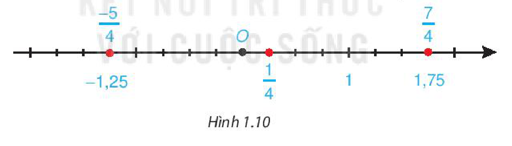
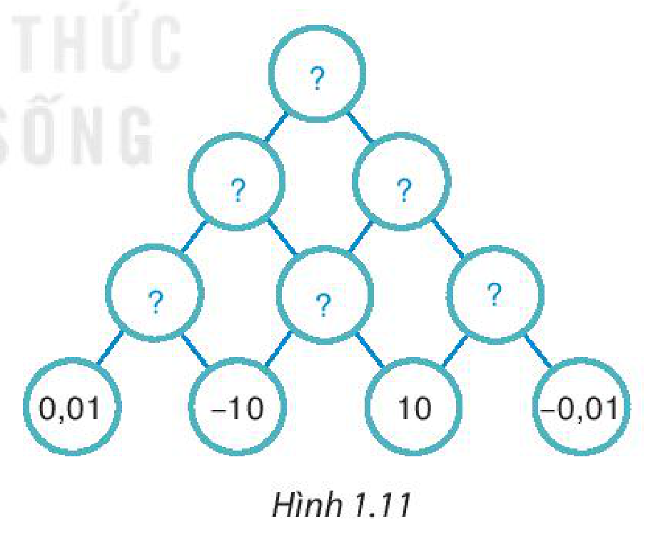

<!-- pdf:15 -->

# LUYỆN TẬP CHUNG (TRANG 14)

**Ví dụ 1:** Tính một cách hợp lí.
<!-- ocr-ok: đã đối chiếu ảnh trang PDF 15, OCR đọc sai nhãn Ví dụ 1 và chữ "hợp lí" -->

a) $A = \frac{37}{5} + (-0,7) + \frac{5}{2} + (-4,3)$;

b) $B = \frac{3}{2} \cdot \left(-\frac{37}{10}\right) + \frac{17}{2} \cdot \left(-\frac{37}{10}\right)$.

**Giải:**

a) $A = 7,4 + (-0,7) + 2,5 + (-4,3) = (7,4 + 2,5) + [(-0,7) + (-4,3)]$

$= 9,9 + (-5) = 4,9$.

b) $B = \left(\frac{3}{2} + \frac{17}{2}\right) \cdot \left(-\frac{37}{10}\right) = 10 \cdot \left(-\frac{37}{10}\right) = -37$.

**Ví dụ 2:**

a) Biểu diễn các số hữu tỉ $1,75$; $-1,25$ và $\frac{1}{4}$ trên trục số.

b) Sắp xếp các số hữu tỉ trên theo thứ tự từ nhỏ đến lớn dựa vào trục số đã vẽ.

**Giải:**

a) Ta viết $1,75 = \frac{7}{4}$; $-1,25 = \frac{-5}{4}$.

Chia đoạn thẳng đơn vị thành bốn đoạn bằng nhau, lấy một đoạn làm đơn vị mới (đơn vị mới bằng $\frac{1}{4}$ đơn vị cũ). Khi đó các số hữu tỉ $1,75$; $-1,25$; $\frac{1}{4}$ được biểu diễn như sau:

*Hình 1.10*

b) Trên trục số Hình 1.10, $-1,25$ nằm trước $\frac{1}{4}$ và $\frac{1}{4}$ nằm trước $1,75$.

Do đó $-1,25 < \frac{1}{4} < 1,75$.

## BÀI TẬP

1.12. So sánh:

a) $\frac{123}{7}$ và $17,75$;

b) $-\frac{65}{9}$ và $-7,125$.

<!-- pdf:16 -->

1.13. Bảng sau cho biết các điểm đông đặc và điểm sôi của sáu nguyên tố được gọi là khí hiếm.

| Khí hiếm | Điểm đông đặc ($^\circ\text{C}$) | Điểm sôi ($^\circ\text{C}$) |
| --- | :---: | :---: |
| Argon (A-gon) | $-189,2$ | $-185,7$ |
| Helium (Hê-li) | $-272,2$ | $-268,6$ |
| Neon (Nê-on) | $-248,67$ | $-245,72$ |
| Krypton (Kríp-tôn) | $-156,6$ | $-152,3$ |
| Radon (Ra-đôn) | $-71,0$ | $-61,8$ |
| Xenon (Xê-nôn) | $-111,9$ | $-107,1$ |
<!-- ocr-ok: đã đối chiếu ảnh trang PDF 16, bảng số liệu nhiều số thập phân âm trong LaTeX -->

*(Theo britannica.com)*

a) Khí hiếm nào có điểm đông đặc nhỏ hơn điểm đông đặc của Krypton?

b) Khí hiếm nào có điểm sôi lớn hơn điểm sôi của Argon?

c) Hãy sắp xếp các khí hiếm theo thứ tự điểm đông đặc tăng dần;

d) Hãy sắp xếp các khí hiếm theo thứ tự điểm sôi giảm dần.

1.14. Theo Đài khí tượng thuỷ văn tỉnh Lào Cai, ngày 10-01-2021, nhiệt độ thấp nhất tại thị xã Sa Pa là $-0,7\ ^\circ\text{C}$; nhiệt độ tại thành phố Lào Cai khoảng $9,6\ ^\circ\text{C}$. Hỏi nhiệt độ tại thành phố Lào Cai cao hơn nhiệt độ tại thị xã Sa Pa bao nhiêu độ C?

*(Theo vietnamplus.vn)*

1.15. Thay mỗi dấu “$?$” bằng số thích hợp để hoàn thiện sơ đồ Hình 1.11, biết số trong mỗi ô ở hàng trên bằng tích của hai số trong hai ô kề nó ở hàng dưới.

*Hình 1.11*

1.16. Tính giá trị của các biểu thức sau:

a) $A = \left(2 - \frac{1}{2} - \frac{1}{8}\right) : \left(1 - \frac{3}{2} - \frac{3}{4}\right)$;

b) $B = 5 - \frac{1 + \frac{1}{3}}{1 - \frac{1}{3}}$.

1.17. Tính một cách hợp lí: $1,2 \cdot \frac{15}{4} + \frac{16}{7} \cdot \frac{-85}{8} - 1,2 \cdot 5\frac{3}{4} - \frac{16}{7} \cdot \frac{-71}{8}$.

## 📷 Danh sách hình trong bài

| Mã hình | Trang PDF | Vị trí trong bài | Chú thích gốc |
| --- | :---: | --- | --- |
| H7-toan-ltc-c01-01-01 | 15 | Ví dụ 2 | Hình 1.10 |
| H7-toan-ltc-c01-01-02 | 16 | Bài tập 1.15 | Hình 1.11 |
