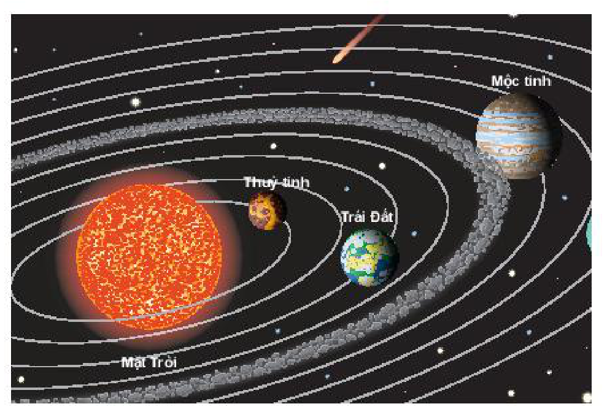

<!-- pdf:24 -->

# LUYỆN TẬP CHUNG (TRANG 23)

**Ví dụ 1:**

Năm ánh sáng là đơn vị chiều dài sử dụng để đo khoảng cách trong thiên văn học. Một năm ánh sáng là độ dài quãng đường mà ánh sáng đi được trong một năm và bằng khoảng $9\,460\,000\,000\,000\text{ km}$.

*(Theo exoplanets.nasa.gov)*

Đó là một con số rất lớn, nên người ta dùng luỹ thừa để viết gọn lại.

a) Hãy viết gọn một năm ánh sáng theo luỹ thừa của $10$.

b) Khoảng cách từ Mộc tinh đến Trái Đất thay đổi theo từng ngày trong năm. Khoảng cách gần nhất khoảng $588\,000\,000\text{ km}$, khoảng cách xa nhất khoảng $968\,000\,000\text{ km}$.

*(Theo space.com)*

Em hãy tính khoảng cách gần nhất và xa nhất từ Mộc tinh đến Trái Đất theo đơn vị năm ánh sáng.
<!-- ocr-ok: đã đối chiếu ảnh trang PDF 24, OCR đọc nhầm "Mộc tinh" thành "Mộc tỉnh" -->

**Giải:** a) Ta có $9\,460\,000\,000\,000\text{ km} = 9,46 \cdot 10^{12}\text{ km}$.

b) Khoảng cách ngắn nhất từ Mộc tinh đến Trái Đất là $5,88 \cdot 10^8\text{ km}$.
<!-- ocr-ok: đã đối chiếu ảnh trang PDF 24, OCR đọc nhầm "Mộc tinh" thành "Mộc tỉnh" -->

Do đó khoảng cách này tính theo năm ánh sáng là:

$\frac{5,88 \cdot 10^8}{9,46 \cdot 10^{12}} = \frac{588}{9\,460\,000} = \frac{147}{2\,365\,000}\text{ (năm ánh sáng)}.$

Khoảng cách xa nhất từ Mộc tinh đến Trái Đất là $9,68 \cdot 10^8\text{ km}$.
<!-- ocr-ok: đã đối chiếu ảnh trang PDF 24, OCR đọc nhầm "Mộc tinh" thành "Mộc tỉnh" -->

Do đó khoảng cách này tính theo năm ánh sáng là:

$\frac{9,68 \cdot 10^8}{9,46 \cdot 10^{12}} = \frac{968}{9\,460\,000} = \frac{11}{107\,500}\text{ (năm ánh sáng)}.$

**Ví dụ 2:** Tính một cách hợp lí: $A = 12,4 \cdot 6\frac{1}{4} + (-12,4) \cdot (-2,5)^2$.
<!-- ocr-ok: đã đối chiếu ảnh trang PDF 24, OCR đọc lỗi nhãn Ví dụ 2 màu tím -->

**Giải:** Ta có $A = 12,4 \cdot 6\frac{1}{4} + (-12,4) \cdot (-2,5)^2 = 12,4 \cdot 6,25 + (-12,4) \cdot 6,25$

$= [12,4 + (-12,4)] \cdot 6,25 = 0 \cdot 6,25 = 0$.

<!-- pdf:25 -->

## BÀI TẬP

1.31. Tìm $x$, biết:

a) $2x + \frac{1}{2} = \frac{7}{9}$;

b) $\frac{3}{4} - 6x = \frac{7}{13}$.

1.32. Diện tích mặt nước của một số hồ nước ngọt lớn nhất trên thế giới được cho trong bảng sau. Em hãy sắp xếp chúng theo thứ tự diện tích từ nhỏ đến lớn.

| Hồ | Diện tích ($\text{m}^2$) |
| --- | :---: |
| Baikal (Nga) | $3,17 \cdot 10^{10}$ |
| Caspian (Châu Âu, Châu Á) | $3,71 \cdot 10^{11}$ |
| Ontario (Bắc Mỹ) | $1,896 \cdot 10^{10}$ |
| Michigan (Mỹ) | $5,8 \cdot 10^{10}$ |
| Superior (Bắc Mỹ) | $8,21 \cdot 10^{10}$ |
| Victoria (Châu Phi) | $6,887 \cdot 10^{10}$ |
| Erie (Bắc Mỹ) | $2,57 \cdot 10^{10}$ |
| Vostok (Nam Cực) | $1,56 \cdot 10^{10}$ |
| Nicaragua | $8,264 \cdot 10^9$ |
<!-- ocr-ok: đã đối chiếu ảnh trang PDF 25, OCR đọc lỗi dòng Caspian trong bảng diện tích các hồ -->

*(Theo visualcapitalist.com)*

1.33. Tính một cách hợp lí.

a) $A = 32,125 - (6,325 + 12,125) - (37 + 13,675)$;

b) $B = 4,75 + \left(\frac{-1}{2}\right)^3 + 0,5^2 - 3 \cdot \frac{-3}{8}$;

c) $C = 2\,021,2345 \cdot 2\,020,1234 + 2\,021,2345 \cdot (-2\,020,1234)$.

1.34. Đặt một cặp dấu ngoặc “$()$” để được biểu thức đúng.

$2,2 - 3,3 + 4,4 - 5,5 = 0.$

## 📷 Danh sách hình trong bài

| Mã hình | Trang PDF | Vị trí trong bài | Chú thích gốc |
| --- | :---: | --- | --- |
| H7-toan-ltc-c01-02-01 | 24 | Ví dụ 1 | (sách không đánh số, minh hoạ Mặt Trời, Thuỷ tinh, Trái Đất và Mộc tinh) |
