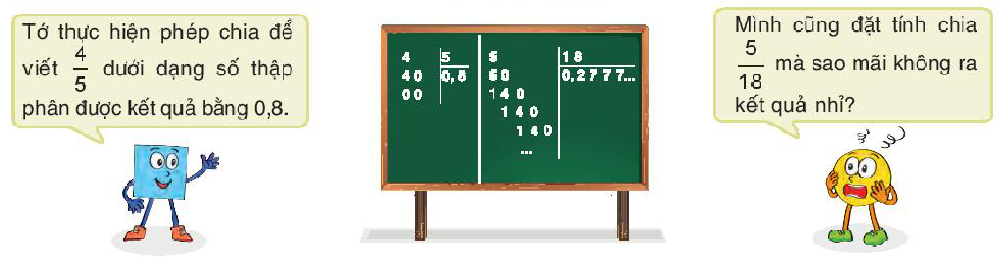
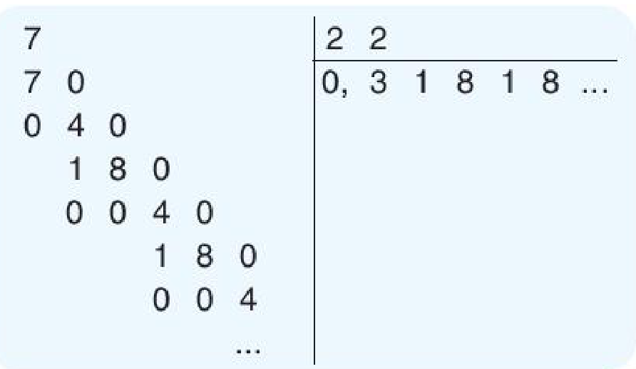
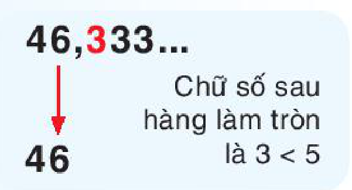
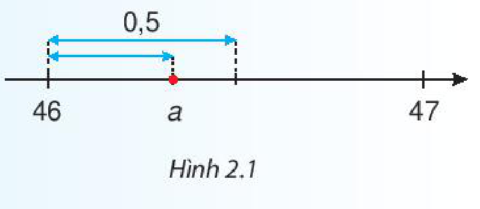

<!-- pdf:27 -->
<!-- Phần giới thiệu đầu Chương II (nửa trên trang PDF 27): SỐ HỌC — CHƯƠNG II: SỐ THỰC -->

Chúng ta đã biết mỗi đoạn thẳng đều có một độ dài, được biểu thị bởi một số. Trong chương này, chúng ta sẽ thấy có những đoạn thẳng mà độ dài của nó không thể biểu thị bằng một *số hữu tỉ*. Điều này cho thấy có một loại số mới, đó là *số vô tỉ*. Số vô tỉ và số hữu tỉ được gọi chung là *số thực*. Chúng ta cùng tìm hiểu về loại số này!

$\pi = 3,1415926535897932384626433\dots$

$\sqrt{2} = 1,414213562373095048801688724209698\dots$

# BÀI 5: LÀM QUEN VỚI SỐ THẬP PHÂN VÔ HẠN TUẦN HOÀN

## 🔤 Khái niệm, thuật ngữ

- Số thập phân hữu hạn
- Số thập phân vô hạn tuần hoàn
- Chu kì
- Độ chính xác

## 🎯 Kiến thức, kĩ năng

- Nhận biết số thập phân hữu hạn và số thập phân vô hạn tuần hoàn.
- Làm tròn số căn cứ vào độ chính xác cho trước.

## 🔴 Mở đầu

- **Vuông:** Tớ thực hiện phép chia để viết $\frac{4}{5}$ dưới dạng số thập phân được kết quả bằng $0,8$.
- **Tròn:** Mình cũng đặt tính chia $\frac{5}{18}$ mà sao mãi không ra kết quả nhỉ?
<!-- ocr-ok: đã đối chiếu ảnh trang PDF 27, hộp bóng thoại của Vuông và Tròn hai bên bảng đen -->

**Số thập phân vô hạn tuần hoàn**

- Khi chia $5$ cho $18$, ta thấy phép chia không bao giờ chấm dứt và nếu cứ tiếp tục chia thì trong thương $0,2777\dots$, chữ số $7$ được lặp lại mãi. Ta nói phân số $\frac{5}{18}$ viết được dưới dạng số thập phân là $0,2777\dots$. Tương tự, ta có $-\frac{17}{11} = -1,545454\dots$. Các số $0,2777\dots$; $-1,545454\dots$ là những **số thập phân vô hạn tuần hoàn**.

<!-- pdf:28 -->

- Số $0,2777\dots$ được viết gọn là $0,2(7)$. Kí hiệu $(7)$ được hiểu là chữ số $7$ được lặp lại vô hạn lần. Số $7$ được gọi là **chu kì** của số thập phân vô hạn tuần hoàn $0,2(7)$. Tương tự, $-1,545454\dots$ có chu kì là $54$ và được viết gọn là $-1,(54)$.
- Các số thập phân đã học như $0,8$; $1,25$; $\dots$ còn được gọi là **số thập phân hữu hạn**.

> ❓ Kết quả của phép chia $1$ cho $9$ là số thập phân hữu hạn hay vô hạn tuần hoàn?

**Ví dụ 1:** Chu kì của số thập phân vô hạn tuần hoàn có thể có nhiều hơn một chữ số, chẳng hạn:

a) $\frac{7}{22} = 0,31818\dots = 0,3(18)$ là số thập phân vô hạn tuần hoàn với chu kì là $18$.

b) $\frac{-7}{22} = -\frac{7}{22} = -0,3(18)$.

**Luyện tập 1:** Viết các phân số $\frac{1}{4}$; $-\frac{2}{11}$ dưới dạng số thập phân rồi cho biết số nhận được là số thập phân hữu hạn hay vô hạn tuần hoàn.

Chỉ ra chu kì rồi viết gọn nếu đó là số thập phân vô hạn tuần hoàn.

**Chú ý:**

Mọi số hữu tỉ đều viết được dưới dạng số thập phân hữu hạn hoặc vô hạn tuần hoàn.

**Làm tròn số thập phân căn cứ vào độ chính xác cho trước**

<!-- term: Làm tròn số thập phân -->
Ở lớp $6$, các em đã học cách làm tròn số thập phân hữu hạn đến một hàng nào đó. Ta cũng làm tròn số thập phân vô hạn theo cách tương tự. Chẳng hạn, nếu làm tròn $a = 46,333\dots$ đến hàng đơn vị thì được kết quả là $46$; nếu làm tròn $b = -1,27(534)$ đến hàng phần trăm thì kết quả là $-1,28$. Ta viết $46,333\dots \approx 46$; $-1,27(534) \approx -1,28$ (kí hiệu “$\approx$” đọc là *xấp xỉ*).

Trên trục số Hình 2.1, ta thấy khoảng cách từ điểm $46$ đến điểm $a = 46,333\dots$ nhỏ hơn $0,5$ (bằng một nửa khoảng cách từ điểm $46$ đến điểm $47$). Ta cũng nói rằng $46$ là kết quả làm tròn của $a = 46,333\dots$ với **độ chính xác** $0,5$.

*Hình 2.1*

*Tổng quát, ta có:*

> Khi làm tròn số đến một hàng nào đó, kết quả làm tròn có **độ chính xác** bằng một nửa đơn vị hàng làm tròn.

<!-- term: Làm tròn số thập phân -->
**Chú ý:** Muốn làm tròn số thập phân với độ chính xác cho trước, ta có thể xác định hàng làm tròn thích hợp bằng cách sử dụng bảng bên.

| Hàng làm tròn | Độ chính xác |
| --- | --- |
| trăm | $50$ |
| chục | $5$ |
| đơn vị | $0,5$ |
| phần mười | $0,05$ |
| phần trăm | $0,005$ |
<!-- ocr-ok: đã đối chiếu ảnh trang PDF 28, bảng quan hệ giữa hàng làm tròn và độ chính xác -->

<!-- pdf:29 -->

**Ví dụ 2:** Làm tròn số $12\,591,27$ với độ chính xác: a) $50$; $\quad$ b) $0,05$.
<!-- ocr-ok: đã đối chiếu ảnh trang PDF 29, OCR đọc lỗi nhãn Ví dụ 2 màu tím và dính chữ -->

**Giải:**

a) Để kết quả làm tròn có độ chính xác là $50$, ta làm tròn số đến hàng trăm.

Áp dụng quy tắc làm tròn số ta được $12\,591,27 \approx 12\,600$.

b) Để kết quả làm tròn có độ chính xác là $0,05$, ta làm tròn số đến hàng phần mười, được kết quả là: $12\,591,27 \approx 12\,591,3$.

**Luyện tập 2:** Làm tròn số $3,14159$ với độ chính xác $0,005$.

**Vận dụng:**

Ước lượng kết quả phép tính $31,(81) \cdot 4,9$ bằng cách làm tròn hai thừa số đến hàng đơn vị.

## BÀI TẬP

2.1. Trong các số thập phân sau, số nào là số thập phân hữu hạn? Số nào là số thập phân vô hạn tuần hoàn?

$0,1; \quad -1,(23); \quad 11,2(3); \quad -6,725.$

2.2. Sử dụng chu kì, hãy viết gọn số thập phân vô hạn tuần hoàn $0,010101\dots$

2.3. Tìm chữ số thập phân thứ năm của số $3,2(31)$ và làm tròn số $3,2(31)$ đến chữ số thập phân thứ năm.

2.4. Số $0,1010010001000010\dots$ (viết liên tiếp các số $10, 100, 1\,000, 10\,000, \dots$ sau dấu phẩy) có phải là số thập phân vô hạn tuần hoàn hay không?

2.5. Làm tròn số $3,14159\dots$

a) đến chữ số thập phân thứ ba;

b) với độ chính xác $0,005$.

## 💡 Em có biết?

Người ta đã chứng minh được rằng:

- Nếu một phân số tối giản với mẫu dương mà mẫu không có ước nguyên tố khác $2$ và $5$ thì phân số đó viết được dưới dạng số thập phân hữu hạn. Chẳng hạn:

  $\frac{3}{40} = \frac{3}{2^3 \cdot 5} = \frac{3 \cdot 5^2}{2^3 \cdot 5 \cdot 5^2} = \frac{75}{1\,000} = 0,075.$

- Nếu một phân số tối giản với mẫu dương mà mẫu có ước nguyên tố khác $2$ và $5$ thì phân số đó viết được dưới dạng số thập phân vô hạn tuần hoàn. Chẳng hạn: $\frac{1}{3} = 0,333\dots$
<!-- ocr-ok: đã đối chiếu ảnh trang PDF 29, OCR đọc sai dấu tiếng Việt trong mục Em có biết -->

- Mỗi số thập phân vô hạn tuần hoàn biểu diễn một số hữu tỉ.

  Chẳng hạn: $0,(1) = \frac{1}{9}$; $0,(01) = \frac{1}{99}$; $0,(17) = \frac{17}{99}$; $0,(9) = 1$.

## 📷 Danh sách hình trong bài

| Mã hình | Trang PDF | Vị trí trong bài | Chú thích gốc |
| --- | :---: | --- | --- |
| H7-toan-b05-01 | 27 | Mở đầu | (sách không đánh số, minh hoạ đặt tính chia $\frac{4}{5}$ và $\frac{5}{18}$ trên bảng) |
| H7-toan-b05-02 | 28 | Ví dụ 1 | (sách không đánh số, phép đặt tính chia $7$ cho $22$ được thương $0,31818\dots$) |
| H7-toan-b05-03 | 28 | Làm tròn số thập phân | (sách không đánh số, sơ đồ làm tròn $46,333\dots$ thành $46$ vì chữ số sau hàng làm tròn là $3 < 5$) |
| H7-toan-b05-04 | 28 | Làm tròn số thập phân | Hình 2.1 |
