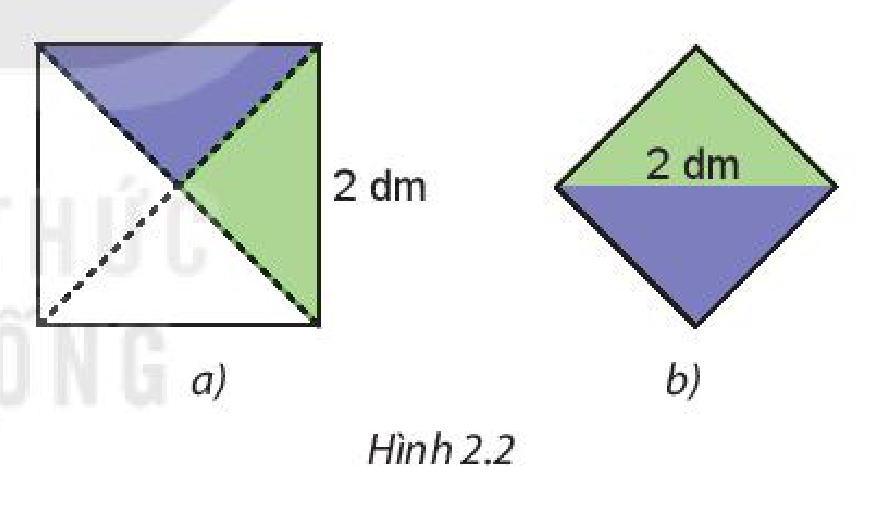
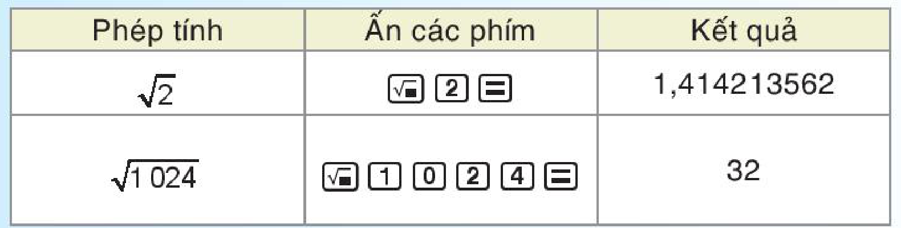
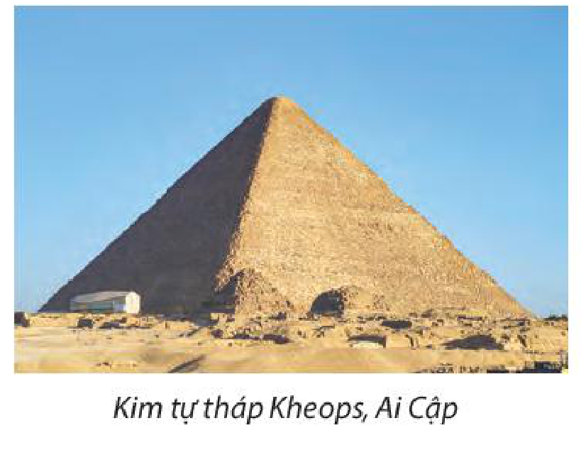
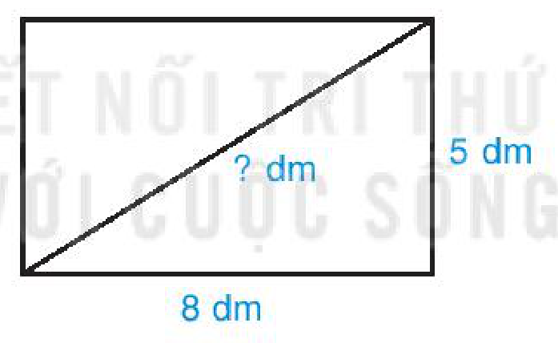

<!-- pdf:30 -->

# BÀI 6: SỐ VÔ TỈ. CĂN BẬC HAI SỐ HỌC

## 🔤 Khái niệm, thuật ngữ

- Số vô tỉ
- Căn bậc hai số học
- Số thập phân vô hạn không tuần hoàn

## 🎯 Kiến thức, kĩ năng

- Nhận biết số vô tỉ.
- Nhận biết căn bậc hai số học của một số không âm.
- Tính giá trị (đúng hoặc gần đúng) căn bậc hai số học của một số nguyên dương bằng máy tính cầm tay.

## 🔴 Mở đầu

- **Tròn:** Tớ ghép được một hình vuông có diện tích bằng $2\text{ dm}^2$.
- **Vuông:** Không biết số nào biểu thị độ dài cạnh của hình vuông đó nhỉ?

## 1. SỐ VÔ TỈ

**Độ dài cạnh hình vuông có diện tích bằng $2\text{ dm}^2$**

**HĐ1:** Cắt một hình vuông có cạnh bằng $2\text{ dm}$, rồi cắt nó thành bốn tam giác vuông bằng nhau dọc theo hai đường chéo của hình vuông (H.2.2a).

**HĐ2:** Lấy hai trong bốn tam giác nhận được ở trên ghép thành một hình vuông (H.2.2b). Em hãy tính diện tích hình vuông nhận được.

*Hình 2.2*

**HĐ3:** Dùng thước có vạch chia để đo độ dài cạnh hình vuông nhận được trong HĐ2. Độ dài cạnh hình vuông này bằng bao nhiêu đềximét?

**Số vô tỉ**

Hình vuông trong Hình 2.2b có diện tích bằng $2\text{ dm}^2$. Nếu độ dài cạnh hình vuông đó là $x\text{ (dm)}$ ($x > 0$) thì $x^2 = 2$.

Người ta đã chứng minh được rằng không có số hữu tỉ nào mà bình phương bằng $2$ và tính được những chữ số thập phân đầu tiên của $x$ là:

$x = 1,4142135623730950488016887\dots$

Đây không là số thập phân hữu hạn, cũng không là số thập phân vô hạn tuần hoàn. Đây là một **số thập phân vô hạn không tuần hoàn**. Ta gọi những số như thế là **số vô tỉ**.

<!-- pdf:31 -->

> **Số vô tỉ** là số viết được dưới dạng số thập phân vô hạn không tuần hoàn.
>
> **Tập hợp các số vô tỉ** được kí hiệu là $\mathbb{I}$.

**Ví dụ 1:** Người ta tính được tỉ số giữa chu vi và đường kính của một đường tròn luôn bằng $3,14159265358\dots$ đây là một số vô tỉ (kí hiệu là $\pi$, đọc là "pi").

Số $-0,10100100\dots$ (sau dấu phẩy viết liên tiếp các số $10$; $100$; $1\,000$; $\dots$) là số vô tỉ.

**Chú ý:** Ta cũng làm tròn số thập phân vô hạn như làm tròn số thập phân hữu hạn, chẳng hạn làm tròn số $0,1010010001\dots$ đến chữ số thập phân thứ ba ta được $0,101$:

$0,1010010001\dots \approx 0,101.$

**Vận dụng 1:** Người xưa đã tính đường kính thân cây theo quy tắc “quân bát, phát tam, tồn ngũ, quân nhị”, tức là lấy chu vi thân cây chia làm $8$ phần bằng nhau (quân bát); bớt đi ba phần (phát tam) còn lại $5$ phần (tồn ngũ) rồi chia đôi kết quả (quân nhị). Hãy cho biết người xưa đã ước lượng số $\pi$ bằng bao nhiêu.

## 2. CĂN BẬC HAI SỐ HỌC

Bài toán tính độ dài $x$ của cạnh hình vuông có diện tích $a$ dẫn đến việc tìm số $x > 0$ sao cho $x^2 = a$. Số $x > 0$ thoả mãn điều kiện đó gọi là *căn bậc hai số học* của $a$.

> **Căn bậc hai số học** của một số $a$ không âm, kí hiệu là $\sqrt{a}$, là số $x$ không âm sao cho $x^2 = a$.

Như vậy cạnh hình vuông trong Hình 2.2b có độ dài bằng $\sqrt{2}\text{ dm}$.

**Ví dụ 2:** Tính: a) $\sqrt{100}$; $\quad$ b) $\sqrt{191^2}$; $\quad$ c) $\sqrt{21,5^2}$.
<!-- ocr-ok: đã đối chiếu ảnh trang PDF 31, OCR đọc lỗi nhãn Ví dụ 2 và kí hiệu căn bậc hai -->

**Giải:** a) Vì $10^2 = 100$ và $10 > 0$ nên $\sqrt{100} = 10$;
<!-- ocr-ok: đã đối chiếu ảnh trang PDF 31, câu chứa nhiều công thức LaTeX -->

b) Vì $191 > 0$ nên $\sqrt{191^2} = 191$; $\quad$ c) Tương tự $\sqrt{21,5^2} = 21,5$.
<!-- ocr-ok: đã đối chiếu ảnh trang PDF 31, câu chứa nhiều căn thức LaTeX -->

**Luyện tập 1:** Tính: a) $\sqrt{16}$; $\quad$ b) $\sqrt{81}$; $\quad$ c) $\sqrt{2\,021^2}$.
<!-- ocr-ok: đã đối chiếu ảnh trang PDF 31, OCR đọc lỗi dòng Luyện tập 1 chứa căn thức -->

**Vận dụng 2:**

Sàn thi đấu bộ môn cử tạ có dạng một hình vuông, diện tích $144\text{ m}^2$. Em hãy tính chu vi của sàn thi đấu đó.

## 3. TÍNH CĂN BẬC HAI SỐ HỌC BẰNG MÁY TÍNH CẦM TAY

**Tính căn bậc hai số học bằng máy tính cầm tay**

Ta có thể sử dụng loại máy tính cầm tay thích hợp để tính căn bậc hai số học của một số không âm. Chẳng hạn:

<!-- pdf:32 -->

| Phép tính | Ấn các phím | Kết quả |
| :---: | --- | :---: |
| $\sqrt{2}$ | `√■` `2` `=` | $1,414213562$ |
| $\sqrt{1\,024}$ | `√■` `1` `0` `2` `4` `=` | $32$ |
<!-- ocr-ok: đã đối chiếu ảnh trang PDF 32, bảng phím bấm máy tính cầm tay dùng kí hiệu đồ hoạ -->

**Chú ý:** Màn hình máy tính cầm tay chỉ hiển thị được một số hữu hạn chữ số nên các kết quả là số thập phân vô hạn (tuần hoàn hay không tuần hoàn) đều được làm tròn, chẳng hạn:
<!-- ocr-ok: đã đối chiếu ảnh trang PDF 32, OCR đọc sai "cầm tay" thành "cằm tay" -->

$\sqrt{2} \approx 1,414213562.$

> **Vuông:** Kết quả bên được làm tròn đến chữ số thập phân thứ chín.

**Ví dụ 3:**

Sử dụng loại máy tính cầm tay thích hợp, tính $\sqrt{91}$ rồi làm tròn kết quả:

a) Đến chữ số thập phân thứ tư; $\quad$ b) Với độ chính xác $0,05$.
<!-- ocr-ok: đã đối chiếu ảnh trang PDF 32, OCR đọc sai "Đến" thành "Đền" -->

> **Pi:** Căn bậc hai số học của một số tự nhiên không chính phương luôn là một số vô tỉ.

**Giải:**

Ấn các phím `√■` `9` `1` `=`, ta được kết quả là $9,539392014$.
<!-- ocr-ok: đã đối chiếu ảnh trang PDF 32, phím bấm máy tính là kí hiệu đồ hoạ -->

a) Làm tròn kết quả đến chữ số thập phân thứ tư ta được

$\sqrt{91} \approx 9,5394.$

b) Để độ chính xác là $0,05$, ta làm tròn số đến hàng phần mười: $\sqrt{91} \approx 9,5$.

**Luyện tập 2:**

Sử dụng máy tính cầm tay, tính các căn bậc hai số học sau (làm tròn kết quả với độ chính xác $0,005$, nếu cần).

a) $\sqrt{15}$;

b) $\sqrt{2,56}$;

c) $\sqrt{17\,256}$;

d) $\sqrt{793\,881}$.

**Vận dụng 3:**

Kim tự tháp Kheops là công trình kiến trúc nổi tiếng thế giới. Để xây dựng được công trình này, người ta phải sử dụng tới hơn $2,5$ triệu mét khối đá, với diện tích đáy lên tới $52\,198,16\text{ m}^2$.
<!-- ocr-ok: đã đối chiếu ảnh trang PDF 32, OCR đọc sai "mét khối" thành "mót khối" -->

*(Theo khoahoc.tv)*

Biết rằng đáy của kim tự tháp Kheops có dạng một hình vuông. Tính độ dài cạnh đáy của kim tự tháp này (làm tròn kết quả đến chữ số thập phân thứ nhất).

*Kim tự tháp Kheops, Ai Cập*

<!-- pdf:33 -->

## BÀI TẬP

2.6. Cho biết $153^2 = 23\,409$. Hãy tính $\sqrt{23\,409}$.

2.7. Từ các số là bình phương của $12$ số tự nhiên đầu tiên, em hãy tìm căn bậc hai số học của các số sau:

a) $9$;

b) $16$;

c) $81$;

d) $121$.

2.8. Khi tìm căn bậc hai số học của một số tự nhiên ta thường phân tích số đó ra thừa số nguyên tố. Chẳng hạn:

Vì $324 = 2^2 \cdot 3^4 = (2 \cdot 3^2)^2 = 18^2$ nên $\sqrt{324} = 18$.

Tính căn bậc hai số học của $129\,600$.

2.9. Tính độ dài cạnh của hình vuông có diện tích bằng:

a) $81\text{ dm}^2$;

b) $3\,600\text{ m}^2$;

c) $1\text{ ha}$.

2.10. Sử dụng máy tính cầm tay tìm căn bậc hai số học của các số sau rồi làm tròn các kết quả với độ chính xác $0,005$.

a) $3$;

b) $41$;

c) $2\,021$.

2.11. Biết rằng bình phương độ dài đường chéo của một hình chữ nhật bằng tổng các bình phương độ dài hai cạnh của nó. Một hình chữ nhật có chiều dài là $8\text{ dm}$ và chiều rộng là $5\text{ dm}$. Độ dài đường chéo của hình chữ nhật đó bằng bao nhiêu đềximét (làm tròn kết quả đến hàng phần mười)?

2.12. Để lát một mảnh sân hình vuông có diện tích $100\text{ m}^2$, người ta cần dùng bao nhiêu viên gạch hình vuông có cạnh dài $50\text{ cm}$ (coi các mạch ghép là không đáng kể)?

## 📷 Danh sách hình trong bài

| Mã hình | Trang PDF | Vị trí trong bài | Chú thích gốc |
| --- | :---: | --- | --- |
| H7-toan-b06-01 | 30 | Mở đầu | (sách không đánh số, minh hoạ hình vuông có diện tích $S = 2\text{ dm}^2$) |
| H7-toan-b06-02 | 30 | Mục 1, HĐ1–HĐ2 | Hình 2.2 |
| H7-toan-b06-03 | 32 | Mục 3 | (sách không đánh số, bảng ấn các phím máy tính cầm tay tính $\sqrt{2}$ và $\sqrt{1\,024}$) |
| H7-toan-b06-04 | 32 | Mục 3, Vận dụng 3 | Kim tự tháp Kheops, Ai Cập |
| H7-toan-b06-05 | 33 | Bài tập 2.11 | (sách không đánh số, hình chữ nhật chiều dài $8\text{ dm}$, chiều rộng $5\text{ dm}$, đường chéo $?\text{ dm}$) |
