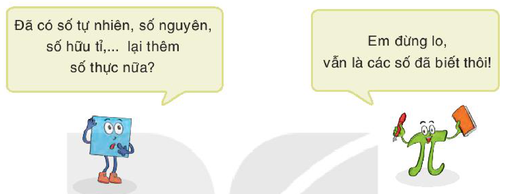
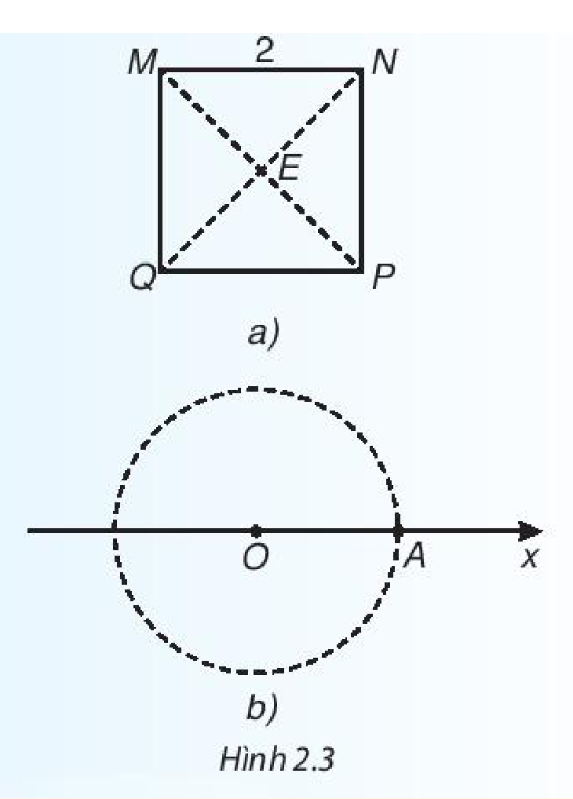
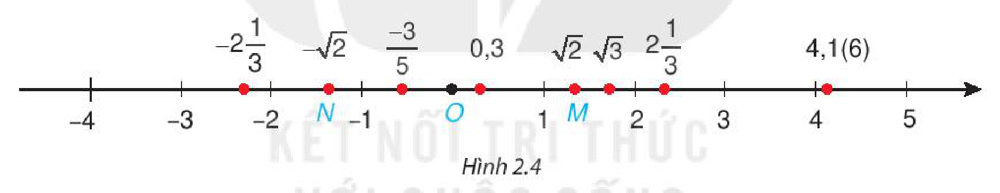
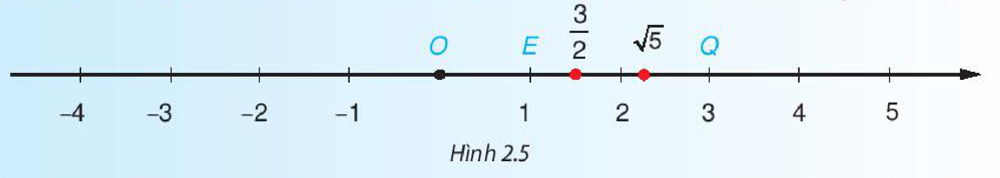
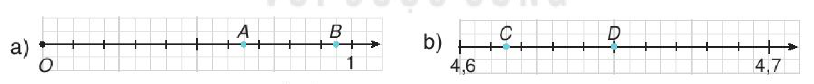

<!-- pdf:34 -->

# BÀI 7: TẬP HỢP CÁC SỐ THỰC

## 🔤 Khái niệm, thuật ngữ

- Số thực
- Số đối của số thực
- Giá trị tuyệt đối

## 🎯 Kiến thức, kĩ năng

- Nhận biết số thực, số đối và giá trị tuyệt đối của số thực.
- Biểu diễn số thực trên trục số trong trường hợp thuận lợi.
- Nhận biết thứ tự trong tập hợp các số thực.

## 🔴 Mở đầu

- **Vuông:** Đã có số tự nhiên, số nguyên, số hữu tỉ,... lại thêm số thực nữa?
- **Pi:** Em đừng lo, vẫn là các số đã biết thôi!

## 1. KHÁI NIỆM SỐ THỰC VÀ TRỤC SỐ THỰC

**Số thực là gì?**

Trong các bài học trước, các em đã thấy là các số hữu tỉ và các số vô tỉ đều viết được dưới dạng số thập phân hữu hạn hoặc vô hạn (tuần hoàn hoặc không tuần hoàn).

Chẳng hạn: $\frac{3}{4} = 0,75$; $\frac{1}{9} = 0,111\dots = 0,(1)$; $\sqrt{2} = 1,4142\dots$

> Số hữu tỉ và số vô tỉ được gọi chung là **số thực**.
>
> **Tập hợp các số thực** được kí hiệu là $\mathbb{R}$.

**Chú ý:**

- Cũng như số hữu tỉ, mỗi số thực $a$ đều có một **số đối** kí hiệu là $-a$;
<!-- ocr-ok: đã đối chiếu ảnh trang PDF 34, OCR đọc sai "mỗi" thành "môi" -->
- Trong tập số thực cũng có các phép toán với các tính chất như trong tập số hữu tỉ.

> **Tròn:** Số $\pi = 3,14159265358\dots$ là một số thực đấy.

**Luyện tập 1:**

a) Cách viết nào sau đây là đúng: $\sqrt{2} \in \mathbb{Q}$; $\pi \in \mathbb{I}$; $15 \in \mathbb{R}$?

b) Viết số đối của các số: $5,08(299)$; $-\sqrt{5}$.

<!-- pdf:35 -->

**Trục số thực**

Ta đã biết mọi số hữu tỉ đều biểu diễn được trên trục số. Các số vô tỉ cũng có thể biểu diễn được trên trục số. Chẳng hạn, trong Bài 6 ta đã thấy $\sqrt{2}$ là độ dài nửa đường chéo của hình vuông với cạnh bằng $2$. Vì vậy, để biểu diễn số $\sqrt{2}$ trên trục số ta làm như sau:

- Vẽ hình vuông $MNPQ$ với cạnh bằng $2$. Gọi $E$ là giao điểm hai đường chéo của hình vuông này (H.2.3a).
- Vẽ đường tròn tâm $O$ (gốc của trục số), bán kính bằng $ME$. Giao điểm $A$ của đường tròn vừa vẽ với tia $Ox$ chính là điểm biểu diễn số $\sqrt{2}$ (H.2.3b).
<!-- ocr-ok: đã đối chiếu ảnh trang PDF 35, OCR dính chữ "tia Ox chính là điểm biểu diễn" -->

*Hình 2.3*

> Mỗi số thực đều được biểu diễn bởi một điểm trên trục số.
>
> Ngược lại, mỗi điểm trên trục số đều biểu diễn một số thực.

**Chú ý:** Vì mỗi điểm trên trục số đều biểu diễn một số thực nên các số thực lấp đầy trục số. Để nhấn mạnh điều này, người ta cũng gọi trục số là **trục số thực** (H.2.4).

*Hình 2.4*

> ❓ Điểm nào trong Hình 2.4 biểu diễn số $-\sqrt{2}$? Em có nhận xét gì về các điểm biểu diễn của hai số đối nhau?
<!-- ocr-ok: đã đối chiếu ảnh trang PDF 35, OCR mất chữ "Điểm" đầu câu hỏi -->

**Luyện tập 2:**

Cho biết nếu một tam giác vuông có hai cạnh góc vuông bằng $1$ và $3$ thì cạnh huyền của tam giác bằng $\sqrt{10}$. Em hãy vẽ điểm biểu diễn số $-\sqrt{10}$ trên trục số.

## 2. THỨ TỰ TRONG TẬP HỢP CÁC SỐ THỰC

**So sánh hai số thực**

Các số thực đều viết được dưới dạng số thập phân (hữu hạn hoặc vô hạn). Vì thế có thể so sánh hai số thực tương tự như so sánh hai số hữu tỉ viết dưới dạng số thập phân.

Chẳng hạn: $0,24(7) = 0,2477\dots > 0,2382\dots$ nên $0,24(7) > 0,2382\dots$;

$\sqrt{2} = 1,414\dots > 1,410$ nên $-\sqrt{2} < -1,41$.

<!-- pdf:36 -->

<!-- term: Thứ tự trong tập hợp các số thực -->
- Cũng như với các số hữu tỉ, ta có
  - Với hai số thực $a$ và $b$ bất kì ta luôn có $a = b$ hoặc $a < b$ hoặc $a > b$.
  - Cho ba số thực $a, b, c$. Nếu $a < b$ và $b < c$ thì $a < c$ (*tính chất bắc cầu*).
- Trên trục số thực, nếu $a < b$ thì điểm $a$ nằm trước điểm $b$. Nói riêng, các điểm nằm trước gốc $O$ biểu diễn các **số âm**, các điểm nằm sau gốc $O$ biểu diễn các **số dương**. Bởi vậy ta viết $x < 0$ để nói $x$ là số âm, viết $x > 0$ để nói $x$ là số dương (H.2.5).

*Hình 2.5*

*Chẳng hạn:* Nếu $x$ là số thực thoả mãn điều kiện $1 < x < 3$ thì điểm biểu diễn của $x$ nằm giữa hai điểm $E$ và $Q$ trên Hình 2.5.

**Chú ý:** Nếu $0 < a < b$ thì $\sqrt{a} < \sqrt{b}$. Ta thường dùng tính chất này để so sánh một căn bậc hai số học với một số hữu tỉ hoặc so sánh hai căn bậc hai số học với nhau. Chẳng hạn, $\sqrt{2} < \sqrt{5}$ vì $2 < 5$.

**Luyện tập 3:** So sánh:
<!-- ocr-ok: đã đối chiếu ảnh trang PDF 36, OCR đọc lỗi nhãn Luyện tập 3 màu tím -->

a) $1,313233\dots$ và $1,(32)$;

b) $\sqrt{5}$ và $2,36$ (có thể dùng máy tính cầm tay để tính $\sqrt{5}$).
<!-- ocr-ok: đã đối chiếu ảnh trang PDF 36, OCR đọc sai dấu hỏi chữ "thể", "để" -->

## 3. GIÁ TRỊ TUYỆT ĐỐI CỦA MỘT SỐ THỰC

**Khái niệm giá trị tuyệt đối**

**HĐ1:** Biểu diễn các số $3$ và $-2$ trên trục số rồi cho biết mỗi điểm ấy nằm cách gốc $O$ bao nhiêu đơn vị.

> **Tròn:** Hai số đối nhau thì có giá trị tuyệt đối bằng nhau.

**HĐ2:** Không vẽ hình, hãy cho biết khoảng cách của mỗi điểm sau đến gốc $O$: $-4$; $-1$; $0$; $1$; $4$.

*Với số thực $a$ tuỳ ý, ta có:*

> Khoảng cách từ điểm $a$ trên trục số đến gốc $O$ là **giá trị tuyệt đối** của số $a$, kí hiệu là $|a|$.

> ❓ Từ HĐ1 và HĐ2, hãy tìm giá trị tuyệt đối của các số: $3$; $-2$; $0$; $4$ và $-4$.

**Nhận xét:**

- Giá trị tuyệt đối của $0$ là $0$;
- Giá trị tuyệt đối của một số dương là chính nó, chẳng hạn $|2| = 2$; $\left|\frac{5}{8}\right| = \frac{5}{8}$;

<!-- pdf:37 -->

- Giá trị tuyệt đối của một số âm là số đối của nó, chẳng hạn $|-2| = 2$; $|-5,1| = 5,1$; $|-\sqrt{2}| = \sqrt{2}$.

Như vậy: $|a| = \begin{cases} a & \text{khi } a > 0 \\ -a & \text{khi } a < 0 \\ 0 & \text{khi } a = 0. \end{cases}$

Nhờ nhận xét này ta có thể tính được giá trị tuyệt đối của một số thực bất kì mà không cần biểu diễn số đó trên trục số.

> ❓ Minh viết $|-2,5| = -2,5$ đúng hay sai?

**Luyện tập 4:** Tính: a) $|-2,3|$; $\quad$ b) $\left|\frac{7}{5}\right|$; $\quad$ c) $|-11|$; $\quad$ d) $|-\sqrt{8}|$.
<!-- ocr-ok: đã đối chiếu ảnh trang PDF 37, OCR không đọc được dòng Luyện tập 4 chứa các dấu giá trị tuyệt đối -->

**Thử thách nhỏ:**

Liệt kê các phần tử của tập hợp $A = \{x \mid x \in \mathbb{Z}, |x| < 5\}$.

## BÀI TẬP

2.13. Xét tập hợp $A = \left\{7,1; -2,(61); 0; 5,14; \frac{4}{7}; \sqrt{15}; -\sqrt{81}\right\}$. Bằng cách liệt kê các phần tử, hãy viết tập hợp $B$ gồm các số hữu tỉ thuộc tập $A$ và tập hợp $C$ gồm các số vô tỉ thuộc tập $A$.
<!-- ocr-ok: đã đối chiếu ảnh trang PDF 37, OCR đọc sai "phần tử", "thuộc" -->

2.14. Gọi $A'$ là tập hợp các số đối của các số thuộc tập hợp $A$ trong Bài tập 2.13. Liệt kê các phần tử của $A'$.

2.15. Các điểm $A, B, C, D$ trong hình sau biểu diễn những số thực nào?

2.16. Tính: a) $|-3,5|$; $\quad$ b) $\left|\frac{-4}{9}\right|$; $\quad$ c) $|0|$; $\quad$ d) $|2,0(3)|$.
<!-- ocr-ok: đã đối chiếu ảnh trang PDF 37, biểu thức giá trị tuyệt đối nhiều kí hiệu LaTeX -->

2.17. Xác định dấu và giá trị tuyệt đối của mỗi số sau:

a) $a = 1,25$;

b) $b = -4,1$;

c) $c = -1,414213562\dots$.

2.18. Tìm tất cả các số thực $x$ thoả mãn điều kiện $|x| = 2,5$.

## 📷 Danh sách hình trong bài

| Mã hình | Trang PDF | Vị trí trong bài | Chú thích gốc |
| --- | :---: | --- | --- |
| H7-toan-b07-01 | 34 | Mở đầu | (sách không đánh số, minh hoạ Vuông và Pi trao đổi về số thực) |
| H7-toan-b07-02 | 35 | Mục 1, Trục số thực | Hình 2.3 |
| H7-toan-b07-03 | 35 | Mục 1, Chú ý | Hình 2.4 |
| H7-toan-b07-04 | 36 | Mục 2 | Hình 2.5 |
| H7-toan-b07-05 | 37 | Bài tập 2.15 | (sách không đánh số, hai phần trục số a và b biểu diễn các điểm $A, B, C, D$) |
