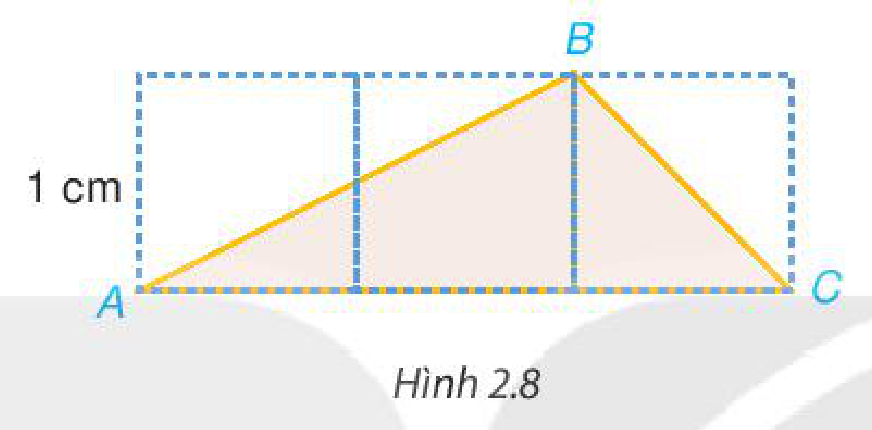

<!-- pdf:40 -->

# BÀI TẬP CUỐI CHƯƠNG II

2.27. Sử dụng máy tính cầm tay làm tròn các số sau đến chữ số thập phân thứ nhất:

$a = \sqrt{2}, \quad b = \sqrt{5}.$

Tính tổng hai số thập phân nhận được.

2.28. Dùng thước dây có vạch chia để đo độ dài đường gấp khúc $ABC$ trong Hình 2.8 (đơn vị xentimét, làm tròn đến chữ số thập phân thứ nhất). So sánh kết quả với kết quả của Bài tập 2.27.

*Hình 2.8*

2.29. Chia một sợi dây đồng dài $10\text{ m}$ thành $7$ đoạn bằng nhau.

a) Tính độ dài mỗi đoạn dây nhận được, viết kết quả dưới dạng số thập phân vô hạn tuần hoàn.

b) Dùng $4$ đoạn dây nhận được ghép thành một hình vuông. Gọi $C$ là chu vi của hình vuông đó. Hãy tìm $C$ bằng hai cách sau rồi so sánh hai kết quả:

*Cách 1.* Dùng thước dây có vạch chia để đo, lấy chính xác đến xentimét.

*Cách 2.* Tính $C = 4 \cdot \frac{10}{7}$, viết kết quả dưới dạng số thập phân với độ chính xác $0,005$.

2.30.

a) Cho hai số thực $a = -1,25$ và $b = -2,3$. So sánh: $a$ và $b$; $|a|$ và $|b|$.
<!-- ocr-ok: đã đối chiếu ảnh trang PDF 40, câu chứa nhiều kí hiệu toán học và giá trị tuyệt đối -->

b) Ta có nhận xét *trong hai số âm, số nào có giá trị tuyệt đối lớn hơn là số bé hơn*.

Em hãy áp dụng nhận xét này để so sánh $-12,7$ và $-7,12$.

2.31. Cho hai số thực $a = 2,1$ và $b = -5,2$.

a) Em có nhận xét gì về hai tích $a \cdot b$ và $-|a| \cdot |b|$?

b) Ta có cách nhân hai số khác dấu như sau: *Muốn nhân hai số khác dấu ta nhân các giá trị tuyệt đối của chúng rồi đặt dấu “$-$” trước kết quả*.

Em hãy áp dụng quy tắc trên để tính $(-2,5) \cdot 3$.

## 📷 Danh sách hình trong bài

| Mã hình | Trang PDF | Vị trí trong bài | Chú thích gốc |
| --- | :---: | --- | --- |
| H7-toan-bt-c02-01 | 40 | Bài tập 2.28 | Hình 2.8 |
