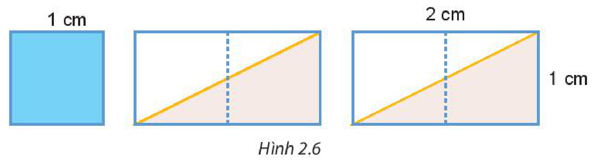
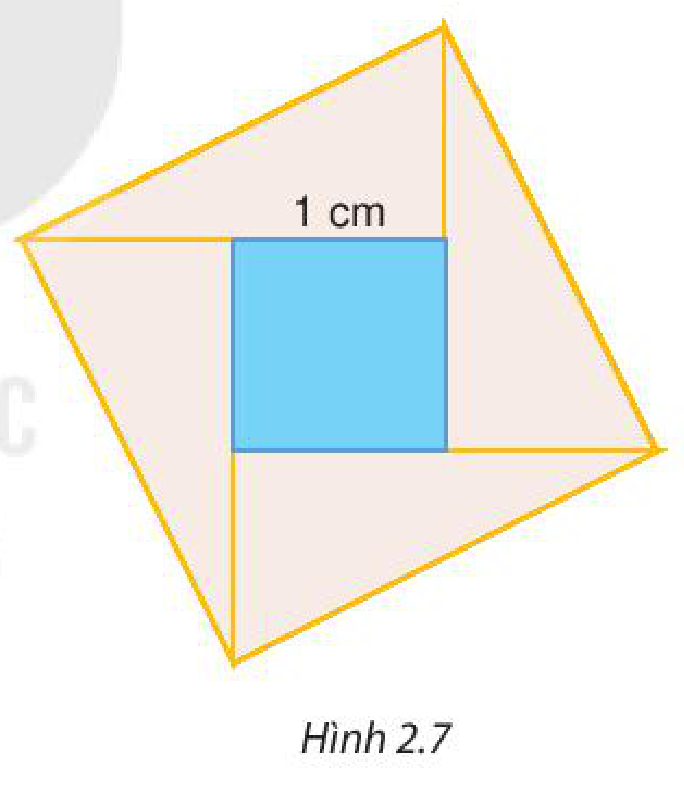
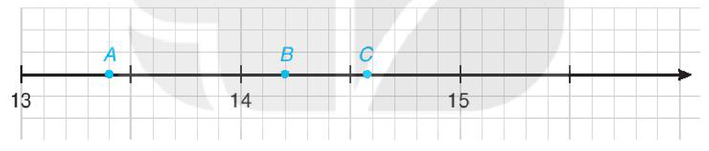

<!-- pdf:38 -->

# LUYỆN TẬP CHUNG (TRANG 37)

**Ví dụ 1:**

Cho một hình vuông cạnh $1\text{ cm}$ và hai hình chữ nhật kích thước $2\text{ cm} \times 1\text{ cm}$ bằng giấy bìa. Cắt hai hình chữ nhật dọc theo đường chéo để nhận được bốn hình tam giác vuông bằng nhau (H.2.6).

*Hình 2.6*

a) Hãy ghép bốn tam giác vuông đó với hình vuông đã cho để nhận được một hình vuông mới, tính diện tích hình vuông đó.

b) Độ dài đường chéo của hình chữ nhật trên bằng bao nhiêu xentimét (làm tròn kết quả đến chữ số thập phân thứ hai)?

**Giải:**

a) Ghép bốn tam giác vuông và hình vuông cạnh $1\text{ cm}$, ta được một hình vuông như Hình 2.7.

Hình vuông cạnh $1\text{ cm}$ có diện tích là: $1 \cdot 1 = 1\text{ (cm}^2\text{)}$;

Diện tích mỗi tam giác vuông là: $\frac{1}{2} \cdot 2 \cdot 1 = 1\text{ (cm}^2\text{)}$;

Diện tích hình vuông tạo thành là: $1 + 4 \cdot 1 = 5\text{ (cm}^2\text{)}$.

b) Độ dài đường chéo của hình chữ nhật ban đầu cũng bằng cạnh hình vuông tạo thành và bằng $\sqrt{5}\text{ cm}$.

*Hình 2.7*

Sử dụng máy tính cầm tay ta tính được $\sqrt{5} \approx 2,236067978$.

Làm tròn kết quả tới chữ số thập phân thứ hai ta được độ dài đường chéo cần tìm là $2,24\text{ cm}$.

**Ví dụ 2:** Tính: $\sqrt{3^2}$; $\left(\sqrt{4,1}\right)^2$; $\sqrt{a^2}$ (trong đó $a$ là số thực dương cho trước).
<!-- ocr-ok: đã đối chiếu ảnh trang PDF 38, câu chứa nhiều căn thức LaTeX -->

**Giải:** Ta có $\sqrt{3^2} = 3$ vì $3 > 0$; $\left(\sqrt{4,1}\right)^2 = 4,1$ (theo định nghĩa căn bậc hai số học).

Tương tự: $\sqrt{a^2} = a$.

<!-- pdf:39 -->

## BÀI TẬP

2.19. Cho bốn phân số: $\frac{17}{80}$; $\frac{611}{125}$; $\frac{133}{91}$ và $\frac{9}{8}$.

a) Phân số nào trong những phân số trên không viết được dưới dạng số thập phân hữu hạn?

b) Cho biết $\sqrt{2} = 1,414213562\dots$, hãy so sánh phân số tìm được trong câu a) với $\sqrt{2}$.

2.20.

a) Viết các phân số sau dưới dạng số thập phân vô hạn tuần hoàn (dùng dấu ngoặc để chỉ rõ chu kì): $\frac{1}{9}$; $\frac{1}{99}$.

Em có nhận xét gì về kết quả nhận được?

b) Em hãy dự đoán dạng thập phân của $\frac{1}{999}$.

2.21. Viết $\frac{5}{9}$ và $\frac{5}{99}$ dưới dạng số thập phân vô hạn tuần hoàn.

2.22. Nam vẽ một phần trục số trên vở ô li và đánh dấu ba điểm $A, B, C$ như sau:

a) Hãy cho biết hai điểm $A, B$ biểu diễn những số thập phân nào?

b) Làm tròn số thập phân được biểu diễn bởi điểm $C$ với độ chính xác $0,05$.

2.23. Thay dấu “$?$” bằng chữ số thích hợp.

a) $-7,02 < -7,\boxed{?}(1)$;

b) $-15,3\boxed{?}021 < -15,3819$.

2.24. So sánh:

a) $12,26$ và $12,(24)$;

b) $31,3(5)$ và $29,9(8)$.

2.25. Tính: a) $\sqrt{1}$; $\quad$ b) $\sqrt{1 + 2 + 1}$; $\quad$ c) $\sqrt{1 + 2 + 3 + 2 + 1}$.

2.26. Tính: a) $\left(\sqrt{3}\right)^2$; $\quad$ b) $\left(\sqrt{21}\right)^2$.

## 📷 Danh sách hình trong bài

| Mã hình | Trang PDF | Vị trí trong bài | Chú thích gốc |
| --- | :---: | --- | --- |
| H7-toan-ltc-c02-01 | 38 | Ví dụ 1 | Hình 2.6 |
| H7-toan-ltc-c02-02 | 38 | Ví dụ 1, Giải | Hình 2.7 |
| H7-toan-ltc-c02-03 | 39 | Bài tập 2.22 | (sách không đánh số, phần trục số trên vở ô li với các điểm $A, B, C$ từ $13$ đến $15$) |
