<!-- pdf:41 -->

<!-- Trang mở đầu Chương III (PDF 41): CHƯƠNG III. GÓC VÀ ĐƯỜNG THẲNG SONG SONG (HÌNH HỌC PHẲNG) — Ở lớp 6, chúng ta đã làm quen với các khái niệm điểm, đường thẳng, góc,... Đó là những khái niệm cơ bản ban đầu của hình học phẳng. Nối tiếp những vấn đề đó, chương này chúng ta sẽ tiếp tục tìm hiểu những nội dung thú vị về góc và đường thẳng song song. -->

# BÀI 8: GÓC Ở VỊ TRÍ ĐẶC BIỆT. TIA PHÂN GIÁC CỦA MỘT GÓC

## 🔤 Khái niệm, thuật ngữ

- Hai góc kề bù
- Hai góc đối đỉnh
- Tia phân giác của một góc

## 🎯 Kiến thức, kĩ năng

- Nhận biết hai góc kề bù, hai góc đối đỉnh.
- Nhận biết tia phân giác của một góc.
- Vẽ tia phân giác của một góc bằng dụng cụ học tập.

## 🔴 Mở đầu

Khi đặt các dây lạt để cắt bánh chưng, các dây lạt tạo ra trên mặt bánh chưng những cặp góc đặc biệt. Những cặp góc đó có mối quan hệ với nhau như thế nào, chúng ta cùng tìm hiểu trong bài học này!

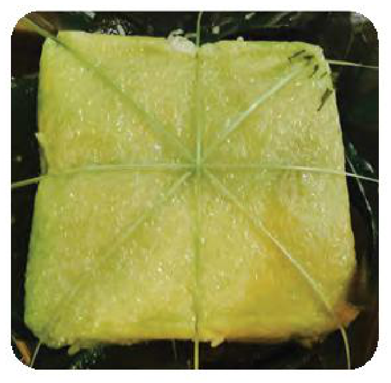

<!-- pdf:42 -->

## 1. GÓC Ở VỊ TRÍ ĐẶC BIỆT

*Hai góc kề bù*

**HĐ1:** Quan sát hình vẽ bên. Em hãy nhận xét quan hệ về đỉnh, về cạnh của hai góc được đánh dấu.

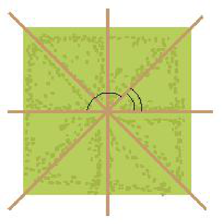

**HĐ2:** Cho ba tia $Ox, Oy, Oz$ như Hình 3.1, trong đó $Ox$ và $Oy$ là hai tia đối nhau.

a) Em hãy nhận xét quan hệ về đỉnh, về cạnh của hai góc $xOz$ và $zOy$.

b) Đo rồi tính tổng số đo hai góc $xOz$ và $zOy$.

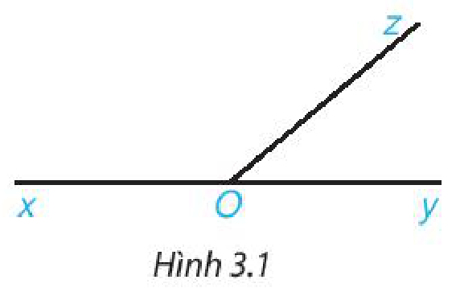
*Hình 3.1*

*Tổng quát ta có định nghĩa:*

> Hai góc có một cạnh chung, hai cạnh còn lại là hai tia đối nhau được gọi là **hai góc kề bù** (H.3.1).

*Tính chất của hai góc kề bù:*

<!-- term: Tính chất của hai góc kề bù -->
> Hai góc kề bù có tổng số đo bằng $180^\circ$.

> ❓ Hai góc được đánh dấu trong hình nào dưới đây là hai góc kề bù?

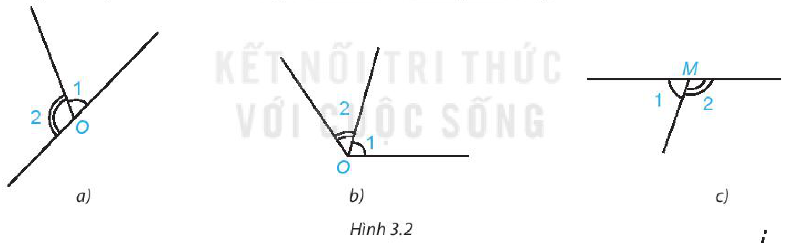
*Hình 3.2*

**Chú ý:**

1. Hai góc kề bù còn được hiểu là hai góc vừa kề nhau, vừa bù nhau. Trong đó:
- **Hai góc kề nhau** là hai góc có một cạnh chung và hai cạnh còn lại nằm khác phía nhau đối với đường thẳng chứa cạnh chung đó. Chẳng hạn, trên Hình 3.3a, góc $xOy$ và góc $yOz$ là hai góc kề nhau.
- **Hai góc bù nhau** là hai góc có tổng số đo bằng $180^\circ$.

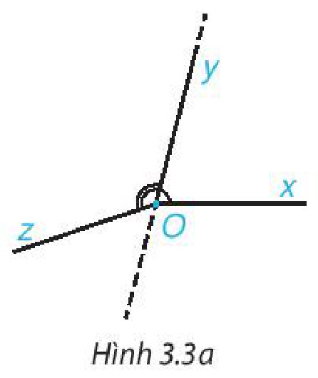
*Hình 3.3a*

2. Nếu điểm $M$ nằm trong góc $xOy$ thì ta nói tia $OM$ nằm giữa hai cạnh (hai tia) $Ox$ và $Oy$ của góc $xOy$ (H.3.3b). Khi đó ta có:

$\widehat{xOM} + \widehat{MOy} = \widehat{xOy}.$

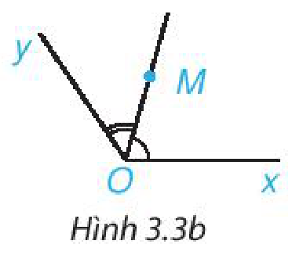
*Hình 3.3b*

<!-- pdf:43 -->

**Luyện tập 1:**

Viết tên hai góc kề bù trong Hình 3.4 và tính số đo góc $mOt$.

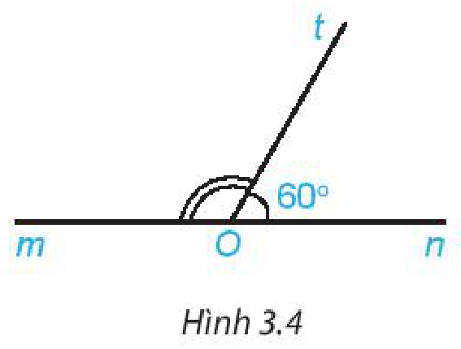
*Hình 3.4*

*Hai góc đối đỉnh*

**HĐ3:** Quan sát hình ảnh hai góc được đánh dấu trong hình bên. Em hãy nhận xét quan hệ về đỉnh, về cạnh của hai góc được đánh dấu.

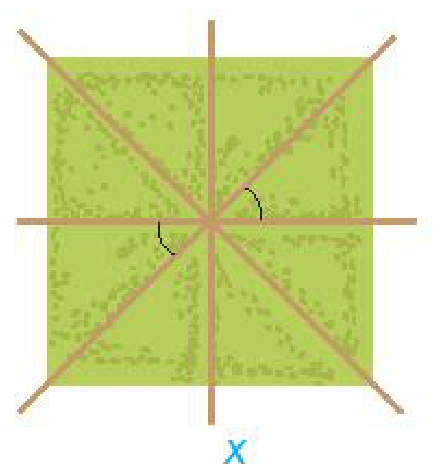

**HĐ4:** Cho hai đường thẳng $xx'$ và $yy'$ cắt nhau tại $O$ (H.3.5).
<!-- ocr-ok: đã đối chiếu trực tiếp ảnh trang PDF 43, công thức/bảng kí hiệu khớp nguyên văn sách in -->

a) Dự đoán xem hai góc $xOy$ và $x'Oy'$ có bằng nhau không.

b) Đo rồi so sánh số đo hai góc $xOy$ và $x'Oy'$.

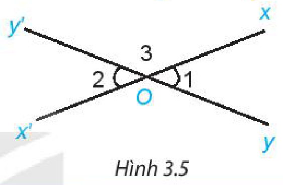
*Hình 3.5*

*Ta có định nghĩa sau:*

> **Hai góc đối đỉnh** là hai góc mà mỗi cạnh của góc này là tia đối của một cạnh của góc kia.

> ❓ Hai góc được đánh dấu trong hình nào dưới đây là hai góc đối đỉnh?

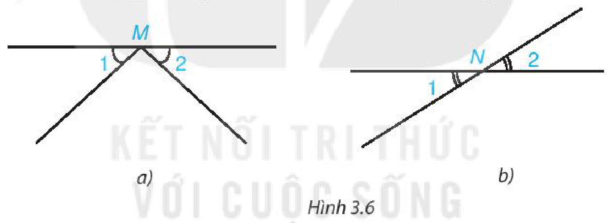
*Hình 3.6*

*Tính chất của hai góc đối đỉnh:*

<!-- term: Tính chất của hai góc đối đỉnh -->
> Hai góc đối đỉnh thì bằng nhau.

**Tập suy luận**

Trong HĐ4 ta đã sử dụng phương pháp đo để kiểm chứng rằng hai góc đối đỉnh $xOy$ và $x'Oy'$ bằng nhau. Dùng tính chất của hai góc kề bù, ta có thể so sánh được $\widehat{xOy}$ và $\widehat{x'Oy'}$ trong Hình 3.5 bằng cách suy luận như sau:

Vì $\widehat{O_1}$ và $\widehat{O_3}$ kề bù nên $\widehat{O_1} + \widehat{O_3} = 180^\circ$. $(1)$
<!-- ocr-ok: đã đối chiếu trực tiếp ảnh trang PDF 43, công thức/bảng kí hiệu khớp nguyên văn sách in -->

Vì $\widehat{O_2}$ và $\widehat{O_3}$ kề bù nên $\widehat{O_2} + \widehat{O_3} = 180^\circ$. $(2)$
<!-- ocr-ok: đã đối chiếu trực tiếp ảnh trang PDF 43, công thức/bảng kí hiệu khớp nguyên văn sách in -->

Từ $(1)$ và $(2)$ ta có: $\widehat{O_1} + \widehat{O_3} = \widehat{O_2} + \widehat{O_3}$.

Suy ra $\widehat{O_1} = \widehat{O_2}$.

<!-- pdf:44 -->

**Ví dụ 1:**

Cho hai đường thẳng $xx'$ và $yy'$ cắt nhau tại $O$ (H.3.7). Biết góc $xOy$ bằng $60^\circ$. Tính số đo các góc $x'Oy'$ và $x'Oy$.

**Giải:** Ta có:

- $\widehat{x'Oy'} = \widehat{xOy}$ (hai góc đối đỉnh).

Suy ra $\widehat{x'Oy'} = 60^\circ$.

- $\widehat{x'Oy} + \widehat{xOy} = 180^\circ$ (hai góc kề bù).

Suy ra $\widehat{x'Oy} = 180^\circ - \widehat{xOy}$

$\widehat{x'Oy} = 180^\circ - 60^\circ$

$\widehat{x'Oy} = 120^\circ$.

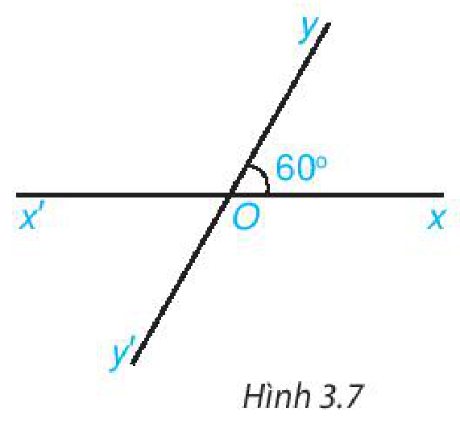
*Hình 3.7*

**Luyện tập 2:**

Hai đường thẳng $xx'$ và $yy'$ cắt nhau tại $O$ sao cho góc $xOy$ vuông (H.3.8). Khi đó các góc $yOx', x'Oy', xOy'$ cũng đều là góc vuông. Vì sao?

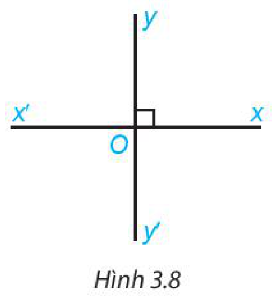
*Hình 3.8*

**Chú ý:** Hai đường thẳng $xx', yy'$ cắt nhau và trong các góc tạo thành có một góc vuông được gọi là **hai đường thẳng vuông góc**. Kí hiệu là $xx' \perp yy'$.

## 2. TIA PHÂN GIÁC CỦA MỘT GÓC

*Tia phân giác*

**HĐ5:** Cắt rời một góc $xOy$ từ một tờ giấy rồi gấp sao cho hai cạnh của góc trùng nhau (H.3.9).

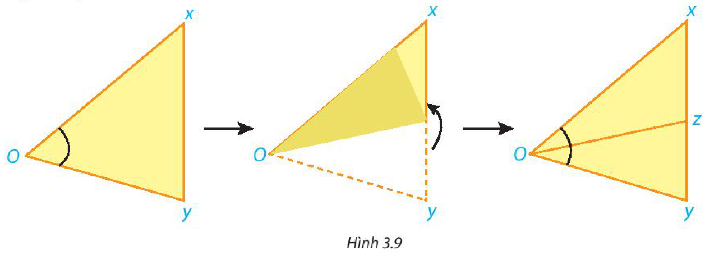
*Hình 3.9*

Mở mảnh giấy ra, nếp gấp cho ta hình ảnh tia $Oz$ chia góc ban đầu thành hai góc.

a) Em hãy nhận xét về vị trí của tia $Oz$ so với hai cạnh của góc $xOy$.

b) Em hãy so sánh hai góc $xOz$ và $zOy$.

<!-- pdf:45 -->

*Ta có định nghĩa sau:*

> Tia nằm giữa hai cạnh của một góc và tạo với hai cạnh ấy hai góc bằng nhau được gọi là **tia phân giác** của góc đó.

*Tính chất của tia phân giác:*

<!-- term: Tính chất của tia phân giác -->
> Khi $Oz$ là tia phân giác của góc $xOy$ thì $\widehat{xOz} = \widehat{yOz} = \frac{1}{2}\widehat{xOy}$ (H.3.10).

- **Pi:** Đường thẳng chứa tia phân giác của một góc gọi là **đường phân giác** của góc đó.

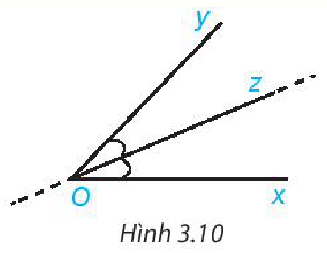
*Hình 3.10*

**Ví dụ 2:**

Cho góc $mOn$ có số đo bằng $70^\circ$, tia $Ot$ là tia phân giác của góc $mOn$. Tính số đo hai góc $mOt$ và $tOn$.

**Giải:** (H.3.11)

Vì $Ot$ là tia phân giác của góc $mOn$ nên

$\widehat{mOt} = \widehat{tOn} = \frac{1}{2}\widehat{mOn} = \frac{1}{2} \cdot 70^\circ = 35^\circ.$

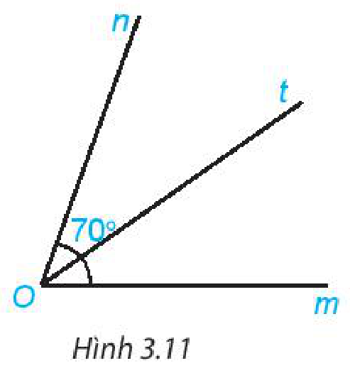
*Hình 3.11*

**Luyện tập 3:**

Cho góc $xAm$ có số đo bằng $65^\circ$ và $Am$ là tia phân giác của góc $xAy$ (H.3.12). Tính số đo góc $xAy$.

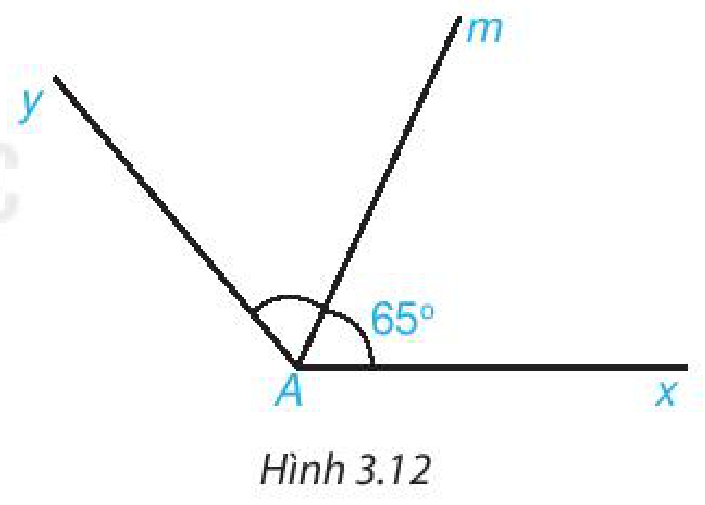
*Hình 3.12*

**Thực hành:**

Vẽ tia phân giác $Oz$ của góc $xOy$ có số đo bằng $68^\circ$, sử dụng thước đo góc theo hướng dẫn.

Nếu $Oz$ là tia phân giác của góc $xOy$ thì $\widehat{xOz} = \frac{1}{2} \cdot 68^\circ = 34^\circ$. Ta có cách vẽ sau:

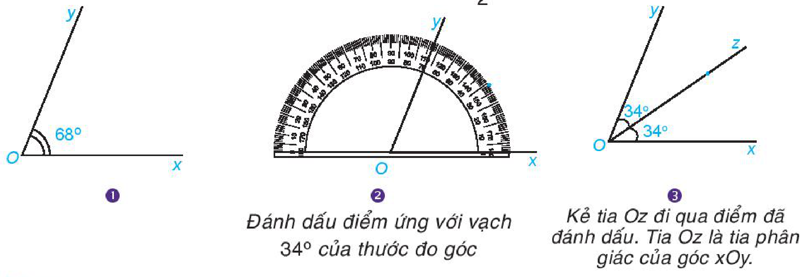

- ② *Đánh dấu điểm ứng với vạch $34^\circ$ của thước đo góc*
- ③ *Kẻ tia $Oz$ đi qua điểm đã đánh dấu. Tia $Oz$ là tia phân giác của góc $xOy$.*

<!-- pdf:46 -->

**Vận dụng:**

Quan sát hình vẽ bên.

Quả cân ở đĩa cân bên trái nặng bao nhiêu kilôgam để cân thăng bằng, tức là kim trên mặt đồng hồ của cân là tia phân giác của góc $AOB$?

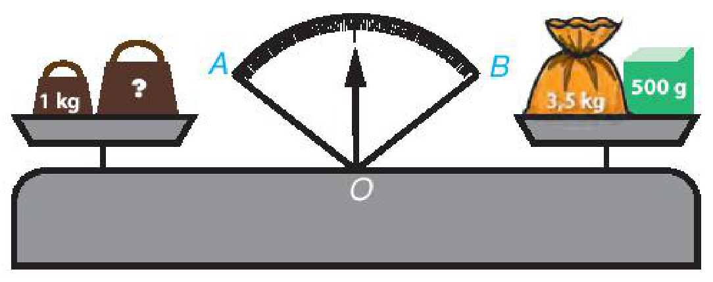

## BÀI TẬP

3.1. Cho Hình 3.13, hãy kể tên các cặp góc kề bù.

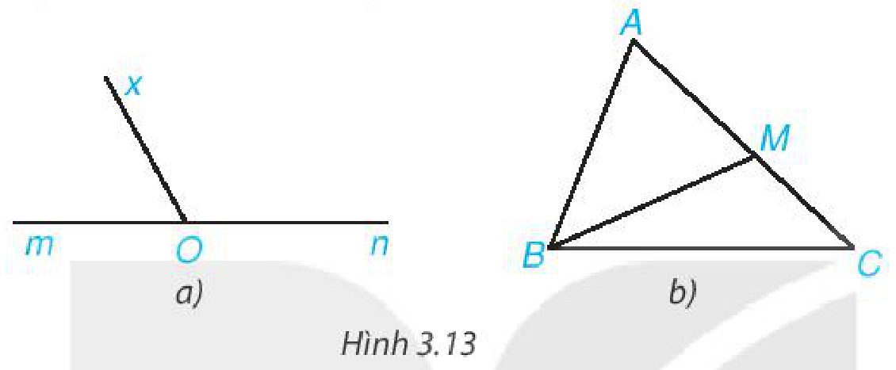
*Hình 3.13*

3.2. Cho Hình 3.14, hãy kể tên các cặp góc đối đỉnh.

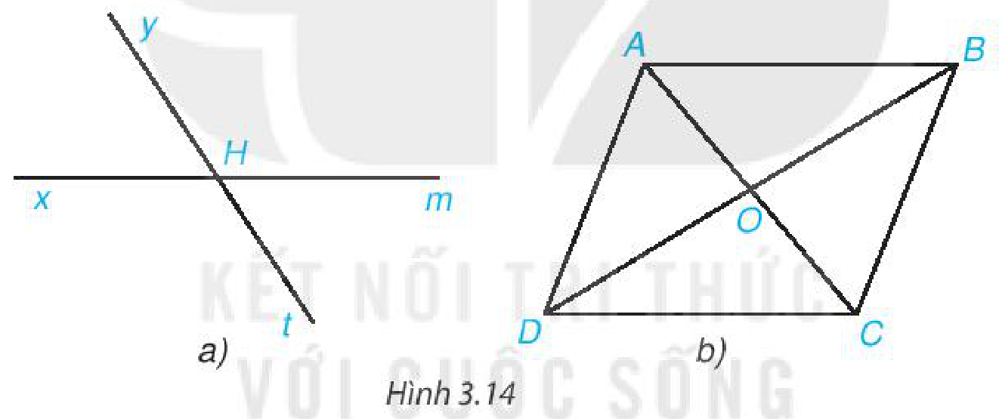
*Hình 3.14*

3.3. Vẽ góc $xOy$ có số đo bằng $60^\circ$. Vẽ tia $Om$ là tia đối của tia $Ox$.

a) Viết tên hai góc kề bù có trong hình vừa vẽ.

b) Tính số đo góc $yOm$.

c) Vẽ tia $Ot$ là tia phân giác của góc $xOy$. Tính số đo các góc $tOy$ và $tOm$.

3.4. Cho Hình 3.15a, biết $\widehat{DMA} = 45^\circ$. Tính số đo góc $DMB$.

3.5. Cho Hình 3.15b, biết $\widehat{xBm} = 36^\circ$. Tính số đo các góc còn lại trong hình vẽ.

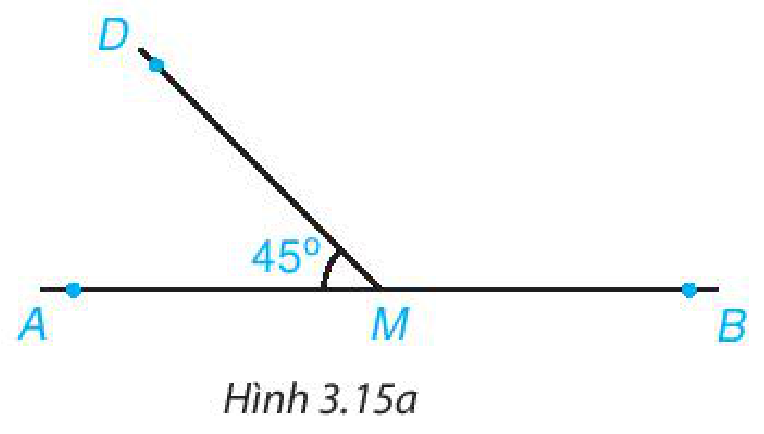
*Hình 3.15a*

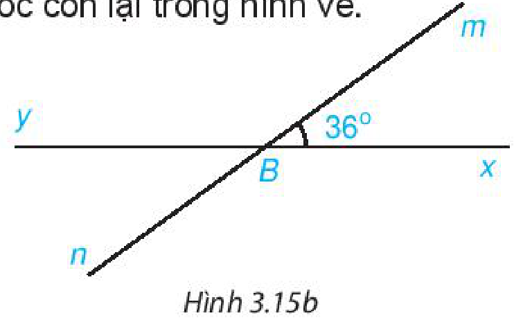
*Hình 3.15b*

## 📷 Danh sách hình trong bài

| Mã hình | Trang PDF | Vị trí trong bài | Chú thích gốc |
| --- | :---: | --- | --- |
| H7-toan-b08-01 | 41 | Mở đầu | (sách không đánh số, bánh chưng buộc dây lạt) |
| H7-toan-b08-02 | 42 | Mục 1, HĐ1 | (sách không đánh số, sơ đồ bánh chưng đánh dấu hai góc kề bù) |
| H7-toan-b08-03 | 42 | Mục 1, HĐ2 | Hình 3.1 |
| H7-toan-b08-04 | 42 | Mục 1, Câu hỏi | Hình 3.2 |
| H7-toan-b08-05 | 42 | Mục 1, Chú ý 1 | Hình 3.3a |
| H7-toan-b08-06 | 42 | Mục 1, Chú ý 2 | Hình 3.3b |
| H7-toan-b08-07 | 43 | Mục 1, Luyện tập 1 | Hình 3.4 |
| H7-toan-b08-08 | 43 | Mục 1, HĐ3 | (sách không đánh số, sơ đồ bánh chưng đánh dấu hai góc đối đỉnh) |
| H7-toan-b08-09 | 43 | Mục 1, HĐ4 | Hình 3.5 |
| H7-toan-b08-10 | 43 | Mục 1, Câu hỏi | Hình 3.6 |
| H7-toan-b08-11 | 44 | Mục 1, Ví dụ 1 | Hình 3.7 |
| H7-toan-b08-12 | 44 | Mục 1, Luyện tập 2 | Hình 3.8 |
| H7-toan-b08-13 | 44 | Mục 2, HĐ5 | Hình 3.9 |
| H7-toan-b08-14 | 45 | Mục 2, Tính chất | Hình 3.10 |
| H7-toan-b08-15 | 45 | Mục 2, Ví dụ 2 | Hình 3.11 |
| H7-toan-b08-16 | 45 | Mục 2, Luyện tập 3 | Hình 3.12 |
| H7-toan-b08-17 | 45 | Mục 2, Thực hành | (sách không đánh số, 3 bước vẽ tia phân giác bằng thước đo góc) |
| H7-toan-b08-18 | 46 | Mục 2, Vận dụng | (sách không đánh số, chiếc cân hai đĩa) |
| H7-toan-b08-19 | 46 | Bài 3.1 | Hình 3.13 |
| H7-toan-b08-20 | 46 | Bài 3.2 | Hình 3.14 |
| H7-toan-b08-21 | 46 | Bài 3.4 | Hình 3.15a |
| H7-toan-b08-22 | 46 | Bài 3.5 | Hình 3.15b |
