<!-- pdf:47 -->

# BÀI 9: HAI ĐƯỜNG THẲNG SONG SONG VÀ DẤU HIỆU NHẬN BIẾT

## 🔤 Khái niệm, thuật ngữ

- Hai đường thẳng song song
- Hai góc đồng vị
- Hai góc so le trong

## 🎯 Kiến thức, kĩ năng

- Nhận biết các góc tạo bởi một đường thẳng cắt hai đường thẳng.
- Mô tả dấu hiệu nhận biết hai đường thẳng song song thông qua cặp góc đồng vị, cặp góc so le trong.
- Nhận biết cách vẽ hai đường thẳng song song.

## 🔴 Mở đầu

Để kiểm tra các thanh ngang trên mái nhà đã song song với nhau chưa, người thợ chỉ cần kiểm tra chúng có cùng vuông góc với một thanh dọc. Vì sao lại như vậy, chúng ta cùng tìm hiểu qua bài học này.

## 1. CÁC GÓC TẠO BỞI MỘT ĐƯỜNG THẲNG CẮT HAI ĐƯỜNG THẲNG

*Góc so le trong, góc đồng vị*

> Cho đường thẳng $c$ cắt hai đường thẳng $a$ và $b$ lần lượt tại $A$ và $B$ tạo thành bốn góc đỉnh $A$, bốn góc đỉnh $B$ được đánh số như Hình 3.16. Ta sắp xếp các góc thành từng cặp. Mỗi cặp gồm một góc đỉnh $A$ và một góc đỉnh $B$.
> - Các cặp góc $A_1$ và $B_3$, $A_4$ và $B_2$ được gọi là các cặp **góc so le trong**.
> - Các cặp góc $A_1$ và $B_1$, $A_2$ và $B_2$, $A_3$ và $B_3$, $A_4$ và $B_4$ được gọi là các cặp **góc đồng vị**.

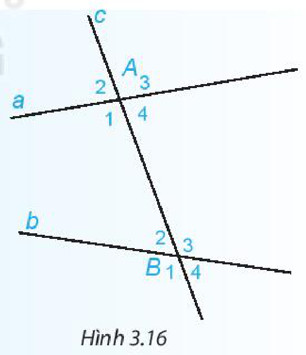
*Hình 3.16*

> ❓ Cho đường thẳng $mn$ cắt hai đường thẳng $xy$ và $uv$ lần lượt tại hai điểm $P$ và $Q$ (H.3.17). Em hãy kể tên:
>
> a) Hai cặp góc so le trong;
>
> b) Bốn cặp góc đồng vị.

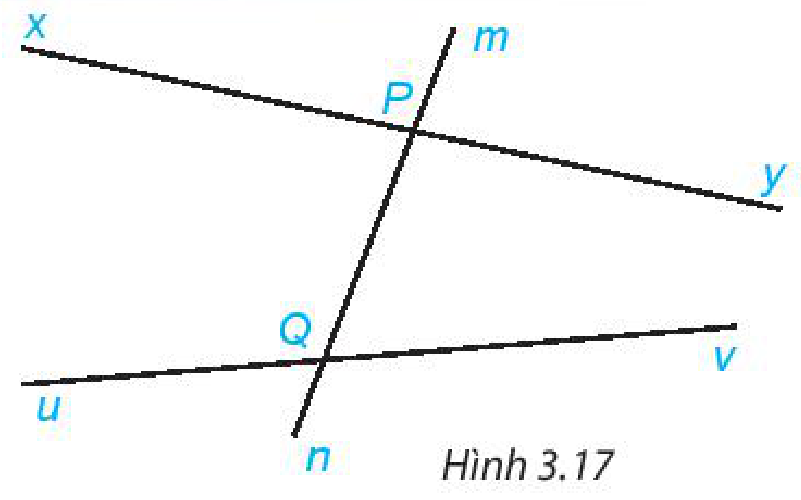
*Hình 3.17*

<!-- pdf:48 -->

*Quan hệ giữa các cặp góc so le trong, cặp góc đồng vị*

Trên Hình 3.18, cho biết hai góc so le trong $A_1$ và $B_3$ bằng nhau và bằng $60^\circ$.

**HĐ1:** Hãy tính và so sánh hai góc so le trong còn lại $A_2$ và $B_4$.

**HĐ2:** Chọn hai góc đồng vị rồi tính và so sánh hai góc đó.

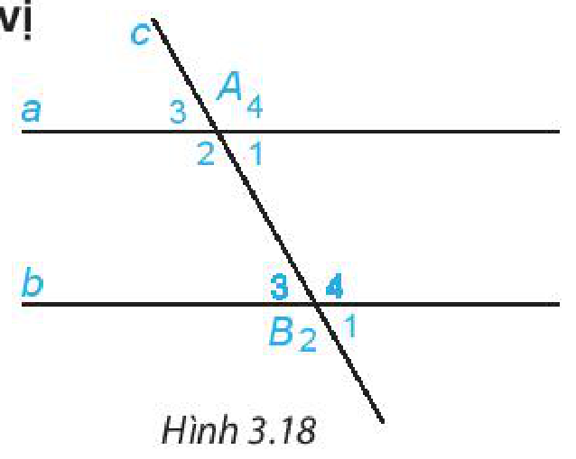
*Hình 3.18*

*Ta có tính chất sau:*

> Nếu đường thẳng $c$ cắt hai đường thẳng phân biệt $a, b$ và trong các góc tạo thành có một cặp góc so le trong bằng nhau thì:
> - Hai góc so le trong còn lại bằng nhau;
> - Hai góc đồng vị bằng nhau.

**Luyện tập 1:**

Quan sát Hình 3.19.

a) Biết $\widehat{A_2} = 40^\circ$, $\widehat{B_4} = 40^\circ$. Em hãy tính số đo các góc còn lại.

b) Các cặp góc $A_1$ và $B_4$; $A_2$ và $B_3$ được gọi là các cặp **góc trong cùng phía**. Tính các tổng: $\widehat{A_1} + \widehat{B_4}$; $\widehat{A_2} + \widehat{B_3}$.

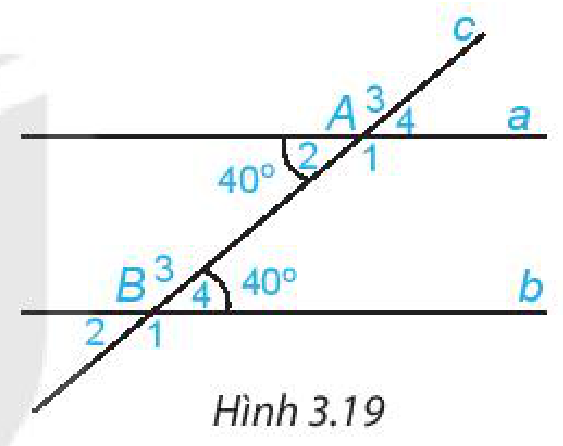
*Hình 3.19*

## 2. DẤU HIỆU NHẬN BIẾT HAI ĐƯỜNG THẲNG SONG SONG

<!-- term: Hai đường thẳng song song -->
Để biết hai đường thẳng cắt nhau hay song song với nhau, ta cần biết chúng có điểm chung hay không. Việc kiểm tra trực tiếp, tức là xác định điểm chung của hai đường thẳng đã cho, trong nhiều trường hợp, là rất khó thực hiện. Chẳng hạn trên Hình 3.20a, không phải lúc nào ta cũng có thể kéo dài được hai đường thẳng $c$ và $d$ để tìm điểm chung của chúng. Vậy có cách nào thuận tiện hơn để nhận biết hai đường thẳng song song hay không?

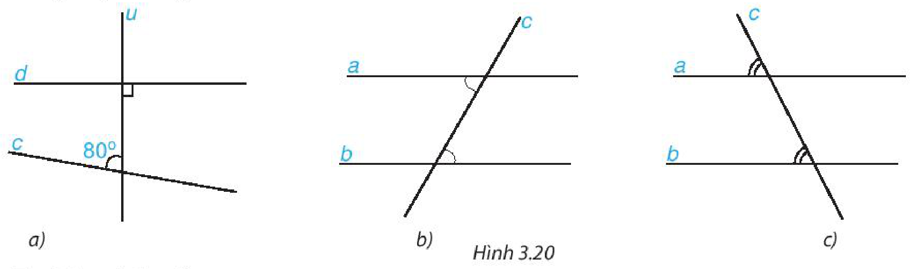
*Hình 3.20*

*Ta thừa nhận rằng:*

<!-- term: Dấu hiệu nhận biết hai đường thẳng song song -->
> Nếu đường thẳng $c$ cắt hai đường thẳng phân biệt $a, b$ và trong các góc tạo thành có một cặp góc so le trong bằng nhau hoặc một cặp góc đồng vị bằng nhau thì $a$ và $b$ song song với nhau (H.3.20b,c).

<!-- pdf:49 -->

**Ví dụ:**

Quan sát Hình 3.21 và giải thích tại sao $xy \parallel x'y'$.

**Giải:**

Ta có $\widehat{xAB} = \widehat{ABy'} = 70^\circ$.

Hai góc này ở vị trí so le trong. Do đó $xy \parallel x'y'$ (dấu hiệu nhận biết hai đường thẳng song song).

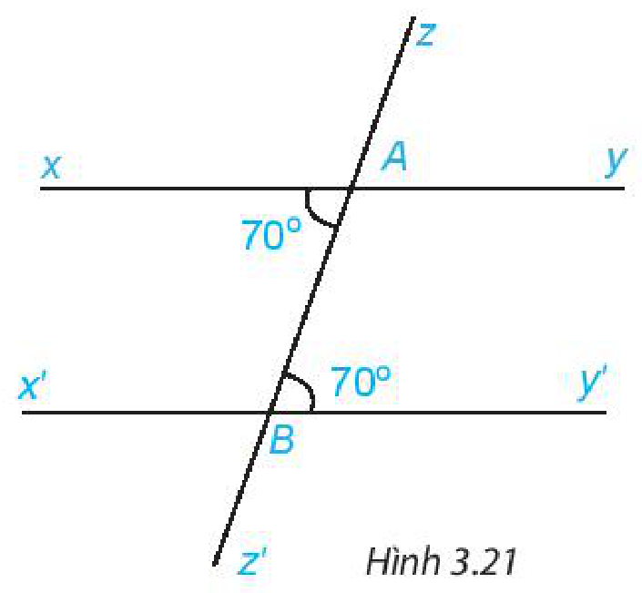
*Hình 3.21*

**Luyện tập 2:**

① Quan sát Hình 3.22 và giải thích vì sao $AB \parallel DC$.

② Tìm trên Hình 3.23 hai đường thẳng song song với nhau và giải thích vì sao chúng song song.

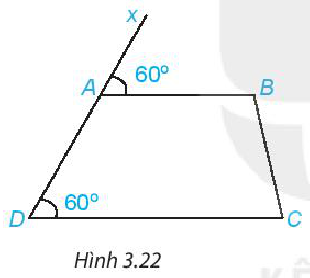
*Hình 3.22*

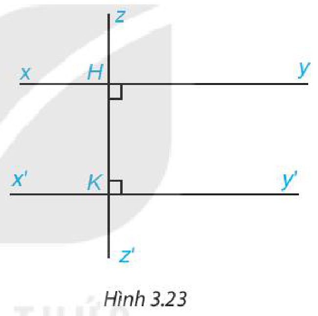
*Hình 3.23*

<!-- term: Dấu hiệu nhận biết hai đường thẳng song song -->
**Nhận xét:** Hai đường thẳng phân biệt cùng vuông góc với một đường thẳng thứ ba thì chúng song song với nhau.

**Thực hành 1:**

Cho đường thẳng $a$ và điểm $A$ nằm ngoài đường thẳng $a$. Để vẽ đường thẳng $b$ đi qua $A$ và song song với $a$, ta có thể sử dụng góc nhọn $60^\circ$ của êke để vẽ như sau:

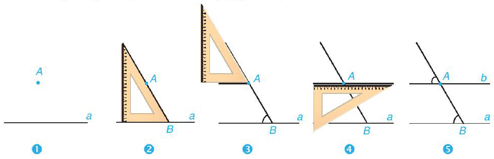

Tại sao khi vẽ như trên ta lại khẳng định được hai đường thẳng $a$ và $b$ song song với nhau?

<!-- pdf:50 -->

**Thực hành 2:**

Dùng góc vuông hay góc $30^\circ$ của êke (thay cho góc $60^\circ$) để vẽ đường thẳng đi qua $A$ và song song với đường thẳng $a$ cho trước.

## BÀI TẬP

3.6. Quan sát Hình 3.24.

a) Tìm một góc ở vị trí so le trong với góc $MNB$.

b) Tìm một góc ở vị trí đồng vị với góc $ACB$.

c) Kể tên một cặp góc trong cùng phía.

d) Biết $MN \parallel BC$, em hãy kể tên ba cặp góc bằng nhau trong hình vẽ.

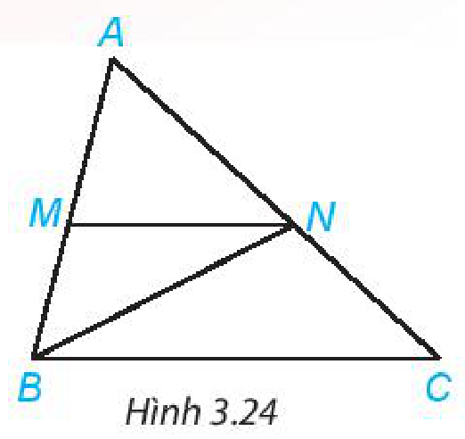
*Hình 3.24*

3.7. Quan sát Hình 3.25. Biết $\widehat{MEF} = 40^\circ$, $\widehat{EMN} = 40^\circ$. Em hãy giải thích tại sao $EF \parallel NM$.

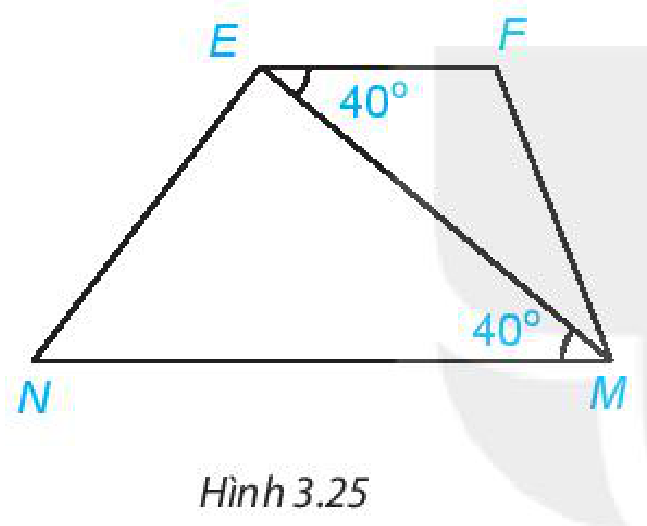
*Hình 3.25*

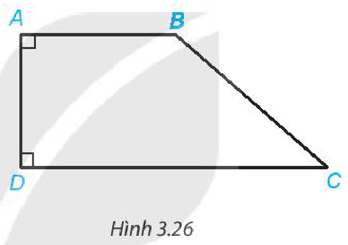
*Hình 3.26*

3.8. Quan sát Hình 3.26, giải thích tại sao $AB \parallel DC$.

3.9. Cho điểm $A$ và đường thẳng $d$ không đi qua $A$. Hãy vẽ đường thẳng $d'$ đi qua $A$ và song song với $d$.

3.10. Cho hai điểm $A$ và $B$. Hãy vẽ đường thẳng $a$ đi qua $A$ và đường thẳng $b$ đi qua $B$ sao cho $a$ song song với $b$.

3.11. Hãy vẽ hai đoạn thẳng $AB$ và $MN$ sao cho $AB \parallel MN$ và $AB = MN$.

## 📷 Danh sách hình trong bài

| Mã hình | Trang PDF | Vị trí trong bài | Chú thích gốc |
| --- | :---: | --- | --- |
| H7-toan-b09-01 | 47 | Mở đầu | (sách không đánh số, mô hình mái nhà và bản vẽ thiết kế) |
| H7-toan-b09-02 | 47 | Mục 1 | Hình 3.16 |
| H7-toan-b09-03 | 47 | Mục 1, Câu hỏi | Hình 3.17 |
| H7-toan-b09-04 | 48 | Mục 1, HĐ1–HĐ2 | Hình 3.18 |
| H7-toan-b09-05 | 48 | Mục 1, Luyện tập 1 | Hình 3.19 |
| H7-toan-b09-06 | 48 | Mục 2 | Hình 3.20 |
| H7-toan-b09-07 | 49 | Mục 2, Ví dụ | Hình 3.21 |
| H7-toan-b09-08 | 49 | Mục 2, Luyện tập 2 | Hình 3.22 |
| H7-toan-b09-09 | 49 | Mục 2, Luyện tập 2 | Hình 3.23 |
| H7-toan-b09-10 | 49 | Mục 2, Thực hành 1 | (sách không đánh số, 5 bước vẽ hai đường thẳng song song bằng êke) |
| H7-toan-b09-11 | 50 | Bài 3.6 | Hình 3.24 |
| H7-toan-b09-12 | 50 | Bài 3.7 | Hình 3.25 |
| H7-toan-b09-13 | 50 | Bài 3.8 | Hình 3.26 |
