<!-- pdf:52 -->

# BÀI 10: TIÊN ĐỀ EUCLID. TÍNH CHẤT CỦA HAI ĐƯỜNG THẲNG SONG SONG

## 🔤 Khái niệm, thuật ngữ

- Tiên đề Euclid

## 🎯 Kiến thức, kĩ năng

- Nhận biết tiên đề Euclid về đường thẳng song song.
- Mô tả một số tính chất của hai đường thẳng song song.

## 🔴 Mở đầu

Qua điểm $M$ nằm ngoài đường thẳng $a$, chúng ta đã biết cách vẽ một đường thẳng $b$ đi qua điểm $M$ và song song với $a$. Vậy có thể vẽ được bao nhiêu đường thẳng $b$ như vậy?

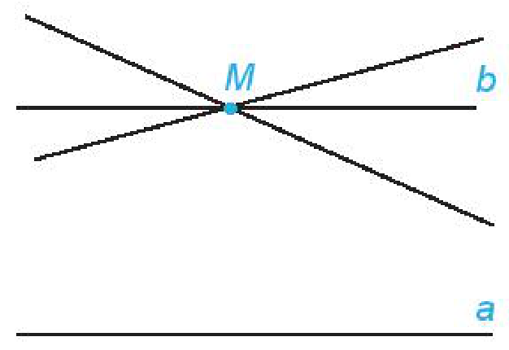

## 1. TIÊN ĐỀ EUCLID VỀ ĐƯỜNG THẲNG SONG SONG

*Tiên đề Euclid*

**HĐ1:** Cho trước đường thẳng $a$ và một điểm $M$ không nằm trên đường thẳng $a$ (H.3.31).

- Dùng bút chì vẽ đường thẳng $b$ đi qua $M$ và song song với đường thẳng $a$.
- Dùng bút màu vẽ đường thẳng $c$ đi qua $M$ và song song với đường thẳng $a$.

Em có nhận xét gì về vị trí của hai đường thẳng $b$ và $c$?

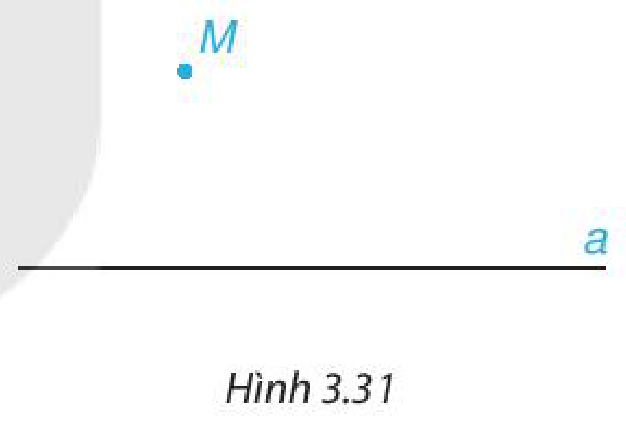
*Hình 3.31*

*Chúng ta thừa nhận tính chất sau mang tên “**Tiên đề Euclid**”:*

> Qua một điểm ở ngoài một đường thẳng, chỉ có một đường thẳng song song với đường thẳng đó.

**Nhận xét:** Trong Hình 3.32, nếu điểm $M$ nằm ngoài đường thẳng $a$ thì đường thẳng $b$ đi qua $M$ và song song với $a$ là duy nhất.

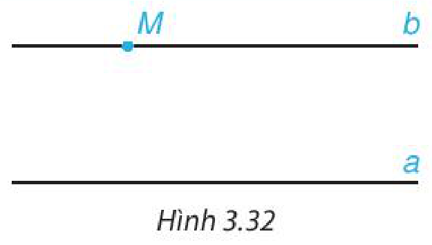
*Hình 3.32*

**Ví dụ 1:**

Cho hai đường thẳng $a$ và $b$ song song với nhau. Hãy sử dụng tiên đề Euclid giải thích vì sao một đường thẳng $c$ cắt đường thẳng $a$ thì cũng cắt đường thẳng $b$.

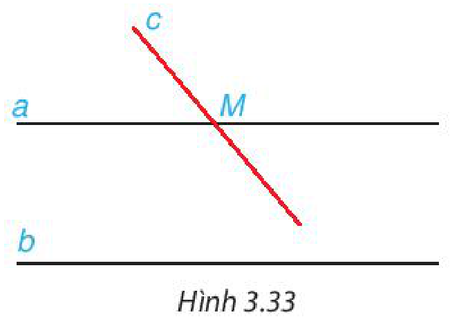
*Hình 3.33*

<!-- pdf:53 -->

**Giải:**

Giả sử đường thẳng $c$ cắt đường thẳng $a$ tại điểm $M$.

Theo tiên đề Euclid, qua điểm $M$ chỉ có một đường thẳng duy nhất song song với đường thẳng $b$, đó là đường thẳng $a$. Do đó đường thẳng $c$ (cũng đi qua $M$) không thể cũng song song với đường thẳng $b$. Vậy đường thẳng $c$ cắt đường thẳng $b$.

**Chú ý:** Từ tiên đề Euclid ta suy ra được: Nếu một đường thẳng cắt một trong hai đường thẳng song song thì nó cũng cắt đường thẳng còn lại.

**Luyện tập 1:** Phát biểu nào sau đây diễn đạt đúng nội dung của tiên đề Euclid?

(1) Cho điểm $M$ nằm ngoài đường thẳng $a$. Đường thẳng đi qua $M$ và song song với $a$ là duy nhất.

(2) Có duy nhất một đường thẳng song song với một đường thẳng cho trước.

(3) Qua điểm $M$ nằm ngoài đường thẳng $a$ có ít nhất một đường thẳng song song với $a$.

## 2. TÍNH CHẤT CỦA HAI ĐƯỜNG THẲNG SONG SONG

*Tính chất của hai đường thẳng song song*

**HĐ2:** Vẽ hai đường thẳng song song $a, b$. Kẻ đường thẳng $c$ cắt đường thẳng $a$ tại $A$ và cắt đường thẳng $b$ tại $B$. Trên Hình 3.34:

a) Em hãy đo một cặp góc so le trong rồi rút ra nhận xét;

b) Em hãy đo một cặp góc đồng vị rồi rút ra nhận xét.

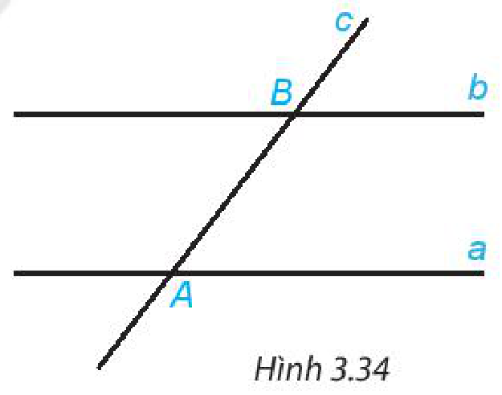
*Hình 3.34*

*Sử dụng tiên đề Euclid, người ta suy ra tính chất sau:*

<!-- term: Tính chất của hai đường thẳng song song -->
> Nếu một đường thẳng cắt hai đường thẳng song song thì:
> - Hai góc so le trong bằng nhau;
> - Hai góc đồng vị bằng nhau.

**Ví dụ 2:**

Cho Hình 3.35, biết $xy \parallel x'y'$ và $\widehat{BAy} = 50^\circ$.

Tính số đo các góc $ABx'$ và $y'Bz'$.

**Giải:**

- Ta có $xy \parallel x'y'$, suy ra $\widehat{ABx'} = \widehat{BAy}$ (hai góc so le trong).

Do đó $\widehat{ABx'} = 50^\circ$.

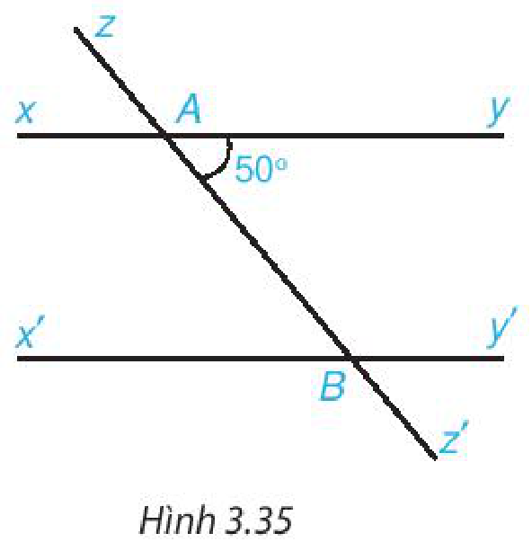
*Hình 3.35*

<!-- pdf:54 -->

- Cũng từ $xy \parallel x'y'$ suy ra $\widehat{y'Bz'} = \widehat{BAy}$ (hai góc đồng vị).

Vậy $\widehat{y'Bz'} = 50^\circ$.

**Luyện tập 2:**

① Cho Hình 3.36, biết $MN \parallel BC, \widehat{ABC} = 60^\circ, \widehat{MNC} = 150^\circ$.

Hãy tính số đo các góc $BMN$ và $ACB$.

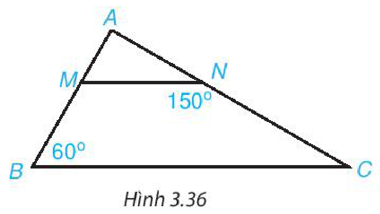
*Hình 3.36*

② Cho Hình 3.37, biết rằng $xx' \parallel yy'$ và $zz' \perp xx'$. Tính số đo góc $ABy$ và cho biết $zz'$ có vuông góc với $yy'$ không.

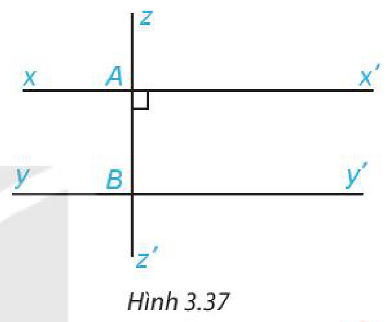
*Hình 3.37*

**Nhận xét:**

<!-- term: Tính chất của hai đường thẳng song song -->
- Một đường thẳng vuông góc với một trong hai đường thẳng song song thì nó cũng vuông góc với đường thẳng kia.
- Hai đường thẳng phân biệt cùng song song với một đường thẳng thứ ba thì chúng song song với nhau (H.3.38).

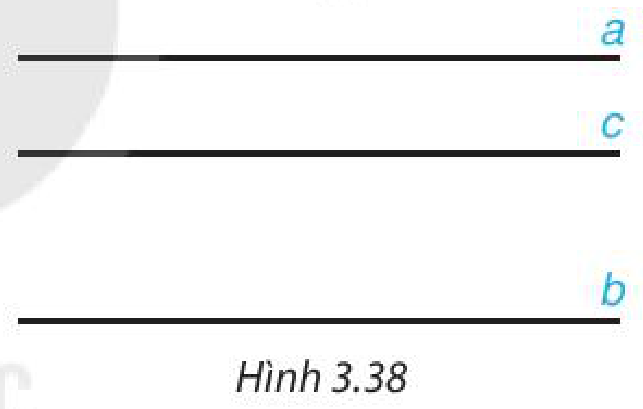
*Hình 3.38*

## BÀI TẬP

3.17. Cho Hình 3.39, biết rằng $mn \parallel pq$. Tính số đo các góc $mHK, vHn$.

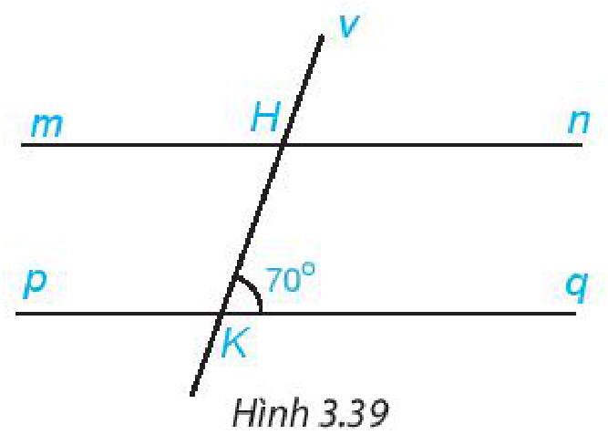
*Hình 3.39*

3.18. Cho Hình 3.40.

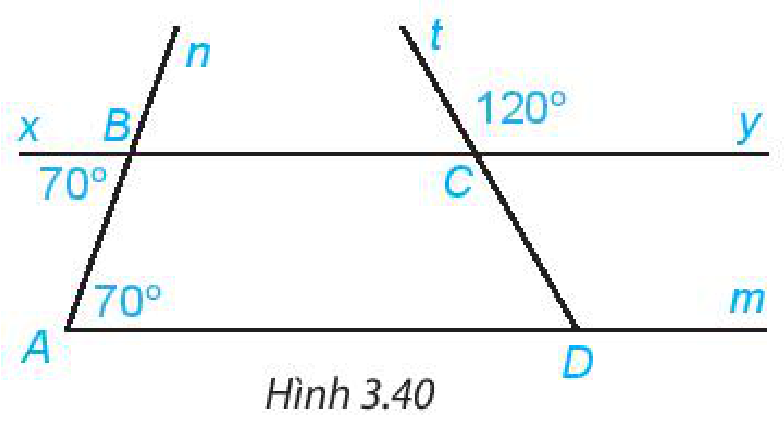
*Hình 3.40*

a) Giải thích tại sao $Am \parallel By$.

b) Tính $\widehat{CDm}$.

<!-- pdf:55 -->

3.19. Cho Hình 3.41.

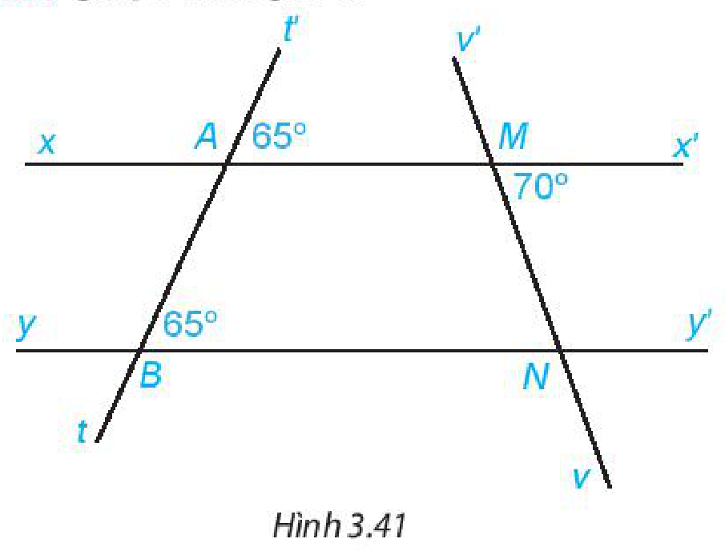
*Hình 3.41*

a) Giải thích tại sao $xx' \parallel yy'$.

b) Tính số đo góc $MNB$.

3.20. Cho Hình 3.42, biết rằng $Ax \parallel Dy$, $\widehat{A} = 90^\circ, \widehat{BCy} = 50^\circ$. Tính số đo các góc $ADC$ và $ABC$.

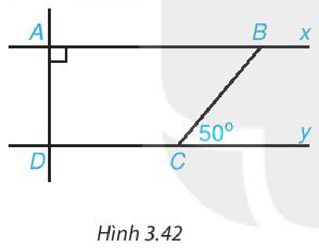
*Hình 3.42*

3.21. Cho Hình 3.43. Giải thích tại sao:

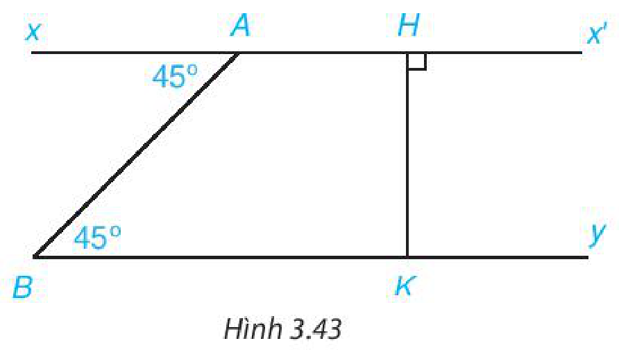
*Hình 3.43*

a) $Ax' \parallel By$;

b) $By \perp HK$.

3.22. Cho tam giác $ABC$. Vẽ đường thẳng $a$ đi qua $A$ và song song với $BC$. Vẽ đường thẳng $b$ đi qua $B$ và song song với $AC$. Có thể vẽ được bao nhiêu đường thẳng $a$, bao nhiêu đường thẳng $b$? Vì sao?

3.23. Cho Hình 3.44.

Giải thích tại sao:

a) $MN \parallel EF$;

b) $HK \parallel EF$;

c) $HK \parallel MN$.

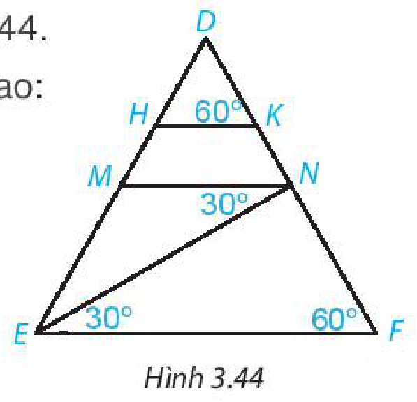
*Hình 3.44*

## 💡 Em có biết?

Euclid là nhà toán học lỗi lạc thời cổ Hi Lạp, sống vào thế kỉ III trước Công nguyên. Có thể nói hầu hết kiến thức hình học ở cấp Trung học cơ sở hiện nay đều đã được đề cập một cách khá hệ thống, chính xác, trong bộ sách “Cơ bản” gồm 13 cuốn do Euclid viết ra. Tục truyền có lần vua Ptolemy (Ptô-lê-mê) hỏi Euclid: “Liệu có thể đến với Hình học bằng con đường khác ngắn hơn không?”. Ông trả lời ngay: “Tâu Bệ hạ, trong Hình học không có con đường dành riêng cho vua chúa”.

(Phan Đức Chính, *Toán 7, tập một*, Nhà xuất bản Giáo dục Việt Nam, 2019, tr. 93)

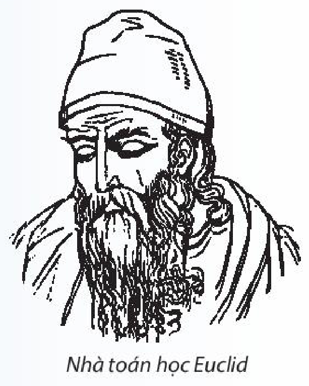
*Nhà toán học Euclid*

## 📷 Danh sách hình trong bài

| Mã hình | Trang PDF | Vị trí trong bài | Chú thích gốc |
| --- | :---: | --- | --- |
| H7-toan-b10-01 | 52 | Mở đầu | (sách không đánh số, các đường thẳng đi qua điểm $M$ nằm ngoài đường thẳng $a$) |
| H7-toan-b10-02 | 52 | Mục 1, HĐ1 | Hình 3.31 |
| H7-toan-b10-03 | 52 | Mục 1, Nhận xét | Hình 3.32 |
| H7-toan-b10-04 | 52 | Mục 1, Ví dụ 1 | Hình 3.33 |
| H7-toan-b10-05 | 53 | Mục 2, HĐ2 | Hình 3.34 |
| H7-toan-b10-06 | 53 | Mục 2, Ví dụ 2 | Hình 3.35 |
| H7-toan-b10-07 | 54 | Mục 2, Luyện tập 2 | Hình 3.36 |
| H7-toan-b10-08 | 54 | Mục 2, Luyện tập 2 | Hình 3.37 |
| H7-toan-b10-09 | 54 | Mục 2, Nhận xét | Hình 3.38 |
| H7-toan-b10-10 | 54 | Bài 3.17 | Hình 3.39 |
| H7-toan-b10-11 | 54 | Bài 3.18 | Hình 3.40 |
| H7-toan-b10-12 | 55 | Bài 3.19 | Hình 3.41 |
| H7-toan-b10-13 | 55 | Bài 3.20 | Hình 3.42 |
| H7-toan-b10-14 | 55 | Bài 3.21 | Hình 3.43 |
| H7-toan-b10-15 | 55 | Bài 3.23 | Hình 3.44 |
| H7-toan-b10-16 | 55 | Em có biết? | Nhà toán học Euclid |
