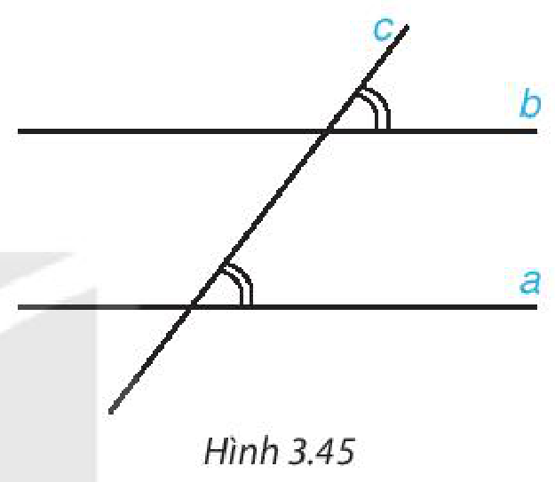
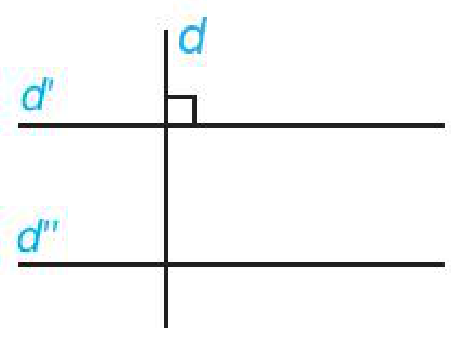
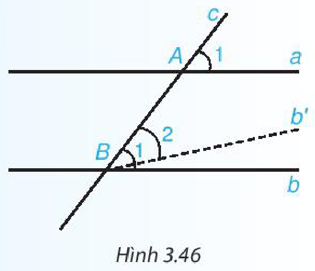

<!-- pdf:56 -->

# BÀI 11: ĐỊNH LÍ VÀ CHỨNG MINH ĐỊNH LÍ

## 🔤 Khái niệm, thuật ngữ

- Định lí
- Giả thiết
- Kết luận
- Chứng minh một định lí

## 🎯 Kiến thức, kĩ năng

- Nhận biết một định lí, giả thiết, kết luận của định lí.
- Làm quen với chứng minh định lí.

## 🔴 Mở đầu

Trong Bài 10, ta đã dùng cách đo đạc để kiểm nghiệm tính chất sau là đúng:

“Nếu một đường thẳng cắt hai đường thẳng song song thì hai góc đồng vị bằng nhau” (H.3.45).

Tuy nhiên, đo đạc chỉ cho ta kết quả gần đúng và chỉ trong một trường hợp cụ thể.

Vậy có cách nào để chắc chắn rằng tính chất đó đúng cho mọi trường hợp không?

*Hình 3.45*

*Định lí. Giả thiết và kết luận của định lí*

- Trong Bài 8, Tập suy luận, trang 42, khẳng định “(Nếu) hai góc đối đỉnh thì (hai góc đó) bằng nhau” đã được suy ra từ điều đúng đã biết là “hai góc kề bù có tổng số đo bằng $180^\circ$”. Đó là một *định lí*.
- Trong một định lí ta cần phân biệt *giả thiết* và *kết luận* của nó. Chẳng hạn:

Nếu $\underbrace{\text{hai góc đối đỉnh}}_{\text{Giả thiết}}$ thì $\underbrace{\text{hai góc đó bằng nhau.}}_{\text{Kết luận}}$

> **Định lí** là một khẳng định được suy ra từ những khẳng định đúng đã biết. Mỗi định lí thường được phát biểu dưới dạng:
>
> **Nếu ... thì ...**
>
> - Phần giữa từ “nếu” và từ “thì” là **giả thiết** của định lí;
> - Phần sau từ “thì” là **kết luận** của định lí.

Chẳng hạn, các tính chất của hai đường thẳng song song đã học đều là những định lí.

<!-- pdf:57 -->

**Ví dụ:**

Trong định lí *“Một đường thẳng vuông góc với một trong hai đường thẳng song song thì nó cũng vuông góc với đường thẳng còn lại”*, thì có:

- Giả thiết là *“một đường thẳng vuông góc với một trong hai đường thẳng song song”*;
- Kết luận là *“nó cũng vuông góc với đường thẳng còn lại”*.

Ta có thể viết giả thiết và kết luận của định lí trên bằng kí hiệu như sau:

| GT | $d, d', d''$ là các đường thẳng, $d' \parallel d'', d \perp d'$ |
| --- | --- |
| KL | $d \perp d''$. |
<!-- ocr-ok: đã đối chiếu trực tiếp ảnh trang PDF 57, công thức/bảng kí hiệu khớp nguyên văn sách in -->

- **Vuông:** Giả thiết, kết luận được viết tắt tương ứng là GT và KL bạn nhé!

**Luyện tập 1:** Vẽ hình và viết giả thiết, kết luận của định lí:

“Hai góc đối đỉnh thì bằng nhau”.

*Thế nào là chứng minh định lí?*

> **Chứng minh một định lí** là dùng lập luận để từ giả thiết và những khẳng định đúng đã biết suy ra kết luận của định lí.

Chẳng hạn, ta chứng minh định lí nói trong *tình huống mở đầu* “Nếu một đường thẳng cắt hai đường thẳng song song thì hai góc đồng vị bằng nhau” như sau:

| GT | $a \parallel b$, $c$ cắt $a$ tại $A$, $c$ cắt $b$ tại $B$; $\widehat{A_1}, \widehat{B_1}$ là hai góc đồng vị. |
| --- | --- |
| KL | $\widehat{A_1} = \widehat{B_1}$. |
<!-- ocr-ok: đã đối chiếu trực tiếp ảnh trang PDF 57, công thức/bảng kí hiệu khớp nguyên văn sách in -->

*Hình 3.46*

*Chứng minh* (H.3.46)

Qua điểm $B$ kẻ đường thẳng $b'$ sao cho góc $\widehat{B_2} = \widehat{A_1}$. Khi đó đường thẳng $c$ tạo với hai đường thẳng $a$ và $b'$ hai góc đồng vị bằng nhau $\widehat{A_1} = \widehat{B_2}$.

Theo dấu hiệu nhận biết hai đường thẳng song song ta có $a$ và $b'$ song song với nhau. Suy ra qua $B$ có hai đường thẳng $b, b'$ cùng song song với $a$. Theo tiên đề Euclid, $b'$ trùng $b$. Từ đó suy ra $\widehat{B_1} = \widehat{A_1}$ (vì cùng bằng $\widehat{B_2}$).

<!-- pdf:58 -->

**Luyện tập 2:** Em hãy chứng minh định lí: *“Hai góc kề bù bằng nhau thì mỗi góc là một góc vuông”*.

- **Pi:** Hai góc vuông kề nhau thì sao nhỉ?

**Tranh luận**

- **Tròn:** Hai góc đối đỉnh thì chắc chắn bằng nhau rồi. Liệu hai góc bằng nhau thì có đối đỉnh không nhỉ?
- **Vuông:** Tớ nghĩ đó là điều không đúng! Nhưng làm thế nào để khẳng định điều đó không đúng nhỉ?

Em có ý kiến gì về hai ý kiến trên?

## BÀI TẬP

3.24. Có thể coi định lí *“Hai đường thẳng phân biệt cùng vuông góc với một đường thẳng thứ ba thì chúng song song với nhau”* được suy ra trực tiếp từ định lí về dấu hiệu nhận biết hai đường thẳng song song không? Suy ra như thế nào?

3.25. Hãy chứng minh định lí nói ở Ví dụ trang 56: *“Một đường thẳng vuông góc với một trong hai đường thẳng song song thì nó cũng vuông góc với đường thẳng còn lại”*. Trong chứng minh đó ta đã sử dụng những điều đúng đã biết nào?

3.26. Cho góc $xOy$ không phải là góc bẹt. Khẳng định nào sau đây là đúng?

(1) Nếu $Ot$ là tia phân giác của góc $xOy$ thì $\widehat{xOt} = \widehat{tOy}$.

(2) Nếu tia $Ot$ thoả mãn $\widehat{xOt} = \widehat{tOy}$ thì $Ot$ là tia phân giác của góc $xOy$.

Nếu có khẳng định không đúng, hãy nêu ví dụ cho thấy khẳng định đó không đúng. (*Gợi ý:* Xét tia đối của một tia phân giác).

## 📷 Danh sách hình trong bài

| Mã hình | Trang PDF | Vị trí trong bài | Chú thích gốc |
| --- | :---: | --- | --- |
| H7-toan-b11-01 | 56 | Mở đầu | Hình 3.45 |
| H7-toan-b11-02 | 57 | Ví dụ | (sách không đánh số, ba đường thẳng $d, d', d''$) |
| H7-toan-b11-03 | 57 | Thế nào là chứng minh định lí? | Hình 3.46 |
