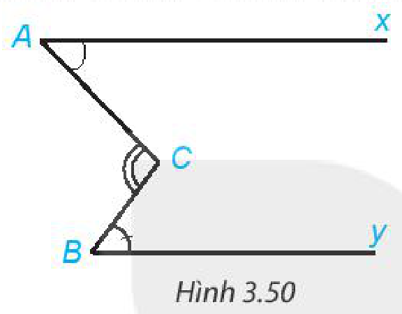
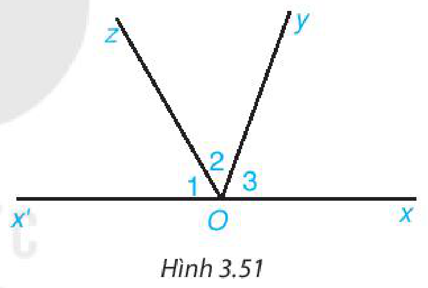
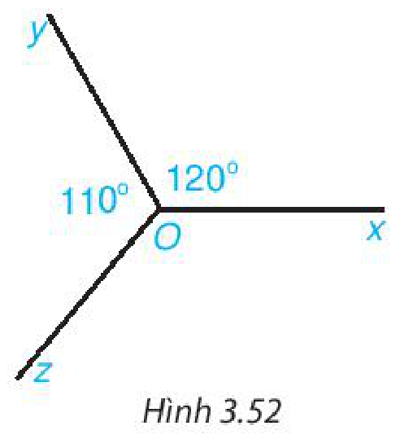

<!-- pdf:60 -->

# BÀI TẬP CUỐI CHƯƠNG III

3.32. Chứng minh rằng: Cho điểm $A$ và đường thẳng $d$ thì có duy nhất đường thẳng đi qua $A$ vuông góc với $d$, tức là nếu có hai đường thẳng đi qua $A$ vuông góc với $d$ thì chúng phải trùng nhau.

3.33. Vẽ ba đường thẳng phân biệt $a, b, c$ sao cho $a \parallel b, b \parallel c$ và hai đường thẳng phân biệt $m, n$ cùng vuông góc với $a$. Hỏi trên hình có bao nhiêu cặp đường thẳng song song, có bao nhiêu cặp đường thẳng vuông góc?

3.34. Cho Hình 3.50, trong đó hai tia $Ax, By$ nằm trên hai đường thẳng song song. Chứng minh rằng $\widehat{C} = \widehat{A} + \widehat{B}$.

- **Pi:** Em hãy kẻ đường thẳng qua $C$ và song song với đường thẳng chứa tia $Ax$.
<!-- ocr-ok: đã đối chiếu trực tiếp ảnh trang PDF 60, công thức/bảng kí hiệu khớp nguyên văn sách in -->

*Hình 3.50*

3.35. Cho Hình 3.51, trong đó $Ox$ và $Ox'$ là hai tia đối nhau.

a) Tính tổng số đo ba góc $O_1, O_2, O_3$.

*Gợi ý:* $\widehat{O_1} + \widehat{O_2} + \widehat{O_3} = \left(\widehat{O_1} + \widehat{O_2}\right) + \widehat{O_3}$,

trong đó $\widehat{O_1} + \widehat{O_2} = \widehat{x'Oy}$.

$\widehat{x'Oy}, \widehat{yOx}$ là hai góc kề bù.

b) Cho $\widehat{O_1} = 60^\circ, \widehat{O_3} = 70^\circ$. Tính $\widehat{O_2}$.

*Hình 3.51*

3.36. Cho Hình 3.52, biết $\widehat{xOy} = 120^\circ, \widehat{yOz} = 110^\circ$.

Tính số đo góc $zOx$.

*Gợi ý:* Kẻ thêm tia đối của tia $Oy$.

*Hình 3.52*

## 📷 Danh sách hình trong bài

| Mã hình | Trang PDF | Vị trí trong bài | Chú thích gốc |
| --- | :---: | --- | --- |
| H7-toan-bt-c03-01 | 60 | Bài 3.34 | Hình 3.50 |
| H7-toan-bt-c03-02 | 60 | Bài 3.35 | Hình 3.51 |
| H7-toan-bt-c03-03 | 60 | Bài 3.36 | Hình 3.52 |
