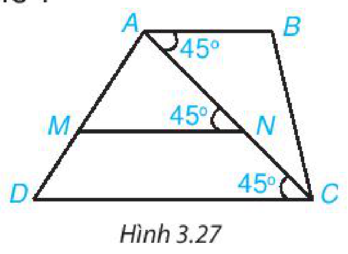
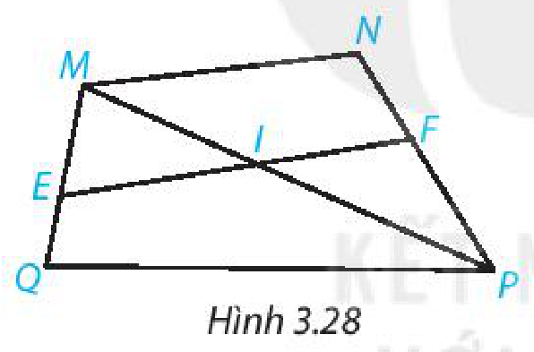
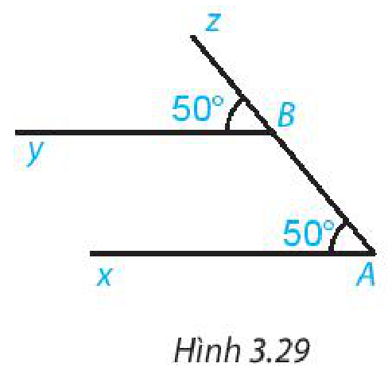
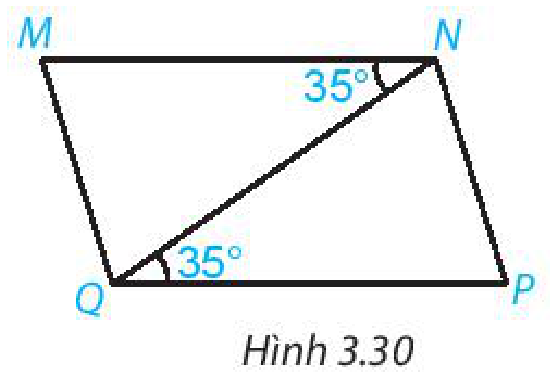

<!-- pdf:51 -->

# LUYỆN TẬP CHUNG (TRANG 50)

**Ví dụ:** Cho Hình 3.27, biết $\widehat{ANM} = 45^\circ$, $\widehat{ACD} = 45^\circ$, $\widehat{BAC} = 45^\circ$.

Em hãy giải thích tại sao:

a) $AB \parallel CD$;

b) $MN \parallel CD$.

*Hình 3.27*

**Giải:**

a) Ta có $\widehat{ACD} = \widehat{BAC} = 45^\circ$.

Hai góc này ở vị trí so le trong. Do đó $AB \parallel CD$ (dấu hiệu nhận biết hai đường thẳng song song).

b) Ta có $\widehat{ANM} = \widehat{ACD} = 45^\circ$.

Hai góc này ở vị trí đồng vị. Do đó $MN \parallel CD$ (dấu hiệu nhận biết hai đường thẳng song song).

## BÀI TẬP

3.12. Cho Hình 3.28.

*Hình 3.28*

a) Tìm các góc ở vị trí so le trong với góc $FIP$; góc $NMI$.

b) Tìm các góc ở vị trí đồng vị với góc $EQP$; góc $IFP$.

3.13. Cho Hình 3.29, biết $\widehat{xAz} = 50^\circ$, $\widehat{yBz} = 50^\circ$. Giải thích tại sao $Ax \parallel By$.

*Hình 3.29*

3.14. Vẽ hình theo yêu cầu sau:

a) Vẽ hai đường thẳng $d$ và $d'$ sao cho $d \parallel d'$.
<!-- ocr-ok: đã đối chiếu trực tiếp ảnh trang PDF 51, công thức/bảng kí hiệu khớp nguyên văn sách in -->

b) Vẽ hai đoạn thẳng $AB$ và $CD$ sao cho $CD = 2AB$ và $CD \parallel AB$.
<!-- ocr-ok: đã đối chiếu trực tiếp ảnh trang PDF 51, công thức/bảng kí hiệu khớp nguyên văn sách in -->

3.15. Cho Hình 3.30, biết các góc $MNQ$ và $PQN$ có cùng số đo bằng $35^\circ$.

Chứng tỏ $MN \parallel QP$.

*Hình 3.30*

3.16. Cho đoạn thẳng $AB$. Vẽ hai tia $Ax, By$ sao cho chúng tạo với $AB$ hai góc so le trong có cùng số đo bằng $60^\circ$ ($\widehat{xAB} = \widehat{yBA} = 60^\circ$). Trên hình vừa vẽ, hai đường thẳng chứa hai tia $Ax$ và $By$ có song song với nhau không? Vì sao?

## 📷 Danh sách hình trong bài

| Mã hình | Trang PDF | Vị trí trong bài | Chú thích gốc |
| --- | :---: | --- | --- |
| H7-toan-ltc-c03-01-01 | 51 | Ví dụ | Hình 3.27 |
| H7-toan-ltc-c03-01-02 | 51 | Bài 3.12 | Hình 3.28 |
| H7-toan-ltc-c03-01-03 | 51 | Bài 3.13 | Hình 3.29 |
| H7-toan-ltc-c03-01-04 | 51 | Bài 3.15 | Hình 3.30 |
