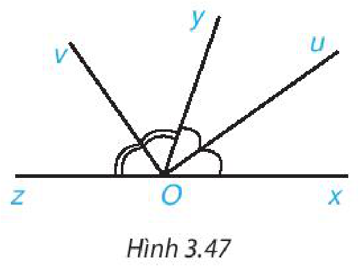
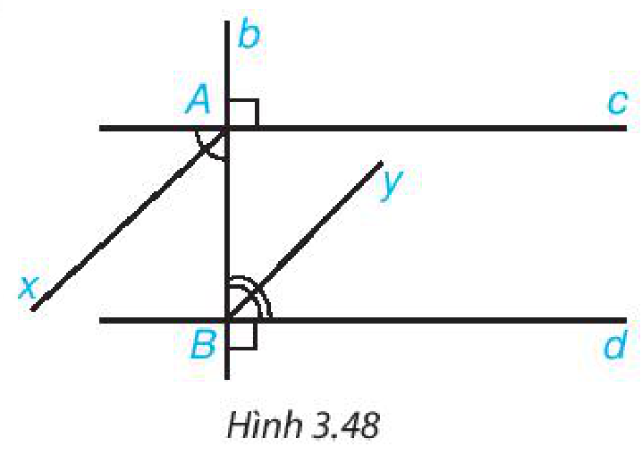
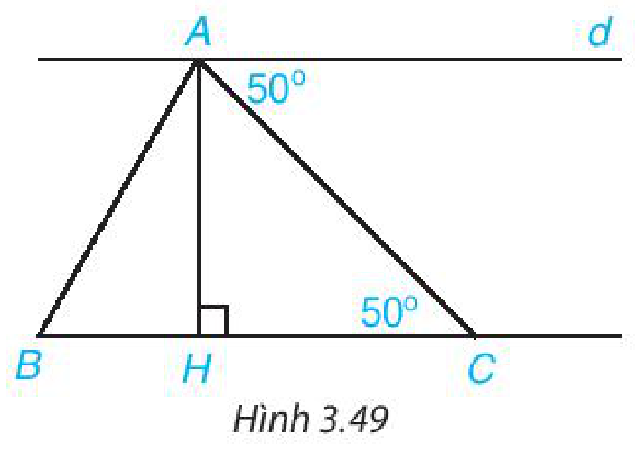

<!-- pdf:59 -->

# LUYỆN TẬP CHUNG (TRANG 58)

**Ví dụ:** Vẽ hình, viết giả thiết, kết luận và trình bày chứng minh định lí sau: *“Góc tạo bởi hai tia phân giác của hai góc kề bù là một góc vuông”*.

**Giải:** (H.3.47)

| GT | $\widehat{xOy}$ và $\widehat{yOz}$ là hai góc kề bù; $Ou$ là tia phân giác của $\widehat{xOy}$; $Ov$ là tia phân giác của $\widehat{yOz}$. |
| --- | --- |
| KL | $\widehat{uOv}$ là góc vuông. |

*Hình 3.47*

Vì $Ou$ là tia phân giác của $\widehat{xOy}$ nên $\widehat{uOy} = \frac{1}{2}\widehat{xOy}$.

Vì $Ov$ là tia phân giác của $\widehat{yOz}$ nên $\widehat{yOv} = \frac{1}{2}\widehat{yOz}$.

Vậy $\widehat{uOy} + \widehat{yOv} = \frac{1}{2}\left(\widehat{xOy} + \widehat{yOz}\right)$. $(*)$

Vế trái của $(*)$ là $\widehat{uOy} + \widehat{yOv} = \widehat{uOv}$. Vì $\widehat{xOy}, \widehat{yOz}$ là hai góc kề bù nên $\widehat{xOy} + \widehat{yOz} = 180^\circ$.

Vậy đẳng thức $(*)$ trở thành $\widehat{uOv} = \frac{1}{2} \cdot 180^\circ = 90^\circ$, tức là $\widehat{uOv}$ là góc vuông.

## BÀI TẬP

3.27. Cho hình thang $ABCD$ có cạnh $AD$ vuông góc với hai đáy $AB$ và $CD$. Số đo góc ở đỉnh $B$ gấp đôi số đo góc ở đỉnh $C$. Tính số đo các góc của hình thang đó.

3.28. Vẽ hình minh hoạ và viết giả thiết, kết luận của định lí: *“Hai đường thẳng phân biệt cùng vuông góc với một đường thẳng thứ ba thì chúng song song với nhau”*.

3.29. Kẻ các tia phân giác $Ax, By$ của một cặp góc so le trong tạo bởi đường thẳng $b$ vuông góc với hai đường thẳng song song $c, d$ (H.3.48). Chứng minh rằng hai tia phân giác đó nằm trên hai đường thẳng song song.

*Hình 3.48*

3.30. Cho hai đường thẳng phân biệt $a, b$ cùng vuông góc với đường thẳng $c$; $d$ là một đường thẳng khác $c$ và $d$ vuông góc với $a$. Chứng minh rằng:

a) $a \parallel b$;

b) $c \parallel d$;

c) $b \perp d$.

3.31. Cho Hình 3.49. Chứng minh rằng:

a) $d \parallel BC$; b) $d \perp AH$; c) Trong các kết luận trên, kết luận nào được suy ra từ tính chất của hai đường thẳng song song, kết luận nào được suy ra từ dấu hiệu nhận biết hai đường thẳng song song?

*Hình 3.49*

## 📷 Danh sách hình trong bài

| Mã hình | Trang PDF | Vị trí trong bài | Chú thích gốc |
| --- | :---: | --- | --- |
| H7-toan-ltc-c03-02-01 | 59 | Ví dụ | Hình 3.47 |
| H7-toan-ltc-c03-02-02 | 59 | Bài 3.29 | Hình 3.48 |
| H7-toan-ltc-c03-02-03 | 59 | Bài 3.31 | Hình 3.49 |
