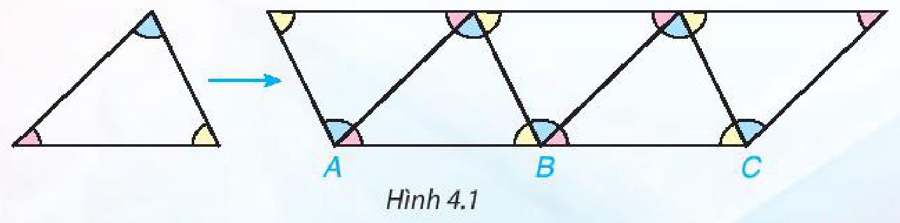
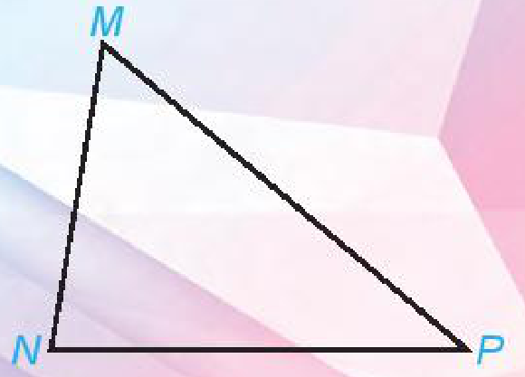
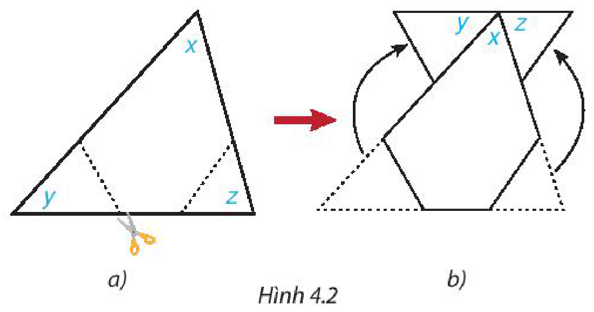
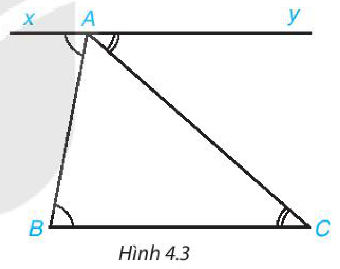
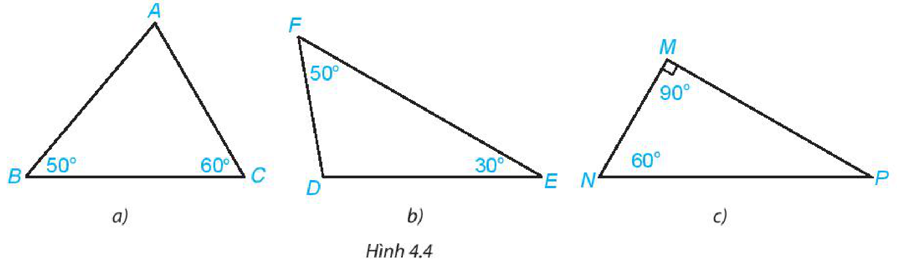
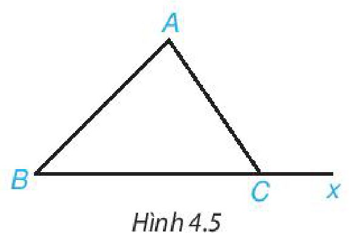
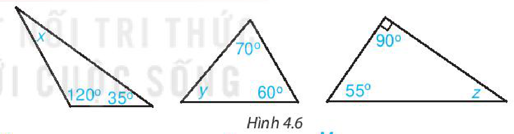
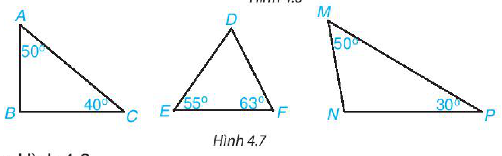
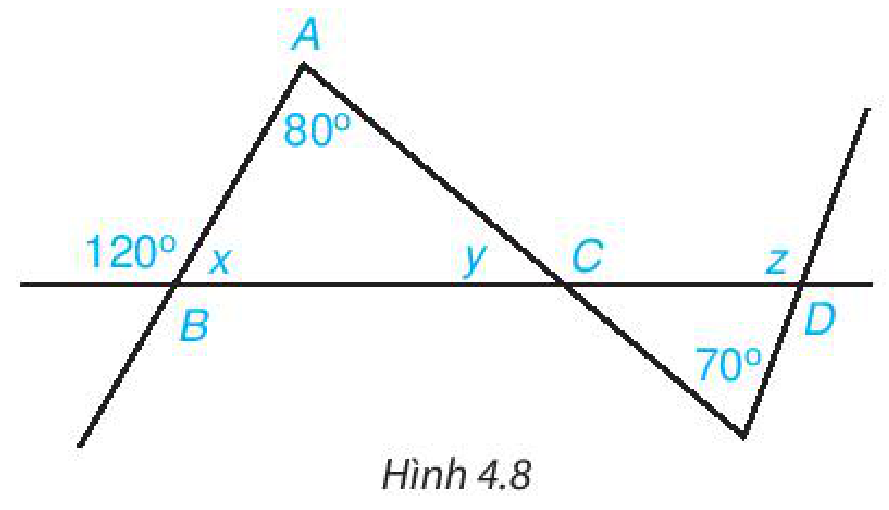

<!-- pdf:61 -->

<!-- Trang mở đầu Chương IV (PDF 61): CHƯƠNG IV. TAM GIÁC BẰNG NHAU (HÌNH HỌC PHẲNG) — Các em từng thấy những viên gạch lát nền hình vuông có cạnh bằng nhau hoặc những viên gạch hình lục giác đều có cạnh bằng nhau được xếp chồng khít lên nhau. Nếu có những viên gạch hình tam giác đều có cạnh bằng nhau thì ta cũng xếp chúng được như vậy đấy. Do đó người ta nói các tam giác đều có cạnh bằng nhau là các tam giác bằng nhau. Vậy trong hình học, nếu hai tam giác bất kì có thể chồng khít lên nhau thì chúng có tính chất chung gì đặc biệt và có những cách nào biết được điều đó mà không phải di chuyển các tam giác này hay không? Chúng ta sẽ cùng tìm hiểu vấn đề đó trong chương này. -->

# BÀI 12: TỔNG CÁC GÓC TRONG MỘT TAM GIÁC

## 🔤 Khái niệm, thuật ngữ

- Tam giác

## 🎯 Kiến thức, kĩ năng

- Giải thích định lí về tổng các góc trong một tam giác bằng $180^\circ$.

## 🔴 Mở đầu

Người ta có thể xếp các viên gạch hình tam giác giống hệt nhau để trang trí như Hình 4.1. Em có nhận xét gì về ba góc tại mỗi đỉnh chung của ba tam giác? Từ đó em rút ra kết luận gì về vị trí của ba điểm $A, B, C$?

*Hình 4.1*

*Tổng các góc trong một tam giác*

**HĐ1:** Vẽ tam giác $MNP$ bất kì, đo ba góc của tam giác đó.

- Tổng số đo ba góc của tam giác $MNP$ bằng bao nhiêu?
- So sánh kết quả của em với các bạn và rút ra nhận xét.

<!-- pdf:62 -->

**HĐ2:** Cắt một hình tam giác bằng giấy bất kì (H.4.2a). Đánh dấu ba góc là $x, y, z$. Cắt hai góc $y, z$ và ghép lên góc $x$ như Hình 4.2b. Từ đó, em hãy dự đoán tổng số đo các góc $x, y, z$ của tam giác ban đầu.

*Hình 4.2*

*Ta có định lí sau:*
<!-- ocr-ok: đã đối chiếu trực tiếp ảnh trang PDF 62, công thức/bảng kí hiệu khớp nguyên văn sách in -->

<!-- term: Tổng ba góc trong một tam giác -->
> Tổng ba góc trong một tam giác bằng $180^\circ$.

<!-- term: Tổng ba góc trong một tam giác -->
- **Pi:** Tổng ba góc trong một tam giác là tổng số đo ba góc trong tam giác đó.

| GT | $\triangle ABC$ |
| --- | --- |
| KL | $\widehat{A} + \widehat{B} + \widehat{C} = 180^\circ$. |

*Chứng minh* (H.4.3)

Qua $A$ kẻ đường thẳng $xy$ song song với $BC$.

$xy \parallel BC \Rightarrow \widehat{B} = \widehat{BAx}; \widehat{C} = \widehat{CAy}$ (các cặp góc so le trong).

Do đó $\widehat{A} + \widehat{B} + \widehat{C} = \widehat{BAC} + \widehat{BAx} + \widehat{CAy} = \widehat{xAy} = 180^\circ$.

*Hình 4.3*

> ❓ Trở lại *tình huống mở đầu*, tổng ba góc tại mỗi đỉnh chung của ba tam giác (chẳng hạn tại $B$ trong Hình 4.1) bằng bao nhiêu độ? Ba điểm $A, B, C$ có thẳng hàng không?

**Ví dụ:** Tính số đo các góc $A, D, P$ trong Hình 4.4.

*Hình 4.4*

**Giải:** Trong tam giác $ABC$ ta có $\widehat{A} + \widehat{B} + \widehat{C} = 180^\circ$.

Do đó $\widehat{A} = 180^\circ - \widehat{B} - \widehat{C} = 180^\circ - 50^\circ - 60^\circ = 70^\circ$.

Tương tự, trong tam giác $DEF$ ta có $\widehat{D} = 180^\circ - \widehat{E} - \widehat{F} = 180^\circ - 30^\circ - 50^\circ = 100^\circ$;

trong tam giác $MNP$ ta có $\widehat{P} = 180^\circ - \widehat{M} - \widehat{N} = 180^\circ - 90^\circ - 60^\circ = 30^\circ$.

<!-- pdf:63 -->

**Chú ý:** Trong Hình 4.4:

- Tam giác $ABC$ có ba góc đều nhọn nên gọi là **tam giác nhọn**.
- Tam giác $DEF$ có một góc tù nên gọi là **tam giác tù**.
- Tam giác $MNP$ có một góc vuông nên gọi là **tam giác vuông**. Trong tam giác $MNP$ vuông tại $M$, $MN$ và $MP$ là hai **cạnh góc vuông**, $NP$ là **cạnh huyền**.

**Luyện tập:** Cho tam giác $ABC$ vuông tại $A$. Tính tổng hai góc $B$ và $C$.
<!-- ocr-ok: đã đối chiếu trực tiếp ảnh trang PDF 63, công thức/bảng kí hiệu khớp nguyên văn sách in -->

**Nhận xét:** Hai góc có tổng bằng $90^\circ$ được gọi là **hai góc phụ nhau**. Vậy trong tam giác vuông, hai góc nhọn phụ nhau.

**Vận dụng:**

Cho tam giác $ABC$ và $Cx$ là tia đối của tia $CB$ (H.4.5).

Chứng minh rằng $\widehat{ACx} = \widehat{BAC} + \widehat{CBA}$.

*Hình 4.5*

**Nhận xét:** Góc $ACx$ được gọi là **góc ngoài** tại $C$ của tam giác $ABC$. Góc $ACx$ không kề với hai góc $A$ và $B$ của tam giác $ABC$.

<!-- term: Tính chất góc ngoài của tam giác -->
- **Pi:** Mỗi góc ngoài của một tam giác có số đo bằng tổng số đo hai góc trong không kề với nó.

## BÀI TẬP

4.1. Tính các số đo $x, y, z$ trong Hình 4.6.

*Hình 4.6*

4.2. Trong các tam giác ở Hình 4.7, tam giác nào là tam giác nhọn, tam giác vuông, tam giác tù?

*Hình 4.7*

4.3. Tính các số đo $x, y, z$ trong Hình 4.8.

*Hình 4.8*

## 📷 Danh sách hình trong bài

| Mã hình | Trang PDF | Vị trí trong bài | Chú thích gốc |
| --- | :---: | --- | --- |
| H7-toan-b12-01 | 61 | Mở đầu | Hình 4.1 |
| H7-toan-b12-02 | 61 | HĐ1 | (sách không đánh số, tam giác $MNP$) |
| H7-toan-b12-03 | 62 | HĐ2 | Hình 4.2 |
| H7-toan-b12-04 | 62 | Chứng minh định lí | Hình 4.3 |
| H7-toan-b12-05 | 62 | Ví dụ | Hình 4.4 |
| H7-toan-b12-06 | 63 | Vận dụng | Hình 4.5 |
| H7-toan-b12-07 | 63 | Bài 4.1 | Hình 4.6 |
| H7-toan-b12-08 | 63 | Bài 4.2 | Hình 4.7 |
| H7-toan-b12-09 | 63 | Bài 4.3 | Hình 4.8 |
