<!-- pdf:64 -->

# BÀI 13: HAI TAM GIÁC BẰNG NHAU. TRƯỜNG HỢP BẰNG NHAU THỨ NHẤT CỦA TAM GIÁC

## 🔤 Khái niệm, thuật ngữ

- Hai tam giác bằng nhau
- Trường hợp bằng nhau cạnh - cạnh - cạnh

## 🎯 Kiến thức, kĩ năng

- Nhận biết hai tam giác bằng nhau.
- Giải thích hai tam giác bằng nhau theo trường hợp cạnh - cạnh - cạnh (c.c.c).
- Lập luận và chứng minh hình học trong những trường hợp đơn giản.

## 🔴 Mở đầu

Ta nói hai đoạn thẳng bằng nhau nếu chúng có cùng độ dài, hai góc bằng nhau nếu chúng có cùng số đo góc. Vậy hai tam giác như thế nào thì được gọi là bằng nhau và làm thế nào để kiểm tra được hai tam giác đó bằng nhau? Trong bài này chúng ta sẽ trả lời câu hỏi đó.

## 1. HAI TAM GIÁC BẰNG NHAU

*Hai tam giác bằng nhau*

**HĐ1:** Gấp đôi một tờ giấy rồi cắt như Hình 4.9.

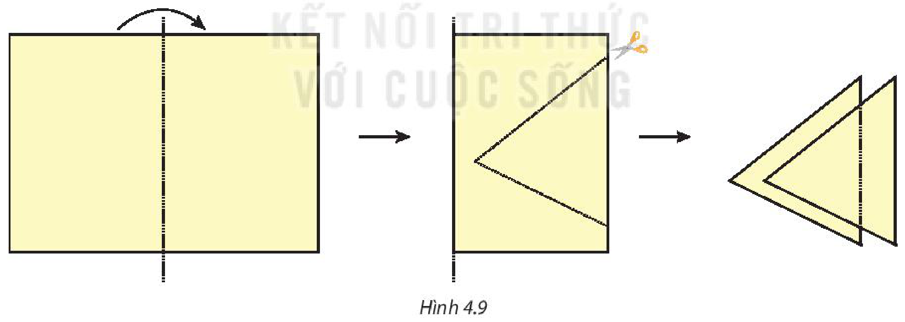
*Hình 4.9*

Phần được cắt ra là hai tam giác “chồng khít” lên nhau.

Theo em:

- Các cạnh tương ứng có bằng nhau không?
- Các góc tương ứng có bằng nhau không?

- **Pi:** Người ta nói hai tam giác đó là **hai tam giác bằng nhau**.

<!-- pdf:65 -->

> Hai tam giác $ABC$ và $A'B'C'$ (H.4.10) bằng nhau nếu chúng có các cạnh tương ứng bằng nhau và các góc tương ứng bằng nhau, nghĩa là:
>
> $\begin{cases} AB = A'B', AC = A'C', BC = B'C' \\ \widehat{A} = \widehat{A'}, \widehat{B} = \widehat{B'}, \widehat{C} = \widehat{C'}. \end{cases}$
>
> Khi đó ta viết $\triangle ABC = \triangle A'B'C'$.

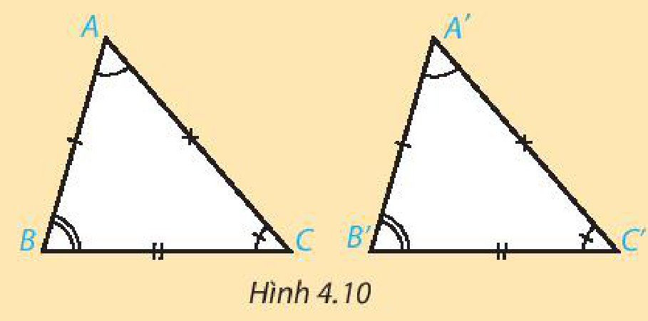
*Hình 4.10*

<!-- term: Đỉnh tương ứng, góc tương ứng, cạnh tương ứng -->
Ở đây hai đỉnh $A$ và $A'$ ($B$ và $B'$, $C$ và $C'$) là hai đỉnh tương ứng; hai góc $A$ và $A'$ ($B$ và $B'$, $C$ và $C'$) là hai góc tương ứng; hai cạnh $AB$ và $A'B'$ ($AC$ và $A'C'$, $BC$ và $B'C'$) là hai cạnh tương ứng.
<!-- ocr-ok: đã đối chiếu trực tiếp ảnh trang PDF 65, công thức/bảng kí hiệu khớp nguyên văn sách in -->

> ❓ Biết hai tam giác trong Hình 4.11 bằng nhau, em hãy chỉ ra các cặp cạnh tương ứng, các cặp góc tương ứng và viết đúng kí hiệu bằng nhau của cặp tam giác đó.

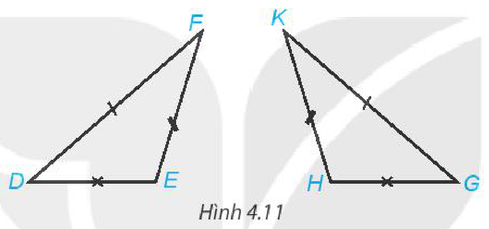
*Hình 4.11*

**Ví dụ 1:**

Cho hai tam giác $ABC$ và $MNP$ có $AB = MN, BC = NP, CA = PM, \widehat{A} = \widehat{M}, \widehat{B} = \widehat{N}$. Chứng minh rằng:
<!-- ocr-ok: đã đối chiếu trực tiếp ảnh trang PDF 65, công thức/bảng kí hiệu khớp nguyên văn sách in -->

a) $\widehat{C} = \widehat{P}$;

b) $\triangle ABC = \triangle MNP$.

**Giải:**

| GT | $\triangle ABC, \triangle MNP$: $AB = MN, BC = NP, CA = PM, \widehat{A} = \widehat{M}, \widehat{B} = \widehat{N}$. |
| --- | --- |
| KL | a) $\widehat{C} = \widehat{P}$; b) $\triangle ABC = \triangle MNP$. |

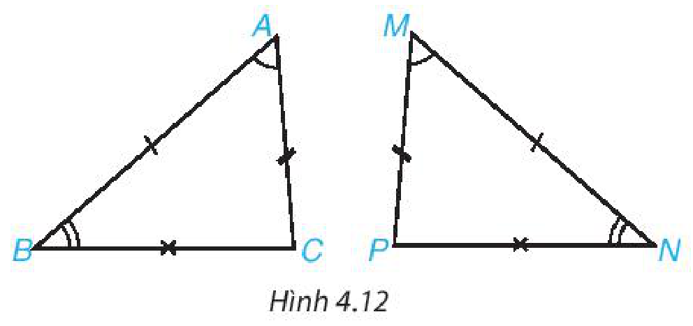
*Hình 4.12*

a) Trong tam giác $ABC$ ta có $\widehat{A} + \widehat{B} + \widehat{C} = 180^\circ$, suy ra $\widehat{C} = 180^\circ - \widehat{A} - \widehat{B}$. $(1)$

Trong tam giác $MNP$ ta có $\widehat{M} + \widehat{N} + \widehat{P} = 180^\circ$, suy ra $\widehat{P} = 180^\circ - \widehat{M} - \widehat{N}$. $(2)$

Vì $\widehat{A} = \widehat{M}, \widehat{B} = \widehat{N}$ nên từ $(1)$ và $(2)$ ta có $\widehat{C} = \widehat{P}$.
<!-- ocr-ok: đã đối chiếu trực tiếp ảnh trang PDF 65, công thức/bảng kí hiệu khớp nguyên văn sách in -->

<!-- pdf:66 -->

b) Hai tam giác $ABC$ và $MNP$ có:
<!-- ocr-ok: đã đối chiếu trực tiếp ảnh trang PDF 66, công thức/bảng kí hiệu khớp nguyên văn sách in -->

$AB = MN, BC = NP, CA = PM$ (theo giả thiết);

$\widehat{A} = \widehat{M}, \widehat{B} = \widehat{N}$ (theo giả thiết), $\widehat{C} = \widehat{P}$ (chứng minh trên).

Vậy hai tam giác $ABC$ và $MNP$ có các cạnh và các góc tương ứng bằng nhau.

Do đó $\triangle ABC = \triangle MNP$.

**Luyện tập 1:**

Cho tam giác $ABC$ bằng tam giác $DEF$ (H.4.13). Biết rằng $BC = 4\text{ cm}, \widehat{ABC} = 40^\circ, \widehat{ACB} = 60^\circ$. Hãy tính độ dài đoạn thẳng $EF$ và số đo góc $EDF$.

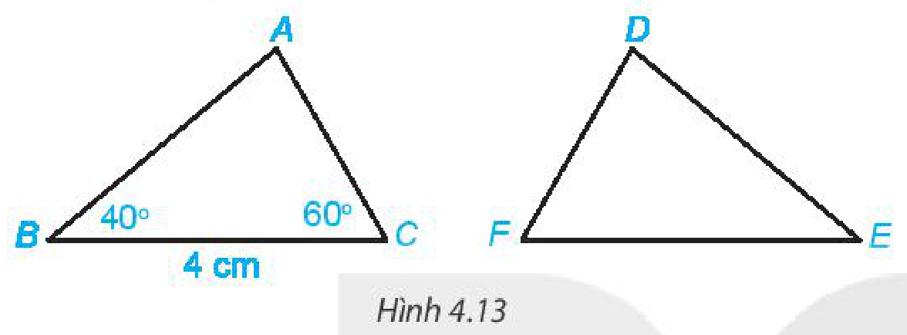
*Hình 4.13*

- **Vuông:** Tớ sẽ tính góc $A$ trước.
<!-- ocr-ok: đã đối chiếu trực tiếp ảnh trang PDF 66, công thức/bảng kí hiệu khớp nguyên văn sách in -->

## 2. TRƯỜNG HỢP BẰNG NHAU THỨ NHẤT CỦA TAM GIÁC: CẠNH - CẠNH - CẠNH (C.C.C)

Để kiểm tra hai tam giác bằng nhau ta có nhất thiết phải kiểm tra cả ba cạnh tương ứng và ba góc tương ứng bằng nhau hay không?

*Trường hợp bằng nhau cạnh - cạnh - cạnh*

**HĐ2:** Vẽ tam giác $ABC$ có $AB = 5\text{ cm}, AC = 4\text{ cm}, BC = 6\text{ cm}$ theo các bước sau:
<!-- ocr-ok: đã đối chiếu trực tiếp ảnh trang PDF 66, công thức/bảng kí hiệu khớp nguyên văn sách in -->

- Dùng thước thẳng có vạch chia vẽ đoạn thẳng $BC = 6\text{ cm}$.
- Vẽ cung tròn tâm $B$ bán kính $5\text{ cm}$ và cung tròn tâm $C$ bán kính $4\text{ cm}$ sao cho hai cung tròn cắt nhau tại điểm $A$ (H.4.14).
- Vẽ các đoạn thẳng $AB, AC$ ta được tam giác $ABC$.

> Dùng compa với khẩu độ $5\text{ cm}$ để vẽ một phần của đường tròn, ta được cung tròn bán kính $5\text{ cm}$.

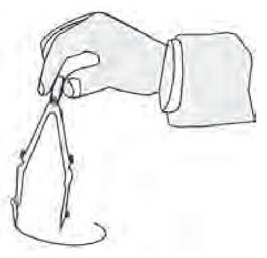

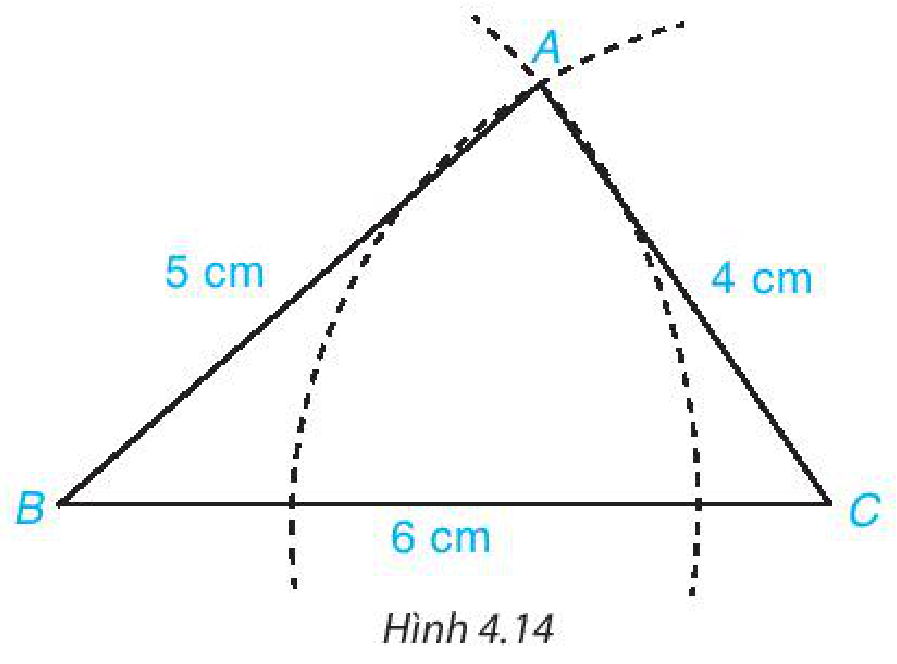
*Hình 4.14*

<!-- pdf:67 -->

**HĐ3:** Tương tự, vẽ thêm tam giác $A'B'C'$ có $A'B' = 5\text{ cm}, A'C' = 4\text{ cm}, B'C' = 6\text{ cm}$.

- Dùng thước đo góc kiểm tra xem các góc tương ứng của hai tam giác $ABC$ và $A'B'C'$ có bằng nhau không.
- Hai tam giác $ABC$ và $A'B'C'$ có bằng nhau không?

*Ta thừa nhận định lí sau:*

> **Trường hợp bằng nhau cạnh - cạnh - cạnh (c.c.c)**
>
> Nếu ba cạnh của tam giác này bằng ba cạnh của tam giác kia thì hai tam giác đó bằng nhau.

> ❓ Trong Hình 4.15, những cặp tam giác nào bằng nhau?

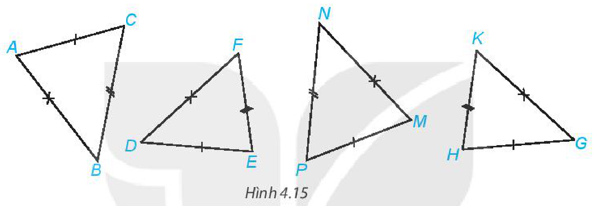
*Hình 4.15*

**Ví dụ 2:**

Cho Hình 4.16, biết $AC = BD, AD = BC$.

Chứng minh rằng $\triangle ACB = \triangle BDA$.

**Giải:**

Hai tam giác $ACB$ và $BDA$ có:
<!-- ocr-ok: đã đối chiếu trực tiếp ảnh trang PDF 67, công thức/bảng kí hiệu khớp nguyên văn sách in -->

$AC = BD$ (theo giả thiết);

$BC = AD$ (theo giả thiết);

$AB$ là cạnh chung.

Vậy $\triangle ACB = \triangle BDA$ (c.c.c).

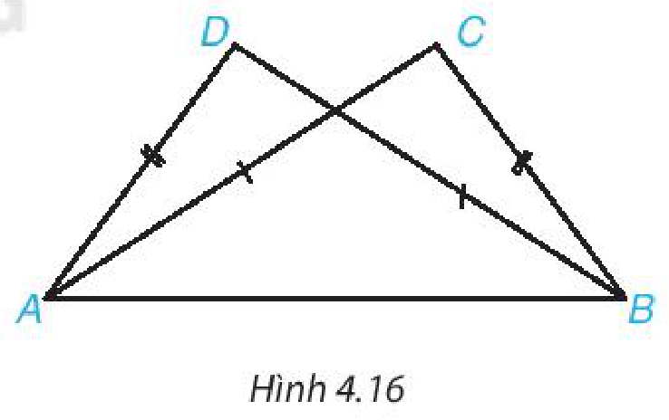
*Hình 4.16*

**Luyện tập 2:**

Cho Hình 4.17, biết $AB = AD, BC = DC$.

Chứng minh rằng $\triangle ABC = \triangle ADC$.

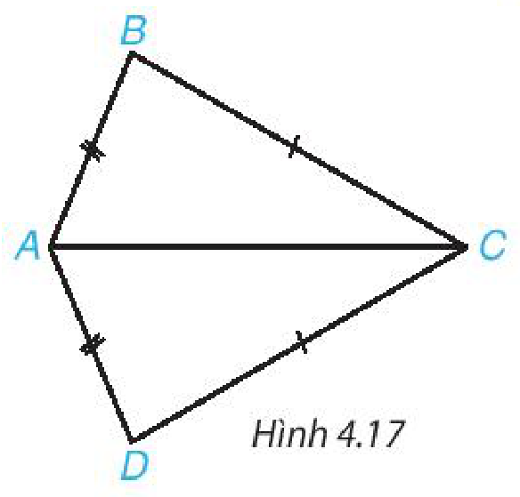
*Hình 4.17*

<!-- pdf:68 -->

**Vận dụng:** Người ta dùng compa và thước thẳng để vẽ tia phân giác của góc $xOy$ như sau:

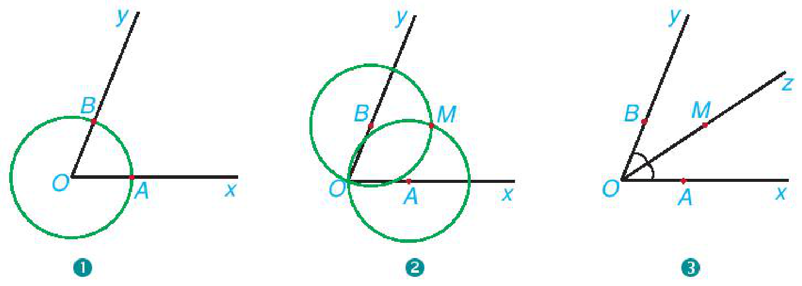

① Vẽ đường tròn tâm $O$ cắt $Ox, Oy$ lần lượt tại $A$ và $B$.
<!-- ocr-ok: đã đối chiếu trực tiếp ảnh trang PDF 68, công thức/bảng kí hiệu khớp nguyên văn sách in -->

② Vẽ đường tròn tâm $A$ bán kính $AO$ và đường tròn tâm $B$ bán kính $BO$. Hai đường tròn cắt nhau tại điểm $M$ khác điểm $O$.

③ Vẽ tia $Oz$ đi qua $M$.
<!-- ocr-ok: đã đối chiếu trực tiếp ảnh trang PDF 68, công thức/bảng kí hiệu khớp nguyên văn sách in -->

Em hãy giải thích vì sao tia $OM$ là tia phân giác của góc $xOy$.

- **Tròn:** Hãy xét hai tam giác $OAM$ và $OBM$.

## BÀI TẬP

4.4. Cho hai tam giác $ABC$ và $DEF$ như Hình 4.18. Trong các khẳng định sau, khẳng định nào đúng?

(1) $\triangle ABC = \triangle DEF$;

(2) $\triangle ACB = \triangle EDF$;

(3) $\triangle BAC = \triangle DFE$;

(4) $\triangle CAB = \triangle DEF$.

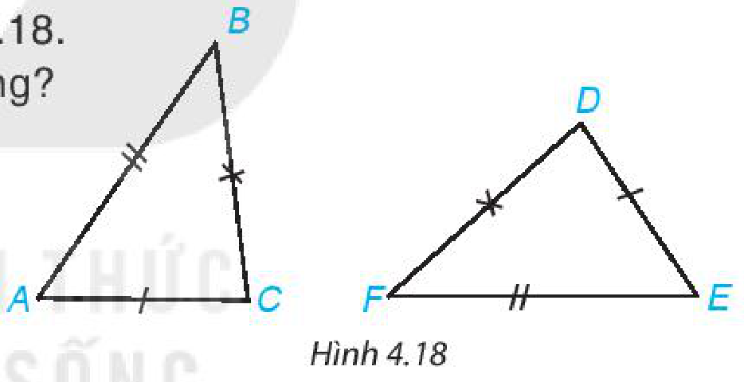
*Hình 4.18*

4.5. Trong Hình 4.19, hãy chỉ ra hai cặp tam giác bằng nhau.

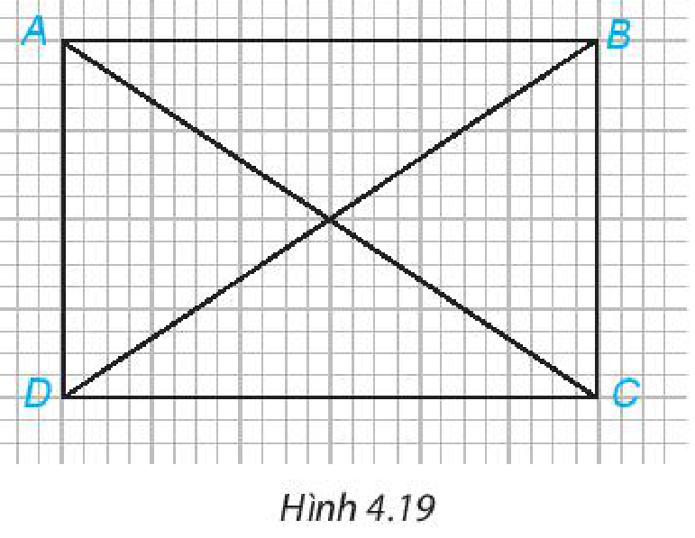
*Hình 4.19*

4.6. Cho Hình 4.20, biết $AB = CB, AD = CD, \widehat{DAB} = 90^\circ, \widehat{BDC} = 30^\circ$.

a) Chứng minh rằng $\triangle ABD = \triangle CBD$.

b) Tính $\widehat{ABC}$.

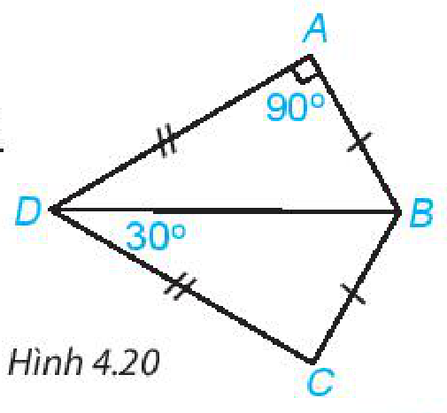
*Hình 4.20*

## 📷 Danh sách hình trong bài

| Mã hình | Trang PDF | Vị trí trong bài | Chú thích gốc |
| --- | :---: | --- | --- |
| H7-toan-b13-01 | 64 | Mục 1, HĐ1 | Hình 4.9 |
| H7-toan-b13-02 | 65 | Mục 1, Khung kiến thức | Hình 4.10 |
| H7-toan-b13-03 | 65 | Mục 1, Câu hỏi | Hình 4.11 |
| H7-toan-b13-04 | 65 | Mục 1, Ví dụ 1 | Hình 4.12 |
| H7-toan-b13-05 | 66 | Mục 1, Luyện tập 1 | Hình 4.13 |
| H7-toan-b13-06 | 66 | Mục 2, HĐ2 | (sách không đánh số, minh hoạ dùng compa vẽ cung tròn) |
| H7-toan-b13-07 | 66 | Mục 2, HĐ2 | Hình 4.14 |
| H7-toan-b13-08 | 67 | Mục 2, Câu hỏi | Hình 4.15 |
| H7-toan-b13-09 | 67 | Mục 2, Ví dụ 2 | Hình 4.16 |
| H7-toan-b13-10 | 67 | Mục 2, Luyện tập 2 | Hình 4.17 |
| H7-toan-b13-11 | 68 | Mục 2, Vận dụng | (sách không đánh số, 3 bước vẽ tia phân giác bằng compa và thước thẳng) |
| H7-toan-b13-12 | 68 | Bài 4.4 | Hình 4.18 |
| H7-toan-b13-13 | 68 | Bài 4.5 | Hình 4.19 |
| H7-toan-b13-14 | 68 | Bài 4.6 | Hình 4.20 |
