<!-- pdf:71 -->

# BÀI 14: TRƯỜNG HỢP BẰNG NHAU THỨ HAI VÀ THỨ BA CỦA TAM GIÁC

## 🔤 Khái niệm, thuật ngữ

- Góc kề với cạnh
- Góc xen giữa hai cạnh

## 🎯 Kiến thức, kĩ năng

- Giải thích hai tam giác bằng nhau theo các trường hợp cạnh - góc - cạnh (c.g.c) và góc - cạnh - góc (g.c.g).
- Lập luận và chứng minh hình học trong những trường hợp đơn giản.

## 🔴 Mở đầu

Trong thực tế, nhiều khi ta không thể đo được hết các cạnh của hai tam giác để khẳng định được chúng có bằng nhau hay không. Khi đó, có cách nào khác giúp ta biết được điều đó?

## 1. TRƯỜNG HỢP BẰNG NHAU THỨ HAI CỦA TAM GIÁC: CẠNH - GÓC - CẠNH (C.G.C)

*Trường hợp bằng nhau cạnh - góc - cạnh*

**HĐ1:** Vẽ $\widehat{xAy} = 60^\circ$. Lấy điểm $B$ trên tia $Ax$ và điểm $C$ trên tia $Ay$ sao cho: $AB = 4\text{ cm}, AC = 3\text{ cm}$.
<!-- ocr-ok: đã đối chiếu trực tiếp ảnh trang PDF 71, công thức/bảng kí hiệu khớp nguyên văn sách in -->

Nối điểm $B$ với điểm $C$ ta được tam giác $ABC$ (H.4.27).

Dùng thước thẳng có vạch chia đo độ dài cạnh $BC$ của tam giác $ABC$.

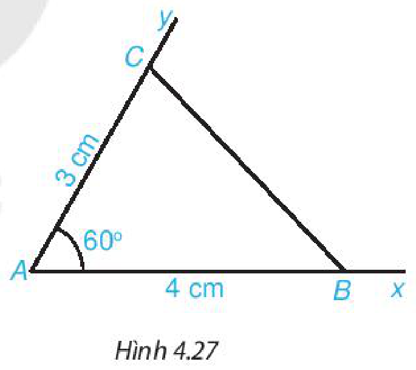
*Hình 4.27*

**HĐ2:** Vẽ thêm tam giác $A'B'C'$ với $\widehat{B'A'C'} = 60^\circ$, $A'B' = 4\text{ cm}$ và $A'C' = 3\text{ cm}$ (H.4.28).
<!-- ocr-ok: đã đối chiếu trực tiếp ảnh trang PDF 71, công thức/bảng kí hiệu khớp nguyên văn sách in -->

Dùng thước thẳng có vạch chia hoặc compa để so sánh độ dài các cạnh tương ứng của hai tam giác $ABC$ và $A'B'C'$.

- Hai tam giác $ABC$ và $A'B'C'$ có bằng nhau không?
- Độ dài các cạnh $BC$ và $B'C'$ của hai tam giác em vừa vẽ có bằng các cạnh $BC$ và $B'C'$ của hai tam giác các bạn khác vẽ không?
- Hai tam giác em vừa vẽ có bằng hai tam giác mà các bạn khác vẽ không?

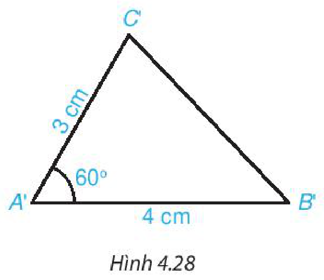
*Hình 4.28*

<!-- pdf:72 -->

Trong tam giác $ABC$ (H.4.27), góc $BAC$ (hay đơn giản là góc $A$) được gọi là **góc xen giữa** hai cạnh $AB$ và $AC$ của tam giác $ABC$.

*Ta thừa nhận định lí sau:*

> **Trường hợp bằng nhau cạnh - góc - cạnh (c.g.c)**
>
> Nếu hai cạnh và góc xen giữa của tam giác này bằng hai cạnh và góc xen giữa của tam giác kia thì hai tam giác đó bằng nhau.

> ❓ Trong Hình 4.29, hai tam giác nào bằng nhau?

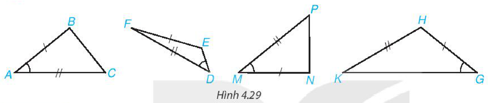
*Hình 4.29*

**Ví dụ 1:**

Xét hai tam giác $ABC$ và $ADC$ như Hình 4.30. Ta có:

$AB = AD$;

$\widehat{BAC} = \widehat{DAC}$;

$AC$ là cạnh chung.

Vậy $\triangle ABC = \triangle ADC$ (c.g.c).

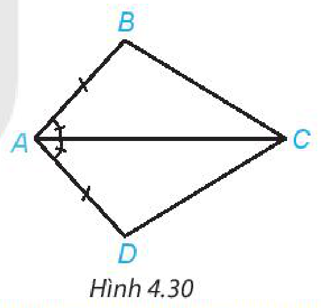
*Hình 4.30*

**Luyện tập 1:**

Hai tam giác $ABC$ và $MNP$ trong Hình 4.31 có bằng nhau không? Vì sao?

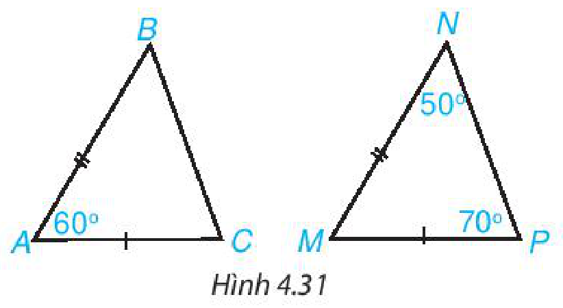
*Hình 4.31*

**Vận dụng:**

Cho Hình 4.32, biết $\widehat{OAB} = \widehat{ODC}, OA = OD$ và $AB = CD$.

Chứng minh rằng:

a) $AC = DB$;

b) $\triangle OAC = \triangle ODB$.

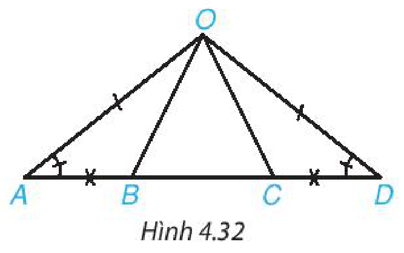
*Hình 4.32*

<!-- pdf:73 -->

## 2. TRƯỜNG HỢP BẰNG NHAU THỨ BA CỦA TAM GIÁC: GÓC - CẠNH - GÓC (G.C.G)

*Trường hợp bằng nhau góc - cạnh - góc*

**HĐ3:** Vẽ đoạn thẳng $BC = 3\text{ cm}$. Vẽ hai tia $Bx$ và $Cy$ sao cho $\widehat{xBC} = 80^\circ, \widehat{yCB} = 40^\circ$ như Hình 4.33.
<!-- ocr-ok: đã đối chiếu trực tiếp ảnh trang PDF 73, công thức/bảng kí hiệu khớp nguyên văn sách in -->

Lấy giao điểm $A$ của hai tia $Bx$ và $Cy$, ta được tam giác $ABC$ (H.4.33).

Dùng thước thẳng có vạch chia đo độ dài hai cạnh $AB, AC$ của tam giác $ABC$.

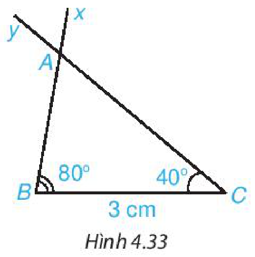
*Hình 4.33*

**HĐ4:** Vẽ thêm tam giác $A'B'C'$ sao cho $B'C' = 3\text{ cm}$, $\widehat{A'B'C'} = 80^\circ, \widehat{A'C'B'} = 40^\circ$ (H.4.34).

Dùng thước thẳng có vạch chia hoặc compa so sánh độ dài các cạnh của hai tam giác $ABC$ và $A'B'C'$.

Hai tam giác $ABC$ và $A'B'C'$ có bằng nhau không?

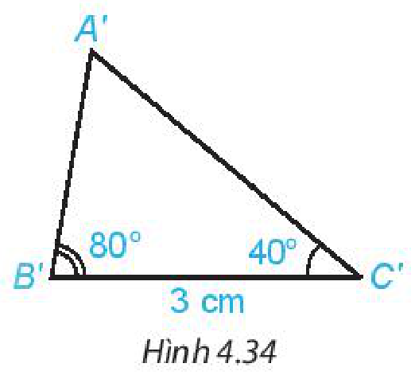
*Hình 4.34*

Trong tam giác $ABC$ (H.4.33), hai góc $\widehat{ABC}, \widehat{ACB}$ (gọi đơn giản là góc $B$ và góc $C$) được gọi là các **góc kề** cạnh $BC$ của tam giác $ABC$. *Ta thừa nhận định lí sau:*

> **Trường hợp bằng nhau góc - cạnh - góc (g.c.g)**
>
> Nếu một cạnh và hai góc kề của tam giác này bằng một cạnh và hai góc kề của tam giác kia thì hai tam giác đó bằng nhau.

> ❓ Hai tam giác nào trong Hình 4.35 bằng nhau?

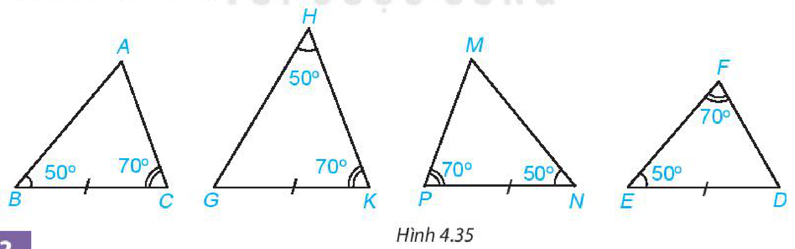
*Hình 4.35*

**Ví dụ 2:**

Xét hai tam giác $ABC$ và $DEC$ như Hình 4.36. Ta có:

$\widehat{BAC} = \widehat{EDC}$ (theo giả thiết);

$AC = DC$ (theo giả thiết);

$\widehat{BCA} = \widehat{ECD}$ (hai góc đối đỉnh).

Vậy $\triangle ABC = \triangle DEC$ (g.c.g).

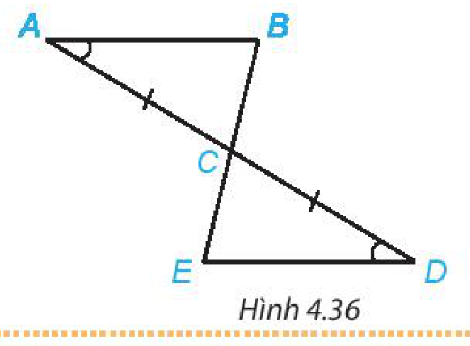
*Hình 4.36*

<!-- pdf:74 -->

**Luyện tập 2:**

Chứng minh hai tam giác $ABD$ và $CBD$ trong Hình 4.37 bằng nhau.

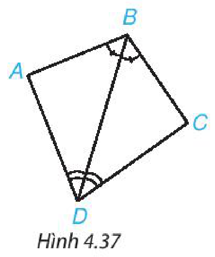
*Hình 4.37*

**Thử thách nhỏ**

Bạn Lan nói rằng: “Nếu tam giác này có một cạnh cùng một góc kề và góc đối diện tương ứng bằng một cạnh cùng một góc kề và góc đối diện của tam giác kia thì hai tam giác đó bằng nhau” (H.4.38). Theo em bạn Lan nói có đúng không? Vì sao?

- **Vuông:** Chỉ cần kiểm tra xem góc còn lại của hai tam giác có bằng nhau không là được.

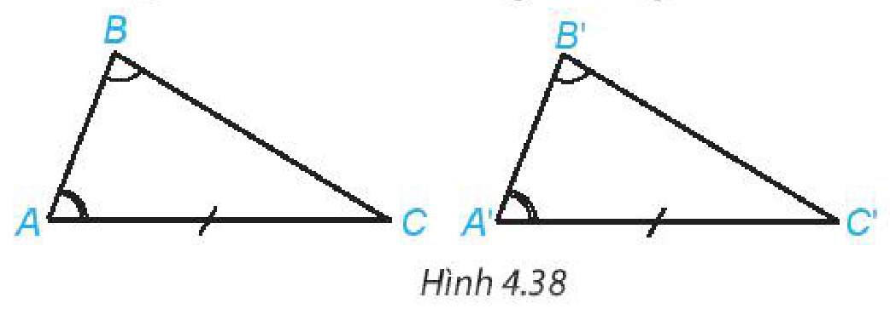
*Hình 4.38*

## BÀI TẬP

4.12. Trong mỗi hình bên (H.4.39), hãy chỉ ra một cặp tam giác bằng nhau và giải thích vì sao chúng bằng nhau.

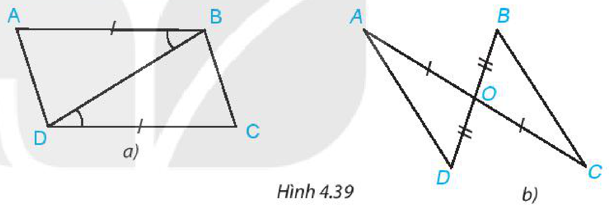
*Hình 4.39*

4.13. Cho hai đoạn thẳng $AC$ và $BD$ cắt nhau tại điểm $O$ sao cho $OA = OC, OB = OD$ như Hình 4.40.

a) Hãy tìm hai cặp tam giác có chung đỉnh $O$ bằng nhau;

b) Chứng minh rằng $\triangle DAB = \triangle BCD$.

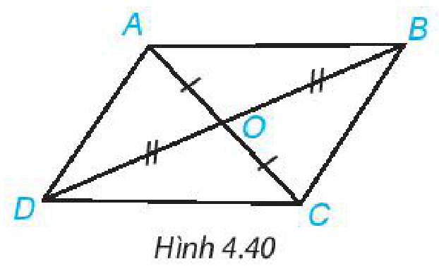
*Hình 4.40*

4.14. Chứng minh rằng hai tam giác $ADE$ và $BCE$ trong Hình 4.41 bằng nhau.

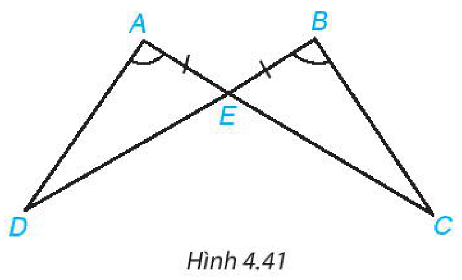
*Hình 4.41*

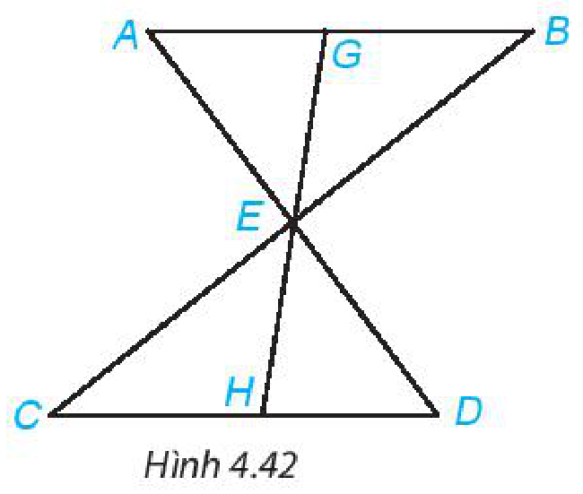
*Hình 4.42*

4.15. Cho đoạn thẳng $AB$ song song và bằng đoạn thẳng $CD$ như Hình 4.42. Gọi $E$ là giao điểm của hai đường thẳng $AD$ và $BC$. Hai điểm $G$ và $H$ lần lượt nằm trên $AB$ và $CD$ sao cho $G, E, H$ thẳng hàng. Chứng minh rằng:

a) $\triangle ABE = \triangle DCE$;

b) $EG = EH$.

## 📷 Danh sách hình trong bài

| Mã hình | Trang PDF | Vị trí trong bài | Chú thích gốc |
| --- | :---: | --- | --- |
| H7-toan-b14-01 | 71 | Mục 1, HĐ1 | Hình 4.27 |
| H7-toan-b14-02 | 71 | Mục 1, HĐ2 | Hình 4.28 |
| H7-toan-b14-03 | 72 | Mục 1, Câu hỏi | Hình 4.29 |
| H7-toan-b14-04 | 72 | Mục 1, Ví dụ 1 | Hình 4.30 |
| H7-toan-b14-05 | 72 | Mục 1, Luyện tập 1 | Hình 4.31 |
| H7-toan-b14-06 | 72 | Mục 1, Vận dụng | Hình 4.32 |
| H7-toan-b14-07 | 73 | Mục 2, HĐ3 | Hình 4.33 |
| H7-toan-b14-08 | 73 | Mục 2, HĐ4 | Hình 4.34 |
| H7-toan-b14-09 | 73 | Mục 2, Câu hỏi | Hình 4.35 |
| H7-toan-b14-10 | 73 | Mục 2, Ví dụ 2 | Hình 4.36 |
| H7-toan-b14-11 | 74 | Mục 2, Luyện tập 2 | Hình 4.37 |
| H7-toan-b14-12 | 74 | Mục 2, Thử thách nhỏ | Hình 4.38 |
| H7-toan-b14-13 | 74 | Bài 4.12 | Hình 4.39 |
| H7-toan-b14-14 | 74 | Bài 4.13 | Hình 4.40 |
| H7-toan-b14-15 | 74 | Bài 4.14 | Hình 4.41 |
| H7-toan-b14-16 | 74 | Bài 4.15 | Hình 4.42 |
