<!-- pdf:76 -->

# BÀI 15: CÁC TRƯỜNG HỢP BẰNG NHAU CỦA TAM GIÁC VUÔNG

## 🎯 Kiến thức, kĩ năng

- Giải thích các trường hợp bằng nhau của tam giác vuông.

## 🔴 Mở đầu

Quan sát hai chiếc cột dựng thẳng đứng, cạnh nhau và cao bằng nhau. Vì Mặt Trời ở rất xa Trái Đất, nên vào buổi chiều các tia nắng Mặt Trời tạo với hai chiếc cột các góc xem như bằng nhau.

- **Vuông:** Tớ thấy bóng hai chiếc cột dài bằng nhau, vì sao vậy nhỉ?
- **Tròn:** Đấy là do hai chiếc cột cao bằng nhau đấy!

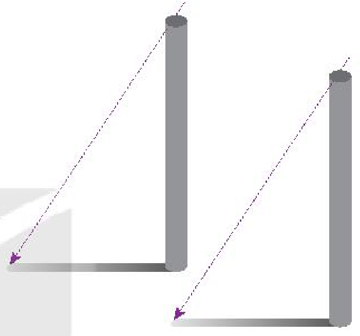

Lí do mà bạn Tròn đưa ra như vậy có đúng không? Qua bài học này, các em sẽ có câu trả lời cho câu hỏi trên.

## 1. BA TRƯỜNG HỢP BẰNG NHAU CỦA TAM GIÁC VUÔNG

*Tìm hiểu ba trường hợp bằng nhau của tam giác vuông*

**HĐ1:** Hai tam giác vuông $ABC$ (vuông tại đỉnh $A$) và $A'B'C'$ (vuông tại đỉnh $A'$) có các cặp cạnh góc vuông bằng nhau:

$AB = A'B', AC = A'C'$ (H.4.45).

Dựa vào trường hợp bằng nhau cạnh - góc - cạnh của hai tam giác, hãy giải thích vì sao hai tam giác vuông $ABC$ và $A'B'C'$ bằng nhau.

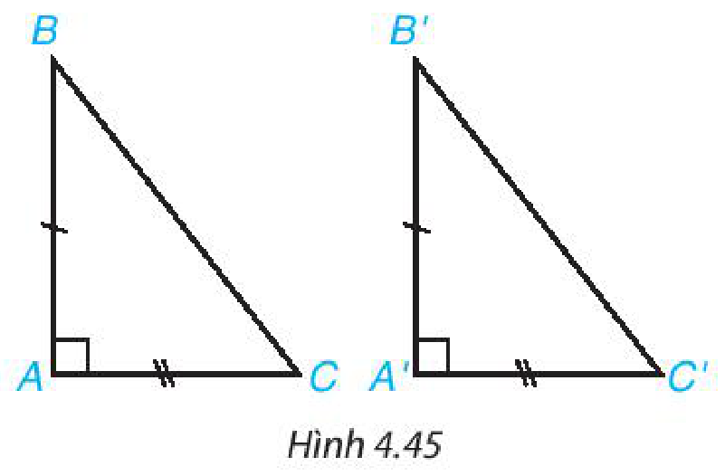
*Hình 4.45*

<!-- term: Các trường hợp bằng nhau của hai tam giác vuông -->
> Nếu hai cạnh góc vuông của tam giác vuông này lần lượt bằng hai cạnh góc vuông của tam giác vuông kia thì hai tam giác vuông đó bằng nhau.

<!-- pdf:77 -->

**HĐ2:** Hai tam giác vuông $ABC$ (vuông tại đỉnh $A$) và $A'B'C'$ (vuông tại đỉnh $A'$) có tương ứng một cạnh góc vuông và một góc nhọn kề với cạnh ấy bằng nhau:

$AB = A'B', \widehat{B} = \widehat{B'}$ (H.4.46).

Dựa vào trường hợp bằng nhau góc - cạnh - góc của hai tam giác, hãy giải thích vì sao hai tam giác vuông $ABC$ và $A'B'C'$ bằng nhau.

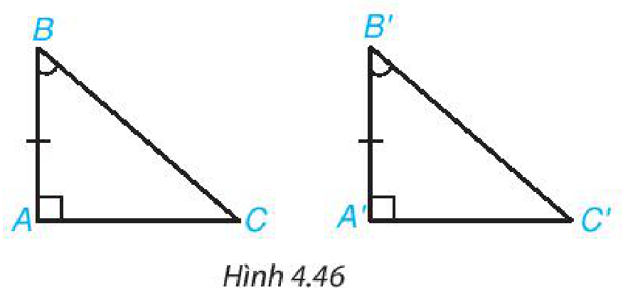
*Hình 4.46*

<!-- term: Các trường hợp bằng nhau của hai tam giác vuông -->
> Nếu một cạnh góc vuông và góc nhọn kề cạnh ấy của tam giác vuông này bằng một cạnh góc vuông và góc nhọn kề cạnh ấy của tam giác vuông kia thì hai tam giác vuông đó bằng nhau.

**Luyện tập 1:**

*Quay lại tình huống mở đầu*, ta thấy mỗi chiếc cột với bóng của nó tạo thành hai cạnh góc vuông của một tam giác vuông. Hai tam giác vuông này có một cặp cạnh góc vuông tương ứng bằng nhau và hai góc ở đỉnh chiếc cột của hai tam giác vuông này cũng bằng nhau. Vậy lí do mà bạn Tròn đưa ra có đúng không?

**HĐ3:** Hình 4.47 mô phỏng chiều dài và độ dốc của hai con dốc bởi các đoạn thẳng $BC, B'C'$ và các góc $B, B'$. Khi đó $AC, A'C'$ mô tả độ cao của hai con dốc.

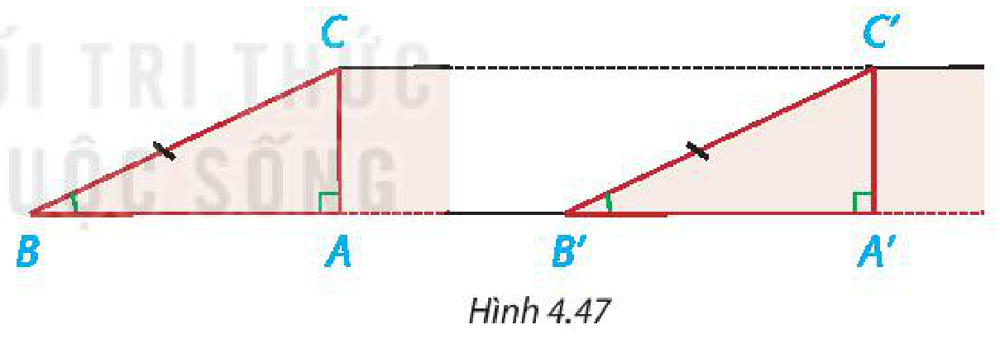
*Hình 4.47*

a) Dựa vào trường hợp bằng nhau góc - cạnh - góc của hai tam giác, hãy giải thích vì sao hai tam giác vuông $ABC$ và $A'B'C'$ bằng nhau.

b) So sánh độ cao của hai con dốc.

<!-- term: Các trường hợp bằng nhau của hai tam giác vuông -->
> Nếu cạnh huyền và một góc nhọn của tam giác vuông này bằng cạnh huyền và một góc nhọn của tam giác vuông kia thì hai tam giác vuông đó bằng nhau.

Chẳng hạn trong Hình 4.47, $\triangle ABC$ vuông tại đỉnh $A$ và $\triangle A'B'C'$ vuông tại đỉnh $A'$ có:

$BC = B'C'; \widehat{B} = \widehat{B'}$. Khi đó $\triangle ABC = \triangle A'B'C'$ (cạnh huyền - góc nhọn).

<!-- pdf:78 -->

> ❓ Trong Hình 4.48, hãy tìm các cặp tam giác vuông bằng nhau và giải thích vì sao chúng bằng nhau.

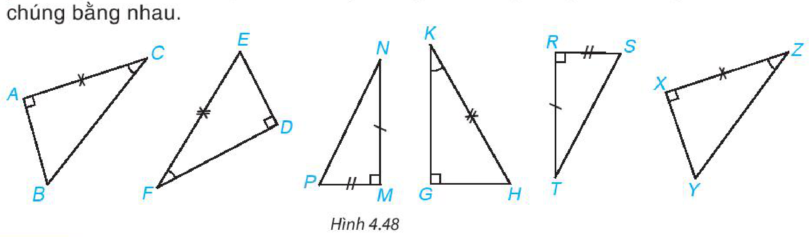
*Hình 4.48*

**Ví dụ 1:**

Cho Hình 4.49. Biết rằng $AB$ vuông góc với $BC$, $AD$ vuông góc với $CD$, $AC$ cắt $BD$ tại $E$ và $\widehat{BAC} = \widehat{DAC}$. Chứng minh rằng:
<!-- ocr-ok: đã đối chiếu trực tiếp ảnh trang PDF 78, công thức/bảng kí hiệu khớp nguyên văn sách in -->

a) $\triangle BAC = \triangle DAC$;

b) $AC$ vuông góc với $BD$ tại $E$.

| GT | $AC$ cắt $BD$ tại $E$. $AB \perp BC, AD \perp CD, \widehat{BAC} = \widehat{DAC}$. |
| --- | --- |
| KL | a) $\triangle BAC = \triangle DAC$; b) $AC \perp BD$ tại $E$. |
<!-- ocr-ok: đã đối chiếu trực tiếp ảnh trang PDF 78, công thức/bảng kí hiệu khớp nguyên văn sách in -->

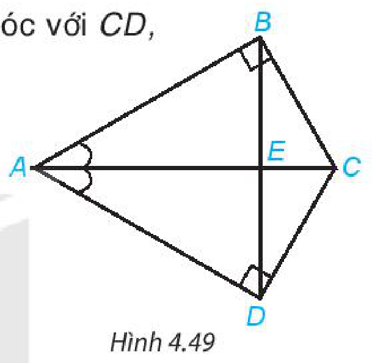
*Hình 4.49*

**Giải:** a) Hai tam giác vuông $BAC$ (vuông tại $B$) và $DAC$ (vuông tại $D$) có:
<!-- ocr-ok: đã đối chiếu trực tiếp ảnh trang PDF 78, công thức/bảng kí hiệu khớp nguyên văn sách in -->

$AC$ là cạnh chung;

$\widehat{BAC} = \widehat{DAC}$ (theo giả thiết).

Vậy $\triangle BAC = \triangle DAC$ (cạnh huyền - góc nhọn).

b) Hai tam giác $BAE$ và $DAE$ có:
<!-- ocr-ok: đã đối chiếu trực tiếp ảnh trang PDF 78, công thức/bảng kí hiệu khớp nguyên văn sách in -->

$AE$ là cạnh chung;

$\widehat{BAE} = \widehat{BAC} = \widehat{DAC} = \widehat{DAE}$ (theo giả thiết);

$AB = AD$ (vì $\triangle BAC = \triangle DAC$).

Vậy $\triangle BAE = \triangle DAE$ (c.g.c), suy ra $\widehat{BEA} = \widehat{DEA}$ (hai góc tương ứng).
<!-- ocr-ok: đã đối chiếu trực tiếp ảnh trang PDF 78, công thức/bảng kí hiệu khớp nguyên văn sách in -->

Mà $\widehat{BEA} + \widehat{DEA} = 180^\circ$ nên $\widehat{BEA} = \widehat{DEA} = 90^\circ$. Vậy $AC$ vuông góc với $BD$ tại $E$.
<!-- ocr-ok: đã đối chiếu trực tiếp ảnh trang PDF 78, công thức/bảng kí hiệu khớp nguyên văn sách in -->

**Luyện tập 2:**

Cho $Oz$ là tia phân giác của góc $xOy$. Lấy điểm $M$ trên tia $Oz$ và hai điểm $A, B$ lần lượt trên các tia $Ox, Oy$ sao cho $MA$ vuông góc với $Ox$, $MB$ vuông góc với $Oy$ (H.4.50). Chứng minh rằng $MA = MB$.

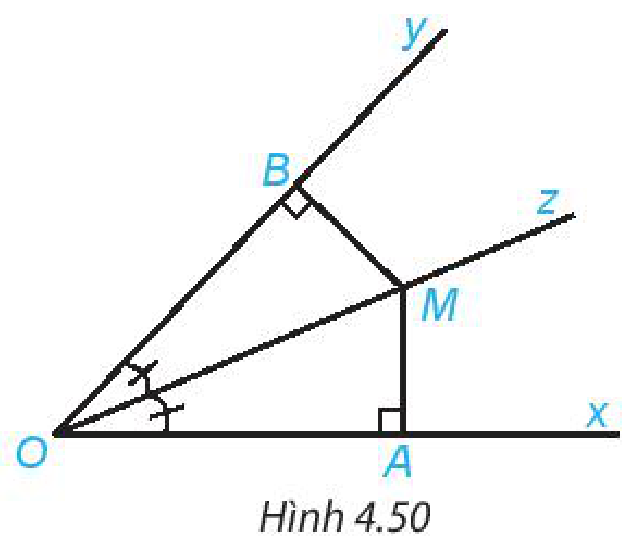
*Hình 4.50*

- **Pi:** Ta có thể xét hai tam giác vuông $OMA$ và $OMB$.

<!-- pdf:79 -->

## 2. TRƯỜNG HỢP BẰNG NHAU ĐẶC BIỆT CỦA TAM GIÁC VUÔNG

*Tìm hiểu trường hợp bằng nhau đặc biệt của tam giác vuông*

**HĐ4:** Vẽ tam giác vuông $ABC$ có $\widehat{A} = 90^\circ, AB = 3\text{ cm}, BC = 5\text{ cm}$ theo các bước sau:

- Dùng thước thẳng có vạch chia vẽ đoạn thẳng $AB = 3\text{ cm}$.
- Vẽ tia $Ax$ vuông góc với $AB$ và cung tròn tâm $B$ bán kính $5\text{ cm}$ như Hình 4.51.

Cung tròn cắt tia $Ax$ tại điểm $C$.

- Vẽ đoạn thẳng $BC$ ta được tam giác $ABC$.

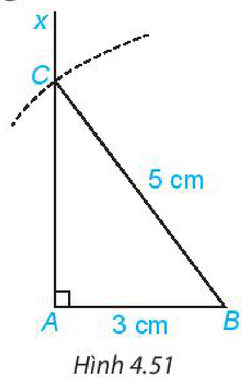
*Hình 4.51*

**HĐ5:** Tương tự, vẽ thêm tam giác $A'B'C'$ có $\widehat{A'} = 90^\circ, A'B' = 3\text{ cm}, B'C' = 5\text{ cm}$.

a) Dùng thước thẳng có vạch chia hoặc compa kiểm tra xem $AC$ có bằng $A'C'$ không.

b) Hai tam giác $ABC$ và $A'B'C'$ có bằng nhau không?

*Ta thừa nhận định lí sau:*

<!-- term: Các trường hợp bằng nhau của hai tam giác vuông -->
<!-- term: Trường hợp bằng nhau cạnh huyền - cạnh góc vuông -->
> Nếu cạnh huyền và một cạnh góc vuông của tam giác vuông này bằng cạnh huyền và một cạnh góc vuông của tam giác vuông kia thì hai tam giác vuông đó bằng nhau.

> ❓ Hãy chỉ ra các cặp tam giác vuông bằng nhau dưới đây.

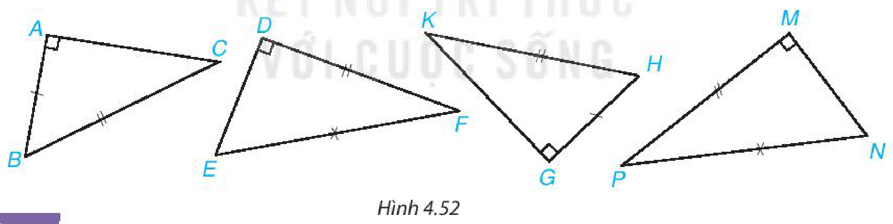
*Hình 4.52*

**Ví dụ 2:**

Cho tam giác $ABC$ vuông tại đỉnh $B$ và tam giác $ADC$ vuông tại đỉnh $D$. Biết rằng $AB = AD$, hãy chứng minh $\triangle ABC = \triangle ADC$.

**Giải:** (H.4.53)

| GT | $\triangle ABC, \widehat{B} = 90^\circ$, $\triangle ADC, \widehat{D} = 90^\circ, AB = AD$. |
| --- | --- |
| KL | $\triangle ABC = \triangle ADC$. |

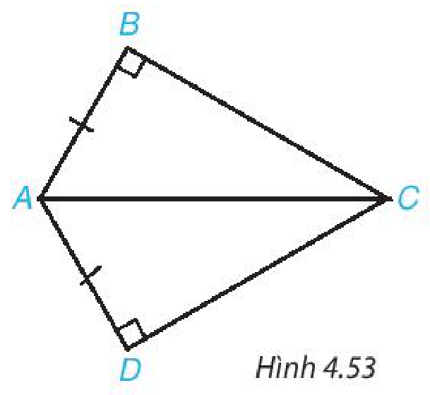
*Hình 4.53*

<!-- pdf:80 -->

Hai tam giác vuông $ABC$ (vuông tại $B$) và $ADC$ (vuông tại $D$) có:
<!-- ocr-ok: đã đối chiếu trực tiếp ảnh trang PDF 80, công thức/bảng kí hiệu khớp nguyên văn sách in -->

$AB = AD$ (theo giả thiết);

$AC$ là cạnh chung.

Vậy $\triangle ABC = \triangle ADC$ (cạnh huyền - cạnh góc vuông).

**Luyện tập 3:**

Cho ba điểm $A, B, C$ nằm trên đường tròn tâm $O$ và các điểm $M, N, P$ như Hình 4.54. Hãy chỉ ra ba cặp tam giác vuông bằng nhau trong hình.

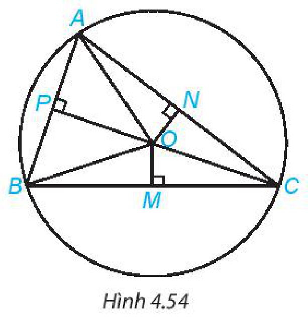
*Hình 4.54*

**Thử thách nhỏ**

Có hai chiếc thang dài như nhau được dựa vào một bức tường với cùng độ cao $BH = B'H'$ như Hình 4.55. Các góc $BAH$ và $B'A'H'$ có bằng nhau không? Vì sao?

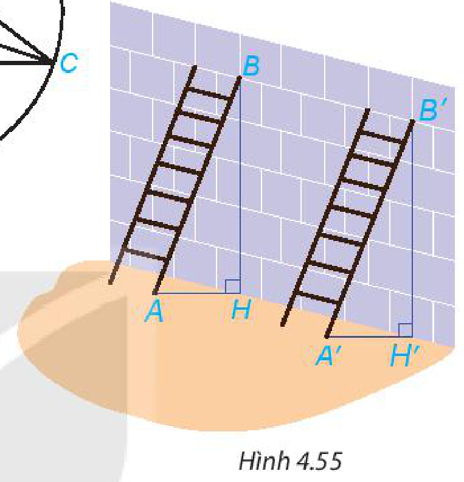
*Hình 4.55*

## BÀI TẬP

4.20. Mỗi hình sau có các cặp tam giác vuông nào bằng nhau? Vì sao?

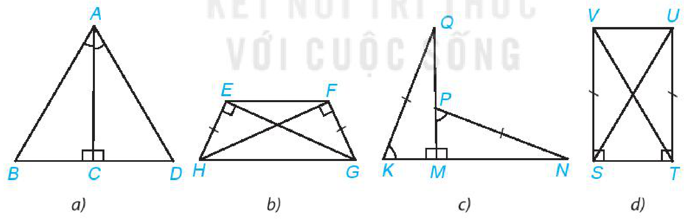

4.21. Cho Hình 4.56, biết $AB = CD, \widehat{BAC} = \widehat{BDC} = 90^\circ$. Chứng minh rằng $\triangle ABE = \triangle DCE$.

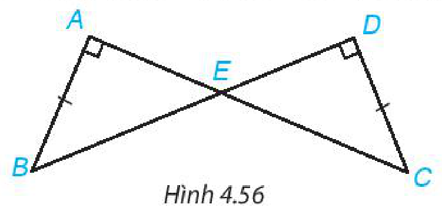
*Hình 4.56*

4.22. Cho hình chữ nhật $ABCD$, $M$ là trung điểm của cạnh $BC$.

Chứng minh rằng $\triangle ABM = \triangle DCM$.

## 📷 Danh sách hình trong bài

| Mã hình | Trang PDF | Vị trí trong bài | Chú thích gốc |
| --- | :---: | --- | --- |
| H7-toan-b15-01 | 76 | Mở đầu | (sách không đánh số, hai chiếc cột và bóng nắng) |
| H7-toan-b15-02 | 76 | Mục 1, HĐ1 | Hình 4.45 |
| H7-toan-b15-03 | 77 | Mục 1, HĐ2 | Hình 4.46 |
| H7-toan-b15-04 | 77 | Mục 1, HĐ3 | Hình 4.47 |
| H7-toan-b15-05 | 78 | Mục 1, Câu hỏi | Hình 4.48 |
| H7-toan-b15-06 | 78 | Mục 1, Ví dụ 1 | Hình 4.49 |
| H7-toan-b15-07 | 78 | Mục 1, Luyện tập 2 | Hình 4.50 |
| H7-toan-b15-08 | 79 | Mục 2, HĐ4 | Hình 4.51 |
| H7-toan-b15-09 | 79 | Mục 2, Câu hỏi | Hình 4.52 |
| H7-toan-b15-10 | 79 | Mục 2, Ví dụ 2 | Hình 4.53 |
| H7-toan-b15-11 | 80 | Mục 2, Luyện tập 3 | Hình 4.54 |
| H7-toan-b15-12 | 80 | Mục 2, Thử thách nhỏ | Hình 4.55 |
| H7-toan-b15-13 | 80 | Bài 4.20 | (sách không đánh số, bốn hình a, b, c, d) |
| H7-toan-b15-14 | 80 | Bài 4.21 | Hình 4.56 |
