<!-- pdf:81 -->

# BÀI 16: TAM GIÁC CÂN. ĐƯỜNG TRUNG TRỰC CỦA ĐOẠN THẲNG

## 🔤 Khái niệm, thuật ngữ

- Tam giác cân
- Đường trung trực

## 🎯 Kiến thức, kĩ năng

- Nhận biết tam giác cân, giải thích tính chất của tam giác cân.
- Nhận biết khái niệm đường trung trực của một đoạn thẳng và các tính chất cơ bản của đường trung trực.
- Vẽ đường trung trực của một đoạn thẳng bằng dụng cụ học tập.

## 🔴 Mở đầu

Kiến trúc sư vẽ bản thiết kế ngôi nhà hình tam giác theo tỉ lệ $1 : 100$. Biết rằng ngôi nhà cao $5\text{ m}$, bề ngang mặt sàn rộng $4\text{ m}$ và hai mái nghiêng như nhau. Theo em, trên bản thiết kế làm thế nào để xác định được chính xác điểm $C$ thể hiện đỉnh ngôi nhà?

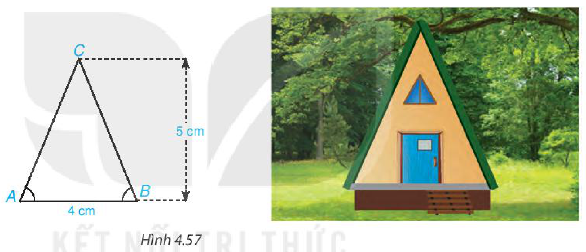
*Hình 4.57*

## 1. TAM GIÁC CÂN VÀ TÍNH CHẤT

*Tam giác cân*

> **Tam giác cân** là tam giác có hai cạnh bằng nhau.

<!-- term: Cạnh bên, cạnh đáy, góc ở đỉnh, góc ở đáy của tam giác cân -->
Trong Hình 4.58, tam giác cân $ABC$ ($AB = AC$) được gọi là cân tại đỉnh $A$, hai cạnh $AB$ và $AC$ là hai cạnh bên, $BC$ là cạnh đáy, $\widehat{B}$ và $\widehat{C}$ là hai góc ở đáy, $\widehat{A}$ là góc ở đỉnh.

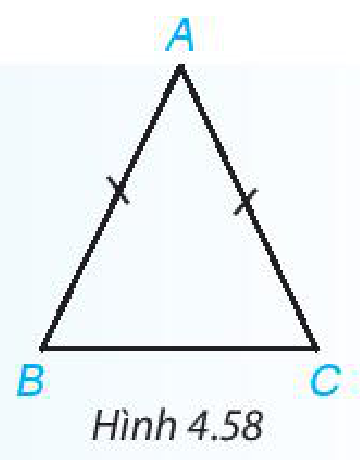
*Hình 4.58*

> ❓ Hãy nêu tên tất cả các tam giác cân trong Hình 4.59. Với mỗi tam giác cân đó, hãy nêu tên cạnh bên, cạnh đáy, góc ở đỉnh, góc ở đáy của chúng.

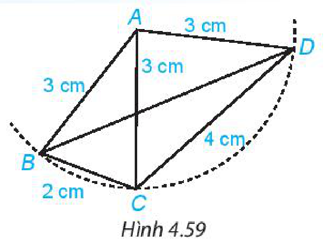
*Hình 4.59*

<!-- pdf:82 -->

*Tính chất của tam giác cân*

**HĐ1:** Quan sát tam giác $ABC$ cân tại $A$ như Hình 4.60.

Lấy $D$ là trung điểm của đoạn thẳng $BC$.

a) Chứng minh rằng $\triangle ABD = \triangle ACD$ theo trường hợp cạnh - cạnh - cạnh.

b) Hai góc $B$ và $C$ của tam giác $ABC$ có bằng nhau không?

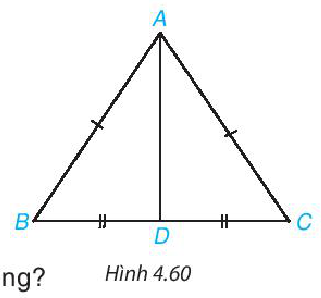
*Hình 4.60*

**HĐ2:** Cho tam giác $MNP$ có $\widehat{M} = \widehat{N}$. Vẽ tia phân giác $PK$ của góc $MPN$ ($K \in MN$).

Chứng minh rằng:

a) $\widehat{MKP} = \widehat{NKP}$;

b) $\triangle MPK = \triangle NPK$;

c) Tam giác $MNP$ có cân tại $P$ không?

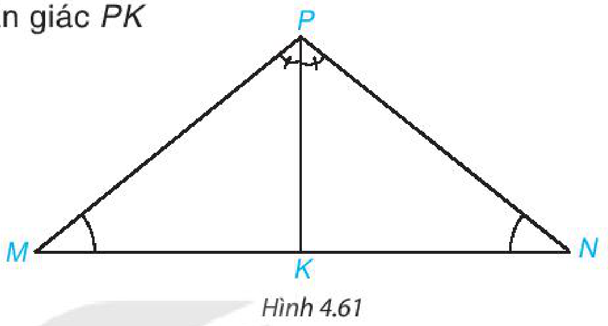
*Hình 4.61*

*Qua HĐ1 và HĐ2 ta có tính chất sau:*

<!-- term: Tính chất của tam giác cân -->
> Trong một tam giác cân, hai góc ở đáy bằng nhau. Ngược lại, một tam giác có hai góc bằng nhau thì tam giác đó là tam giác cân.

**Luyện tập 1:**

Tính số đo các góc và cạnh chưa biết của tam giác $DEF$ trong Hình 4.62.

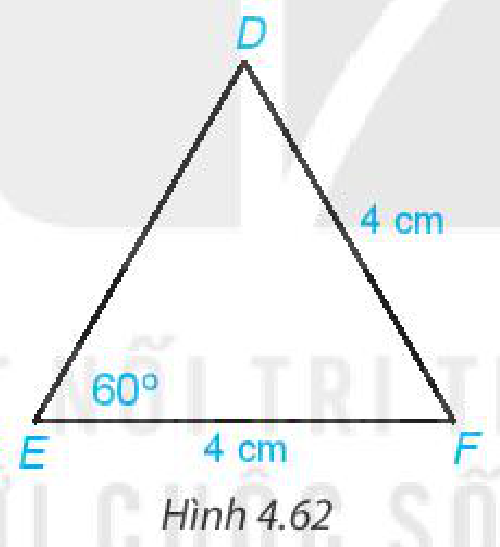
*Hình 4.62*

- **Pi:** **Tam giác đều** là tam giác có ba cạnh bằng nhau.

**Nhận xét:** Tam giác $DEF$ có các cạnh bằng nhau và các góc bằng nhau. Đó là một **tam giác đều**.

**Thử thách nhỏ**

Một tam giác có gì đặc biệt nếu thoả mãn một trong các điều kiện sau:

a) Tam giác có ba góc bằng nhau?

b) Tam giác cân có một góc bằng $60^\circ$?

## 2. ĐƯỜNG TRUNG TRỰC CỦA MỘT ĐOẠN THẲNG

*Đường trung trực của đoạn thẳng*

**HĐ3:** Đánh dấu hai điểm $A$ và $B$ nằm trên hai mép tờ giấy A4, nối $A$ và $B$ để được đoạn thẳng $AB$.

<!-- pdf:83 -->

Gấp mảnh giấy lại như Hình 4.63 sao cho vị trí các điểm $A$ và $B$ trùng nhau.

Mở mảnh giấy ra, kẻ một đường thẳng $d$ theo nếp gấp.

a) Gọi $O$ là giao điểm của đường thẳng $d$ và $AB$. $O$ có là trung điểm của đoạn thẳng $AB$ không?

b) Dùng thước đo góc, kiểm tra đường thẳng $d$ có vuông góc với $AB$ không?

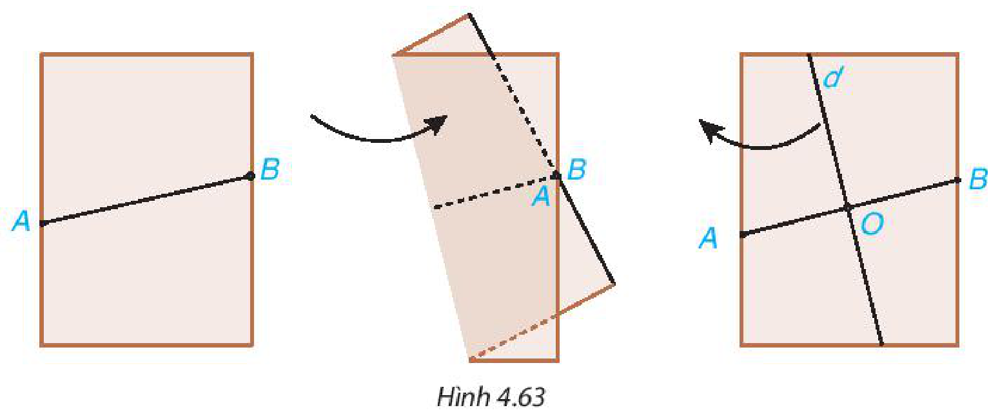
*Hình 4.63*

Đường thẳng $d$ trong HĐ3 được gọi là *đường trung trực* của đoạn thẳng $AB$.

*Ta có định nghĩa sau:*

> Đường thẳng vuông góc với một đoạn thẳng tại trung điểm của nó được gọi là **đường trung trực** của đoạn thẳng đó.

- **Pi:** Đường trung trực của một đoạn thẳng cũng là trục đối xứng của đoạn thẳng đó.

> ❓ Trong Hình 4.64, bạn Lan vẽ đường trung trực của các đoạn thẳng. Theo em, hình nào Lan vẽ đúng?

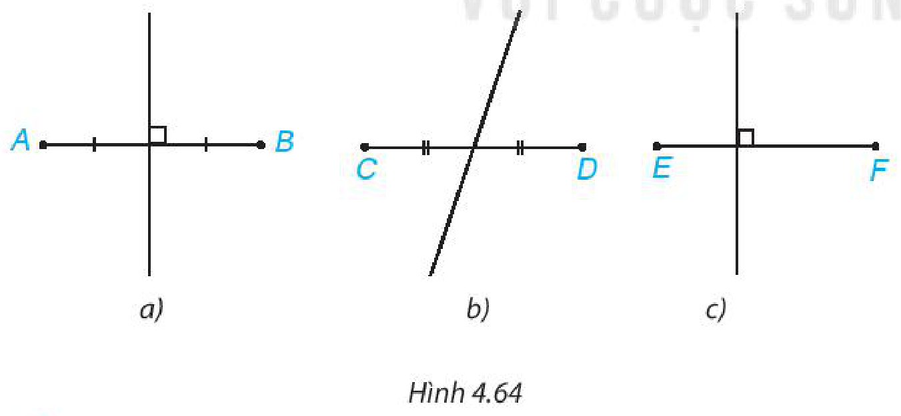
*Hình 4.64*

*Tính chất của đường trung trực*

**HĐ4:** Trên mảnh giấy trong HĐ3, lấy điểm $M$ bất kì trên đường thẳng $d$. Dùng thước thẳng có vạch chia kiểm tra xem $AM$ có bằng $BM$ không (H.4.65).

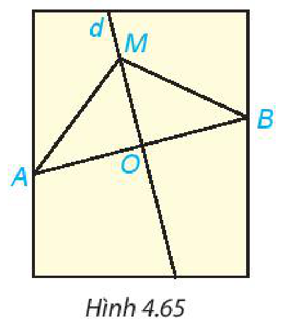
*Hình 4.65*

<!-- pdf:84 -->

*Từ HĐ4, ta có tính chất sau về đường trung trực của một đoạn thẳng:*

<!-- term: Tính chất của đường trung trực -->
> Điểm nằm trên đường trung trực của một đoạn thẳng thì cách đều hai mút của đoạn thẳng đó.

**Ví dụ:** Cho đoạn thẳng $AB$ và điểm $M$ không thuộc đoạn thẳng $AB$ sao cho $MA = MB$.

Chứng minh rằng $M$ thuộc đường trung trực của đoạn thẳng $AB$.

**Giải:** (H.4.66)

| GT | $M \notin AB, MA = MB$. |
| --- | --- |
| KL | $M$ thuộc trung trực của đoạn thẳng $AB$. |

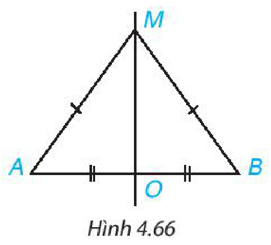
*Hình 4.66*

Gọi $O$ là trung điểm của đoạn thẳng $AB$.

Hai tam giác $OMA$ và $OMB$ có:
<!-- ocr-ok: đã đối chiếu trực tiếp ảnh trang PDF 84, công thức/bảng kí hiệu khớp nguyên văn sách in -->

$OA = OB$ (do $O$ là trung điểm của đoạn thẳng $AB$);

$MA = MB$ (theo giả thiết);

$OM$ là cạnh chung.

Vậy $\triangle OMA = \triangle OMB$ (c.c.c). Suy ra $\widehat{AOM} = \widehat{BOM}$ (hai góc tương ứng).

Mặt khác, vì $\widehat{AOM} + \widehat{BOM} = 180^\circ$ nên $\widehat{AOM} = \widehat{BOM} = 90^\circ$. Vậy $MO$ vuông góc với $AB$, hay $MO$ là đường trung trực của đoạn thẳng $AB$.

<!-- term: Tính chất của đường trung trực -->
**Nhận xét:** Trong Ví dụ, nếu $M \in AB$ thì $M$ là trung điểm của $AB$ và do đó $M$ cũng thuộc đường trung trực của đoạn thẳng $AB$. Ta thấy đường trung trực của đoạn thẳng $AB$ là tập hợp tất cả các điểm cách đều hai mút của đoạn thẳng đó.

**Luyện tập 2:**

Cho $M$ là một điểm nằm trên đường trung trực của đoạn thẳng $AB$. Biết $AM = 3\text{ cm}$ và $\widehat{MAB} = 60^\circ$ (H.4.67). Tính $BM$ và số đo góc $MBA$.

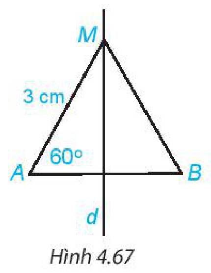
*Hình 4.67*

**Thực hành:**

Sử dụng thước thẳng và compa để vẽ đường trung trực của đoạn thẳng $AB$ như sau:

- Vẽ đoạn thẳng $AB$;
- Lấy $A$ làm tâm, vẽ cung tròn (bán kính lớn hơn $\frac{AB}{2}$), sau đó lấy $B$ làm tâm, vẽ cung tròn có cùng bán kính, sao cho hai cung tròn này cắt nhau tại hai điểm $M$ và $N$;
- Dùng thước thẳng vẽ đường thẳng $MN$. Khi đó $MN$ là đường trung trực của đoạn thẳng $AB$ (H.4.68).

<!-- pdf:85 -->

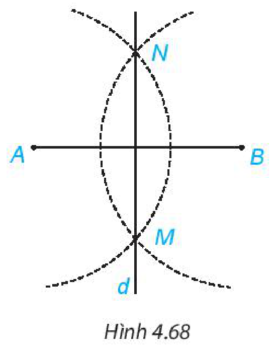
*Hình 4.68*

- **Tròn:** Cách trên cũng dùng để vẽ trung điểm của một đoạn thẳng. Giao điểm của $MN$ và $AB$ là trung điểm của đoạn thẳng $AB$.

## BÀI TẬP

4.23. Cho tam giác $ABC$ cân tại $A$ và các điểm $E, F$ lần lượt nằm trên các cạnh $AC, AB$ sao cho $BE$ vuông góc với $AC$, $CF$ vuông góc với $AB$ (H.4.69). Chứng minh rằng $BE = CF$.

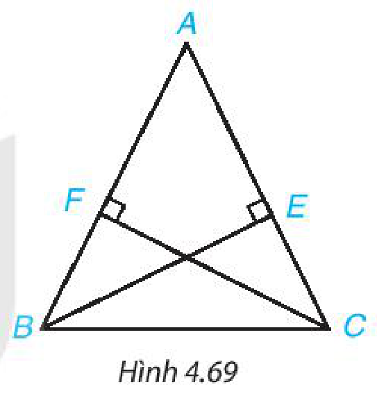
*Hình 4.69*

4.24. Cho tam giác $ABC$ cân tại $A$ và $M$ là trung điểm của đoạn thẳng $BC$. Chứng minh $AM$ vuông góc với $BC$ và $AM$ là tia phân giác của góc $BAC$.

4.25. Cho tam giác $ABC$ và $M$ là trung điểm của đoạn thẳng $BC$.

a) Giả sử $AM$ vuông góc với $BC$. Chứng minh rằng tam giác $ABC$ cân tại $A$.

b) Giả sử $AM$ là tia phân giác của góc $BAC$. Chứng minh rằng tam giác $ABC$ cân tại $A$.

4.26. Tam giác vuông có hai cạnh bằng nhau được gọi là **tam giác vuông cân**.

Hãy giải thích các khẳng định sau:

a) Tam giác vuông cân thì cân tại đỉnh góc vuông;

b) Tam giác vuông cân có hai góc nhọn bằng $45^\circ$;

c) Tam giác vuông có một góc nhọn bằng $45^\circ$ là tam giác vuông cân.

4.27. Trong Hình 4.70, đường thẳng nào là đường trung trực của đoạn thẳng $AB$?

4.28. Cho tam giác $ABC$ cân tại $A$ có đường cao $AD$. Chứng minh rằng đường thẳng $AD$ là đường trung trực của đoạn thẳng $BC$.

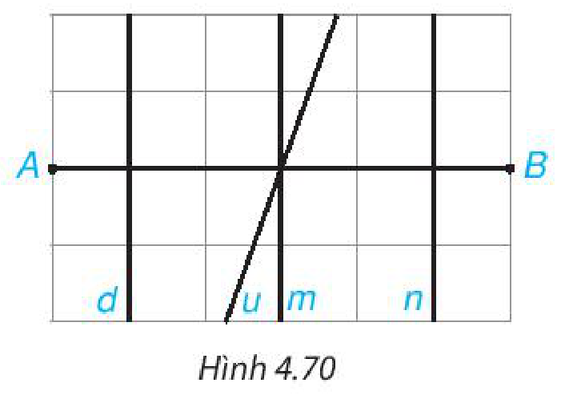
*Hình 4.70*

## 📷 Danh sách hình trong bài

| Mã hình | Trang PDF | Vị trí trong bài | Chú thích gốc |
| --- | :---: | --- | --- |
| H7-toan-b16-01 | 81 | Mở đầu | Hình 4.57 |
| H7-toan-b16-02 | 81 | Mục 1 | Hình 4.58 |
| H7-toan-b16-03 | 81 | Mục 1, Câu hỏi | Hình 4.59 |
| H7-toan-b16-04 | 82 | Mục 1, HĐ1 | Hình 4.60 |
| H7-toan-b16-05 | 82 | Mục 1, HĐ2 | Hình 4.61 |
| H7-toan-b16-06 | 82 | Mục 1, Luyện tập 1 | Hình 4.62 |
| H7-toan-b16-07 | 83 | Mục 2, HĐ3 | Hình 4.63 |
| H7-toan-b16-08 | 83 | Mục 2, Câu hỏi | Hình 4.64 |
| H7-toan-b16-09 | 83 | Mục 2, HĐ4 | Hình 4.65 |
| H7-toan-b16-10 | 84 | Mục 2, Ví dụ | Hình 4.66 |
| H7-toan-b16-11 | 84 | Mục 2, Luyện tập 2 | Hình 4.67 |
| H7-toan-b16-12 | 85 | Mục 2, Thực hành | Hình 4.68 |
| H7-toan-b16-13 | 85 | Bài 4.23 | Hình 4.69 |
| H7-toan-b16-14 | 85 | Bài 4.27 | Hình 4.70 |
