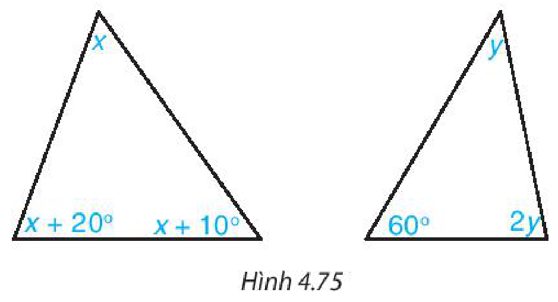
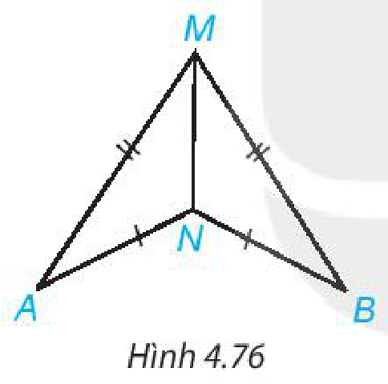
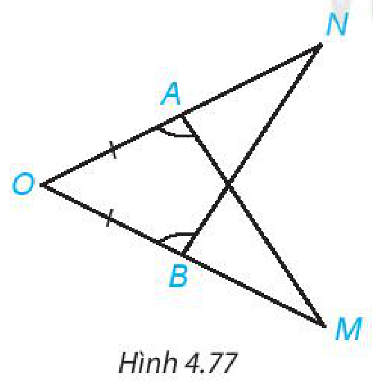
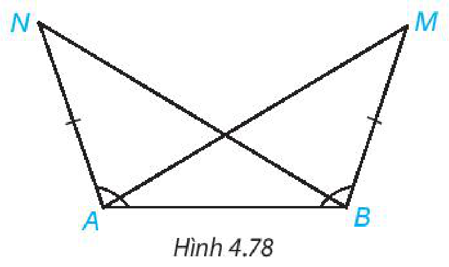

<!-- pdf:88 -->

# BÀI TẬP CUỐI CHƯƠNG IV

4.33. Tính các số đo $x, y$ trong các tam giác dưới đây (H.4.75).

*Hình 4.75*

4.34. Trong Hình 4.76, có $AM = BM, AN = BN$. Chứng minh rằng $\widehat{MAN} = \widehat{MBN}$.
<!-- ocr-ok: đã đối chiếu trực tiếp ảnh trang PDF 88, công thức/bảng kí hiệu khớp nguyên văn sách in -->

*Hình 4.76*

4.35. Trong Hình 4.77, có $AO = BO, \widehat{OAM} = \widehat{OBN}$. Chứng minh rằng $AM = BN$.

*Hình 4.77*

4.36. Trong Hình 4.78, có $AN = BM, \widehat{BAN} = \widehat{ABM}$.

Chứng minh rằng $\widehat{BAM} = \widehat{ABN}$.

*Hình 4.78*

4.37. Cho $M, N$ là hai điểm phân biệt nằm trên đường trung trực của đoạn thẳng $AB$ sao cho $AM = AN$. Chứng minh rằng $MB = NB$ và góc $AMB$ bằng góc $ANB$.

4.38. Cho tam giác $ABC$ cân tại $A$ có $\widehat{A} = 120^\circ$. Trên cạnh $BC$ lấy hai điểm $M, N$ sao cho $MA, NA$ lần lượt vuông góc với $AB, AC$. Chứng minh rằng:
<!-- ocr-ok: đã đối chiếu trực tiếp ảnh trang PDF 88, công thức/bảng kí hiệu khớp nguyên văn sách in -->

a) $\triangle BAM = \triangle CAN$;

b) Các tam giác $ANB, AMC$ lần lượt cân tại $N, M$.

4.39. Cho tam giác $ABC$ vuông tại $A$ có $\widehat{B} = 60^\circ$. Trên cạnh $BC$ lấy điểm $M$ sao cho $\widehat{CAM} = 30^\circ$. Chứng minh rằng:
<!-- ocr-ok: đã đối chiếu trực tiếp ảnh trang PDF 88, công thức/bảng kí hiệu khớp nguyên văn sách in -->

a) Tam giác $CAM$ cân tại $M$;

b) Tam giác $BAM$ là tam giác đều;

c) $M$ là trung điểm của đoạn thẳng $BC$.

## 📷 Danh sách hình trong bài

| Mã hình | Trang PDF | Vị trí trong bài | Chú thích gốc |
| --- | :---: | --- | --- |
| H7-toan-bt-c04-01 | 88 | Bài 4.33 | Hình 4.75 |
| H7-toan-bt-c04-02 | 88 | Bài 4.34 | Hình 4.76 |
| H7-toan-bt-c04-03 | 88 | Bài 4.35 | Hình 4.77 |
| H7-toan-bt-c04-04 | 88 | Bài 4.36 | Hình 4.78 |
