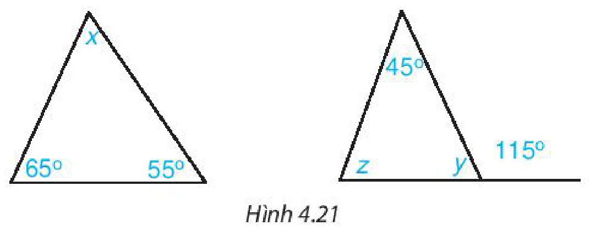
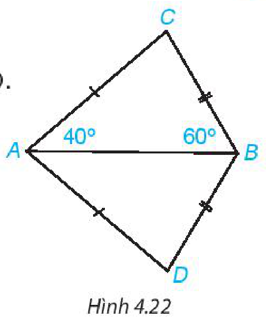
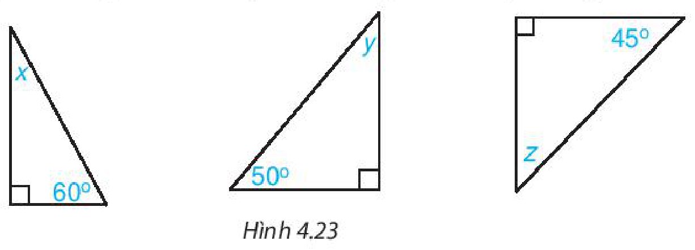
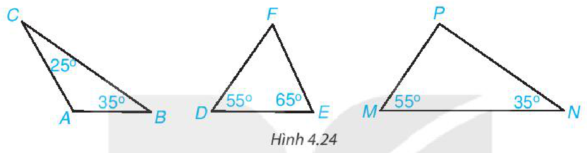
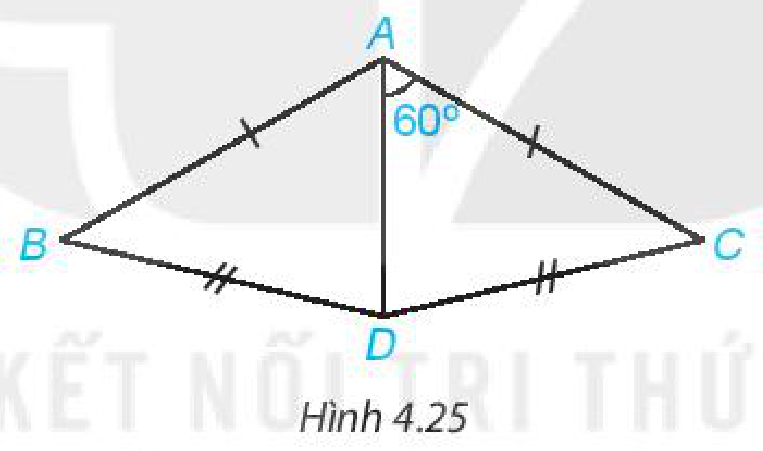
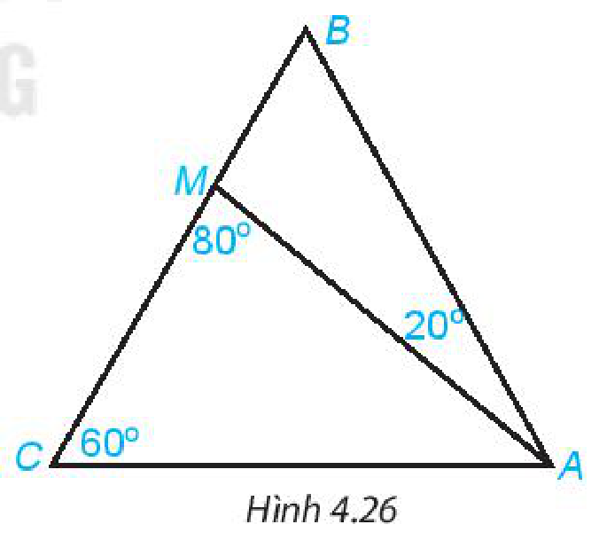

<!-- pdf:69 -->

# LUYỆN TẬP CHUNG (TRANG 68)

**Ví dụ 1:**

Tính các số đo $x, y, z$ trong Hình 4.21.

*Hình 4.21*

**Giải:**

a) Ta có $x + 65^\circ + 55^\circ = 180^\circ$ (tổng ba góc trong một tam giác bằng $180^\circ$).

Do đó $x = 180^\circ - 65^\circ - 55^\circ = 60^\circ$.

b) Ta có $y + 115^\circ = 180^\circ$ (hai góc kề bù). Do đó $y = 180^\circ - 115^\circ = 65^\circ$.

Lại có $y + z + 45^\circ = 180^\circ$ (tổng ba góc trong một tam giác bằng $180^\circ$).

Suy ra $z = 180^\circ - y - 45^\circ = 180^\circ - 65^\circ - 45^\circ = 70^\circ$.

**Ví dụ 2:**

Cho Hình 4.22, biết $\widehat{BAC} = 40^\circ, \widehat{ABC} = 60^\circ, AC = AD, BC = BD$.

a) Chứng minh rằng $\triangle ABC = \triangle ABD$;

b) Tính số đo góc $ADB$.

**Giải:**

| GT | $\widehat{BAC} = 40^\circ, \widehat{ABC} = 60^\circ, AC = AD, BC = BD$. |
| --- | --- |
| KL | a) $\triangle ABC = \triangle ABD$; b) Tính $\widehat{ADB}$. |
<!-- ocr-ok: đã đối chiếu trực tiếp ảnh trang PDF 69, công thức/bảng kí hiệu khớp nguyên văn sách in -->

*Hình 4.22*

a) Hai tam giác $ABC$ và $ABD$ có:
<!-- ocr-ok: đã đối chiếu trực tiếp ảnh trang PDF 69, công thức/bảng kí hiệu khớp nguyên văn sách in -->

$AC = AD$ (theo giả thiết);

$BC = BD$ (theo giả thiết);

$AB$ là cạnh chung.

Vậy $\triangle ABC = \triangle ABD$ (c.c.c).

b) Vì tổng ba góc trong tam giác $ABC$ bằng $180^\circ$ nên ta có:

$\widehat{ACB} = 180^\circ - \widehat{ABC} - \widehat{BAC} = 180^\circ - 60^\circ - 40^\circ = 80^\circ$.

Theo câu a) ta có $\triangle ABC = \triangle ABD$, suy ra $\widehat{ADB} = \widehat{ACB} = 80^\circ$.

<!-- pdf:70 -->

## BÀI TẬP

4.7. Các số đo $x, y, z$ trong mỗi tam giác vuông dưới đây bằng bao nhiêu độ?

*Hình 4.23*

4.8. Tính số đo góc còn lại trong mỗi tam giác dưới đây. Hãy chỉ ra tam giác nào là tam giác vuông.

*Hình 4.24*

4.9. Cho Hình 4.25, biết $\widehat{DAC} = 60^\circ, AB = AC, DB = DC$. Hãy tính $\widehat{DAB}$.

*Hình 4.25*

4.10. Cho tam giác $ABC$ có $\widehat{BCA} = 60^\circ$ và điểm $M$ nằm trên cạnh $BC$ sao cho $\widehat{BAM} = 20^\circ, \widehat{AMC} = 80^\circ$ (H.4.26).

Tính số đo các góc $AMB, ABC, BAC$.

*Hình 4.26*

4.11. Cho $\triangle ABC = \triangle DEF$. Biết rằng $\widehat{A} = 60^\circ, \widehat{E} = 80^\circ$, tính số đo các góc $B, C, D, F$.

## 📷 Danh sách hình trong bài

| Mã hình | Trang PDF | Vị trí trong bài | Chú thích gốc |
| --- | :---: | --- | --- |
| H7-toan-ltc-c04-01-01 | 69 | Ví dụ 1 | Hình 4.21 |
| H7-toan-ltc-c04-01-02 | 69 | Ví dụ 2 | Hình 4.22 |
| H7-toan-ltc-c04-01-03 | 70 | Bài 4.7 | Hình 4.23 |
| H7-toan-ltc-c04-01-04 | 70 | Bài 4.8 | Hình 4.24 |
| H7-toan-ltc-c04-01-05 | 70 | Bài 4.9 | Hình 4.25 |
| H7-toan-ltc-c04-01-06 | 70 | Bài 4.10 | Hình 4.26 |
