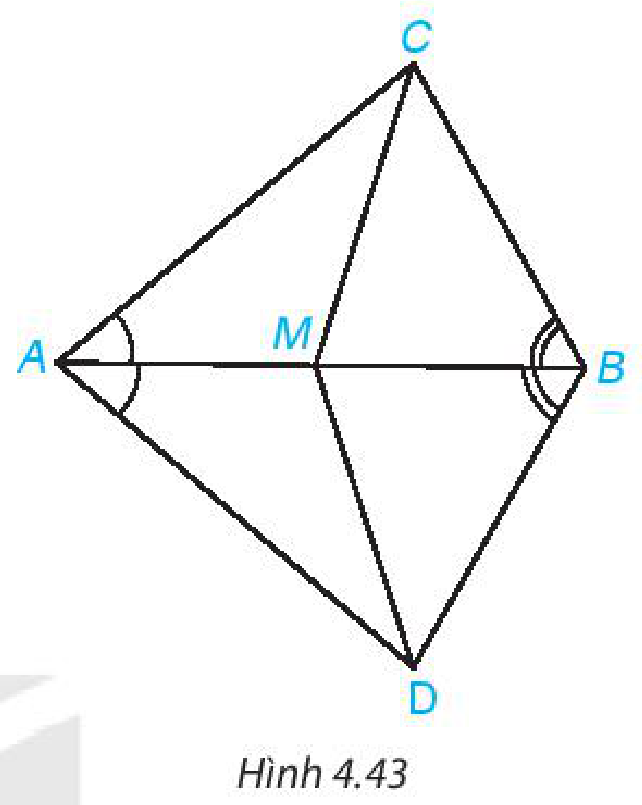
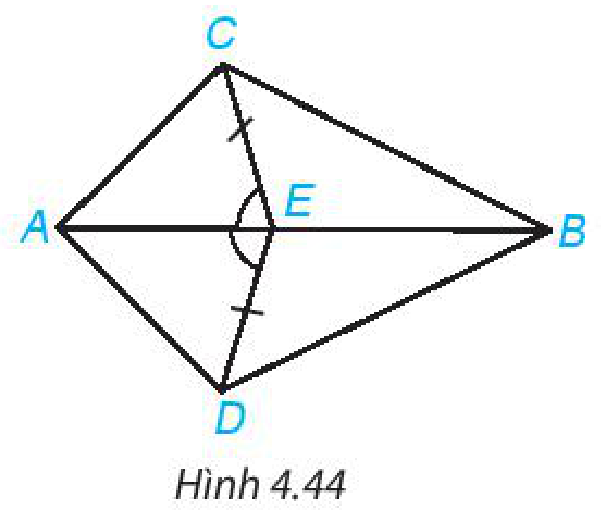

<!-- pdf:75 -->

# LUYỆN TẬP CHUNG (TRANG 74)

**Ví dụ:**

Cho điểm $M$ thuộc đoạn thẳng $AB$ và hai điểm $C, D$ như Hình 4.43 sao cho $\widehat{BAC} = \widehat{BAD}, \widehat{ABC} = \widehat{ABD}$. Chứng minh rằng:

a) $\triangle ABC = \triangle ABD$;

b) $\triangle AMC = \triangle AMD$.

**Giải:**

| GT | $M \in AB, \widehat{BAC} = \widehat{BAD}, \widehat{ABC} = \widehat{ABD}$. |
| --- | --- |
| KL | a) $\triangle ABC = \triangle ABD$; b) $\triangle AMC = \triangle AMD$. |

*Hình 4.43*

a) Hai tam giác $ABC$ và $ABD$ có:
<!-- ocr-ok: đã đối chiếu trực tiếp ảnh trang PDF 75, công thức/bảng kí hiệu khớp nguyên văn sách in -->

$\widehat{BAC} = \widehat{BAD}$ (theo giả thiết);

$AB$ là cạnh chung;

$\widehat{ABC} = \widehat{ABD}$ (theo giả thiết).

Vậy $\triangle ABC = \triangle ABD$ (g.c.g).

b) Hai tam giác $AMC$ và $AMD$ có:
<!-- ocr-ok: đã đối chiếu trực tiếp ảnh trang PDF 75, công thức/bảng kí hiệu khớp nguyên văn sách in -->

$AM$ là cạnh chung;

$\widehat{MAC} = \widehat{BAC} = \widehat{BAD} = \widehat{MAD}$ (theo giả thiết);

$AC = AD$ (vì $\triangle ABC = \triangle ABD$).

Vậy $\triangle AMC = \triangle AMD$ (c.g.c).

## BÀI TẬP

4.16. Cho hai tam giác $ABC$ và $DEF$ thoả mãn $AB = DE, AC = DF, \widehat{BAC} = \widehat{EDF} = 60^\circ, BC = 6\text{ cm}, \widehat{ABC} = 45^\circ$. Tính độ dài cạnh $EF$ và số đo các góc $ACB, DEF, EFD$.

4.17. Cho hai tam giác $ABC$ và $DEF$ thoả mãn $AB = DE, \widehat{ABC} = \widehat{DEF} = 70^\circ, \widehat{BAC} = \widehat{EDF} = 60^\circ, AC = 6\text{ cm}$. Tính độ dài cạnh $DF$.

4.18. Cho Hình 4.44, biết $EC = ED$ và $\widehat{AEC} = \widehat{AED}$. Chứng minh rằng:

a) $\triangle AEC = \triangle AED$;

b) $\triangle ABC = \triangle ABD$.

*Hình 4.44*

4.19. Cho tia $Oz$ là tia phân giác của góc $xOy$. Lấy các điểm $A, B, C$ lần lượt thuộc các tia $Ox, Oy, Oz$ sao cho $\widehat{CAO} = \widehat{CBO}$.

a) Chứng minh rằng $\triangle OAC = \triangle OBC$.

b) Lấy điểm $M$ trên tia đối của tia $CO$. Chứng minh rằng $\triangle MAC = \triangle MBC$.

## 📷 Danh sách hình trong bài

| Mã hình | Trang PDF | Vị trí trong bài | Chú thích gốc |
| --- | :---: | --- | --- |
| H7-toan-ltc-c04-02-01 | 75 | Ví dụ | Hình 4.43 |
| H7-toan-ltc-c04-02-02 | 75 | Bài 4.18 | Hình 4.44 |
