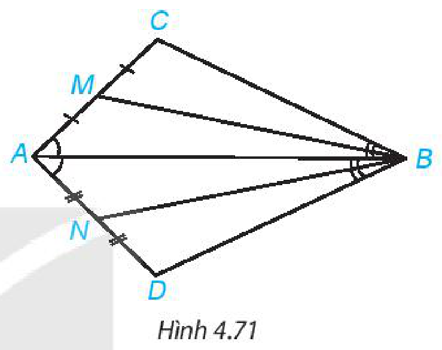
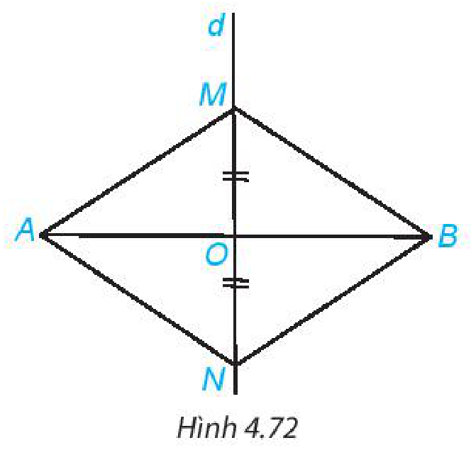
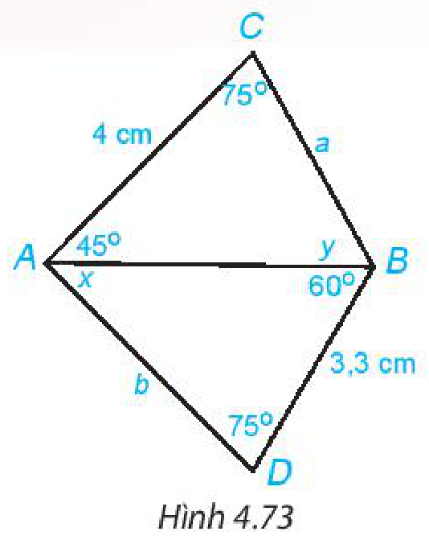
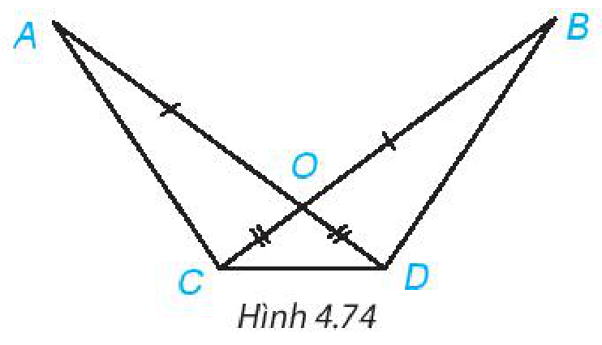

<!-- pdf:86 -->

# LUYỆN TẬP CHUNG (TRANG 85)

**Ví dụ 1:**

Cho Hình 4.71, biết $\widehat{ABC} = \widehat{ABD}, \widehat{BAC} = \widehat{BAD}$.

Gọi $M, N$ lần lượt là trung điểm của các đoạn thẳng $AC, AD$. Chứng minh rằng:

a) $\triangle ABC = \triangle ABD$;

b) $\triangle BCM = \triangle BDN$.

**Giải:**

| GT | $\widehat{ABC} = \widehat{ABD}, \widehat{BAC} = \widehat{BAD}$, $M \in AC, MA = MC; N \in AD, NA = ND$. |
| --- | --- |
| KL | $\triangle ABC = \triangle ABD, \triangle BCM = \triangle BDN$. |

*Hình 4.71*

a) Hai tam giác $ABC$ và $ABD$ có:
<!-- ocr-ok: đã đối chiếu trực tiếp ảnh trang PDF 86, công thức/bảng kí hiệu khớp nguyên văn sách in -->

$\widehat{ABC} = \widehat{ABD}$ (theo giả thiết),

$AB$ là cạnh chung,

$\widehat{BAC} = \widehat{BAD}$ (theo giả thiết).

Vậy $\triangle ABC = \triangle ABD$ (g.c.g).

b) Vì $\triangle ABC = \triangle ABD$ (theo chứng minh trên) nên $BC = BD, AC = AD$ và $\widehat{BCA} = \widehat{BDA}$.

Do $M, N$ lần lượt thuộc $CA, DA$ nên $\widehat{BCM} = \widehat{BCA}, \widehat{BDN} = \widehat{BDA}$.
<!-- ocr-ok: đã đối chiếu trực tiếp ảnh trang PDF 86, công thức/bảng kí hiệu khớp nguyên văn sách in -->

Vì vậy $\widehat{BCM} = \widehat{BCA} = \widehat{BDA} = \widehat{BDN}$.

Mặt khác, vì $M$ và $N$ lần lượt là trung điểm của $AC$ và $AD$ nên $CM = \frac{AC}{2} = \frac{AD}{2} = DN$.
<!-- ocr-ok: đã đối chiếu trực tiếp ảnh trang PDF 86, công thức/bảng kí hiệu khớp nguyên văn sách in -->

Vậy hai tam giác $BCM$ và $BDN$ có:
<!-- ocr-ok: đã đối chiếu trực tiếp ảnh trang PDF 86, công thức/bảng kí hiệu khớp nguyên văn sách in -->

$BC = BD, \widehat{BCM} = \widehat{BDN}, CM = DN$ (theo chứng minh trên).

Do đó $\triangle BCM = \triangle BDN$ (c.g.c).

**Ví dụ 2:**

Cho $d$ là đường trung trực của đoạn thẳng $AB$ và $O$ là giao điểm của $d$ với $AB$. Cho $M$ và $N$ là hai điểm phân biệt nằm trên $d$ sao cho $OM = ON$. Chứng minh rằng:
<!-- ocr-ok: đã đối chiếu trực tiếp ảnh trang PDF 86, công thức/bảng kí hiệu khớp nguyên văn sách in -->

a) $\triangle MAO = \triangle MBO$;

b) $\widehat{MAN} = \widehat{MBN}$;

c) Tam giác $AMN$ cân tại $A$.

<!-- pdf:87 -->

**Giải:** (H.4.72)

| GT | $d$ là đường trung trực của $AB$, $d$ cắt $AB$ tại $O$, $M, N \in d$: $M$ khác $N$, $OM = ON$. |
| --- | --- |
| KL | a) $\triangle MAO = \triangle MBO$; b) $\widehat{MAN} = \widehat{MBN}$; c) $\triangle AMN$ cân tại $A$. |
<!-- ocr-ok: đã đối chiếu trực tiếp ảnh trang PDF 87, công thức/bảng kí hiệu khớp nguyên văn sách in -->

*Hình 4.72*

Vì $d$ là đường trung trực của đoạn thẳng $AB$ nên $d$ vuông góc với $AB$ tại $O$.
<!-- ocr-ok: đã đối chiếu trực tiếp ảnh trang PDF 87, công thức/bảng kí hiệu khớp nguyên văn sách in -->

a) Xét hai tam giác vuông $MAO$ và $MBO$. Ta có:

$OM$ là cạnh chung; $AM = BM$ (vì $M$ thuộc đường trung trực của đoạn thẳng $AB$).

Do đó $\triangle MAO = \triangle MBO$ (cạnh huyền - cạnh góc vuông).

b) Xét hai tam giác $MAN$ và $MBN$. Ta có:
<!-- ocr-ok: đã đối chiếu trực tiếp ảnh trang PDF 87, công thức/bảng kí hiệu khớp nguyên văn sách in -->

$MA = MB$ (vì $M$ thuộc đường trung trực của đoạn thẳng $AB$);

$NA = NB$ (vì $N$ thuộc đường trung trực của đoạn thẳng $AB$);

$MN$ là cạnh chung.

Vậy $\triangle MAN = \triangle MBN$ (c.c.c).

Do đó $\widehat{MAN} = \widehat{MBN}$ (hai góc tương ứng).

c) Xét hai tam giác vuông $AOM$ và $AON$. Ta có:

$OM = ON$ (theo giả thiết); $OA$ là cạnh chung.

Do đó $\triangle AOM = \triangle AON$ (hai cạnh góc vuông).

Vậy $AM = AN$ (hai cạnh tương ứng). Từ đó suy ra tam giác $AMN$ cân tại $A$.

## BÀI TẬP

4.29. Cho Hình 4.73. Hãy tìm số đo $x, y$ của các góc và độ dài $a, b$ của các đoạn thẳng trên hình vẽ.

*Hình 4.73*

4.30. Cho góc $xOy$. Trên tia $Ox$ lấy hai điểm $A, M$; trên tia $Oy$ lấy hai điểm $B, N$ sao cho $OA = OB, OM = ON, OA > OM$.

Chứng minh rằng:

a) $\triangle OAN = \triangle OBM$;

b) $\triangle AMN = \triangle BNM$.

4.31. Cho Hình 4.74, biết $OA = OB, OC = OD$. Chứng minh rằng:

a) $AC = BD$;

b) $\triangle ACD = \triangle BDC$.

*Hình 4.74*

4.32. Cho tam giác $MBC$ vuông tại $M$ có $\widehat{B} = 60^\circ$. Gọi $A$ là điểm nằm trên tia đối của tia $MB$ sao cho $MA = MB$. Chứng minh rằng tam giác $ABC$ là tam giác đều.

## 📷 Danh sách hình trong bài

| Mã hình | Trang PDF | Vị trí trong bài | Chú thích gốc |
| --- | :---: | --- | --- |
| H7-toan-ltc-c04-03-01 | 86 | Ví dụ 1 | Hình 4.71 |
| H7-toan-ltc-c04-03-02 | 87 | Ví dụ 2 | Hình 4.72 |
| H7-toan-ltc-c04-03-03 | 87 | Bài 4.29 | Hình 4.73 |
| H7-toan-ltc-c04-03-04 | 87 | Bài 4.31 | Hình 4.74 |
