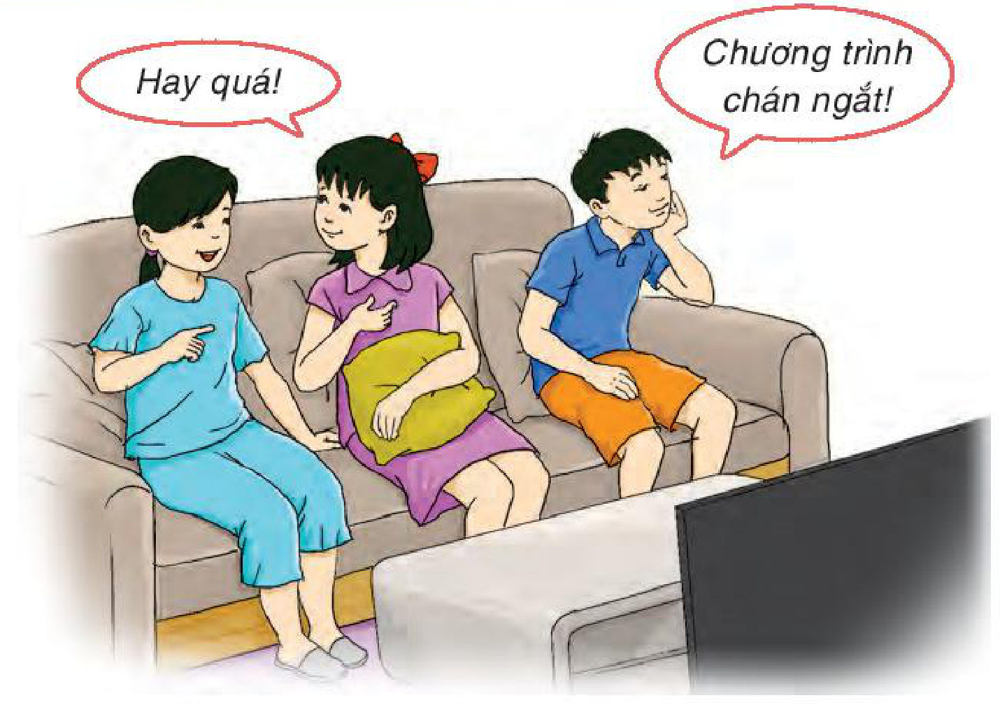
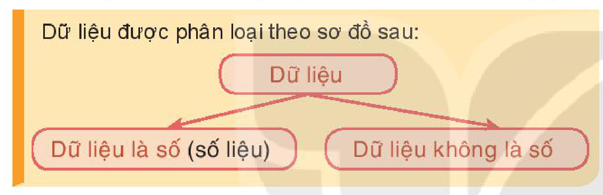
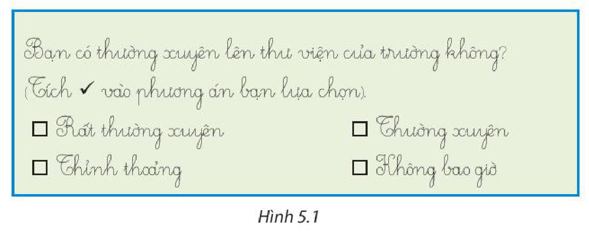
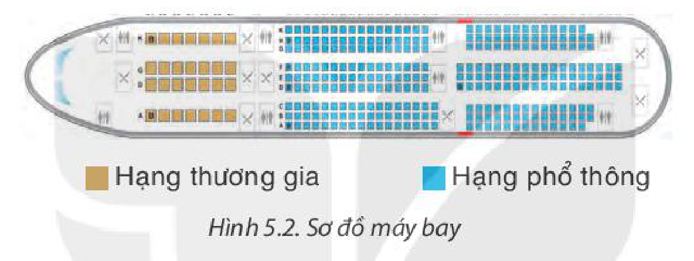
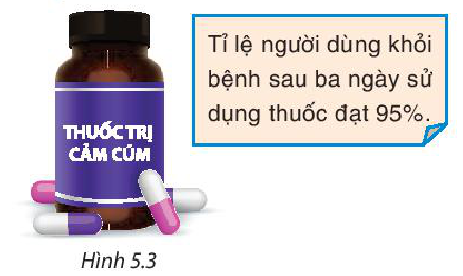

<!-- pdf:89 -->
<!-- Trang mở đầu Chương V (PDF 89): CHƯƠNG V. THU THẬP VÀ BIỂU DIỄN DỮ LIỆU (THỐNG KÊ) — “Không có dữ liệu, chúng ta như người mù và điếc đứng giữa xa lộ”. (Geoffrey Moore) -->

# BÀI 17: THU THẬP VÀ PHÂN LOẠI DỮ LIỆU

## 🔤 Khái niệm, thuật ngữ

- Thu thập dữ liệu
- Tính đại diện của dữ liệu

## 🎯 Kiến thức, kĩ năng

- Thu thập dữ liệu bằng phỏng vấn, bảng hỏi.
- Phân loại dữ liệu.
- Nhận biết tính đại diện của dữ liệu.

## 🔴 Mở đầu

Để nâng cao chất lượng các chương trình truyền hình dành cho thanh thiếu niên, đài truyền hình cần biết đánh giá cũng như sở thích của người xem về các chương trình của đài.

Em có thể giúp đài truyền hình thu thập những thông tin này không?

- *Hay quá!*
- *Chương trình chán ngắt!*
<!-- ocr-ok: đã đối chiếu ảnh trang PDF 89, lời thoại trong bóng thoại của tranh Mở đầu -->

<!-- pdf:90 -->

## 1. THU THẬP VÀ PHÂN LOẠI DỮ LIỆU

<!-- term: Thu thập dữ liệu -->
**HĐ1:** Em hãy giúp đài truyền hình thu thập dữ liệu bằng cách phỏng vấn các bạn trong tổ, sử dụng ba câu hỏi sau:

(1) Trung bình mỗi ngày bạn dành bao nhiêu giờ để xem ti vi?

(2) Các chương trình ti vi bạn xem là gì?

(3) Bạn có cho rằng các chương trình ti vi hiện nay rất hấp dẫn không? Chọn một trong các ý kiến sau:

Rất đồng ý, Đồng ý, Không đồng ý, Rất không đồng ý.

<!-- term: Thu thập dữ liệu -->
**HĐ2:** Lập bảng thống kê cho ba dãy dữ liệu thu được.

**HĐ3:** Trong ba dãy dữ liệu thu được, dãy nào là dãy số liệu? Dãy nào không là dãy số liệu? Dãy nào có thể sắp xếp được theo thứ tự tăng, giảm?

> Dữ liệu được phân loại theo sơ đồ sau:
> - Dữ liệu gồm **dữ liệu là số** (**số liệu**) và **dữ liệu không là số**.
<!-- ocr-ok: đã đối chiếu ảnh trang PDF 90, sơ đồ phân nhánh trong khung cam -->

- **Pi:** Dữ liệu là số còn gọi là **dữ liệu định lượng**. Dữ liệu không là số còn gọi là **dữ liệu định tính**.

**Chú ý.** **Dữ liệu không là số** có thể phân thành hai loại, loại không thể sắp thứ tự (chẳng hạn dữ liệu về tên các tỉnh: Nam Định, Thái Bình,...) và loại có thể sắp thứ tự (chẳng hạn dữ liệu về đánh giá chất lượng dịch vụ khách sạn với các mức Rất tốt, Tốt, Trung bình, Kém).

> ❓ Em hãy lấy một ví dụ về dữ liệu không là số, có thể sắp xếp theo thứ tự.

**Ví dụ 1:** Bình đã phỏng vấn các bạn trong lớp và thu được các dãy dữ liệu sau.

(1) Cân nặng (đơn vị kilôgam) của năm bạn trong lớp:

$43; \quad 41; \quad 48; \quad 45; \quad 52.$

(2) Tên một số tỉnh thuộc đồng bằng sông Hồng:

Nam Định, Thái Bình, Hưng Yên, Bắc Ninh.

(3) Đánh giá của bốn bạn học sinh về chất lượng bài giảng môn Toán:

Tốt, Xuất sắc, Khá Tốt, Trung bình.

Em hãy xác định mỗi dãy dữ liệu đó thuộc loại nào.

**Giải**

- Dãy dữ liệu (1) là dãy số liệu.
- Dãy dữ liệu (2) không phải là dãy số liệu, không thể sắp thứ tự.

<!-- pdf:91 -->

- Dãy dữ liệu (3) không phải là dãy số liệu, có thể sắp xếp theo thứ tự từ mức cao nhất đến mức thấp nhất (*Xuất sắc, Tốt, Khá Tốt, Trung bình*) nên đây là dãy dữ liệu không là số, có thể sắp thứ tự.

**Luyện tập 1:**

a) Em hãy đưa ra một số câu hỏi phỏng vấn để:

(1) Khảo sát ý kiến của các bạn trong lớp về vật nuôi yêu thích;

(2) Khảo sát thời gian (giờ) mà các bạn trong lớp dành cho hoạt động thể thao trong ngày.

b) Với mỗi dãy dữ liệu thu được, em hãy cho biết dữ liệu đó thuộc loại nào.

**Tranh luận**

Một số tuyến xe buýt ở Hà Nội mà bạn An đã đi là: $01; 02; 12; 15$.

- **Tròn:** Đây là dãy số liệu.
- **Vuông:** Đây không phải là dãy số liệu.
- **Pi:** Tuyến số $01$ là tuyến đi từ Gia Lâm đến Yên Nghĩa đấy!
<!-- ocr-ok: đã đối chiếu ảnh trang PDF 91, ba bóng thoại nhân vật đặt ngang nhau -->

Em ủng hộ Vuông hay Tròn?

## 2. TÍNH ĐẠI DIỆN CỦA DỮ LIỆU

**HĐ4:** Vuông và Tròn muốn tìm hiểu về mức độ thường xuyên lên thư viện trường của các bạn học sinh trong trường nên đã lập phiếu như Hình 5.1 để tiến hành khảo sát.

- **Tròn:** Mình chỉ cần phát phiếu khảo sát cho các bạn lên thư viện trường trong một tuần.
- **Vuông:** Không, tớ nghĩ mỗi lớp cần chọn ngẫu nhiên $10$ bạn để phát phiếu khảo sát.
<!-- ocr-ok: đã đối chiếu ảnh trang PDF 91, hai bóng thoại nhân vật đặt ngang nhau -->

Em hãy thảo luận nhóm và cho biết dữ liệu thu được trong mỗi cách làm của Vuông và Tròn có đại diện cho toàn bộ học sinh trong trường không.

*Hình 5.1*

- *Bạn có thường xuyên lên thư viện của trường không? (Tích $\checkmark$ vào phương án bạn lựa chọn)*
  - $\square$ *Rất thường xuyên* $\qquad$ $\square$ *Thường xuyên*
  - $\square$ *Thỉnh thoảng* $\qquad$ $\square$ *Không bao giờ*
<!-- ocr-ok: đã đối chiếu ảnh trang PDF 91, chữ viết tay cách điệu trong Hình 5.1 -->

<!-- pdf:92 -->

**Nhận xét**

Để có thể đưa ra các kết luận hợp lí, dữ liệu thu được phải đảm bảo **tính đại diện** cho toàn bộ đối tượng đang được quan tâm.

Chẳng hạn, khi đối tượng quan tâm là toàn thể học sinh thì không thể chỉ lấy ý kiến các bạn nam hoặc chỉ lấy ý kiến của các bạn trong câu lạc bộ Toán học,... mà phải lấy ý kiến của các học sinh được chọn một cách ngẫu nhiên.

**Ví dụ 2:** Một hãng hàng không muốn khảo sát ý kiến của khách hàng trên một chuyến bay để đánh giá mức độ hài lòng về chất lượng phục vụ trên chuyến bay đó.

a) Em hãy cho biết đối tượng mà hãng hàng không này cần lấy ý kiến.

b) Trong hai cách khảo sát sau, cách nào hợp lí hơn?

*Cách 1.* Lấy ý kiến của $20$ hành khách ở khoang hạng thương gia.

*Cách 2.* Đánh số ngẫu nhiên $100$ hành khách trên chuyến bay và xin ý kiến của những hành khách số $5; 10; 15; 20; \dots; 100$.

*Hình 5.2. Sơ đồ máy bay*

**Giải**

a) Hãng hàng không cần lấy ý kiến của tất cả các hành khách đi trên chuyến bay.

b) Theo cách 1, hành khách hạng phổ thông không được tham gia khảo sát nên dữ liệu thu thập chưa đảm bảo được tính đại diện. Khảo sát theo cách 2 hợp lí hơn.

**Luyện tập 2:** Em hãy cho biết cách khảo sát sau có đảm bảo được tính đại diện không.

Để đánh giá mức độ phù hợp của đề thi thử môn Toán, nhà trường đã cho các bạn trong câu lạc bộ Toán học làm bài và xem xét kết quả.

**Ví dụ 3:** Một công ty dược phẩm đã khảo sát hiệu quả sử dụng của một loại thuốc trị cảm cúm bằng cách cho $100$ người bệnh ở độ tuổi từ $20$ đến $30$ sử dụng loại thuốc này. Kết quả cho thấy có $95$ người đã khỏi bệnh sau ba ngày sử dụng thuốc.

Công ty đưa ra thông tin quảng cáo về sản phẩm như Hình 5.3.

*Hình 5.3*

Theo em, dựa vào khảo sát trên mà đưa ra kết luận như trong quảng cáo thì có hợp lí không? Vì sao?

**Giải.** Kết luận như trong quảng cáo là không hợp lí, vì đối tượng của khảo sát chỉ là những người trong độ tuổi từ $20$ đến $30$, không đảm bảo tính đại diện cho toàn bộ người dùng (ở các độ tuổi khác nhau).

<!-- pdf:93 -->

**Tranh luận**

Làm cách nào để thực hiện khảo sát thời gian sử dụng mạng Internet vào hai ngày cuối tuần của mỗi bạn học sinh trong trường?

- **Vuông:** Tớ sẽ chọn ngẫu nhiên một số bạn và gửi bảng hỏi đến bố mẹ của các bạn đó yêu cầu trả lời và gửi lại phiếu.
- **Tròn:** Còn tớ sẽ gửi phiếu hỏi đến các bạn trong câu lạc bộ Tin học của trường.
<!-- ocr-ok: đã đối chiếu ảnh trang PDF 93, hai bóng thoại nhân vật đặt ngang nhau -->

Theo em, cách làm của bạn nào hợp lí hơn?

## BÀI TẬP

5.1. Với mỗi câu hỏi sau, hãy xác định xem dữ liệu thu được thuộc loại nào.

a) Bạn có cho rằng đọc sách là một thói quen tốt?

A. Rất đồng ý $\qquad$ B. Đồng ý

C. Không đồng ý $\qquad$ D. Rất không đồng ý

b) Ca sĩ Việt Nam nào bạn thích nhất?

5.2. Vuông đưa ra ý kiến về tay thuận của các học sinh trong trường như hình bên. Em hãy đưa ra phương án thu thập dữ liệu phù hợp để giúp Vuông kiểm tra ý kiến của mình nhé!

- **Vuông:** Đa phần học sinh trong trường thuận tay phải.

5.3. Vân muốn kiểm tra nhận định “Các bạn học sinh nam yêu thích các chương trình thể thao hơn các bạn nữ”. Hãy lập bảng hỏi và thu thập dữ liệu để kiểm tra nhận định này.

5.4. Các dữ liệu thu thập được trong mỗi trường hợp sau có đảm bảo tính đại diện không?

a) Trong một khu dân cư có $5\,000$ hộ gia đình. Để xác định trung bình mỗi hộ gia đình có bao nhiêu ti vi, một nhóm nghiên cứu đã thu thập dữ liệu bằng cách đánh số các hộ gia đình từ $1$ đến $5\,000$ và ghi lại số ti vi của những hộ gia đình có số thứ tự là $1; 11; \dots; 4\,991$.

b) Để đánh giá thể lực của học sinh toàn trường, giáo viên thể dục đã cho các bạn trong câu lạc bộ bóng đá của trường chạy cự li $1\,000\text{ m}$ và ghi lại kết quả.

5.5. Bình phỏng vấn $50$ bạn nam trong trường thấy có $30$ bạn thích bóng đá. Bình kết luận rằng “Đa phần các học sinh thích bóng đá”. Kết luận này có hợp lí không?

## 📷 Danh sách hình trong bài

| Mã hình | Trang PDF | Vị trí trong bài | Chú thích gốc |
| --- | :---: | --- | --- |
| H7-toan-b17-01 | 89 | Mở đầu | (sách không đánh số, tranh khán giả nhận xét về chương trình truyền hình) |
| H7-toan-b17-02 | 90 | Mục 1, sau HĐ3 | (sách không đánh số, sơ đồ phân loại dữ liệu) |
| H7-toan-b17-03 | 91 | Mục 2, HĐ4 | Hình 5.1 |
| H7-toan-b17-04 | 92 | Mục 2, Ví dụ 2 | Hình 5.2. Sơ đồ máy bay |
| H7-toan-b17-05 | 92 | Mục 2, Ví dụ 3 | Hình 5.3 |
| H7-toan-b17-06 | 93 | Bài tập 5.2 | (sách không đánh số, ý kiến của Vuông về tay thuận của học sinh) |
