<!-- pdf:94 -->

# BÀI 18: BIỂU ĐỒ HÌNH QUẠT TRÒN

## 🔤 Khái niệm, thuật ngữ

- Biểu đồ hình quạt tròn

## 🎯 Kiến thức, kĩ năng

- Đọc và mô tả dữ liệu từ biểu đồ hình quạt tròn.
- Biểu diễn dữ liệu vào biểu đồ hình quạt tròn (cho sẵn).
- Nhận ra vấn đề hoặc quy luật đơn giản từ việc phân tích biểu đồ hình quạt tròn.

## 🔴 Mở đầu

Để thấy được tỉ lệ gây ra tai nạn thương tích theo các nguyên nhân khác nhau ở Việt Nam, báo cáo tổng hợp về phòng chống tai nạn thương tích ở trẻ em đã sử dụng biểu đồ hình quạt tròn như Hình 5.4.

Chúng ta cùng tìm hiểu về loại biểu đồ này!

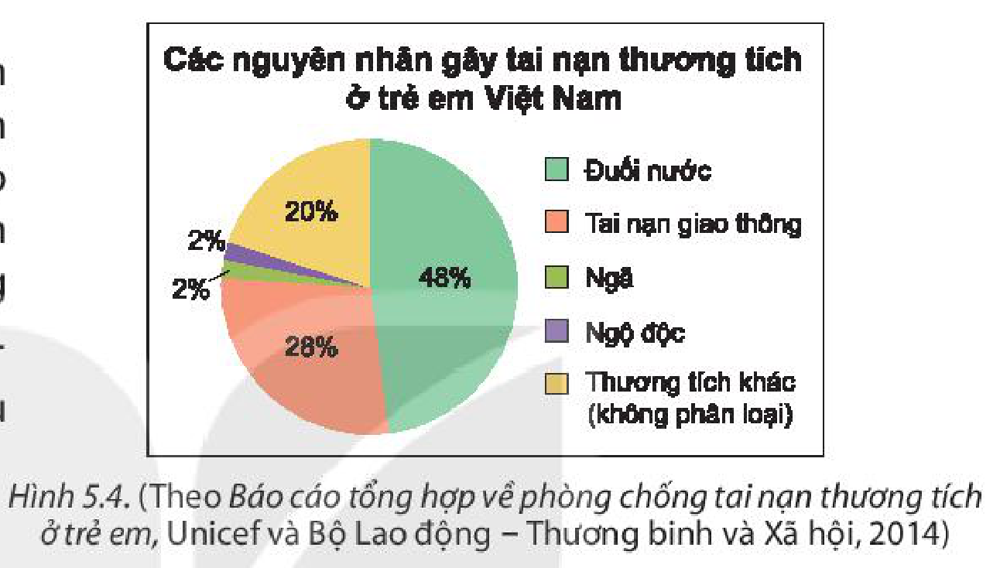
*Hình 5.4. (Theo Báo cáo tổng hợp về phòng chống tai nạn thương tích ở trẻ em, Unicef và Bộ Lao động – Thương binh và Xã hội, 2014)*

## 1. ĐỌC VÀ MÔ TẢ BIỂU ĐỒ HÌNH QUẠT TRÒN

> - **Biểu đồ hình quạt tròn** dùng để so sánh các phần trong toàn bộ dữ liệu.
> - Trong biểu đồ hình quạt tròn, phần chính là hình tròn biểu diễn dữ liệu được chia thành nhiều hình quạt (được tô màu khác nhau). Mỗi hình quạt biểu diễn tỉ lệ của một phần so với toàn bộ dữ liệu. Cả hình tròn biểu diễn toàn bộ dữ liệu, tức là ứng với $100\%$.

<!-- term: Các thành phần của biểu đồ hình quạt tròn -->
Chẳng hạn, các thành phần của biểu đồ hình quạt tròn ở Hình 5.4 được thể hiện như trong Hình 5.5 (gồm tiêu đề, hình tròn biểu diễn dữ liệu và chú giải). Phần hình tròn biểu diễn toàn bộ dữ liệu được chia thành $5$ hình quạt, mỗi hình quạt biểu diễn tỉ lệ tai nạn thương tích do một nguyên nhân gây ra.

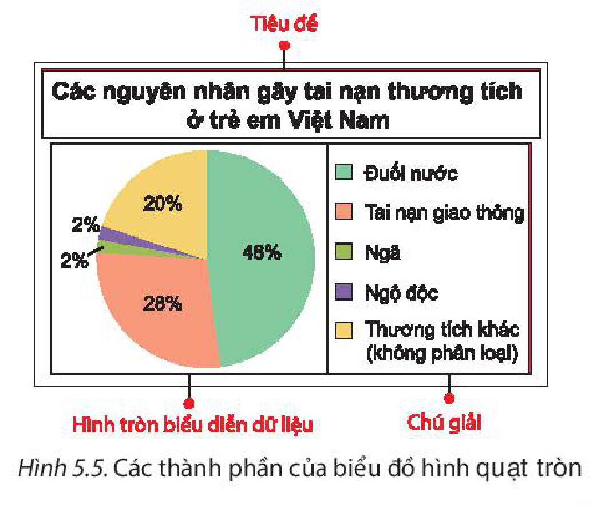
*Hình 5.5. Các thành phần của biểu đồ hình quạt tròn*

<!-- pdf:95 -->

> ❓ Từ biểu đồ Hình 5.4, em hãy lập bảng thống kê tỉ lệ các nguyên nhân gây tai nạn thương tích ở trẻ em Việt Nam.

**HĐ1:** Biểu đồ Hình 5.6 cho biết tỉ lệ thí sinh được trao huy chương các loại trong một cuộc thi. Em hãy cho biết:

a) Hai loại huy chương nào có cùng tỉ lệ thí sinh được trao?

b) Số thí sinh không có huy chương chiếm tỉ lệ bao nhiêu phần trăm? Em có nhận xét gì về phần hình quạt biểu diễn tỉ lệ này?

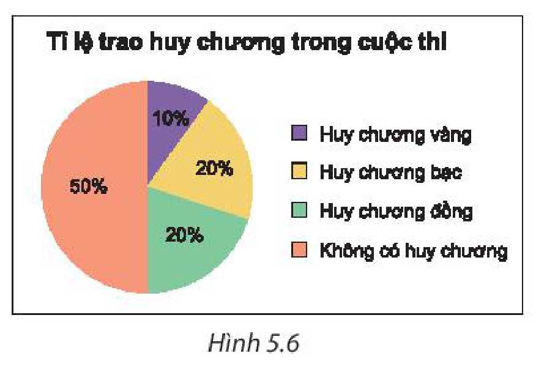
*Hình 5.6*

**Nhận xét**

- Hai hình quạt giống nhau biểu diễn cùng một tỉ lệ.
- Phần hình quạt ứng với một nửa hình tròn biểu diễn tỉ lệ $50\%$.

**Luyện tập 1:** Biểu đồ Hình 5.7 cho biết tỉ lệ các loại kem bán được trong một ngày của một cửa hàng kem.

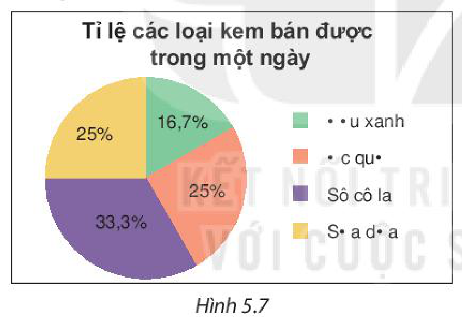
*Hình 5.7*

- **Pi:** Phần hình quạt ứng với $\dfrac{1}{4}$ hình tròn biểu diễn tỉ lệ $25\%$.

a) Em hãy chỉ ra các thành phần của biểu đồ trên.

b) Trong biểu đồ trên, hình tròn được chia thành mấy hình quạt, mỗi hình quạt biểu diễn số liệu nào?

c) Em hãy lập bảng thống kê tỉ lệ các loại kem bán được trong một ngày của cửa hàng.

## 2. BIỂU DIỄN DỮ LIỆU VÀO BIỂU ĐỒ HÌNH QUẠT TRÒN

**Ví dụ 1:** Bảng số liệu sau cho biết tỉ lệ các loại sách ở một thư viện trường học:

| Loại sách | Sách giáo khoa | Sách tham khảo | Sách truyện | Sách khác |
| --- | :---: | :---: | :---: | :---: |
| Tỉ lệ | $40\%$ | $20\%$ | $30\%$ | $10\%$ |

<!-- pdf:96 -->

Hãy hoàn thiện biểu đồ Hình 5.8 vào vở để biểu diễn bảng thống kê này.

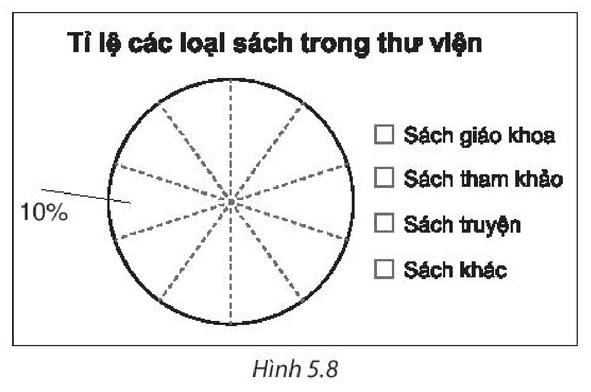
*Hình 5.8*

- **Vuông:** Hình tròn biểu diễn dữ liệu đã được chia sẵn thành các hình quạt, mỗi hình quạt ứng với $10\%$.

**Giải**

Biểu đồ đã hoàn thiện có dạng sau (H.5.9).

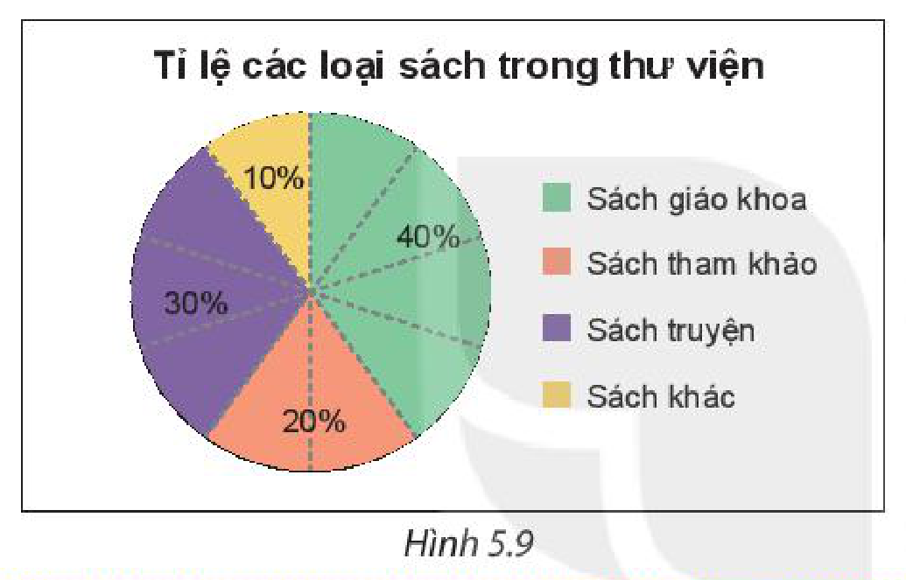
*Hình 5.9*

- **Tròn:** Sách giáo khoa chiếm $40\%$ nên tớ tô màu bốn hình quạt chia sẵn để biểu diễn số liệu này.

**Luyện tập 2:** Bảng sau cho biết tỉ lệ các bạn trong trường dự đoán đội vô địch giải bóng đá học sinh khối 7.

| Đội tuyển lớp | 7A | 7B | 7C | 7D |
| --- | :---: | :---: | :---: | :---: |
| Tỉ lệ dự đoán | $15\%$ | $30\%$ | $20\%$ | $35\%$ |
<!-- ocr-ok: đã đối chiếu ảnh trang PDF 96, bảng thống kê ngang 5 cột -->

Hãy hoàn thiện biểu đồ Hình 5.10 vào vở để biểu diễn bảng thống kê này.

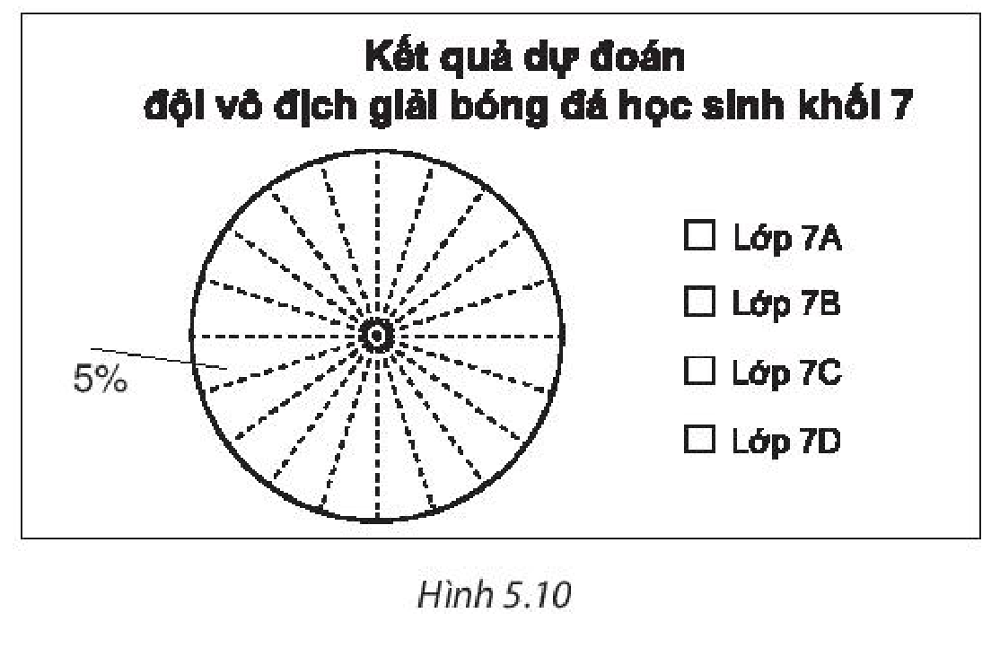
*Hình 5.10*

- **Tròn:** Hình tròn biểu diễn dữ liệu đã được chia sẵn thành các hình quạt, mỗi hình quạt ứng với $5\%$.

<!-- pdf:97 -->

**Ví dụ 2:** Sau một năm thực hiện đề án phổ cập bơi, người ta tiến hành thu thập dữ liệu về kĩ năng bơi của học sinh tiểu học ở một huyện, được kết quả như sau:

| Tình trạng | Bơi thành thạo | Biết bơi nhưng chưa thành thạo | Chưa biết bơi |
| --- | :---: | :---: | :---: |
| Số học sinh | $250$ | $175$ | $75$ |

a) Tính tỉ lệ số học sinh mỗi loại trên tổng số học sinh tham gia khảo sát.

b) Hãy hoàn thiện biểu đồ hình quạt tròn sau vào vở để biểu diễn bảng thống kê này.

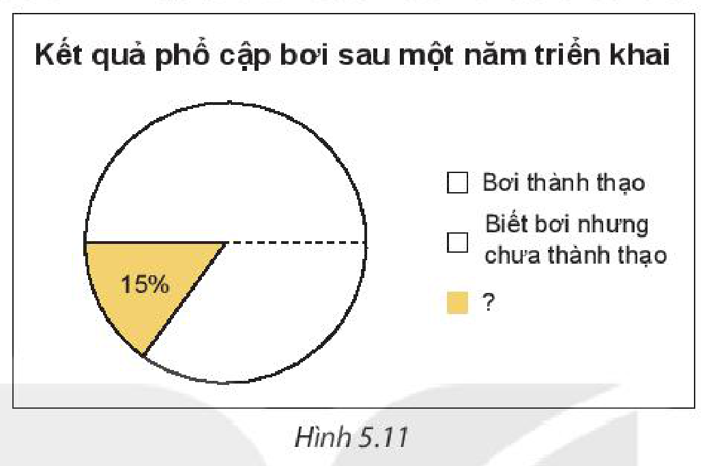
*Hình 5.11*

**Giải**

a) Tổng số học sinh tham gia khảo sát là: $250 + 175 + 75 = 500$ (học sinh).

Tỉ lệ số học sinh bơi thành thạo, biết bơi nhưng chưa thành thạo và chưa biết bơi trên tổng số học sinh tương ứng là: $\dfrac{250}{500} = 50\%$; $\dfrac{175}{500} = 35\%$; $\dfrac{75}{500} = 15\%$.

b) Biểu đồ đã hoàn thiện có dạng sau:

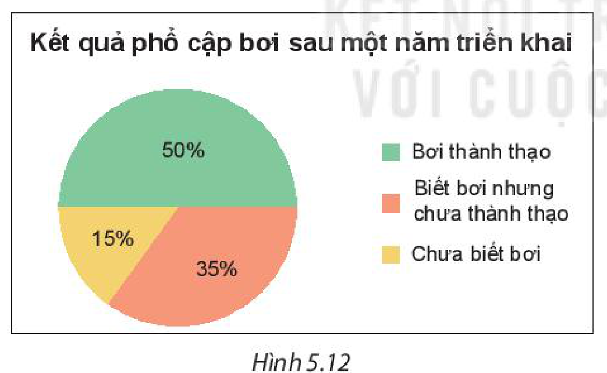
*Hình 5.12*

- **Vuông:** Hình quạt nào lớn hơn biểu diễn số liệu lớn hơn.

**Luyện tập 3:** Bảng số liệu sau cho biết tỉ lệ áo đồng phục theo kích cỡ của các bạn học sinh lớp 7A.

| Cỡ áo | S | M | L | XL |
| --- | :---: | :---: | :---: | :---: |
| Tỉ lệ | $15\%$ | $50\%$ | $30\%$ | $5\%$ |

Hãy hoàn thiện biểu đồ Hình 5.13 vào vở để biểu diễn bảng thống kê này.

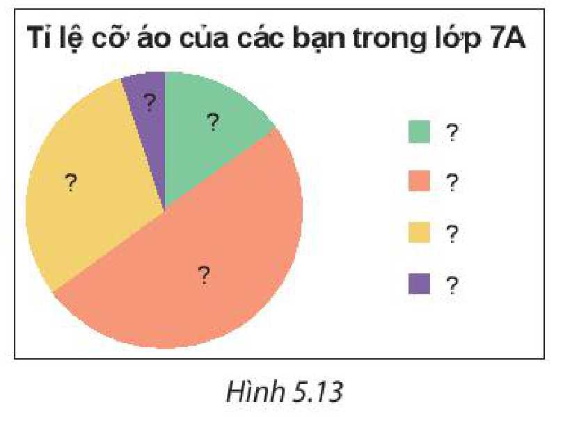
*Hình 5.13*

<!-- pdf:98 -->

## 3. PHÂN TÍCH DỮ LIỆU TRONG BIỂU ĐỒ HÌNH QUẠT TRÒN

**Ví dụ 3:** Cho biểu đồ Hình 5.14.
<!-- ocr-ok: đã đối chiếu ảnh trang PDF 98, nhãn Ví dụ 3 in chữ trắng trên nền tím -->

a) Em hãy lập bảng thống kê về mức độ ảnh hưởng (đơn vị $\%$) của các yếu tố đến chiều cao của trẻ.

b) Ngoài yếu tố di truyền, ba yếu tố ảnh hưởng nhiều nhất đến chiều cao là gì? Ba yếu tố đó chiếm tổng cộng bao nhiêu phần trăm?

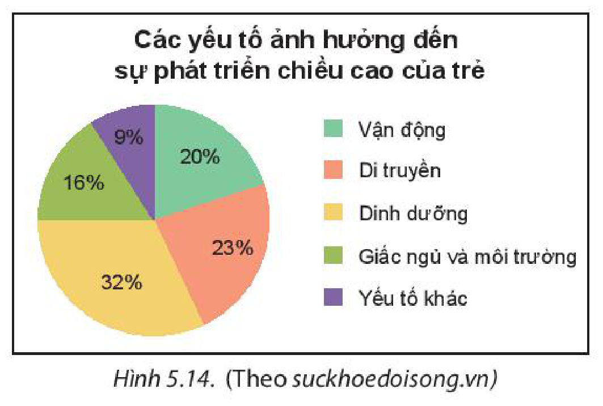
*Hình 5.14. (Theo suckhoedoisong.vn)*

**Giải**

a) Bảng thống kê:

| Yếu tố | Vận động | Di truyền | Dinh dưỡng | Giấc ngủ và môi trường | Yếu tố khác |
| --- | :---: | :---: | :---: | :---: | :---: |
| Mức độ ảnh hưởng ($\%$) | $20$ | $23$ | $32$ | $16$ | $9$ |
<!-- ocr-ok: đã đối chiếu ảnh trang PDF 98, bảng thống kê ngang 6 cột -->

b) Ngoài yếu tố di truyền, ba yếu tố ảnh hưởng nhiều nhất đến chiều cao là:

Dinh dưỡng: $32\%$; vận động: $20\%$; giấc ngủ và môi trường: $16\%$.

Tổng mức độ ảnh hưởng của ba yếu tố này là: $32\% + 20\% + 16\% = 68\%$.

**Luyện tập 4:** Cho biểu đồ Hình 5.15.

a) Hãy liệt kê ba nguồn điện chủ yếu của Việt Nam năm 2019.

b) Biết sản lượng điện của Việt Nam năm 2019 là $240,1 \cdot 10^9\text{ kWh}$. Em hãy cho biết trong năm này Việt Nam đã nhập khẩu bao nhiêu $\text{kWh}$ điện.

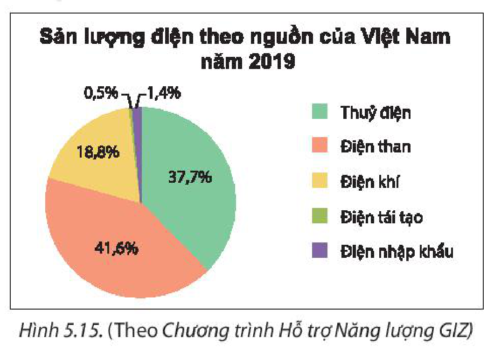
*Hình 5.15. (Theo Chương trình Hỗ trợ Năng lượng GIZ)*

<!-- pdf:99 -->

**Ví dụ 4:** *Ứng dụng để dự đoán*
<!-- ocr-ok: đã đối chiếu ảnh trang PDF 99, nhãn Ví dụ 4 in chữ trắng trên nền tím -->

Biểu đồ Hình 5.16 cho biết các hoạt động của học sinh khối 7 tại một trường trung học trong thời gian rảnh rỗi.

Hãy dự đoán trong $200$ học sinh khối 7 của trường đó có khoảng bao nhiêu bạn thích chơi thể thao trong thời gian rảnh rỗi.

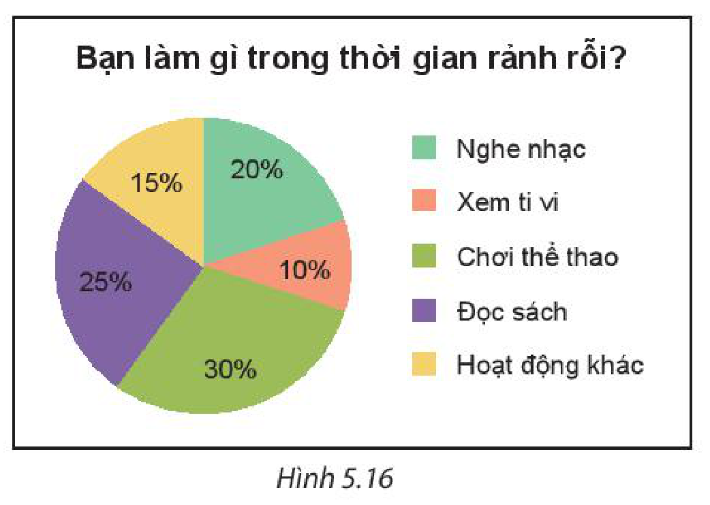
*Hình 5.16*

**Giải**

Số học sinh khối 7 của trường thích chơi thể thao trong thời gian rảnh rỗi là khoảng:

$200 \cdot 30\% = 200 \cdot \dfrac{30}{100} = 60\text{ (học sinh)}.$

**Luyện tập 5:** Dựa vào biểu đồ Hình 5.16, em hãy cho biết trong $200$ học sinh khối 7 của trường đó có khoảng bao nhiêu bạn thích đọc sách hoặc nghe nhạc trong thời gian rảnh rỗi.

**Tranh luận**

Cho biểu đồ Hình 5.17.

- **Tròn:** Như vậy, nếu một trường trung học có $1\,000$ học sinh thì chắc chắn có $328$ học sinh bị cận thị.
- **Vuông:** Tớ nghĩ đây chỉ là con số ước lượng thôi.

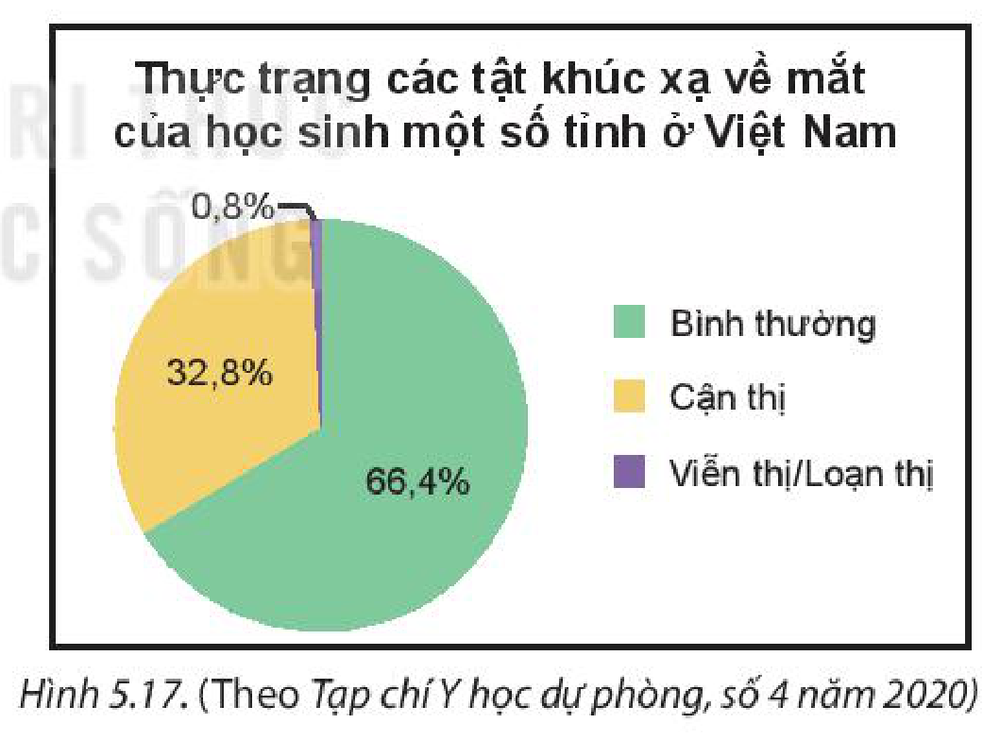
*Hình 5.17. (Theo Tạp chí Y học dự phòng, số 4 năm 2020)*

Em đồng ý với ý kiến nào trong hai ý kiến trên?

<!-- pdf:100 -->

## BÀI TẬP

5.6. Cho biểu đồ Hình 5.18.

a) Cho biết các thành phần của biểu đồ này.

b) Hình tròn trong biểu đồ được chia thành mấy hình quạt? Mỗi hình quạt biểu diễn số liệu nào?

c) Châu lục nào có số dân đông nhất? Ít nhất?

d) Biết rằng năm 2020 tổng số dân của $5$ châu lục là $7\,773$ triệu người. Tính số dân của mỗi châu lục.

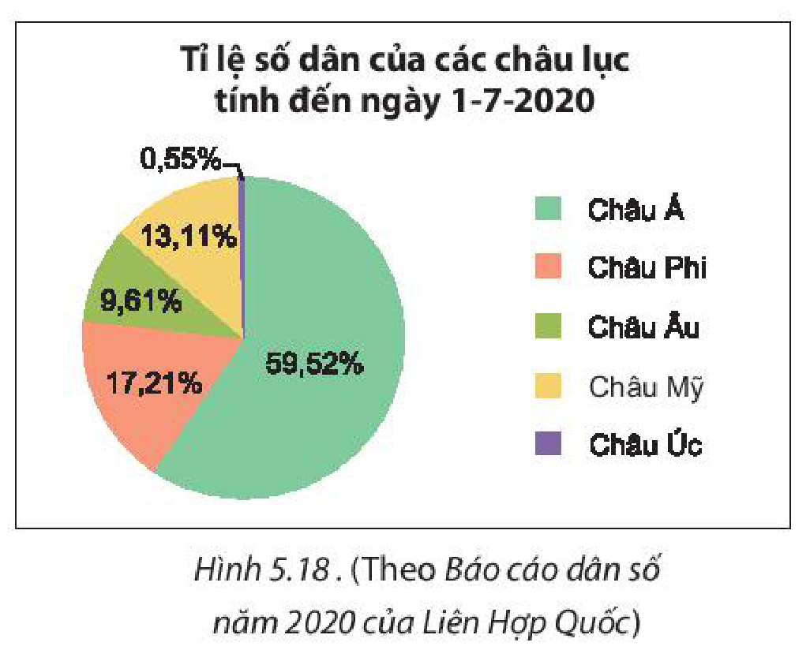
*Hình 5.18. (Theo Báo cáo dân số năm 2020 của Liên Hợp Quốc)*

5.7. An khảo sát về thú nuôi được yêu thích của các bạn trong lớp và thu được kết quả như bảng sau:

| Vật nuôi | Chó | Mèo | Chim | Cá |
| --- | :---: | :---: | :---: | :---: |
| Số bạn yêu thích | $10$ | $20$ | $7$ | $3$ |

Hãy hoàn thiện biểu đồ Hình 5.19 vào vở để biểu diễn bảng thống kê trên.

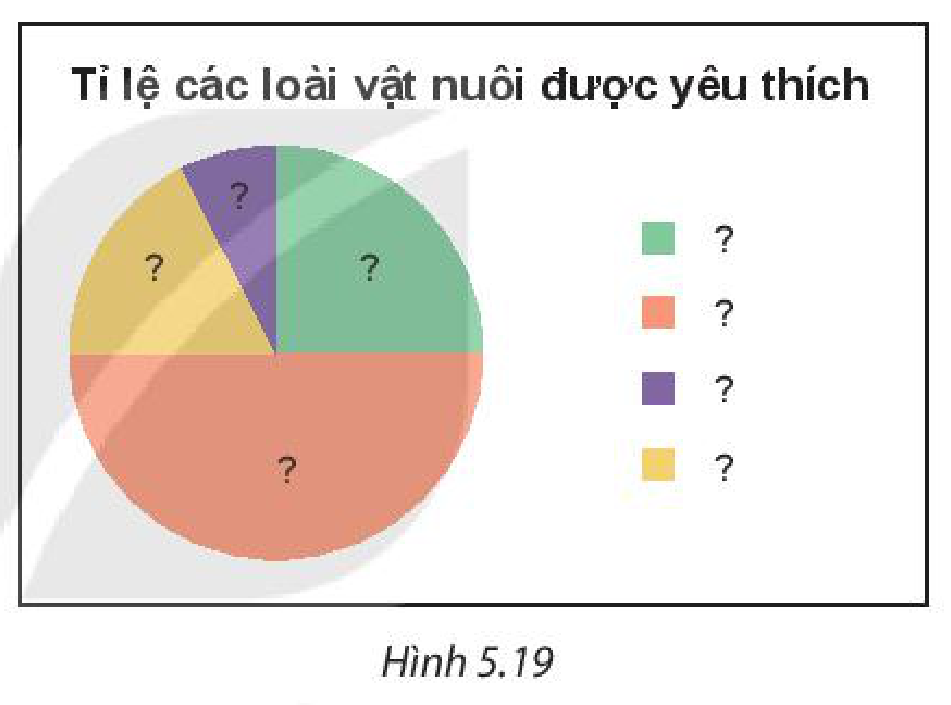
*Hình 5.19*

5.8. Biểu đồ Hình 5.20 cho biết tỉ lệ thành viên theo nhóm máu của một đội hiến máu gồm $200$ tình nguyện viên. Hỏi:

a) Có bao nhiêu người mang nhóm máu A, bao nhiêu người mang nhóm máu B?

b) Có bao nhiêu người mang nhóm máu A hoặc O?

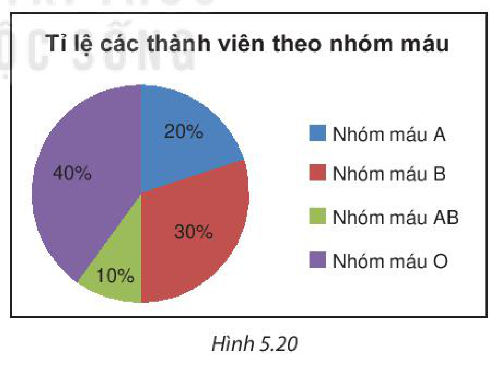
*Hình 5.20*

5.9. Từ kết quả thu thập dữ liệu về kĩ năng bơi của học sinh tiểu học (H.5.12), em hãy ước lượng xem trong $800$ học sinh tiểu học của một xã trong huyện đó, có bao nhiêu học sinh bơi thành thạo, bao nhiêu học sinh chưa biết bơi.

## 📷 Danh sách hình trong bài

| Mã hình | Trang PDF | Vị trí trong bài | Chú thích gốc |
| --- | :---: | --- | --- |
| H7-toan-b18-01 | 94 | Mở đầu (allow_edge_ink: cạnh trái chạm mép phải đoạn văn Mở đầu do dòng chú thích Hình 5.4 trải sang trái tới x=244) | Hình 5.4. (Theo Báo cáo tổng hợp về phòng chống tai nạn thương tích ở trẻ em, Unicef và Bộ Lao động – Thương binh và Xã hội, 2014) |
| H7-toan-b18-02 | 94 | Mục 1 | Hình 5.5. Các thành phần của biểu đồ hình quạt tròn |
| H7-toan-b18-03 | 95 | Mục 1, HĐ1 | Hình 5.6 |
| H7-toan-b18-04 | 95 | Mục 1, Luyện tập 1 | Hình 5.7 |
| H7-toan-b18-05 | 96 | Mục 2, Ví dụ 1 | Hình 5.8 |
| H7-toan-b18-06 | 96 | Mục 2, Ví dụ 1 (Giải) | Hình 5.9 |
| H7-toan-b18-07 | 96 | Mục 2, Luyện tập 2 | Hình 5.10 |
| H7-toan-b18-08 | 97 | Mục 2, Ví dụ 2 | Hình 5.11 |
| H7-toan-b18-09 | 97 | Mục 2, Ví dụ 2 (Giải) | Hình 5.12 |
| H7-toan-b18-10 | 97 | Mục 2, Luyện tập 3 | Hình 5.13 |
| H7-toan-b18-11 | 98 | Mục 3, Ví dụ 3 | Hình 5.14. (Theo suckhoedoisong.vn) |
| H7-toan-b18-12 | 98 | Mục 3, Luyện tập 4 | Hình 5.15. (Theo Chương trình Hỗ trợ Năng lượng GIZ) |
| H7-toan-b18-13 | 99 | Mục 3, Ví dụ 4 | Hình 5.16 |
| H7-toan-b18-14 | 99 | Mục 3, Tranh luận | Hình 5.17. (Theo Tạp chí Y học dự phòng, số 4 năm 2020) |
| H7-toan-b18-15 | 100 | Bài tập 5.6 | Hình 5.18. (Theo Báo cáo dân số năm 2020 của Liên Hợp Quốc) |
| H7-toan-b18-16 | 100 | Bài tập 5.7 | Hình 5.19 |
| H7-toan-b18-17 | 100 | Bài tập 5.8 | Hình 5.20 |
