<!-- pdf:101 -->

# BÀI 19: BIỂU ĐỒ ĐOẠN THẲNG

## 🔤 Khái niệm, thuật ngữ

- Biểu đồ đoạn thẳng

## 🎯 Kiến thức, kĩ năng

- Đọc và mô tả dữ liệu từ biểu đồ đoạn thẳng.
- Vẽ biểu đồ đoạn thẳng.
- Nhận ra vấn đề hoặc quy luật đơn giản từ việc phân tích biểu đồ đoạn thẳng.

## 🔴 Mở đầu

Sự thay đổi dân số Việt Nam theo thời gian từ năm 1979 đến 2019, được biểu diễn bằng biểu đồ đoạn thẳng như Hình 5.21.

Qua biểu đồ đoạn thẳng, ta có thể thu nhận được những thông tin gì? Cách vẽ biểu đồ đó như thế nào?

Chúng ta cùng tìm hiểu loại biểu đồ này!

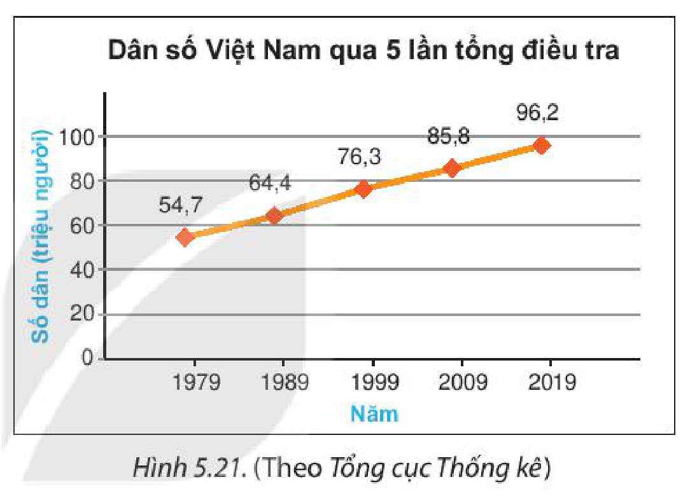
*Hình 5.21. (Theo Tổng cục Thống kê)*

## 1. GIỚI THIỆU BIỂU ĐỒ ĐOẠN THẲNG

> **Biểu đồ đoạn thẳng** thường được dùng để biểu diễn sự thay đổi của một đại lượng theo thời gian. Các thành phần của biểu đồ đoạn thẳng gồm:
> - Trục ngang biểu diễn thời gian;
> - Trục đứng biểu diễn đại lượng ta đang quan tâm;
> - Mỗi điểm biểu diễn giá trị của đại lượng tại một thời điểm. Hai điểm liên tiếp được nối với nhau bằng một đoạn thẳng.
> - Tiêu đề của biểu đồ thường ở dòng trên cùng.

- **Pi:** Có thể dùng biểu tượng khác như dấu chấm tròn, dấu nhân,... để biểu diễn các điểm.

Chẳng hạn, các thành phần của biểu đồ đoạn thẳng Hình 5.21 được biểu diễn như Hình 5.22.

<!-- pdf:102 -->

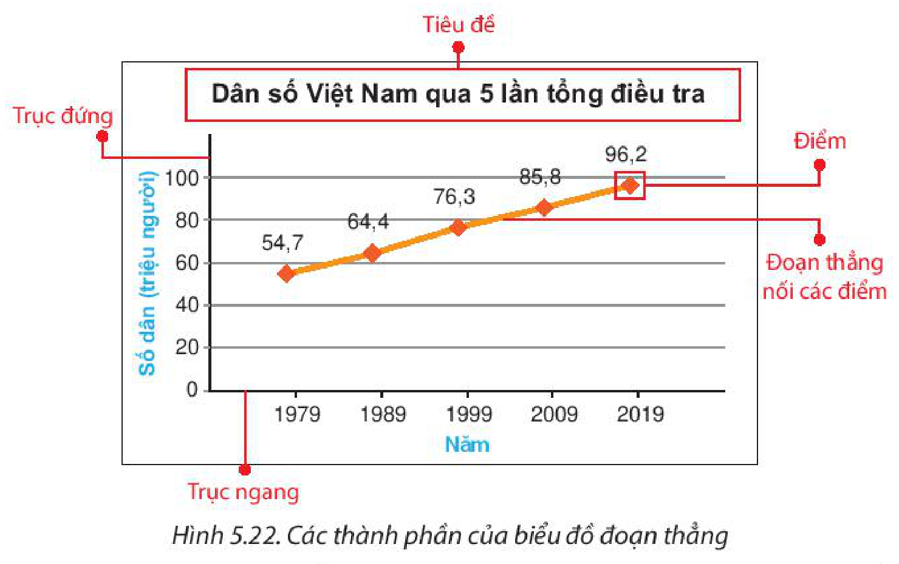
*Hình 5.22. Các thành phần của biểu đồ đoạn thẳng*

Trong biểu đồ trên, trục ngang biểu diễn thời gian (năm), trục đứng biểu diễn số dân (đơn vị triệu người), mỗi điểm biểu diễn số dân của Việt Nam tại năm tương ứng.

**Luyện tập 1:** Biểu đồ Hình 5.23 cho biết thứ hạng của bóng đá nam Việt Nam trên bảng xếp hạng của Liên đoàn Bóng đá thế giới (FIFA) trong các năm từ 2016 đến 2020.

a) Xác định tên biểu đồ, các trục, đơn vị trên các trục.

b) Em hãy cho biết mỗi điểm trên biểu đồ biểu diễn thông tin gì.

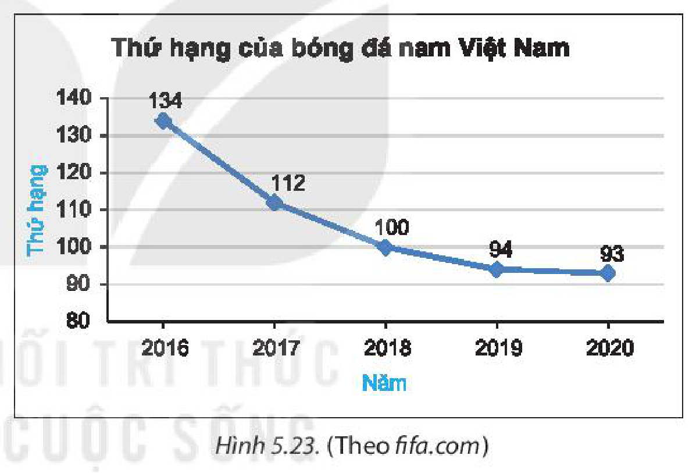
*Hình 5.23. (Theo fifa.com)*

## 2. ĐỌC VÀ PHÂN TÍCH DỮ LIỆU TRONG BIỂU ĐỒ ĐOẠN THẲNG

Quan sát biểu đồ (H.5.21)

**HĐ1:** Em hãy thống kê số dân của Việt Nam từ năm 1979 đến năm 2019 bằng cách hoàn thành bảng sau:

| Năm | 1979 | 1989 | 1999 | 2009 | 2019 |
| --- | :---: | :---: | :---: | :---: | :---: |
| Số dân (triệu người) | $54,7$ | $?$ | $76,3$ | $?$ | $?$ |

**HĐ2:** Số dân của Việt Nam tăng hay giảm qua các năm từ 1979 đến 2019?

**Nhận xét.** Biểu đồ đoạn thẳng giúp ta dễ dàng nhận ra xu thế của đại lượng ta đang quan tâm theo thời gian.

<!-- pdf:103 -->

**Ví dụ 1:** Cho biểu đồ đoạn thẳng biểu diễn chiều cao của một cây đậu trong $5$ ngày (H.5.24).

a) Từ biểu đồ, em hãy lập bảng thống kê về chiều cao của cây đậu qua từng ngày;

b) Theo em, ngày nào chiều cao của cây đậu tăng nhiều nhất so với các ngày còn lại?

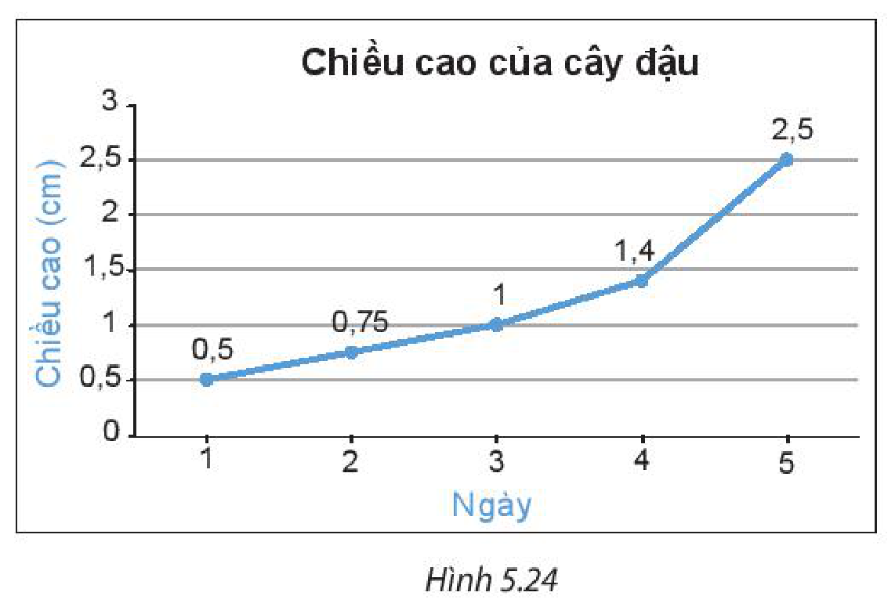
*Hình 5.24*

**Giải**

a) Bảng thống kê chiều cao của cây đậu:

| Ngày | $1$ | $2$ | $3$ | $4$ | $5$ |
| --- | :---: | :---: | :---: | :---: | :---: |
| Chiều cao (cm) | $0,5$ | $0,75$ | $1$ | $1,4$ | $2,5$ |

*Bảng 5.1*

<!-- term: Độ dốc của biểu đồ đoạn thẳng -->
- **Pi:** Độ dốc của biểu đồ đoạn thẳng cho biết tốc độ tăng của đại lượng được biểu diễn trong biểu đồ.

b) Ngày $5$ chiều cao của cây đậu tăng nhiều nhất và tăng: $2,5 - 1,4 = 1,1\text{ (cm)}$.

**Luyện tập 2:** Biểu đồ Hình 5.25 cho biết số lượt khách quốc tế đến Việt Nam trong những năm gần đây.

a) Năm 2018 có bao nhiêu lượt khách quốc tế đến Việt Nam?

b) Từ năm 2015 đến năm 2019, số lượt khách quốc tế đến Việt Nam có xu hướng tăng hay giảm?

c) Em có biết vì sao số lượt khách quốc tế đến Việt Nam trong năm 2020 lại giảm mạnh không?

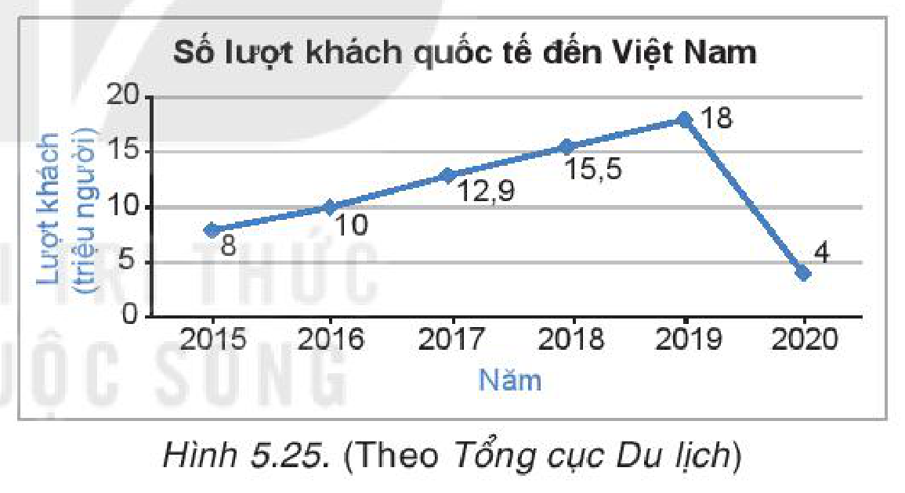
*Hình 5.25. (Theo Tổng cục Du lịch)*

**Ví dụ 2:** Cho biểu đồ đoạn thẳng (H.5.26).

a) Biểu đồ này cho ta biết thông tin gì?

b) Trong tháng Sáu, cửa hàng bán được loại máy tính nào nhiều hơn?

c) Phân tích xu thế về số lượng máy tính mỗi loại mà cửa hàng bán được. Thời gian tiếp theo cửa hàng nên nhập nhiều loại máy tính nào?

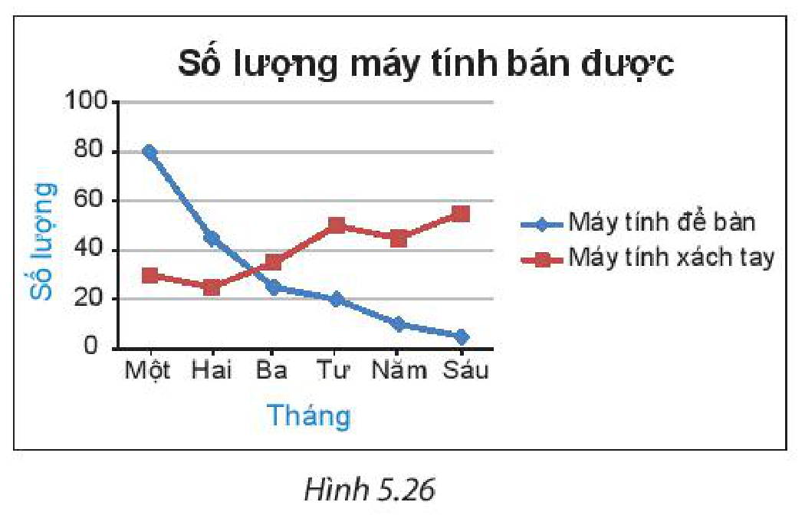
*Hình 5.26*

<!-- pdf:104 -->

**Giải**

a) Biểu đồ cho biết số lượng máy tính để bàn và máy tính xách tay một cửa hàng bán được trong $6$ tháng đầu năm.

b) Trong tháng Sáu, cửa hàng bán được nhiều máy tính xách tay hơn.

c) Trong hai tháng đầu, số lượng máy tính để bàn bán được nhiều hơn. Bốn tháng sau, số lượng máy tính để bàn bán được ngày càng giảm, trong khi số lượng máy tính xách tay bán được có xu hướng tăng. Vì thế, thời gian tới cửa hàng nên nhập nhiều máy tính xách tay.

**Chú ý.** Đôi khi người ta biểu diễn nhiều bộ số liệu trên cùng một biểu đồ để dễ so sánh (mỗi đường có chú giải ứng với một bộ số liệu) (H.5.26).

**Luyện tập 3:** Biểu đồ Hình 5.27 cho biết tỉ lệ học sinh biết bơi của hai tỉnh A, B trong các năm từ 2016 đến 2020.

Em có nhận xét gì về tỉ lệ học sinh biết bơi của hai tỉnh A và B từ năm 2016 đến 2020?

Trong giai đoạn này, tỉnh nào có tỉ lệ học sinh biết bơi tăng nhanh hơn?

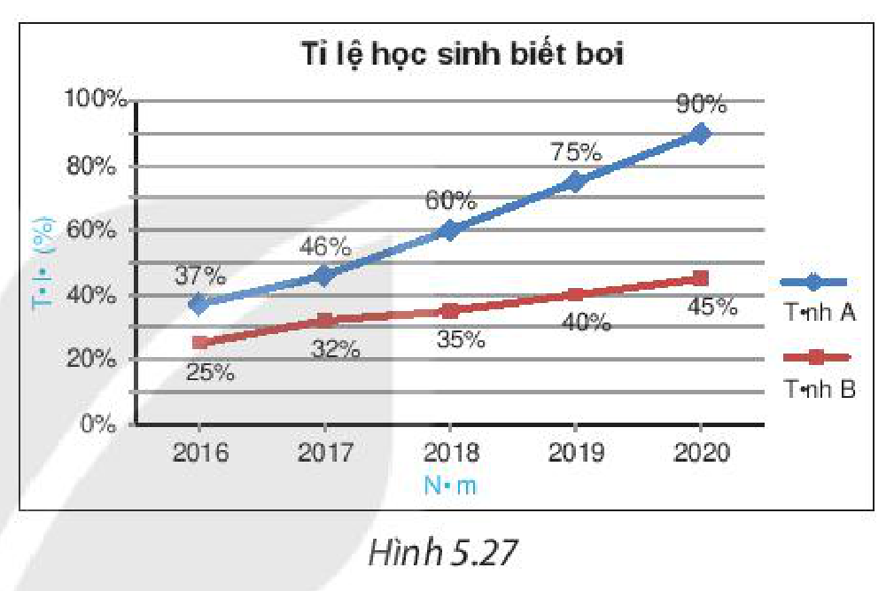
*Hình 5.27*

## 3. VẼ BIỂU ĐỒ ĐOẠN THẲNG

<!-- term: Các bước vẽ biểu đồ đoạn thẳng -->
**Thực hành:** Để vẽ biểu đồ đoạn thẳng biểu diễn số liệu về chiều cao cây đậu trong Bảng 5.1, ta thực hiện theo các bước sau:

<!-- term: Các bước vẽ biểu đồ đoạn thẳng -->
*Bước 1.* Vẽ trục ngang biểu diễn ngày, trục đứng biểu diễn chiều cao cây đậu. Do chiều cao lớn nhất là $2,5\text{ cm}$ và thấp nhất là $0,5\text{ cm}$ nên ở trục đứng ta chọn đơn vị là $0,5$ và giá trị lớn nhất là $3$ (H.5.28).

<!-- term: Các bước vẽ biểu đồ đoạn thẳng -->
*Bước 2.* Với mỗi ngày trên trục ngang, chiều cao của cây đậu tại ngày đó được biểu diễn bởi một điểm (H.5.29).

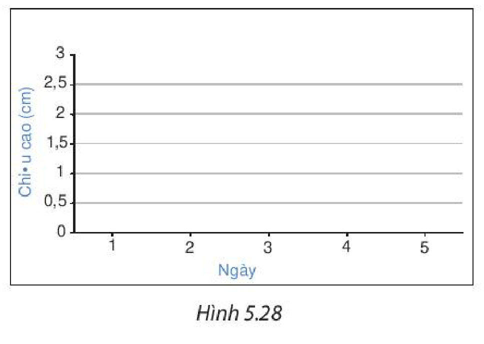
*Hình 5.28*

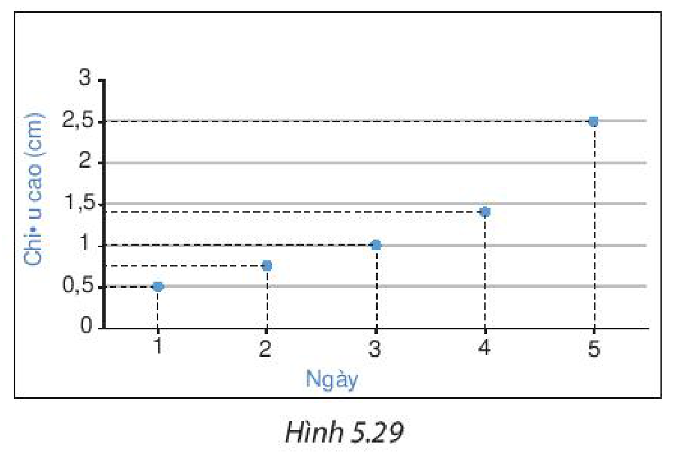
*Hình 5.29*

<!-- pdf:105 -->

<!-- term: Các bước vẽ biểu đồ đoạn thẳng -->
*Bước 3.* Nối các điểm liên tiếp với nhau bằng các đoạn thẳng (H.5.30).

<!-- term: Các bước vẽ biểu đồ đoạn thẳng -->
*Bước 4.* Ghi chú thích cho các trục, điền giá trị tại các điểm (nếu cần) và đặt tên cho biểu đồ để hoàn thiện biểu đồ (H.5.24).

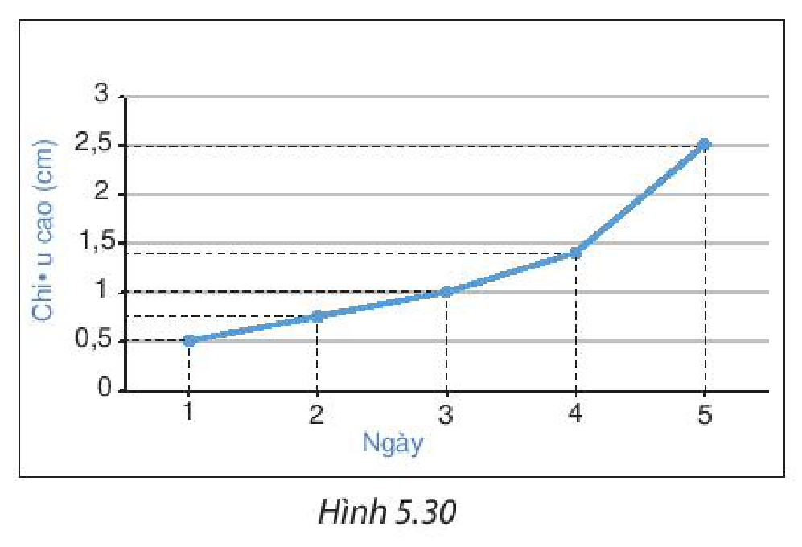
*Hình 5.30*

**Luyện tập 4:** Bảng thống kê sau đây cho biết thành tích của một vận động viên chạy cự li $1\,500\text{ m}$ trong thời gian luyện tập từ tuần $1$ đến tuần $7$.

| Tuần | $1$ | $2$ | $3$ | $4$ | $5$ | $6$ | $7$ |
| --- | :---: | :---: | :---: | :---: | :---: | :---: | :---: |
| Thành tích (phút) | $8$ | $8$ | $8$ | $7$ | $6,5$ | $6,5$ | $6$ |

Hãy vẽ biểu đồ đoạn thẳng biểu diễn bảng số liệu trên.

- **Pi:** Em có thể sử dụng phần mềm Excel để vẽ biểu đồ đoạn thẳng.

**Thử thách nhỏ**

Cho hai biểu đồ biểu diễn tuổi thọ trung bình của người Việt Nam qua các năm (H.5.31).

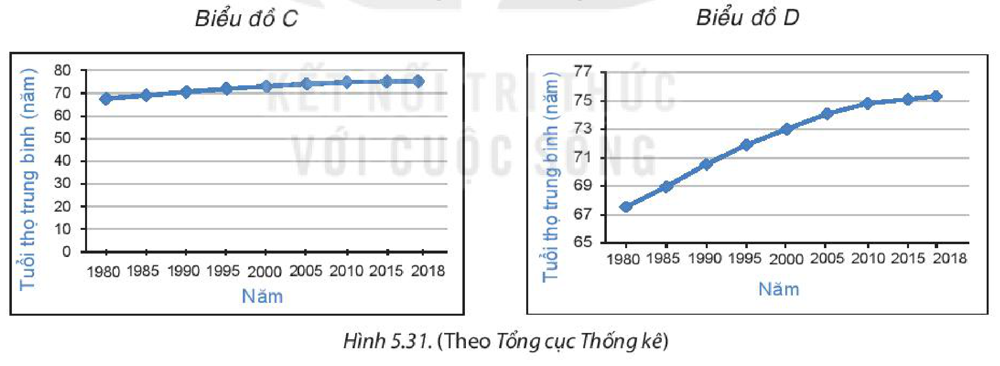
*Biểu đồ C — Biểu đồ D — Hình 5.31. (Theo Tổng cục Thống kê)*

Theo em, để thấy rõ hơn tuổi thọ trung bình của người Việt Nam ngày càng tăng, ta nên dùng biểu đồ nào?

<!-- term: Độ dốc của biểu đồ đoạn thẳng -->
**Nhận xét.** Độ dốc của biểu đồ phụ thuộc vào việc chọn đơn vị của trục đứng. Khi số liệu lớn trong khi đơn vị độ dài của trục đứng nhỏ thì ta không nên vẽ trục đứng bắt đầu từ $0$.

<!-- pdf:106 -->

## BÀI TẬP

5.10. Biểu đồ Hình 5.32 cho biết kỉ lục thế giới về thời gian chạy cự li $100\text{ m}$ trong các năm từ 1912 đến 2009.

a) Kỉ lục thế giới về chạy cự li $100\text{ m}$ đạt được ở năm 1991 là bao nhiêu giây?

b) Từ năm 1912 đến 2009, kỉ lục thế giới về chạy cự li $100\text{ m}$ đã giảm được bao nhiêu giây?

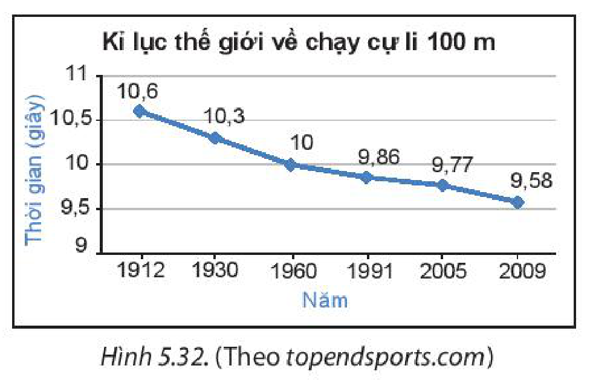
*Hình 5.32. (Theo topendsports.com)*

5.11. Biểu đồ Hình 5.33 cho biết số dân của ba châu lục gồm châu Phi, châu Mỹ và châu Âu trong một số năm.

a) Cho biết xu hướng tăng, giảm về số dân của mỗi châu lục theo thời gian.

b) Trong ba châu lục trên, châu lục nào có số dân cao nhất, thấp nhất trong các năm từ 1950 đến 1980?

c) Từ năm 1950 đến 1980, số dân của châu lục nào tăng chậm nhất?

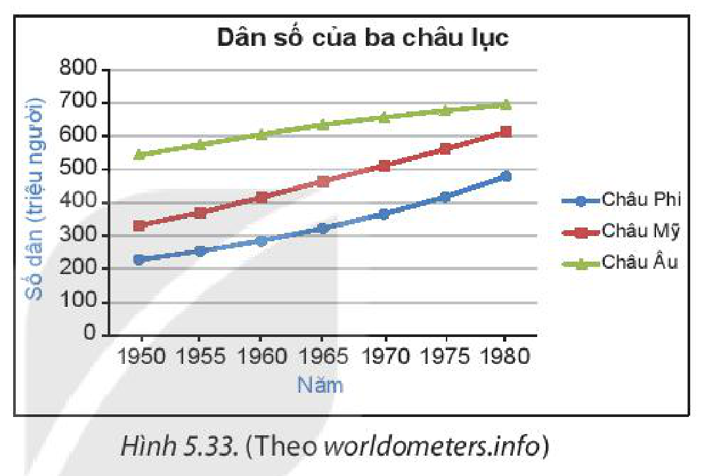
*Hình 5.33. (Theo worldometers.info)*

5.12. Bảng sau cho biết nhiệt độ tại thủ đô Hà Nội vào một ngày mùa thu.

| Thời điểm (giờ) | $8$ | $10$ | $12$ | $14$ | $16$ | $18$ | $20$ |
| --- | :---: | :---: | :---: | :---: | :---: | :---: | :---: |
| Nhiệt độ ($^\circ\text{C}$) | $23$ | $25$ | $34$ | $32$ | $26$ | $22$ | $18$ |

Vẽ biểu đồ đoạn thẳng biểu diễn bảng thống kê trên.

5.13. Số trận thắng của một đội bóng trong $8$ năm từ năm 2013 đến 2020 được cho như sau:

$36 \quad 42 \quad 15 \quad 23 \quad 25 \quad 35 \quad 32 \quad 20.$

a) Hãy vẽ biểu đồ đoạn thẳng biểu diễn dãy số liệu trên.

b) Cho biết số trận thắng của đội bóng này trong các năm có xu hướng tăng hay giảm.

## 📷 Danh sách hình trong bài

| Mã hình | Trang PDF | Vị trí trong bài | Chú thích gốc |
| --- | :---: | --- | --- |
| H7-toan-b19-01 | 101 | Mở đầu | Hình 5.21. (Theo Tổng cục Thống kê) |
| H7-toan-b19-02 | 102 | Mục 1 | Hình 5.22. Các thành phần của biểu đồ đoạn thẳng |
| H7-toan-b19-03 | 102 | Mục 1, Luyện tập 1 | Hình 5.23. (Theo fifa.com) |
| H7-toan-b19-04 | 103 | Mục 2, Ví dụ 1 | Hình 5.24 |
| H7-toan-b19-05 | 103 | Mục 2, Luyện tập 2 | Hình 5.25. (Theo Tổng cục Du lịch) |
| H7-toan-b19-06 | 103 | Mục 2, Ví dụ 2 | Hình 5.26 |
| H7-toan-b19-07 | 104 | Mục 2, Luyện tập 3 | Hình 5.27 |
| H7-toan-b19-08 | 104 | Mục 3, Thực hành | Hình 5.28 |
| H7-toan-b19-09 | 104 | Mục 3, Thực hành | Hình 5.29 |
| H7-toan-b19-10 | 105 | Mục 3, Thực hành | Hình 5.30 |
| H7-toan-b19-11 | 105 | Mục 3, Thử thách nhỏ | Biểu đồ C — Biểu đồ D — Hình 5.31. (Theo Tổng cục Thống kê) |
| H7-toan-b19-12 | 106 | Bài tập 5.10 | Hình 5.32. (Theo topendsports.com) |
| H7-toan-b19-13 | 106 | Bài tập 5.11 | Hình 5.33. (Theo worldometers.info) |
