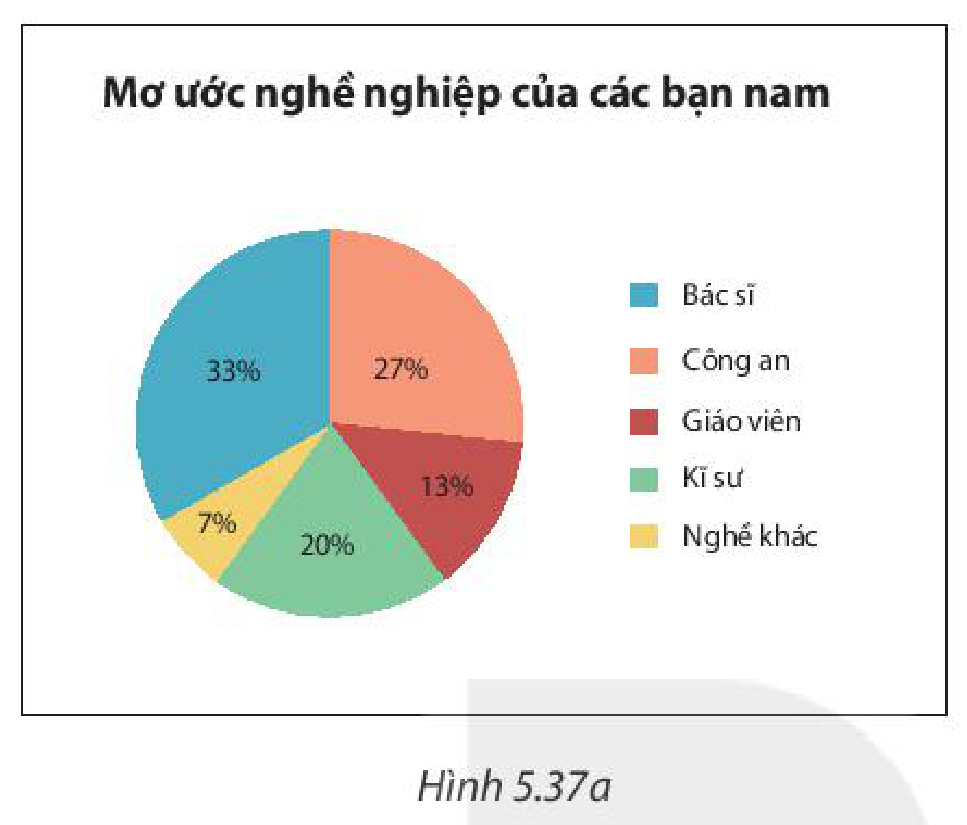
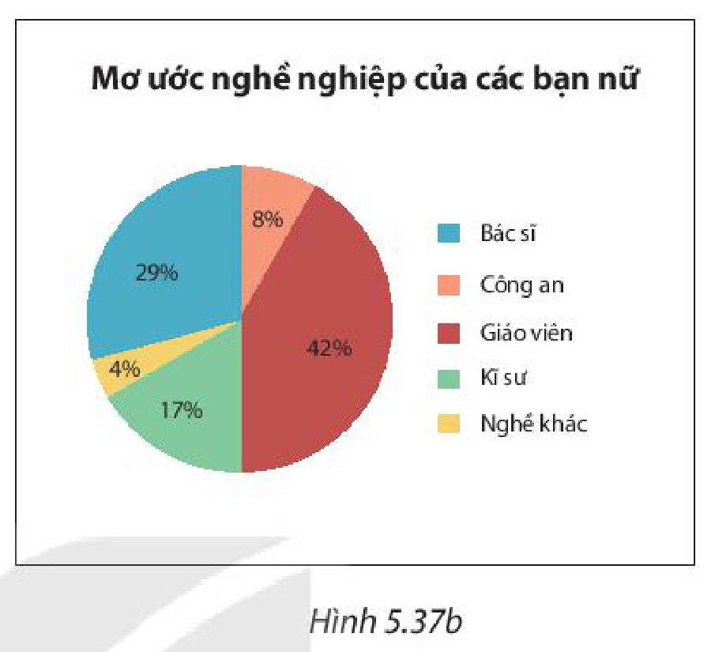
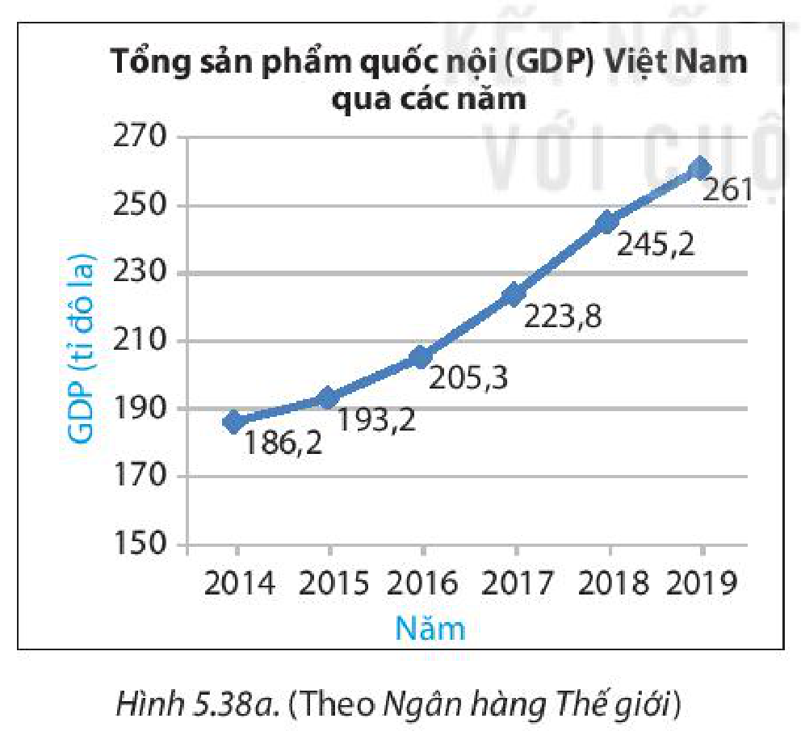
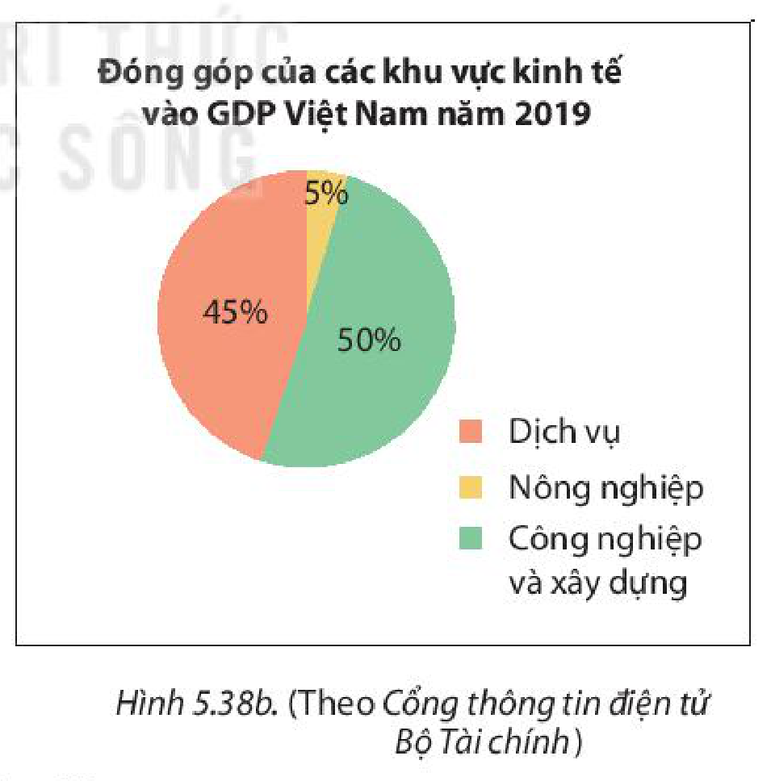
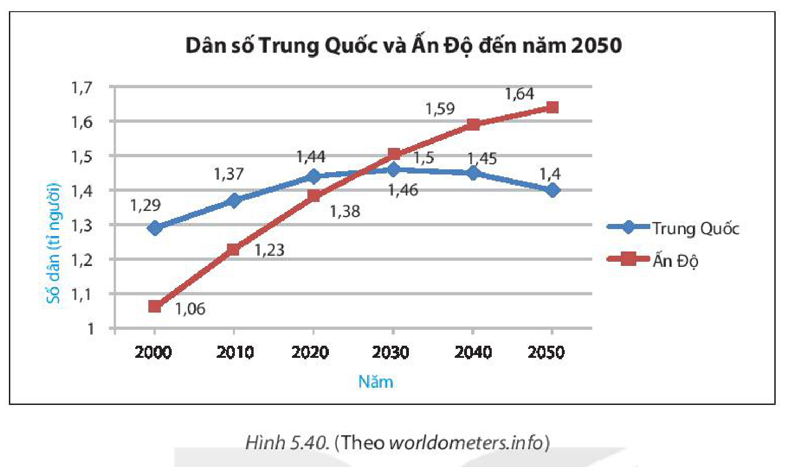

<!-- pdf:109 -->

# BÀI TẬP CUỐI CHƯƠNG V

5.18. Một nhóm nghiên cứu đã khảo sát về mơ ước nghề nghiệp của các bạn học sinh khối 7 của một tỉnh và thu được kết quả như các biểu đồ Hình 5.37.

*Hình 5.37a*

*Hình 5.37b*

a) Lập bảng thống kê về mơ ước nghề nghiệp của các bạn nam, nữ.

b) Liệt kê những nghề có tỉ lệ bạn nữ lựa chọn cao hơn các bạn nam.

c) Một trường Trung học của tỉnh này có $250$ học sinh khối 7, gồm $130$ bạn nam và $120$ bạn nữ, hãy dự đoán số bạn có mơ ước trở thành giáo viên.

5.19. Cho hai biểu đồ sau:

*Hình 5.38a. (Theo Ngân hàng Thế giới)*

*Hình 5.38b. (Theo Cổng thông tin điện tử Bộ Tài chính)*

a) Mỗi biểu đồ trên cho biết những thông tin gì?

b) Cho biết năm 2019, GDP của Việt Nam là bao nhiêu tỉ đô la. Mỗi khu vực kinh tế đóng góp bao nhiêu tỉ đô la?

<!-- pdf:110 -->
<!-- Sách in nhảy số thứ tự hình từ Hình 5.38b (trang in 108, PDF 109) sang Hình 5.40 (trang in 109, PDF 110), không có Hình 5.39. -->

5.20. Biểu đồ đoạn thẳng Hình 5.40 cho biết số dân và dự báo quy mô dân số của Trung Quốc và Ấn Độ đến năm 2050.

*Hình 5.40. (Theo worldometers.info)*

Từ biểu đồ trên, em hãy dự đoán:

a) Năm 2020, số dân nước nào lớn hơn, tương ứng là khoảng bao nhiêu tỉ người?

b) Đến khoảng năm nào thì số dân hai nước bằng nhau?

c) Xác định xu thế tăng, giảm dân số của mỗi nước trong quá khứ và trong tương lai.

5.21. Để biểu diễn dữ liệu trong các tình huống sau, em sẽ chọn loại biểu đồ nào?

a) Tỉ lệ đóng góp vào GDP của các thành phần kinh tế ở Việt Nam;

b) Sự thay đổi của giá gạo xuất khẩu từ năm 2010 đến nay.

## 📷 Danh sách hình trong bài

| Mã hình | Trang PDF | Vị trí trong bài | Chú thích gốc |
| --- | :---: | --- | --- |
| H7-toan-bt-c05-01 | 109 | Bài tập 5.18 | Hình 5.37a |
| H7-toan-bt-c05-02 | 109 | Bài tập 5.18 | Hình 5.37b |
| H7-toan-bt-c05-03 | 109 | Bài tập 5.19 | Hình 5.38a. (Theo Ngân hàng Thế giới) |
| H7-toan-bt-c05-04 | 109 | Bài tập 5.19 | Hình 5.38b. (Theo Cổng thông tin điện tử Bộ Tài chính) |
| H7-toan-bt-c05-05 | 110 | Bài tập 5.20 | Hình 5.40. (Theo worldometers.info) |
