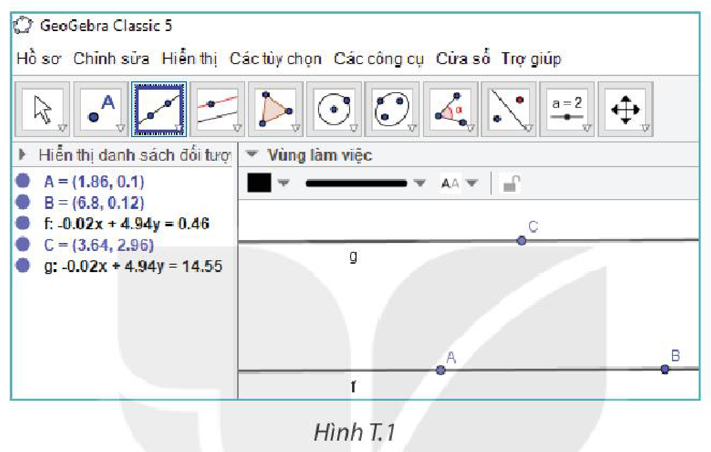
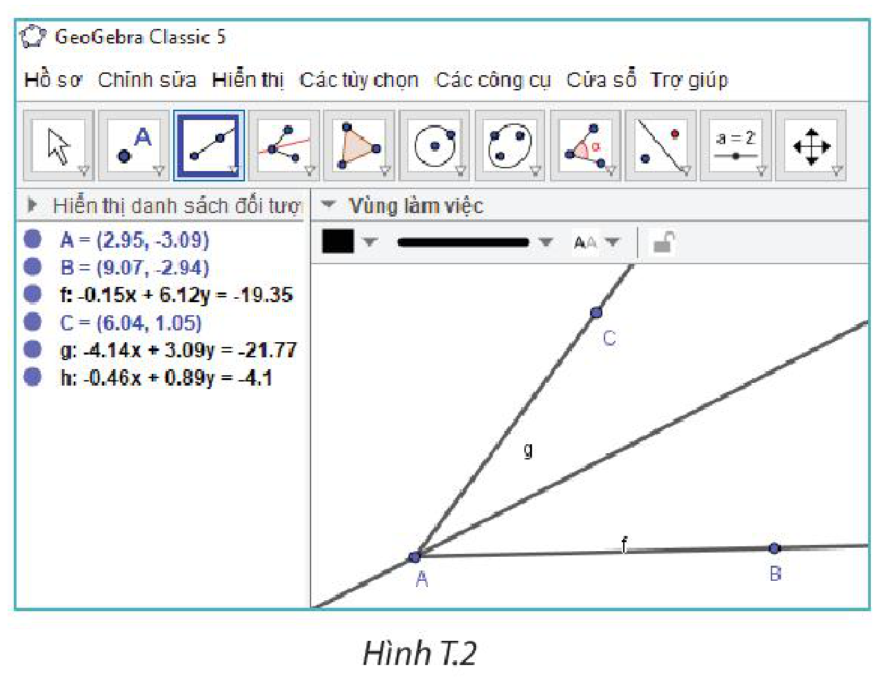
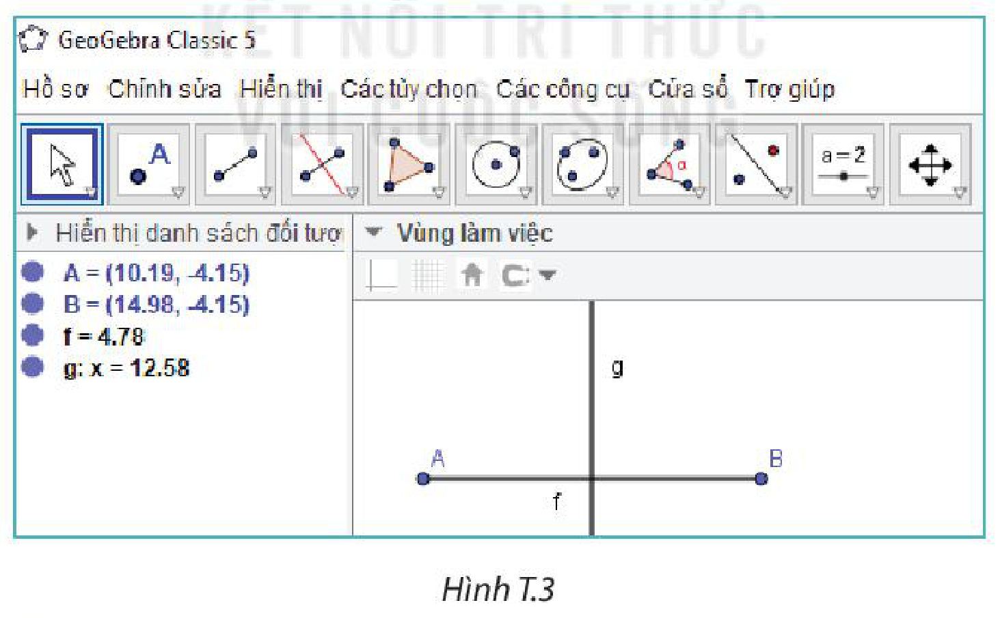
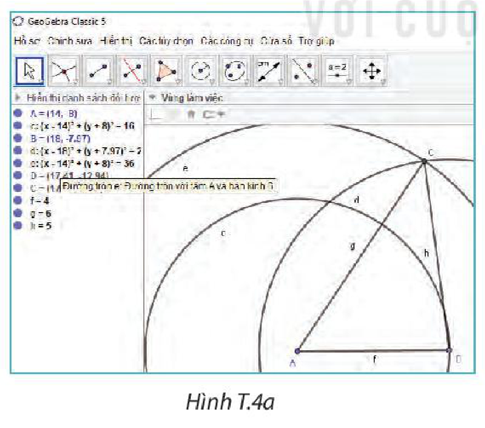
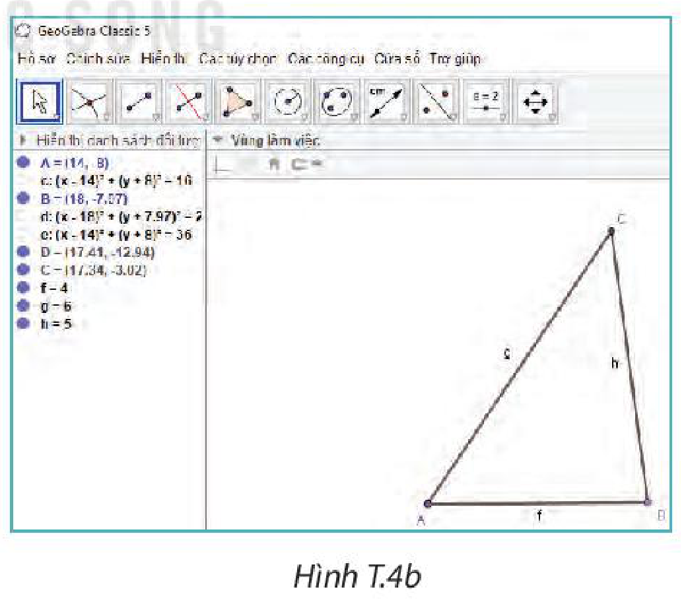
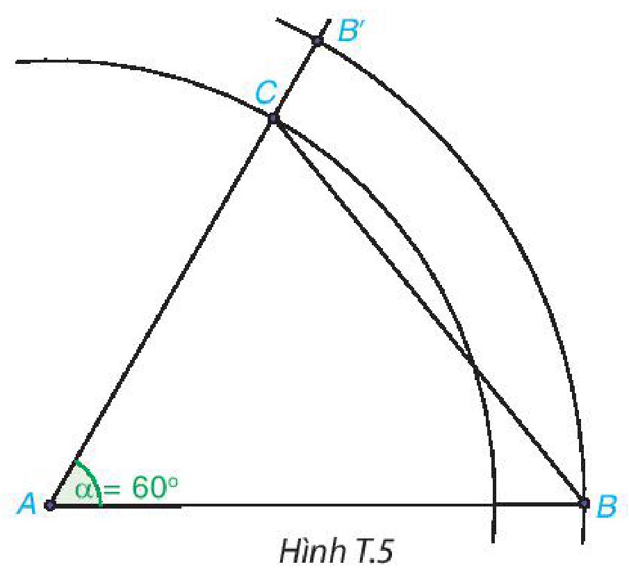

<!-- pdf:111 -->
<!-- Trang mở đầu phần Hoạt động thực hành trải nghiệm cuối Tập 1 (PDF 111): HOẠT ĐỘNG THỰC HÀNH TRẢI NGHIỆM -->

# VẼ HÌNH ĐƠN GIẢN VỚI PHẦN MỀM GEOGEBRA

## 🎯 Mục tiêu

- Biết sử dụng phần mềm GeoGebra để vẽ:
- Hai đường thẳng song song
- Tia phân giác của một góc
- Đường trung trực của một đoạn thẳng
- Tam giác biết một số yếu tố về cạnh và góc

## 🔴 Mở đầu

Em đã được học về tia phân giác của một góc, đường trung trực của đoạn thẳng, đường thẳng song song, các loại tam giác. Chúng ta đã biết cách vẽ các hình đó bằng thước kẻ và compa. Nếu dùng phần mềm GeoGebra thì ta sẽ vẽ như thế nào?

Chúng ta cùng thực hành nhé.

**HĐ1. VẼ HAI ĐƯỜNG THẲNG SONG SONG**

Em thấy vẽ hai đường thẳng song song bằng bút và thước thẳng thật khó đúng không. Chúng ta sẽ sử dụng hộp công cụ đường thẳng trong GeoGebra để vẽ nhé.

*Bước 1.* Vẽ đường thẳng $f$ đi qua hai điểm $A, B$:

Chọn công cụ Đường thẳng $\rightarrow$ Chọn Đường thẳng qua 2 điểm $\rightarrow$ Chọn điểm $A$ $\rightarrow$ Chọn điểm $B$.

<!-- pdf:112 -->

*Bước 2.* Vẽ điểm $C$ nằm ngoài đường thẳng $f$:

Chọn công cụ Điểm $\rightarrow$ Chọn Điểm mới $\rightarrow$ Chọn điểm $C$ nằm ngoài đường thẳng $f$.

*Bước 3.* Vẽ đường thẳng $g$ đi qua điểm $C$ song song với đường thẳng $f$:

Chọn công cụ Đường đặc biệt $\rightarrow$ Chọn Đường song song $\rightarrow$ Nháy chuột vào điểm $C$ $\rightarrow$ Nháy chuột vào đường thẳng $f$.
<!-- ocr-ok: đã đối chiếu ảnh trang PDF 112, dòng hướng dẫn xen kẽ biểu tượng công cụ GeoGebra -->

Ta được đường thẳng $g$ đi qua điểm $C$ song song với đường thẳng $f$ như Hình T.1.

*Hình T.1*

**Cùng suy luận.** Sau khi thực hiện Bước 3, ta thấy có đúng một đường thẳng $g$ được hiện ra. Điều này gợi cho em liên tưởng đến khẳng định nào?

**HĐ2. VẼ TIA PHÂN GIÁC CỦA MỘT GÓC**

Các em vẽ tia phân giác của góc $BAC$ theo các bước sau.

*Bước 1.* Vẽ tia $AB$

Chọn công cụ Đường thẳng $\rightarrow$ Chọn Tia đi qua 2 điểm $\rightarrow$ Chọn điểm $A$ $\rightarrow$ Chọn điểm $B$.

*Bước 2.* Vẽ góc $BAC$

Chọn công cụ Đường thẳng $\rightarrow$ Chọn Tia đi qua 2 điểm $\rightarrow$ Nháy chuột vào điểm $A$ $\rightarrow$ Chọn điểm $C$.

*Bước 3.* Vẽ đường phân giác của góc $BAC$

Chọn công cụ Đường đặc biệt $\rightarrow$ Chọn Đường phân giác $\rightarrow$ Nháy chuột lần lượt vào các điểm $B, A, C$.
<!-- ocr-ok: đã đối chiếu ảnh trang PDF 112, dòng hướng dẫn xen kẽ biểu tượng công cụ GeoGebra -->

Phần đường thẳng nằm trong góc $BAC$ là tia phân giác của góc $BAC$ như Hình T.2.

<!-- pdf:113 -->

*Hình T.2*

**HĐ3. VẼ ĐƯỜNG TRUNG TRỰC CỦA MỘT ĐOẠN THẲNG**

Các em vẽ đường trung trực của đoạn thẳng $AB$ theo các bước sau.

*Bước 1.* Vẽ đoạn thẳng $AB$

Chọn công cụ Đường thẳng $\rightarrow$ Chọn Đoạn thẳng $\rightarrow$ Chọn điểm $A$ $\rightarrow$ Chọn điểm $B$.

*Bước 2.* Vẽ đường trung trực của đoạn thẳng $AB$

Chọn công cụ Đường đặc biệt $\rightarrow$ Chọn Đường trung trực $\rightarrow$ Nháy chuột vào đoạn thẳng $AB$.
<!-- ocr-ok: đã đối chiếu ảnh trang PDF 113, dòng hướng dẫn xen kẽ biểu tượng công cụ GeoGebra -->

Ta thu được đường trung trực $g$ của đoạn thẳng $AB$ như hình T.3.

*Hình T.3*

**Cùng suy luận.** Bạn Lan vẽ đường trung trực của đoạn thẳng $AB$ theo các bước như sau:

*Bước 1.* Chọn công cụ Đường thẳng $\rightarrow$ Chọn Đoạn thẳng $\rightarrow$ Chọn điểm $A$ $\rightarrow$ Chọn điểm $B$.

<!-- pdf:114 -->

*Bước 2.* Chọn công cụ Điểm $\rightarrow$ Chọn Trung điểm hoặc tâm $\rightarrow$ Nháy chuột vào đoạn thẳng $AB$ (trung điểm của đoạn thẳng $AB$ được kí hiệu là $C$).

*Bước 3.* Chọn công cụ Đường đặc biệt $\rightarrow$ Chọn Đường vuông góc $\rightarrow$ Nháy chuột lần lượt vào điểm $C$ và đoạn thẳng $AB$.

Đường thẳng $g$ vẽ được có phải là đường trung trực của đoạn thẳng $AB$ không?

**HĐ4. VẼ TAM GIÁC BIẾT ĐỘ DÀI BA CẠNH**

Các em vẽ tam giác $ABC$ có $AB = 4\text{ cm}$, $BC = 5\text{ cm}$, $CA = 6\text{ cm}$ theo các bước sau.

*Bước 1.* Vẽ hai điểm $A, B$ sao cho $AB = 4\text{ cm}$.

Chọn công cụ Đường tròn $\rightarrow$ Chọn Đường tròn khi biết tâm và bán kính $\rightarrow$ Chọn điểm $A$, nhập bán kính bằng $4$.
<!-- ocr-ok: đã đối chiếu ảnh trang PDF 114, dòng hướng dẫn xen kẽ biểu tượng công cụ GeoGebra -->

Chọn công cụ Điểm $\rightarrow$ Chọn Điểm mới $\rightarrow$ Chọn điểm $B$ nằm trên đường tròn.
<!-- ocr-ok: đã đối chiếu ảnh trang PDF 114, dòng hướng dẫn xen kẽ biểu tượng công cụ GeoGebra -->

*Bước 2.* Chọn công cụ Đường tròn $\rightarrow$ Chọn Đường tròn khi biết tâm và bán kính $\rightarrow$ Nháy chuột vào điểm $B$, nhập bán kính bằng $5$.
<!-- ocr-ok: đã đối chiếu ảnh trang PDF 114, dòng hướng dẫn xen kẽ biểu tượng công cụ GeoGebra -->

*Bước 3.* Chọn công cụ Đường tròn $\rightarrow$ Chọn Đường tròn khi biết tâm và bán kính $\rightarrow$ Nháy chuột vào điểm $A$, nhập bán kính bằng $6$.
<!-- ocr-ok: đã đối chiếu ảnh trang PDF 114, dòng hướng dẫn xen kẽ biểu tượng công cụ GeoGebra -->

*Bước 4.* Chọn công cụ Điểm $\rightarrow$ Chọn Giao điểm của 2 đối tượng $\rightarrow$ Lần lượt nháy chuột vào hai đường tròn ở Bước 2 và Bước 3, giao điểm $C$ của hai đường tròn được đánh dấu.

*Bước 5.* Chọn công cụ đoạn thẳng Đoạn thẳng để nối các điểm $A, B, C$ với nhau và thu được tam giác $ABC$ như Hình T.4a. Ẩn các đường tròn ta được Hình T.4b như sau.

*Hình T.4a*

*Hình T.4b*

> ❓ Nếu cho trước đoạn thẳng $AB = 4\text{ cm}$ cố định, em vẽ được mấy tam giác $ABC$ thoả mãn yêu cầu $BC = 5\text{ cm}$, $CA = 6\text{ cm}$?

<!-- pdf:115 -->

**HĐ5. VẼ TAM GIÁC BIẾT ĐỘ DÀI HAI CẠNH VÀ GÓC XEN GIỮA**

Em vẽ tam giác $ABC$ có $AB = 6\text{ cm}$, $AC = 5\text{ cm}$, $\widehat{BAC} = 60^\circ$ theo các bước gợi ý sau:

*Bước 1.* Vẽ hai điểm $A, B$ sao cho $AB = 6\text{ cm}$ tương tự Bước 1 của HĐ4.

*Bước 2.* Vẽ góc $\widehat{BAB'} = 60^\circ$ bằng cách:

Chọn công cụ Góc $\rightarrow$ Chọn Góc với độ lớn cho trước $\rightarrow$ Nháy chuột lần lượt vào các điểm $B, A$ (theo ngược chiều kim đồng hồ) và nhập số đo góc $60$.

*Bước 3.* Vẽ điểm $C$ là giao điểm của đường thẳng $AB'$ và đường tròn tâm $A$ bán kính $5$.

*Bước 4.* Chọn công cụ đoạn thẳng Đoạn thẳng để nối các điểm $A, B, C$ với nhau và ta thu được tam giác $ABC$ cần vẽ (H.T.5).

*Hình T.5*

> ❓ Tam giác $ABC$ có phải là tam giác nhọn không? Em hãy sử dụng công cụ Góc kiểm tra các góc của tam giác để trả lời câu hỏi đó.

**Luyện tập 1:** Vẽ tam giác $ABC$ có $AB = 6\text{ cm}$, $\widehat{BAC} = 50^\circ$, $\widehat{ABC} = 60^\circ$.

*Gợi ý:* Vẽ $\widehat{BAB'} = 50^\circ$ (theo ngược chiều kim đồng hồ); $\widehat{ABA'} = 60^\circ$ (theo chiều kim đồng hồ) và $C$ là giao điểm của hai tia $AB'$ và $BA'$.

**Luyện tập 2:** Vẽ tam giác $ABC$ vuông tại $A$, có $AB = 4\text{ cm}$, $BC = 6\text{ cm}$.
<!-- ocr-ok: đã đối chiếu ảnh trang PDF 115, nhãn Luyện tập 2 in chữ trắng trên nền tím kèm kí hiệu toán -->

*Gợi ý:*
- Vẽ đoạn thẳng $AB = 4\text{ cm}$.
- Vẽ $C$ là giao điểm của đường tròn tâm $B$ bán kính $6$ và đường thẳng đi qua $A$ vuông góc với $AB$.

## BÀI TẬP

1. a) Em hãy trình bày các bước dùng phần mềm GeoGebra để vẽ tam giác $ABC$ có: $AB = 6\text{ cm}$, $\widehat{BAC} = 60^\circ$, $\widehat{ACB} = 70^\circ$.

b) Vẽ tam giác trên trong phần mềm GeoGebra và lưu thành một tệp có đuôi png.

2. a) Sử dụng phần mềm GeoGebra, em hãy vẽ tam giác $ABC$ vuông tại $A$, $AB = 4\text{ cm}$, $AC = 3\text{ cm}$ và lưu thành một tệp có đuôi png.

b) Dùng phần mềm GeoGebra, em hãy đo độ dài cạnh $BC$.

## 📷 Danh sách hình trong bài

| Mã hình | Trang PDF | Vị trí trong bài | Chú thích gốc |
| --- | :---: | --- | --- |
| H7-toan-hd-thtn-01-01 | 112 | HĐ1, Bước 3 | Hình T.1 |
| H7-toan-hd-thtn-01-02 | 113 | HĐ2, Bước 3 | Hình T.2 |
| H7-toan-hd-thtn-01-03 | 113 | HĐ3, Bước 2 | Hình T.3 |
| H7-toan-hd-thtn-01-04 | 114 | HĐ4, Bước 5 | Hình T.4a |
| H7-toan-hd-thtn-01-05 | 114 | HĐ4, Bước 5 | Hình T.4b |
| H7-toan-hd-thtn-01-06 | 115 | HĐ5, Bước 4 | Hình T.5 |
