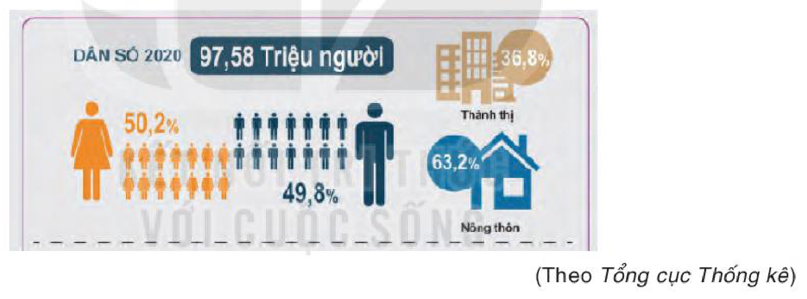
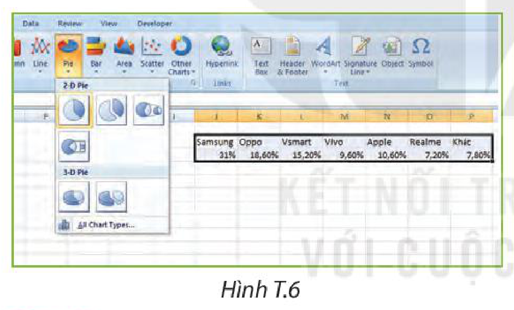
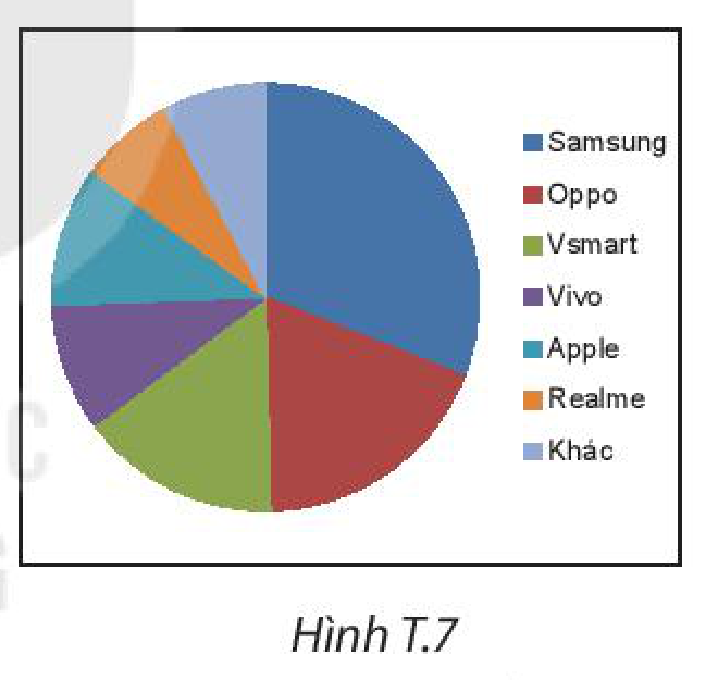
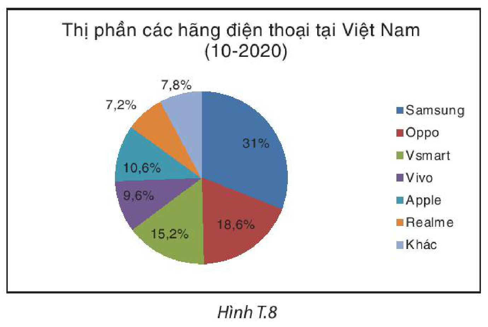
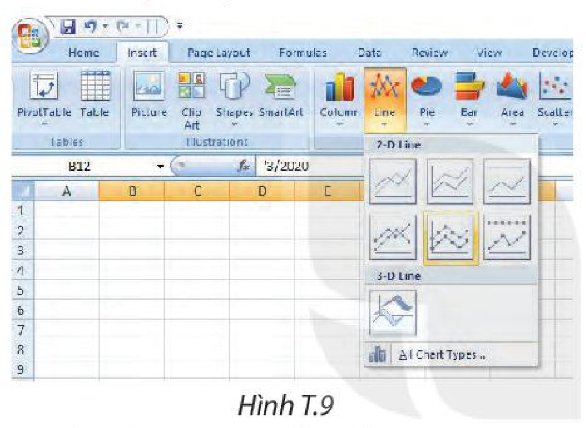
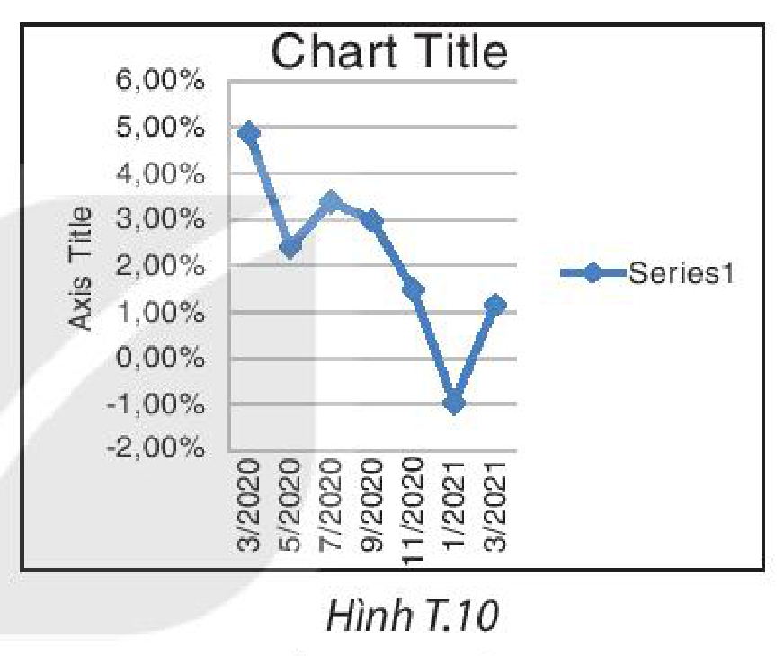
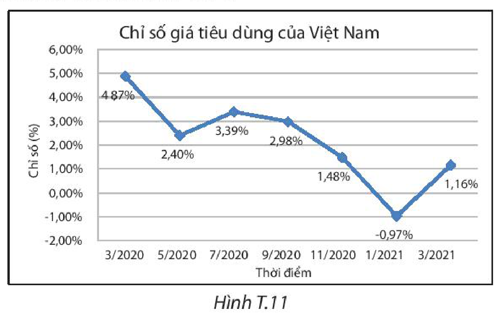

<!-- pdf:116 -->

# DÂN SỐ VÀ CƠ CẤU DÂN SỐ VIỆT NAM

## 🎯 Mục tiêu

- Tìm hiểu về dân số Việt Nam và cơ cấu dân số Việt Nam.

**HĐ1. THU THẬP SỐ LIỆU**

- Em hãy thu thập số liệu về dân số Việt Nam từ năm 2011 đến năm 2020. Có thể thu thập từ sách, báo hoặc truy cập Internet và thu thập số liệu từ:
  - Website của Tổng cục Thống kê https://www.gso.gov.vn/ (mục Số liệu thống kê $\rightarrow$ Dân số và lao động).
  - Website https://www.worldometers.info/ (mục Population $\rightarrow$ Population by Country $\rightarrow$ Vietnam).
- Lập bảng thống kê cho dãy số liệu thu thập được.
- Hình vẽ dưới đây cho biết về cấu trúc dân số Việt Nam năm 2020.

- *DÂN SỐ 2020: $97,58$ Triệu người — Nữ: $50,2\%$; Nam: $49,8\%$ — Thành thị: $36,8\%$; Nông thôn: $63,2\%$ (Theo Tổng cục Thống kê)*
<!-- ocr-ok: đã đối chiếu ảnh trang PDF 116, nội dung đồ hoạ thông tin dân số -->

Em hãy lập các bảng thống kê biểu diễn cơ cấu dân số (đơn vị $\%$) theo giới tính (nam, nữ) và theo nơi sinh sống (thành thị, nông thôn).

**HĐ2. VẼ BIỂU ĐỒ**

- Vẽ biểu đồ đoạn thẳng biểu diễn số dân của Việt Nam từ năm 2011 đến năm 2020.
- Vẽ các biểu đồ hình quạt tròn biểu diễn cơ cấu dân số Việt Nam năm 2020 theo giới tính và theo nơi sinh sống.

**HĐ3. PHÂN TÍCH DỮ LIỆU**

- Nhận xét về xu thế số dân của Việt Nam từ năm 2011 đến năm 2020.
- Nhận xét về cơ cấu dân số Việt Nam năm 2020 theo giới tính và theo nơi sinh sống.
- Tính số dân Việt Nam sống ở thành thị, nông thôn năm 2020.

<!-- pdf:117 -->

*HƯỚNG DẪN THỰC HÀNH VỚI MÁY TÍNH*

## 1. Vẽ biểu đồ hình quạt tròn bằng Excel

Thị phần các hãng điện thoại tại Việt Nam tại thời điểm tháng 10 năm 2020 được cho trong bảng sau:

| Hãng | Samsung | Oppo | Vsmart | Vivo | Apple | Realme | Khác |
| --- | :---: | :---: | :---: | :---: | :---: | :---: | :---: |
| Thị phần ($\%$) | $31$ | $18,6$ | $15,2$ | $9,6$ | $10,6$ | $7,2$ | $7,8$ |

*(Theo vov.vn)*

Để vẽ biểu đồ hình quạt tròn biểu diễn bảng số liệu trên ta thực hiện theo các bước sau đây:

*Bước 1.* Mở công cụ Microsoft Excel và nhập dữ liệu:

| Samsung | Oppo | Vsmart | Vivo | Apple | Realme | Khác |
| :---: | :---: | :---: | :---: | :---: | :---: | :---: |
| $31\%$ | $18,6\%$ | $15,2\%$ | $9,6\%$ | $10,6\%$ | $7,2\%$ | $7,8\%$ |

*Bước 2.* Chọn vùng dữ liệu cần vẽ biểu đồ. Trên thanh Menu chọn Insert $\rightarrow$ Pie $\rightarrow$ 2-D Pie sau đó chọn biểu tượng tương ứng với định dạng của biểu đồ hình quạt tròn muốn vẽ (H.T.6).

*Hình T.6*

*Hình T.7*

*Bước 3.* Hoàn thiện tiêu đề, các chú giải khác bằng cách chọn Layout, cụ thể:

- Chọn Chart Title $\rightarrow$ Above Chart rồi điền tiêu đề: *Thị phần các hãng điện thoại tại Việt Nam (10-2020)*.
- Chọn Data Labels $\rightarrow$ Best Fit (hoặc lựa chọn khác) để hiện số liệu. Kết quả được biểu đồ như Hình T.8.

*Hình T.8*

<!-- pdf:118 -->

## 2. Vẽ biểu đồ đoạn thẳng bằng Excel

Bảng sau đây cho biết chỉ số giá tiêu dùng của Việt Nam từ tháng 3-2020 đến tháng 3-2021.

| Thời điểm | 3-2020 | 5-2020 | 7-2020 | 9-2020 | 11-2020 | 1-2021 | 3-2021 |
| --- | :---: | :---: | :---: | :---: | :---: | :---: | :---: |
| Chỉ số | $4,87\%$ | $2,40\%$ | $3,39\%$ | $2,98\%$ | $1,48\%$ | $-0,97\%$ | $1,16\%$ |

Để vẽ biểu đồ đoạn thẳng biểu diễn bảng số liệu này ta thực hiện theo các bước sau đây:

*Bước 1.* Mở công cụ Microsoft Excel và nhập dữ liệu.

| 3-2020 | 5-2020 | 7-2020 | 9-2020 | 11-2020 | 1-2021 | 3-2021 |
| :---: | :---: | :---: | :---: | :---: | :---: | :---: |
| $4,87\%$ | $2,40\%$ | $3,39\%$ | $2,98\%$ | $1,48\%$ | $-0,97\%$ | $1,16\%$ |

*Bước 2.* Chọn vùng dữ liệu cần vẽ biểu đồ. Trên thanh Menu chọn Insert $\rightarrow$ Line $\rightarrow$ 2-D Line, sau đó chọn biểu tượng tương ứng với định dạng của biểu đồ đoạn thẳng muốn vẽ (H.T.9).

*Hình T.9*

*Hình T.10*

Vì biểu đồ này chỉ biểu diễn một dãy dữ liệu nên ta sẽ xoá phần chú giải Series1.

*Bước 3.* Hoàn thiện tiêu đề, các chú giải khác bằng cách chọn Layout, cụ thể:

- Đổi tên Chart Title thành *Chỉ số giá tiêu dùng của Việt Nam*.

Trường hợp chưa có Chart Title, chọn Chart Title $\rightarrow$ Above Chart rồi điền tiêu đề: *Chỉ số giá tiêu dùng của Việt Nam*.

- Chọn Data Labels và chọn một lựa chọn để hiện số liệu.
- Chọn Axis Title để đặt tên cho các trục đứng và trục ngang.

Kết quả được biểu đồ như Hình T.11.

*Hình T.11*

## 📷 Danh sách hình trong bài

| Mã hình | Trang PDF | Vị trí trong bài | Chú thích gốc |
| --- | :---: | --- | --- |
| H7-toan-hd-thtn-02-01 | 116 | HĐ1 | (Theo Tổng cục Thống kê) |
| H7-toan-hd-thtn-02-02 | 117 | Mục 1, Bước 2 | Hình T.6 |
| H7-toan-hd-thtn-02-03 | 117 | Mục 1, Bước 2 | Hình T.7 |
| H7-toan-hd-thtn-02-04 | 117 | Mục 1, Bước 3 | Hình T.8 |
| H7-toan-hd-thtn-02-05 | 118 | Mục 2, Bước 2 | Hình T.9 |
| H7-toan-hd-thtn-02-06 | 118 | Mục 2, Bước 2 | Hình T.10 |
| H7-toan-hd-thtn-02-07 | 118 | Mục 2, Bước 3 | Hình T.11 |
