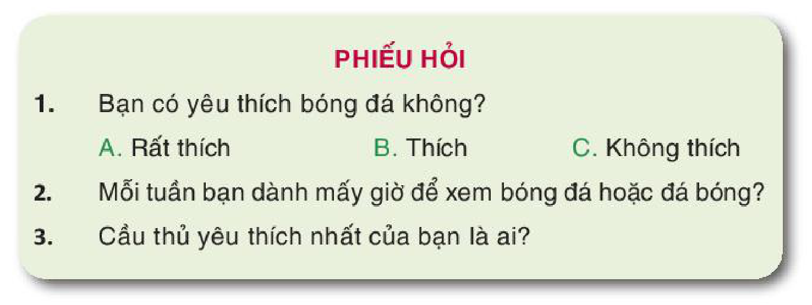
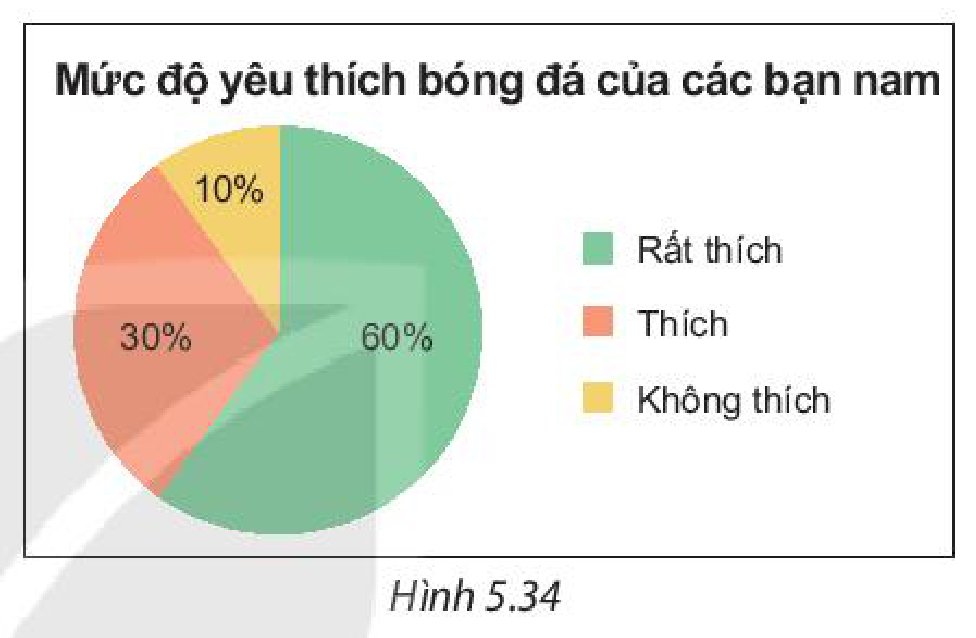
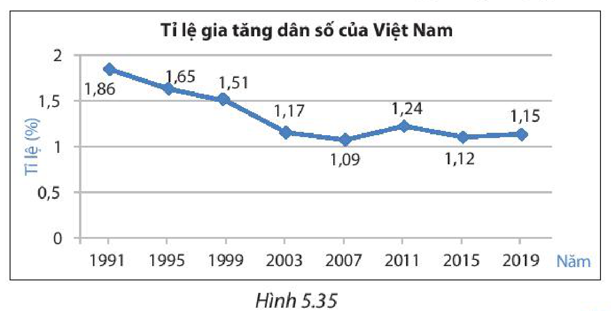
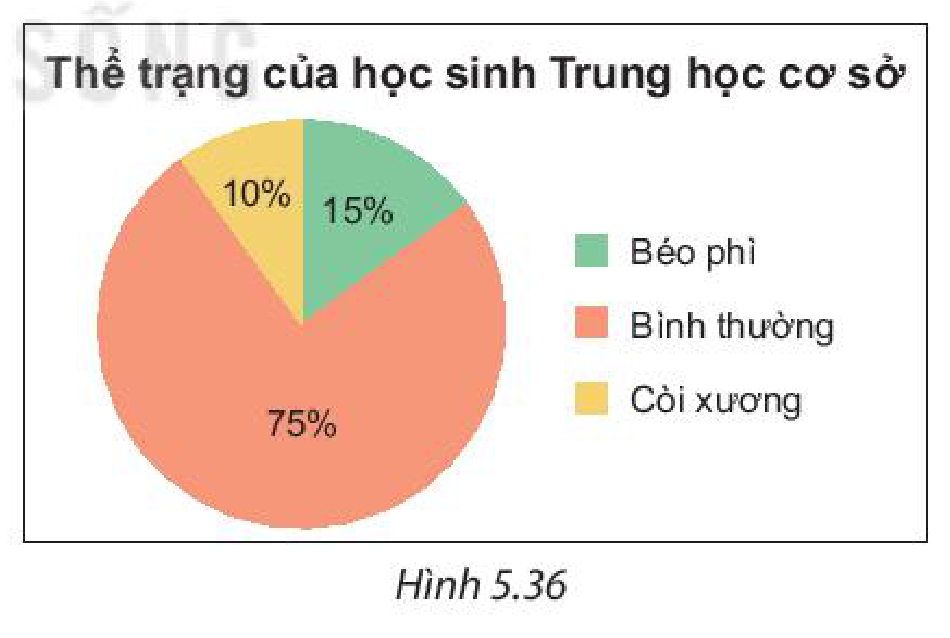

<!-- pdf:107 -->

# LUYỆN TẬP CHUNG (TRANG 106)

**Ví dụ 1:** Chi muốn tìm hiểu về sự yêu thích bóng đá của các bạn trong trường nên đã lập phiếu hỏi như hình bên và phát cho $30$ bạn nam trong trường để thu thập dữ liệu.

**PHIẾU HỎI**

1. Bạn có yêu thích bóng đá không?
   A. Rất thích $\qquad$ B. Thích $\qquad$ C. Không thích
2. Mỗi tuần bạn dành mấy giờ để xem bóng đá hoặc đá bóng?
3. Cầu thủ yêu thích nhất của bạn là ai?

a) Dữ liệu thu được từ mỗi câu hỏi trên thuộc loại nào?

b) Biểu đồ Hình 5.34 cho biết tỉ lệ lựa chọn các phương án trong câu hỏi 1 của $30$ học sinh tham gia khảo sát.

Em hãy cho biết mỗi phương án có bao nhiêu bạn lựa chọn.

c) Từ thông tin này, Chi kết luận rằng “Đa phần các bạn yêu thích bóng đá”. Kết luận này có hợp lí không.

*Hình 5.34*

**Giải**

a) Dữ liệu thu được từ câu hỏi 1 không phải là số, có thể sắp thứ tự.

Dữ liệu thu được từ câu hỏi 2 là số (đơn vị giờ) nên là số liệu.

Dữ liệu thu được từ câu hỏi 3 là tên các cầu thủ nên dữ liệu này không phải là số, không thể sắp thứ tự.

b) Số bạn lựa chọn phương án A là: $\dfrac{60}{100} \cdot 30 = 18$ (bạn).

Số bạn lựa chọn phương án B là: $\dfrac{30}{100} \cdot 30 = 9$ (bạn).

Số bạn lựa chọn phương án C là: $\dfrac{10}{100} \cdot 30 = 3$ (bạn).

c) Vì Chi chỉ khảo sát trên các bạn nam trong trường mà lại kết luận chung cho tất cả các bạn nên kết luận này không hợp lí.

**Ví dụ 2:** Tỉ lệ tăng dân số Việt Nam trong một số năm gần đây được cho trong bảng sau:

| Năm | 1991 | 1995 | 1999 | 2003 | 2007 | 2011 | 2015 | 2019 |
| --- | :---: | :---: | :---: | :---: | :---: | :---: | :---: | :---: |
| Tỉ lệ ($\%$) | $1,86$ | $1,65$ | $1,51$ | $1,17$ | $1,09$ | $1,24$ | $1,12$ | $1,15$ |

*(Theo vietnam.opendevelopmentmekong.net)*

<!-- pdf:108 -->

a) Vẽ biểu đồ đoạn thẳng biểu diễn bảng số liệu trên.

b) Tỉ lệ gia tăng dân số thấp nhất vào năm nào, là bao nhiêu?

c) Tỉ lệ gia tăng dân số của Việt Nam từ năm 1991 đến 2007 có xu hướng tăng hay giảm?

**Giải**

a) Biểu đồ được vẽ như Hình 5.35.

b) Năm 2007 là năm có tỉ lệ gia tăng dân số thấp nhất với $1,09\%$.

c) Từ năm 1991 đến 2007, tỉ lệ gia tăng dân số Việt Nam có xu hướng giảm.

*Hình 5.35*

## BÀI TẬP

5.14. Xác định phương pháp thu thập dữ liệu trong mỗi trường hợp sau và cho biết mỗi dữ liệu thu được thuộc loại nào?

a) Mức độ thường xuyên tập thể dục buổi sáng của các bạn trong lớp (rất thường xuyên, thường xuyên, không thường xuyên).

b) Phương tiện giao thông các bạn trong lớp sử dụng để đến trường.

5.15. Các dữ liệu thu được trong mỗi trường hợp sau có đảm bảo tính đại diện không?

a) Để xác định sức bật cao của học sinh khối 7, giáo viên đã yêu cầu các bạn trong câu lạc bộ bóng rổ bật cao và ghi lại kết quả;

b) Để khảo sát ý kiến của học sinh về quy định mới, nhà trường đã chọn ngẫu nhiên một số học sinh khối 7 và phát phiếu khảo sát.

5.16. Biểu đồ Hình 5.36 được trích từ báo cáo tổng kết của một tỉnh về thể trạng học sinh Trung học cơ sở tại tỉnh này.

Một trường Trung học cơ sở của tỉnh có $1\,500$ học sinh. Em hãy ước lượng số học sinh béo phì của trường đó.

*Hình 5.36*

5.17. Vẽ biểu đồ đoạn thẳng biểu diễn nhiệt độ không khí trung bình tại Hà Nội trong $6$ năm từ 2014 đến 2019.

| Năm | 2014 | 2015 | 2016 | 2017 | 2018 | 2019 |
| --- | :---: | :---: | :---: | :---: | :---: | :---: |
| Nhiệt độ trung bình ($^\circ\text{C}$) | $24,6$ | $25,3$ | $25,2$ | $25,1$ | $25,1$ | $25,9$ |

*(Theo Tổng cục Thống kê)*

## 📷 Danh sách hình trong bài

| Mã hình | Trang PDF | Vị trí trong bài | Chú thích gốc |
| --- | :---: | --- | --- |
| H7-toan-ltc-c05-01 | 107 | Ví dụ 1 | (sách không đánh số, mẫu Phiếu hỏi khảo sát sự yêu thích bóng đá) |
| H7-toan-ltc-c05-02 | 107 | Ví dụ 1b | Hình 5.34 |
| H7-toan-ltc-c05-03 | 108 | Ví dụ 2 (Giải) | Hình 5.35 |
| H7-toan-ltc-c05-04 | 108 | Bài tập 5.16 | Hình 5.36 |
